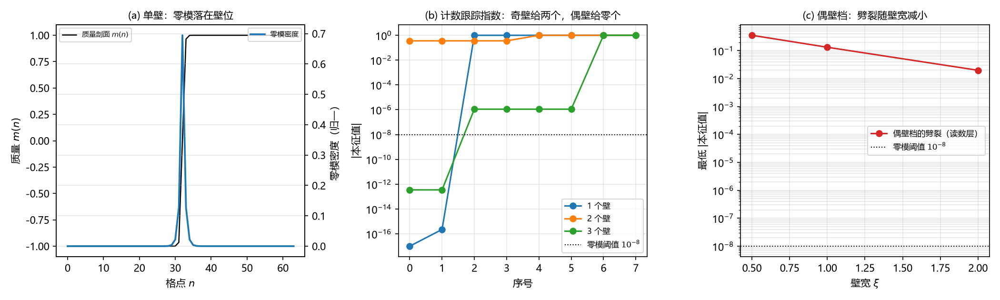

# 注记-质量通道首轮：畴壁零模的手征成对与净手征性为零（判据第 653 号）

## 元数据

- **日期**：2026-10-16 13:27:13（初版）
- **脚本**：`验证脚本/mass_channel_kink.py`
- **判据**：冒烟 1 至 2，G1 至 G3，另附反例、恒真检验与四段检验
- **可逆性等级**：判据稳健（零模为机零、手征分辨为精确整数、反例明确）。偶壁档的劈裂量属读数层，随壁宽 $\xi$ 与剖面形状而变（判据敏感），已单列。
- **类型**：狄拉克线阶段 4 补轮（质量通道首轮）
- **所属计划**：[[理论攻坚/狄拉克方程攻坚计划：从元相子几何导出狄拉克方程与完整几何意义]]（阶段 4）；承接 [[验证脚本/注记-绕数对费米子透明：缺陷与费米耦合首轮（判据第652号）]]
- **关联**：[[验证脚本/注记-复结构畴壁承载绕数（第486条）：联结类型决定 K 无关性、壁位零模终止无穷后退|第 486 号]]（壁位零模，须与本文的费米核零模区分）；[[手征性的几何本质与宇称不守恒：模态复结构与宇称自发破缺]]（复结构符号 $\sigma$ 的 $\mathbb{Z}_2$ 取值）；[[验证脚本/注记-D1候选丙绕数阈值势垒（第501条）：三候选对比闭合与质量项非唯一判定|第 501 号]]（质量项形式）
- **图**：见 §四 图 1

---

## 一、要判什么

第 652 号判否了电荷通道：守恒绕数在相位耦合上对费米子透明。手征来源的候选通道据此只剩一条，即质量通道，也就是缺陷相对真空的绑定能。质量在体系里是不带绕数的标量，故它若给出手征选择，只能走符号翻转那条路，载体是复结构符号 $\sigma$ 的 $\mathbb{Z}_2$ 畴壁。本轮问的是：**这种畴壁能否给出手征选择的费米零模。**

## 二、模型设定

一维格点 $N=64$，两分量 Dirac 算符

$$H=-\mathrm{i}\sigma_2\otimes D+\sigma_3\otimes\mathrm{diag}(m),$$

其中 $D=(S-S^\dagger)/2$ 为格点导数（开链或周期环），手征算符取 $\gamma_5=\sigma_1\otimes I$。质量剖面取 $w$ 个壁的乘积形式

$$m(n)=\Delta\prod_{i=1}^{w}\tanh\!\left(\frac{n-c_i}{\xi}\right),\qquad c_i=\frac{Ni}{w+1},$$

其端点符号为 $m(-\infty)=\Delta(-1)^w$、$m(+\infty)=\Delta$，故连续指数为 $(1-(-1)^w)/2$。零模计数取 $|\lambda|<10^{-8}$，并同时打印最低几个 $|\lambda|$ 以核间隙。

## 三、判据与结果

| 判据 | 内容 | 期望 | 实测 | 判定 |
| --- | --- | --- | --- | --- |
| 冒烟1 | $H$ 厄米 | $0$ | $0.000\times10^{0}$ | 通过 |
| 冒烟2 | 常数质量：无零模、谱开隙 | $0$ 与 $\lvert\Delta\rvert$ | $0$、$1.000000$ | 通过 |
| G1 | 单壁：零模计数、手征谱、峰位 | $2$、$[-1,+1]$、落在壁位 | $2$（机零）、$[-1,+1]$、质心 $32.000$（壁位 $32$） | 通过 |
| G2 | 手征分辨 $n_+$ 与 $n_-$ | 相等 | 全档 $1/1$，净手征性 $0$ | 通过 |
| G3 | 壁宽扫描：计数稳定、宽度随 $\xi$ 增 | 计数不变 | $2,2,2,2$；半宽 $0.722\to0.826\to1.072\to1.462$ | 通过 |
| 反例 | 常数质量、无符号翻转的剖面 | $0$ | $0$、$0$ | 通过 |
| 读数 | 偶壁档（$w=2$）的劈裂 | 读数 | $0.3564$、$0.1327$、$0.0199$（$\xi=0.5,1,2$） | 读数（判据敏感） |
| 对照 | 连续层单壁 | $1$ 个零模、手征由 $\mathrm{sign}(\Delta)$ 定 | 解析 | 对照 |

## 四、结果解读

**零模存在，且落在壁位。** 单壁档给出两个精确为零的本征值（机零），密度峰落在壁位，宽度随 $\xi$ 单调增（半宽 $0.722$ 至 $1.462$）。冒烟2 确认常数质量下谱开隙、最低本征值等于 $|\Delta|$，反例与恒真检验（无符号翻转的非平凡剖面）都给出零个零模，说明判据对符号翻转敏感、对剖面本身不敏感。

**手征恒成对，净手征性为零。** 这是本轮的核心读数。所有出现零模的档（开链与环、单壁与三壁），$\gamma_5$ 在零模子空间上的谱都是 $[-1,+1]$，手征分辨恒为 $1$ 对 $1$。**每一个受保护的零模都配着一个相反手征的伙伴，净手征性为零。**

**原因是味加倍，不是通道平凡。** 对照栏给出分界：连续层单壁只给一个零模，其手征由 $\mathrm{sign}(\Delta)$ 定。格点给两个，是因为一维格点 Dirac 算符有两个味（$k=0$ 与 $k=\pi$），两个味各自给出一个零模，而它们的手征相反。于是**符号翻转在格点上选不出手征**：它能选出零模，选不出净手征性。这与第 652 号的原因不同，那一轮的原因是耦合本身恒为平凡。

**偶壁档给出一个额外的结构性读数。** 指数为零的档（两个壁）成对模式被劈裂，劈裂量为 $0.3564$、$0.1327$、$0.0199$（壁宽 $0.5,1,2$），随壁宽单调递减，即壁越软、重叠越强、劈裂越小。故该档零模计数为零。环上单壁剖面因关于壁位反对称，劈裂恰为零（读到两个机零零模），这是对称性保护的特例，登记为读数层细节。

**简并与四段检验通过。** 单壁的零模子空间二重简并（简并检测报零簇重数 $2$）。EP1 正交性偏差 $0$，EP2 子空间内算符残差 $9.001\times10^{-18}$，EP3 子空间内随机组合矢的 $\gamma_5$ 期望极差 $1.989603$（半宽 $0.994802$，说明朴素单矢读数被完全污染，必须走子空间分类），EP4 读到 $\{\gamma_5,H\}=0$、$[\gamma_5,H]=2.0$。EP4 判为反对易，而反对易的推论（能量本征态上期望恒零）只对 $E\ne0$ 成立，本轮的读数对象恰是 $E=0$ 的核，故核上读数合法。子空间谱分类给出 $[-1,+1]$，两模手征相反。

### 图 1

图注按脚本绘图面板逐条核对撰写。

## 五、结论与登记

**质量通道给不出净手征性。** 畴壁能选出零模、能定位零模、宽度随壁宽标度，但每个受保护的零模都成对手征出现。故手征来源的两条候选通道至此穷尽：电荷通道（第 652 号）因耦合恒为平凡而判否，质量通道（本轮）因味加倍把净手征性抵消而判否。

**阶段 4 的结论获得全通道支撑。** 单手征在体系内不能免代价地取得，采纳标准处方（Wilson 项）并登记手征破缺代价。第 650 号的闸门、第 652 号的耦合层、本轮的最后一通道，三者方向一致。方案选定仍属裁决点 D-e，交作者。

**与第 486 号的区分须写明。** 第 486 号的「壁位零模」是能量泛函的平移零模（壁挪到哪里能量都一样），本轮的零模是费米算符的核，两者不同物，不构成冲突，也不互相替代。

## 六、严格程度声明与边界声明

**严格层**：冒烟1 的厄米性；冒烟2 的最低本征值等于 $|\Delta|$；单壁与三壁档零模为机零；$\gamma_5$ 子空间谱精确为 $\pm1$（故手征分辨是精确整数）；反例与恒真检验均为零个零模。

**读数层**：偶壁档的劈裂量（随 $\xi$ 与剖面形状变，且剖面反对称时恰为零）；壁宽扫描的半宽（依赖密度二阶矩的窗口约定）。

**边界声明**：本轮在一维、自由算符上做，不判二维与味道抵消的对接（下一步）；不判与第 486 号壁位零模的合并；不判质量项形式的选择（第 501 号 D1 判负的遗留）；不改动 `理论总纲/` 基准。

## 修订记录

- **2026-10-16 初版**（触发：第 652 号把手征来源收窄至质量通道；作者指示执行最优下一步）
    - 冒烟 1 至 2、G1 至 G3 通过；关键读数：单壁给两个机零零模、$\gamma_5$ 子空间谱 $[-1,+1]$、手征分辨全档 $1/1$、净手征性为零
    - 结论：质量通道因味加倍给不出净手征性；与第 652 号的电荷通道判否合并，阶段 4 的结论获得全通道支撑
    - 过程记录（两处判据设计教训）：其一，首版剖面取 $m=\Delta\tanh(\sin(k\pi n/N)/\xi)$，其 $k$ 为奇数时 $\sin\ge0$ 恒成立、根本没有符号翻转，导致读数与期望对不上；改用乘积形式 $m=\Delta\prod\tanh((n-c_i)/\xi)$，壁数可控且端点符号可解析写出。其二，首版期望写「单壁给一个零模」，是从连续层直接搬来的；格点给两个，差的那一个是味加倍，期望据此改写并加连续对照栏。EP4 的判语首版硬编码为「非零」，实测 $\{\gamma_5,H\}=0$，已改为按实测判并写明 $E=0$ 的豁免
