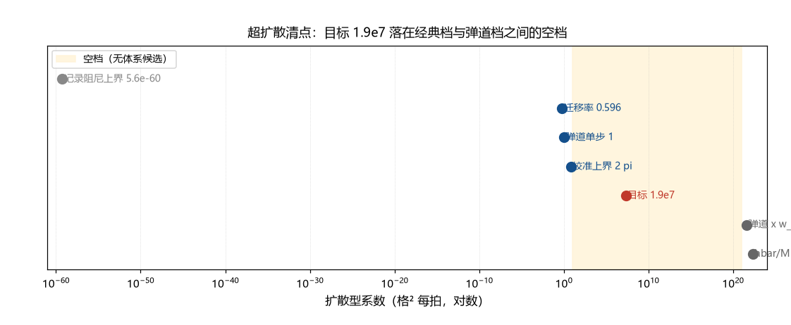

# 注记-超扩散候选清点（第410条）：D_req 与体系输运系数的对照

- **日期**：2026-09-25 06:41:42
- **类型**：清点判定轮（f 线判句一的收束）
- **脚本**：`验证脚本/superdiffusion_audit.py`（第 410 条）
- **图**：见 §3 图 1（`images/superdiffusion_audit.png`）
- **依据**：[[验证脚本/注记-ξ 的独立依据（第408条）：单参数曲线结构与扩散建立的对照]]（$D_{\rm req} = 1.909\times10^7$）；[[缺陷动力学：孤子的质量、迁移率与最小量子化]] §4（迁移率与阻尼口径值）；[[验证脚本/注记-动态写入协变形式与阻尼观测量级（G3与判据C合轮）：判据D1至D7]]（记录阻尼上界）
- **状态**：清点完成。目标落在空档（最近候选差 $6.5$ 个数量级）；「超扩散缺口」成立；判句一关闭
- **可逆性等级**：判据稳健（空档结构与跨线观察不随实现或口径翻；各档距离数字随 $f$ 档位与登记值移动）

## 1 判据与设定

第 408 条（判句一）把链条闭合规约为「扩散建立假设下 $D$ 的唯一解 $D_{\rm req} = 1.909\times10^7$ 格²每拍」，并注明其超校准上界 $3.1\times10^6$ 倍。本轮把体系内全部扩散型系数列全并对照（Y1、Y2），给弹道等效参数化（Y3），并做综合判定（Y4）。全部为确定性算术。

## 2 结果

Y1（候选清单）：六档。记录阻尼观测上界 $5.6\times10^{-60}$（作扩散档下界）；缺陷迁移率 $\gamma_d = 0.5958$；弹道单步档 $c\,l_P = 1$；校准扩散上界 $2\pi = 6.2832$；弹道乘缺陷宽度档 $c\,w_{\rm def} = 3.80\times10^{21}$；量子扩散档 $\hbar/M_{\rm sol} = 1.876\times10^{22}$（$M_{\rm sol} = 5.33\times10^{-23}$，孤子质量格子单位）。

Y2（对照）：目标 $D_{\rm req}$ 与各档的距离（个数量级）为 $66.53$、$7.51$、$7.28$、$6.48$、$14.30$、$14.99$。最近者为校准扩散上界（$6.48$），其次为弹道单步与迁移率档（$7.28$、$7.51$）。

Y3（弹道参数化）：若 $D = cL$（弹道等效），所需 $L = 1.909\times10^7$ 格 $= 3.085\times10^{-28}$ 米，为 $w_{\rm def}$ 的 $1/2.0\times10^{14}$；该长度无独立鉴认。

Y4（综合）：目标落在经典输运档（不超过 $10$）与弹道及量子档（不小于 $10^{21}$）之间的空档，距两侧最近候选分别为 $6.5$ 与 $14.3$ 个数量级，无候选对照。跨线观察：两条线都要求超校准输运，朗道-齐纳宽度需 $2.7$ 至 $10.8$ 倍，本判句需 $3.039\times10^6$ 倍；量级不同而方向相同。

## 3 图

## 4 结论与判句移交

超扩散候选无对照：「超扩散缺口」成立（目标落在空档，最近候选差 $6.5$ 个数量级）。f 线判句一由此关闭，结论取「自由度加缺口」两件：链条的 $\xi$ 自由度与 $D_{\rm req}$ 的机制缺口（前者是运动学事实，后者是动力学缺口）。

**弹道对照（同日补记）**：以 $c$ 建立 $w_{\rm def}$ 只需 $3.8\times10^{21}$ 拍（$\ll t_*$），但弹道无停止机制（会把 $\xi$ 推到因果上界 $7.6\times10^{35}$ 格，链条产量差 $42$ 个数量级）；本轮的定量缺口（$3.04\times10^6$ 倍）属扩散读法下的条件读出，弹道读法下问题转化为停止机制缺口。

跨线观察：**「超校准输运的缺席」是 S 线与 f 线的共同结构性缺口**。两处的需求（$2.7$ 至 $10.8$ 倍与 $3.0\times10^6$ 倍）都指向「体系已有的输运档（校准扩散、缺陷迁移率）不足以支撑相应过程的时标」；两处也都以「超校准倍率」的形式被登记，尚无机制候选。

判句移交：其一，超校准输运的机制（两线共享，可能是同一个机制）；其二，若该机制长期不出现，两线的缺口按体系级结构项登记（而非线内项）；其三，f 线的剩余两判句（$A$ 的动力学、口径命名）不受本轮影响。

## 5 严格程度与边界声明

严格程度：Y1 为材料清点（判据级）；Y2、Y3 为算术（判据级）；Y4 的空档判定为结构性读数（判据级），跨线观察为平行陈述（两线的需求量级均已登记）。

边界：不建立输运机制；不改第 408 条与缺陷动力学的登记值；「空档」限定在所列六档之内（若有未列入的输运档，结论按新档修订）；跨线观察不声称两处的倍率由同一机制给（只标记方向相同）。

## 6 过程记录

触发：第 408 条把判句一压缩为「$D_{\rm req}$ 的机制」后，本轮做候选对照。清点设计的三条要点：把观测阻尼上界也列入（作下界档，保证谱的两端完整）；给弹道等效的参数化（避免只用「扩散」一词遮蔽弹道档）；把跨线观察写进结论（它与 S 线宽度困境同向，量级更大）。判定的意外收获是两线需求的「同向不同量级」结构，它提示超校准输运可能是一个体系级而非线级的缺口。
