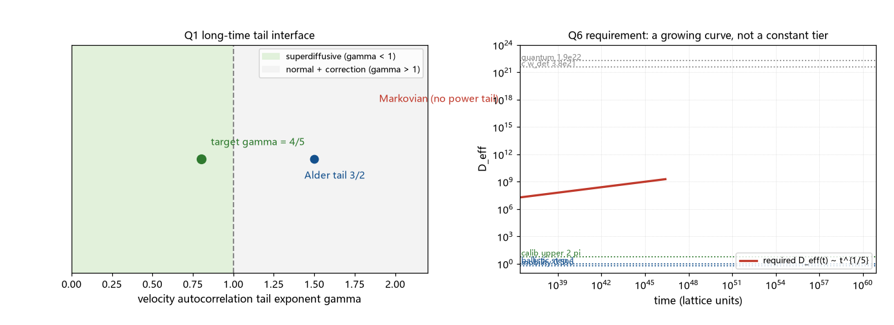

# 注记-超扩散输运的候选机制清点（第418条）：长时尾接口与短程结构判负

- **日期**：2026-09-26 02:05:17
- **类型**：清点轮（P0-5 候选机制六轮；输运路线首轮）
- **脚本**：`验证脚本/minimal_verification_superdiffusion_source_audit.py`（第 418 条）
- **图**：见 §3 图 1（`images/superdiffusion_source_audit.png`）
- **依据**：[[验证脚本/注记-超扩散候选清点（第410条）：D_req 与体系输运系数的对照]]（六档基线）；[[验证脚本/注记-结晶扩张相变的标度清点（第415条）：标准临界标度全判负与三分之五的机制域]]（$z = 5/3$ 与 $D_{\rm eff} \propto t^{1/5}$）；[[验证脚本/注记-G4-1（γ 频率依赖）：常数口径的适用带与记忆时间上界]]（记忆时间上界）；[[缺陷动力学：孤子的质量、迁移率与最小量子化]]（过阻尼标定）；[[验证脚本/注记-q 的来源清点（第417条）：稀释继承下界与校准保护分数]]（校准链关闭）
- **状态**：清点完成。九条候选：判负五条（记忆核、校准、持续随机行走、守恒尾、过阻尼扩散）、待建四条（跳跃重尾、迁移率时变、缺陷增殖、两相混合）；现成机制无活口
- **可逆性等级**：判据稳健（判负五条的每条依据均为框架既有判定或标准动力学结论；「无活口」为阴性陈述）

## 1 判据与设定

第 417 条收束后，输运路线（$z = 5/3$）成为唯一活跃入口。本轮清点其来源：把 $\alpha = 3/5$ 换算成长时语言（Q1），列九条候选并判定（Q2），核对判负基线（Q3），给出待建接口的条件式（Q4、Q5），净判（Q6）。设定同前：允许带 $[0.5598, 0.6015]$、目标 $D_{\rm req} = 1.909\times10^7$、$t_* = 2.539\times10^{36}$ 拍。

## 2 结果

Q1（等价表述）：$\alpha = 3/5$ 等价于 $z = 5/3$、$\langle x^2\rangle \propto t^{6/5}$、$D_{\rm eff} \propto t^{1/5}$、速度自关联尾 $C_v(s) \propto s^{-4/5}$。语义：尾指数 $\gamma < 1$ 给超扩散（主指数 $2-\gamma$）；$\gamma = 1$ 临界；$\gamma > 1$ 只给修正（Alder 尾 $3/2$ 属此类，不改变主指数）。

Q2（候选判定）：判负五条。长程记忆核：记忆时间上界 $\tau_m \le t_P$（碰撞写入每拍一次的两层结构）；校准通道：瞬时无损（2026-09-26 裁决）且谱型为扩散；持续随机行走：长时极限为正常扩散；守恒尾：尾指数大于一，仅修正；过阻尼晶格扩散：$\gamma_d = 0.5958$ 常数加马尔可夫。待建四条：跳跃重尾（$\mu = 5/3$）、迁移率时变（$\gamma_{\rm eff} \propto t^{-1/5}$）、缺陷增殖（$n \propto t^{1/5}$）、两相混合（$D \propto \phi_s^k$）。

Q3（基线核对）：$\tau_m \le t_P$ 的论证基于碰撞写入的两层结构（频率依赖至 $O((\omega t_P)^2)$）；$\gamma_d = 0.5958$ 由迁移率 $18.9$ 反解、为常数标定；校准为瞬时无损；六档中最近目标者为校准扩散上界 $2\pi$，仍差 $6.48$ 个数量级。

Q4（三接口条件式）：甲，跳跃分布 $P(\ell) \propto \ell^{-1-\mu}$，$\mu = 5/3$（尾指数 $8/3$）；乙，速度尾 $C_v(s) \propto s^{-4/5}$；丙，有效摩擦 $\gamma_{\rm eff} \propto t^{-1/5}$。

Q5（框架材料位置）：甲的材料最近（第 386 条钉扎门槛、D-7 钉扎势垒有读数，分布形状未建模）；乙与丙无材料；两相混合（丁）需 $\phi_s(t)$ 与环境耦合的联合模型，初判 Avrami 端部指数（早期 $t^4$、晚期饱和）均不合 $1/5$。

## 3 图

## 4 结论与移交

净判两条。其一，超扩散输运在框架内无现成活口：五条判负覆盖「时间记忆、校准通道、随机行走、守恒修正、过阻尼扩散」，其判负依据均为框架既有判定或标准结论。其二，P0-5 缺口的性质被精确刻画：需要补的是一类长时结构（幂律尾或重尾）的机制；放大倍数（$3\times10^6$ 倍）属表象；框架的现有结构（碰撞接力的马尔可夫性、校准瞬时、过阻尼）在结构上均为短时或短程，与长时幂律需求方向相反。

待建四条的排序（按材料接近度）：甲（跳跃重尾）最近，钉扎读数已存在、只缺分布形状的建模；丁（两相混合）居中，需凝固分数与环境耦合的联合模型；丙（迁移率时变）靠后；乙（速度尾）无材料。

移交两条。其一，接口甲首轮：钉扎网络的空间分布形状判定（第 386 条与 D-7 的钉扎读数是否支持重尾或分形间距分布；均匀泊松分布给指数尾、无超扩散，需正面建模异质性来源）。其二，接口丁的半页估算：凝固分数 $\phi_s(t)$ 的 Avrami 端部与「临界区」结构的对照，检查是否存在 $\phi_s \propto t^{1/5}$ 的窗口。

## 5 严格程度与边界声明

严格程度：Q1 为等价换算（代数级）；Q2 的判负条目为材料核对与标准结论引用（判据级）；Q3 为引文核对；Q4 为条件式换算；净判为阴性陈述，不声称穷尽所有可能机制。

边界（本脚本不验证的内容）：其一，不建立任何长时尾机制；其二，判负限于已登记的框架结构与标准动力学类别；其三，「两相混合」的 Avrami 端部指数按均匀成核口径，未含异质成核修正；其四，不重算第 410、415、417 条；其五，接口条件式为需求侧刻画，不构成供给。

## 6 过程记录

其一，首版候选清单为八条，核对中补入「两相混合的渗透型输运」（凝固分数控制 $D \propto \phi_s^k$）为第九条，判定为待建并登记 Avrami 端部初判。

其二，$Q1$ 的尾指数换算经双向核对：$\gamma = 4/5 \Rightarrow$ MSD 指数 $2-\gamma = 6/5 \Rightarrow z = 2/(6/5) = 5/3 \Rightarrow \alpha = 1/z = 3/5$，闭环一致。

其三，判负五条的「依据类型」分两档记录：框架既有判定（记忆上界、校准瞬时、过阻尼标定）与标准动力学结论（PRW 长时极限、Alder 尾语义），便于后续替换单条依据时快速定位。
