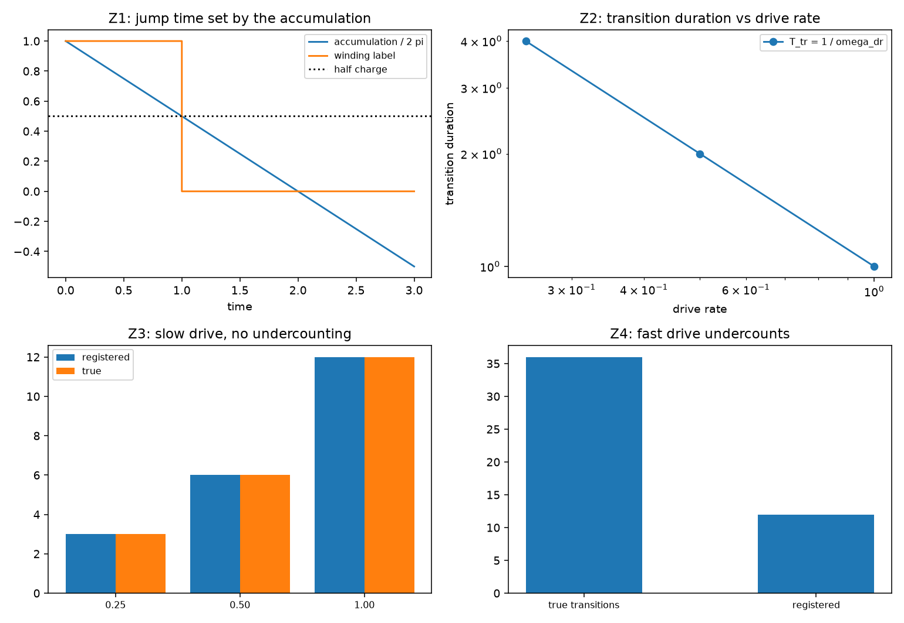

# 注记-跃迁率轮的最小验证：跃迁时长、跃迁率上界与记录流的时间分辨率

- **日期**：2026-09-19
- **对应脚本**：`验证脚本/transition_rate.py`（判据 Z1 至 Z6 共 6 项，6/6 通过；确定性，无随机数；运行约 0.0 秒；图存 `images/transition_rate.png`，见 §一 图 1）
- **依据**：[[验证脚本/注记-运动双侧轮的最小验证：连续累加与离散绕数在同一条过程上]]（第 143 条，双侧读数）；[[验证脚本/注记-写入算符与绕数扇区相容性轮的最小验证：扇区封闭、标签可加、单体模固定、相位住关系层]]（第 139 条，度为一的计数结构）
- **状态**：判据 6/6 通过。核心读数：跃迁时刻等于累加跨过 $\pi$ 的时刻（偏离 $0$）；跃迁时长 $T_{\rm tr} = 1/\omega_{\rm dr}$（三档 $4.000$、$2.000$、$1.000$，双对数斜率 $-1.0000$）；慢驱动下登记数等于真实数（$3/3$、$6/6$、$12/12$）；快驱动欠计数（登记 $12$ 对真实 $36$，比值 $0.33$）；离散侧给出的归属周期与解析一致。

---

## 一、判据与结果

| 判据 | 内容 | 通过条件 | 实测 |
|---|---|---|---|
| Z1 | 跃迁时刻由累加给出 | 偏离 $< 10^{-12}$ | $0$ |
| Z2 | 跃迁时长与驱动率成反比 | 斜率 $-1.00$ | $-1.0000$ |
| Z3 | 慢驱动不欠计数 | 登记 $=$ 真实 | $3/3$、$6/6$、$12/12$ |
| Z4 | 快驱动欠计数 | 比值小于 $1$ | $12/36 = 0.33$ |
| Z5 | 双侧分辨率 | 时刻偏差 $0$、周期一致 | 时刻 $1.2500$；周期 $1$ 对 $1$ |
| Z6 | 口径登记 | 见 §三 | 登记 |

图注：左上为累加与标签（跃迁时刻落在半荷线上）；右上为跃迁时长随驱动率的双对数关系（斜率 $-1$）；左下为慢驱动下登记数与真实数的对照（三档相等）；右下为快驱动下的欠计数。

## 二、模型设定

把驱动取为棱差的匀速推进（给定外力，非体系自身的缺陷动力学）：累加按 $S(\tau) = 2\pi(1 - \omega_{\rm dr}\tau)$ 流动，绕数标签取 ${\rm round}(S/2\pi)$，跃迁时刻为 $S = \pi$ 之时。跃迁时长定义为从上一个整周构型到下一个整周构型的间隔（$1/\omega_{\rm dr}$），即场处于非站点可实现状态的整段时长。记录流按每站每周期一笔取样（间隔 $t_P$），登记数取相邻取样点标签变化的次数。

## 三、读数的意义

**跃迁有时长。** $T_{\rm tr} = 1/\omega_{\rm dr}$（三档 $4.000$、$2.000$、$1.000$，双对数斜率 $-1.0000$）。读法是：跃迁在中间态停留的时间由累加走完一整圈所需的时间决定，驱动越慢，跃迁越长。第 143 条把跃迁读成半荷点的跳变，本轮给它补上时间尺度。

**两侧各给一半的时间信息。** 连续侧给出跃迁时刻（偏离 $0$），离散侧只能给出跃迁落在哪个周期（实测周期 $1$ 与解析一致）。分辨率之比就是连续量与取样间隔之比。

**观测跃迁率的上界。** 取样间隔为 $t_P$，故慢驱动（$\omega_{\rm dr} \le 1/t_P$）不欠计数（三档登记数等于真实数），快驱动欠计数（$3/t_P$ 时登记 $12$ 对真实 $36$，比值 $0.33$）。可分辨的跃迁率上界为 $1/t_P$，与度为一的计数结构同源。

**退化情形与口径。** 取样点正好落在跃迁时刻时，标签取整出现平局（半整数），归属差一个周期，此时跃迁不可分辨；驱动为给定外力，缺陷自身的动力学方程仍未定，本轮只读给定驱动下的时间尺度与观测分辨率。

## 四、过程记录

判据订正一处。Z5 首版取驱动率 $0.5$，跃迁时刻 $1.0000$ 正落在取样点上，归属周期给出 $0$ 与解析 $1$ 不符；改用 $0.4$（跃迁时刻 $1.2500$）后归属一致，并把退化情形写进口径。

效率记录：脚本约 $0.0$ 秒（纯解析与离散取样），无字体问题。
