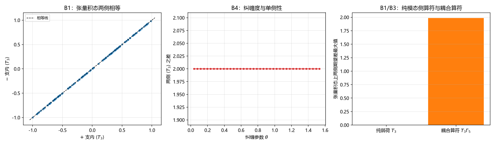

# 注记-跨侧桥的判据化：张量积下的单侧不可能性与纠缠出路（判据第 664 号）

## 元数据

- **日期**：2026-10-17 11:43:48（取系统当前时刻）
- **脚本**：`验证脚本/minimal_verification_cross_bridge_single_side.py`
- **判据**：冒烟 M1 至 M2、B1 至 B5，共 8 项（8/8 通过）
- **可逆性等级**：判据稳健。B1 与 B3 为随机态上的分布读数（种子固定），结论对样本不敏感；B2 与 B4 为解析参数族的直接计算。
- **类型**：判据级读数（跨侧桥的判据化：把 P1-1 卡点一「对易但不同物」翻译成可判条件）
- **关联**：[[验证脚本/注记-来源层判据化第二轮：CR 结构类型分解与作用分类（判据第663号）|第 663 号]]（本轮的直接上游：模态侧对分支中性，故偏心须在桥层找）；[[验证脚本/注记-模态-时空接口的对易性审计：第494号其五「反对易」结论的复核（判据第661号）|第 661 号]]（$[\Gamma_5, \kappa\sigma_z]=0$ 与四扇区结构）；[[wiki/先验纠缠]]（体系对物侧态不可分离的主张，本轮出路判据与之衔接）；[[内部草稿/总结注记-手征问题攻坚全面总结：定理射程、逐轮清点与接口缺口（2026-10-16）|手征攻坚总结]] §六 卡点一
- **图**：见 §三 图 1

---

## 摘要

第 663 号把模态侧理清：弱荷对模态空间的 CR 分支中性。故「弱作用只作用左手」这份偏心只能在模态侧与时空侧之间那一层找。本轮把该层的形式做成判据，得三条读数。

**其一，张量积框架下纯弱荷不可能单侧。** 在 8 分量结构（模态 2 维 × 时空 4 维）上，$T_3 = \sigma_z \otimes I_4$ 与 $\Gamma_5 = I_2 \otimes \gamma_5$ 对易，四扇区各 2 维。二百个随机张量积态上，$T_3$ 在两手征扇区内的条件期望之差最大 $3.33\times10^{-16}$，即纯模态侧算符完全不区分手征扇区。

**其二，纠缠态下可以单侧。** 在同一结构上取纠缠族 $\cos\theta\,|0\rangle_m|+\rangle_s + \sin\theta\,|1\rangle_m|-\rangle_s$，$T_3$ 的两侧期望之差最大达到 $2.000000$（上界），随 $\theta$ 单调上升。体系主张物侧态空间本身不可分离（先验纠缠），故这条出路在体系内是开着的。

**其三，耦合算符是另一条路，与弱荷单侧不是一回事。** 对照算符 $T_3\Gamma_5$ 在**张量积态**上也能把两侧分开（期望差最大 $1.986537$），它靠的是算符自身的因子结构，与态的纠缠无关。故「让弱作用偏手」有两条互不相同的方式：换算符（耦合）或换态（纠缠）。

## 一、模型设定与依据

模态侧取 2 维（第 663 号的模态系数空间），时空侧取 4 维 Dirac 旋量，总空间 8 维。算符取

$$T_3 = \sigma_z \otimes I_4, \qquad \Gamma_5 = I_2 \otimes \gamma_5,$$

扇区投影 $P_\pm = I_2 \otimes (1 \pm \gamma_5)/2$。判据是"同一个态在两个手征扇区内的 $T_3$ 条件期望之差"：差为零即该算符不区分手征，差非零即区分。

体系对桥的既有主张有两条。手征正稿说"模态复结构与时空旋量手征结构是同一结构"（$\gamma_5$ 对应 $J$，纲领层）。先验纠缠词条说物侧态空间受全局绕数扇区约束，乘积矢被直接排除，全部态都是不可分离态。

## 二、判据与结果

| 判据 | 内容 | 实测 | 期望 |
|---|---|---|---|
| M1 | $[T_3, \Gamma_5]$ | $0$ | 复现第 661 号 |
| M2 | 四扇区维数 | $[2,2,2,2]$ | 各 $2$ |
| B1 | 张量积态上 $T_3$ 两侧期望差最大（200 态） | $3.33\times10^{-16}$ | 机器零 |
| B2 | 纠缠族上 $T_3$ 两侧期望差最大 | $2.000000$ | 非零（上界 $2$） |
| B3 | 对照：$T_3\Gamma_5$ 在张量积态上的两侧差最大 | $1.986537$ | 非零 |
| B4 | 纠缠参数扫描：可读档与单调性 | $39/41$ 档，由近 $0$ 升到 $2.000000$ | 单调 |
| B5 | 恒真检验与权重反例 | 恒等重合 $0$ 项；乘积态 $-支权重为零（读数 None） | 判据有区分力 |

## 三、图

图注按脚本绘图面板逐条核对撰写。

## 四、结论

**结论一，桥层有一条定理级的限制：张量积态配纯模态侧算符，单侧加载不可能。** 理由是结构性的：$T_3$ 只作用在模态因子上，而手征扇区只由时空因子决定，二者对易，故 $T_3$ 在两个手征扇区内的条件期望恒等于同一个数（模态侧期望）。二百个随机张量积态上该差值的机器零读数即是这条限制的数值形态。

**结论二，出路是态层纠缠，而体系主张的物侧态空间正好是不可分离的。** 纠缠族上的读数是上界 $2.000000$，且随纠缠参数单调上升。先验纠缠词条说乘积矢被扇区约束直接排除，故这条出路在体系内本来就开着，属既有主张的直接推论。

**结论三，耦合算符与弱荷单侧是两条不同的路，不可互代。** $T_3\Gamma_5$ 型耦合在张量积态上就能分开两侧（$1.986537$），但它不是纯弱荷：它把手征因子塞进了算符，等于把"偏手"预先装进耦合里。若要求弱荷本身保持纯模态侧（即弱荷算符不显含手征因子），那么唯一的出路是态层纠缠。这回答了第 663 号留下的问题：模态侧中性并不排除单侧，它只把单侧的来源限定到态层。

**与 P1-1 卡点一的衔接。** 卡点一说"缺的是把'对易但不同物'翻译成可判对应"。本轮的读数给出该翻译的一种形式：对应不在算符层（两个算符对易、各自住在自己的因子上），而在态层（态的不可分离性使模态侧读数依赖手征扇区）。第 662 与 663 号排除了算符层的两条路（模态侧单侧、$\sigma$ 场选支），本轮把剩下的那条路指认为态层。

## 五、严格程度声明与边界声明

**严格层**：$[T_3,\Gamma_5]=0$（严格零）、四扇区维数、张量积态上两侧期望差的机器零读数（$3.33\times10^{-16}$）、纠缠族上的解析读数（上界 $2.000000$）、扫描的单调性。

**物理对应假设层**：模态侧 2 维与时空侧 4 维的张量积结构；$T_3 = \sigma_z\otimes I_4$；$\gamma_5 = \mathrm{diag}(1,1,-1,-1)$ 的 Dirac 表示。

**纲领层**：把态层纠缠读作体系"先验纠缠"主张的具体实现，仍属纲领层；纠缠的具体形式（哪一对因子纠缠、纠缠度由什么决定）本轮未构造。

**边界声明**：不判定体系是否真的实现了单侧加载（本轮只给出"必须走态层"这一必要条件与"态层可行"这一充分方向的构造）；不构造纠缠的具体物理形式；不判定 $SU(2)_L$ 真动力学；不改动 `理论总纲/` 基准；不重开第 502 至 506、508、661、662、663 号的任何判定。

## 六、登记衔接

本条为跨侧桥判据化的第一轮，登记入 [[内部草稿/开放问题档案/开放问题-P1-1-手征性|P1-1 档案页]] 与开放问题总览 P1-1 卡。下一轮的落点由结论二与结论三给出：纠缠的形式尚未构造，可做成"哪一种因子对纠缠能在保持弱荷纯模态侧的前提下给出单侧"的判据。

## 七、过程记录

**判据设计的两处留意。** 其一，条件期望的扇区权重可能为零（乘积态 $|0\rangle_m|+\rangle_s$ 的 $-$ 支权重为零），此时读数为未定义。首版直接用比值会得到 $0/0$，故实现中加了权重阈值并返回 None，同时把该情形作为反例登记（B5）。其二，对照组的选取须与"纯弱荷"形成结构上的差别：$T_3\Gamma_5$ 与 $T_3$ 的差别在于前者显含手征因子，这正是"换算符"与"换态"两条路的分别。

**与第 663 号方法教训的呼应**：上一轮的教训是"判断一个操作对某结构做了什么，须先把结构写出来再读数"。本轮的同型做法是：判断"单侧是否可能"，须先固定态空间的形式（张量积还是纠缠），再读数；两个框架下的答案相反，混着谈就会得出矛盾结论。

## 八、来源

- 上游：[[验证脚本/注记-来源层判据化第二轮：CR 结构类型分解与作用分类（判据第663号）|第 663 号]]（模态侧中性）
- 对易性与扇区结构：[[验证脚本/注记-模态-时空接口的对易性审计：第494号其五「反对易」结论的复核（判据第661号）|第 661 号]]
- 态空间主张：[[wiki/先验纠缠]]（全局绕数扇区约束排除乘积矢）
- 脚本：`验证脚本/minimal_verification_cross_bridge_single_side.py`（确定性，种子 $20261017$，约 $2$ 秒）
- 图：`images/fig_cross_bridge_single_side.png`

## 修订记录

- **2026-10-17 11:43:48 初版**（跨侧桥判据化第一轮，判据 8/8）
    - B1：张量积态上纯模态侧算符 $T_3$ 的两侧期望差机器零（$3.33\times10^{-16}$），单侧不可能
    - B2：纠缠族上该差达上界 $2.000000$，随纠缠参数单调
    - B3：对照算符 $T_3\Gamma_5$ 在张量积态上即可分开两侧（$1.986537$），"换算符"与"换态"是两条路
    - B5：扇区权重为零的态须排除（乘积态反例）
    - 与 P1-1 卡点一衔接：对应不在算符层而在态层
