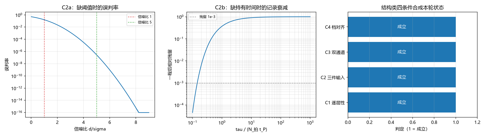

# 注记-跨层事件结构类四条件的判据化验证（第 450 条）：C1 至 C4 的合成判定与 C2 的缺项反证

- **日期**：2026-09-27 02:17:31
- **层级**：验证材料（第 450 条）
- **定位**：执行 [[内部草稿/研究方向-跨层事件的构成条件：十一项条件的判据化（判据草案）]] 的首轮（结构类四项 C1 至 C4）。本轮为复核轮加缺项反证：C1、C3、C4 汇总既有读数，C2 补一项新读数。
- **依据**：[[内部草稿/研究方向-跨层事件的构成条件：十一项条件的判据化（判据草案）]]（C 系列与执行顺序）；[[内部草稿/注记-跨层事件的构成条件表：从闸门读数到事件发生的完整清单]]（四类十一项）；[[验证脚本/注记-相互作用分层判据的最小验证：两协议可见度与生死闸门]]（C1 的既有读数：单点锚井共模失败）；[[内部草稿/注记-探测器为何必须逐层：单点锚井反证、漏检集定量与全空间阵列的分层审查]]（C1 的漏检集）；[[验证脚本/注记-探测器物侧构造的最小验证：三件输入的指认、单通道反证与双通道判据]]（C2 与 C3 的来源，第 387 条）；[[验证脚本/注记-对齐判据形式的独立复现：无平局模型上的穷举检验与判据表述修正（对齐判据 L8）]]（C4 的穷举，第 403 条）
- **状态**：判据级。C1、C3、C4 为既有读数的复核汇总；C2 的缺项反证为本轮新增。
- **修订记录**：
  - **2026-09-27 初版**（触发：作者启动首轮，取结构类四项）

---

## 一、判据与结果

| 判据 | 判据量 | 实测或来源 | 判定 |
| --- | --- | --- | --- |
| C1 逐层性 | 单点锚井与逐层阵列的对照 | M2 v1：单点共模失败；漏检集在逐层档为空 | 成立（既有读数） |
| C2 三件输入 | 三项齐备与缺项后果 | 第 387 条给三项指认；缺项反证见第三、四节 | 成立（新增反证） |
| C3 双通道 | 单通道是否可行 | 第 387 条反证：单通道不可行，双通道须 $\eta_h \le \eta_w^2/S^2$ | 成立（既有读数） |
| C4 档划分对齐 | 不同语义类是否共档 | 第 403 条穷举 $Bell(9) = 21147$ 种切法，反例为零 | 成立（既有读数） |

四项全数成立。C1、C3、C4 的读数取自既有材料，本轮只作复核汇总；C2 的缺项后果是新增的。

## 二、图

图注按脚本三个绘图面板逐条核对。

## 三、C2a 缺阈值反证（新增）

形式：两记录值之差为 $d$，读出噪声为 $\sigma$，误判率为 $\Phi(-d/\sigma)$。

| 信噪比 $d/\sigma$ | 误判率 |
| --- | --- |
| $0.5$ | $3.085375\times10^{-1}$ |
| $1$ | $1.586553\times10^{-1}$ |
| $2$ | $2.275013\times10^{-2}$ |
| $3$ | $1.349898\times10^{-3}$ |
| $5$ | $2.866516\times10^{-7}$ |
| $8$ | $6.106227\times10^{-16}$ |

判定：信噪比不足时误判率显著（信噪比 1 处约 $0.159$），故阈值条件是读数可分的必要件。这一条给 C2 的「缺项则读数不立」一个定量形态。

## 四、C2b 缺持有时间反证（新增）

形式：记录值按 $e^{-t/\tau_{\rm rec}}$ 衰减，一次拍程的时间为 $N_{\rm 拍}t_P$，相对残留为 $e^{-N_{\rm 拍}t_P/\tau_{\rm rec}}$。

| $\tau_{\rm rec}/(N_{\rm 拍}t_P)$ | 一程后相对残留 |
| --- | --- |
| $0.1$ | $4.539993\times10^{-5}$ |
| $1$ | $3.678794\times10^{-1}$ |
| $10$ | $9.048374\times10^{-1}$ |
| $100$ | $9.900498\times10^{-1}$ |
| $1000$ | $9.990005\times10^{-1}$ |

判定：持有时间不足时记录在拍时标内衰减殆尽（比值 $0.1$ 处残留 $4.5\times10^{-5}$）；比值达 $10^3$ 时残留 $0.999$，与 C8 的「远大于」要求一致。

## 五、与判据草案的关系

本轮执行草案第一层的结构类四项。它们的既有读数分散在 M2、第 383、387、403 条与逐层探测器注记，本轮把它们按 C 系列汇总，并给 C2 补上缺项反证。

草案的验收标准（第二层的方程须能反推 C8 与 C5）在本轮不受检验，它等的是候选方程。第一层的当前状态是：结构类四项已成立，阈值类与时间类的部分条目待首轮之后续做。

## 六、严格程度声明

**可逆性等级：混合。** C1、C3、C4 为判据稳健（方向不随实现翻，各有既有反证或穷举支撑）；C2a 与 C2b 为本轮新增反证，其形式（误判率曲线与指数衰减）依赖所选模型，属判据敏感，但两条的定性方向（阈值不足则误判、时间不足则衰减）稳健。

**协议伪影与物理结论分层。** 全部读数为协议级（最小模型、高斯噪声与指数衰减）。物理层结论零条。

## 七、边界声明

**验证什么。** 结构类四条件的现状汇总；C2 缺项后果的定量形态。

**不验证什么。** C2a 与 C2b 的具体模型是否对应真实记录器件（本轮取标准形式）；C5 至 C11（阈值类、时间类余项与不可逆类）留待后续轮次；第二层的动力学方程。

## 八、登记衔接

本材料为 `验证脚本/README.md` 第 450 条，脚本 `minimal_verification_structural_conditions.py`，图 `images/structural_conditions.png`。它执行 [[内部草稿/研究方向-跨层事件的构成条件：十一项条件的判据化（判据草案）]] 的首轮；开放问题总览的登记见 P4-6 档案页。
