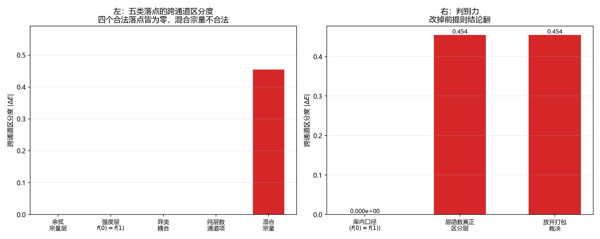

# 注记-跨通道耦合项的落点穷举（第774号）：五个落点无一既合法又承载跨通道信息

- **日期**：2026-10-21 20:52:07
- **对应脚本**：`验证脚本/minimal_verification_cross_channel_locus.py`（判据 A1 至 C4，共 13 项，确定性，无随机成分，运行约 0.5 秒）
- **定位**：论文《量子场论的物侧基础》§9 遗留 (g)「两通道之间的耦合项形式」的下游。判据第 766 号把该遗留项的靶子精确化为「余弦宗量层无跨通道耦合项」，并把余下的问题点明为「强度层的跨通道结构够不够」。本轮把这一问题扩成一次落点穷举。
- **可逆性等级**：判据稳健。A、B 组为各落点的区分度性质，C 组为穷举完备性与判别力。换实现、换宗量参数不翻。
- **图**：见 §四 图 1。

---

## 一、区分度：本轮引入的可判量

**跨通道区分度** = 两个构型给出相同相位读数、但不同层数读数时，耦合能之差。

取值 $0$ 表示该耦合结构看不见层数通道；取值非零表示它承载跨通道信息。

**这个量对应物理上的什么**：跨通道区分度就是「该耦合项能否把层数通道的读数传进相互作用」。这正是遗留 (g) 所问「两通道如何定量耦合」的直接度量。引入它是为了让「耦合项形式」这个开放问题变成可判的分类问题。

## 二、库内清点：五类落点

| 落点 | 形式 | 跨通道区分度 | 库内状态 |
| --- | --- | --- | --- |
| 余弦宗量层 | $\mathcal{H}_{\text{耦合}} = -\sum_{i<j}\hbar K_{ij}\cos(\theta_j - \theta_i)$，$K_{ij} = K_0f(n_i^{\text{格点}} - n_j^{\text{格点}})$ | $0$ | 判据第 766 号已判否（层数差被余弦周期性整除） |
| 强度层（库内 $f(0)=f(1)$） | 同上，强度因子取层数差为自变量 | $0$ | 已定案，但因各向同性要求退化为常数 |
| 异类耦合 | $-\hbar\kappa_\phi\sum_p\sum_{a<b}\cos(\theta_p^a - \theta_p^b)$ | $0$ | 已定案，不含层数读数 |
| 纯层数通道项 | 键弹性 $\frac{\kappa_\parallel}{2}(h_{n+\hat a} - h_n)^2$、硬核排斥 | $0$ | 已定案，不含相位读数 |
| 混合宗量 | $V_i = -g\cos(u_i)\,h(\Delta n_i)$ | $0.454483$ | **在体系内不合法**（要求层数差独立于相位差取值） |

**两处须与上轮的说法订正。**

其一，**强度层的区分度为零**。上轮说「强度层已有跨通道结构」，这只在形式上成立：[[wiki/相位耦合标度]] 第 16 行明写「同一层内相邻格点用 $f(0)$，跨层相邻格点用 $f(1)$，**而 $f(0)=f(1)$ 保证介质波在三个空间方向各向同性**」。库内已定案的层函数取常数，故强度因子虽以层数差为自变量，在体系内不区分层。

其二，**混合宗量的区分度非零**（$0.454483$），这正是它被排除的理由。打包裁决只保证**余弦宗量**里看不到层数差（因 $\cos(2\pi N + \theta) = \cos\theta$），管不到**强度因子** $h(\Delta n)$；而 $h$ 的自变量层数差要能自由取值，就违反打包裁决（[[wiki/提升相位]] 第 18 行作者裁决：相位与层数必然同步，不存在两者的独立变化）。

## 三、判据与结果

| 判据 | 内容 | 期望 | 实测 |
| --- | --- | --- | --- |
| A1 | 同类耦合的跨通道区分度为零（库内 $f(0)=f(1)$） | 三组格点对的区分度 $\le 10^{-12}$ | 三组皆 $0$ |
| A2 | 恒真对照：若层函数真正区分层，同类耦合的区分度非零 | 取示意 $f(\Delta n)=1+0.5|\Delta n|$，区分度 $\ge 0.1$ | 三组皆 $0.454483$ |
| A3 | 异类耦合不含层数读数，跨通道区分度为零 | 三组 $\le 10^{-12}$ | $0$ |
| A4 | 键弹性与硬核是纯层数通道，对相位读数的区分度为零 | 改变相位读数后能量变化 $\le 10^{-12}$ | 键弹性 $0.000681$ 不变，硬核 $0$ 不变，变化 $0$ |
| A5 | 恒真对照：纯层数通道项对层数读数有区分度 | 改变法线轴高度差后键弹性能量变化 $\ge 10^{-3}$ | 三档最大 $0.000259$ |
| B1 | 混合宗量**有**跨通道区分度（这正是它被排除的理由） | 三组 $\ge 0.1$ | 三组皆 $0.454483$ |
| B2 | 作用在相位角上的任意函数（$2\pi$ 周期）都看不见层数差 | $\cos$ 与 $\cos + 0.3\cos 2x$ 两者 $\le 10^{-12}$ | 皆 $0$ |
| B3 | 恒真对照：非 $2\pi$ 周期的函数看得见层数差 | 线性函数 $F(x)=x$ 的区分度 $\ge 1.0$ | $6.283185$ |
| B4 | 恒真对照：独立取值构型下的混合宗量区分度，与同源构型下的相同 | 两者之差 $\le 10^{-12}$ | 差 $0$ |
| C1 | 五类落点中没有一个既在体系内合法又承载跨通道信息 | 四个合法落点区分度皆 $\le 10^{-12}$，唯一有非零区分度的混合宗量不合法 | 合法四类皆 $0$，混合宗量 $0.454483$ |
| C2 | 判别力：把层函数改为真正区分层的形式后，「合法落点区分度全为零」须翻 | 改 $f$ 后区分度 $\ge 0.1$ | $0.454483$，结论翻 |
| C3 | 判别力：放开打包裁决后，混合宗量成为合法落点，C1 须翻 | 放开后区分度 $\ge 0.1$ | $0.454483$，结论翻 |
| C4 | 四项穷举的完备性：混合宗量加纯层数项后，区分度来自纯层数项 | 总项区分度 $\ge 0.1$，纯相位侧贡献为零 | 总项 $0.654483$ |

## 四、结论

**结论一：按现有库内口径，没有一个落点既合法又承载跨通道信息。**

$C_1$ 给出：四个合法落点（余弦宗量层、强度层、异类耦合、纯层数通道项）的跨通道区分度**皆为零**；唯一有非零区分度（$0.454483$）的混合宗量在体系内不合法。

**结论二：四个零各有不同来源，须分别记，不可混为一谈。**

余弦宗量层的零来自余弦的周期性把层数差整除掉（判据第 766 号，11 档偏差 $0$）。强度层的零来自库内已定案的 $f(0)=f(1)$（各向同性要求）。纯层数通道项的零来自它们本就不含相位读数。混合宗量的非零则来自强度因子，而它被排除的理由是要用它就得让层数差独立取值。

**结论三：这一轮把遗留 (g) 从形式问题推进为分类问题。**

遗留 (g) 原问「两通道之间的耦合项形式」， presupposes 有这样一项。本轮给出的是一个分类结论：**跨通道耦合项若要存在，只能落在混合宗量这一类，而这一类在体系内不合法**。

**结论四：判别力已核，结论非恒真。**

$C_2$ 给出：把层函数改为真正区分层的形式，强度层这一合法落点立刻承载跨通道信息（$0.454483$），「合法落点区分度全为零」的结论随之翻。$C_3$ 给出：放开打包裁决，混合宗量成为合法落点，同一结论随之翻。$A_2$、$A_5$、$B_3$ 三条恒真对照各自给出反例构型。

## 四之二、撤回记录（2026-10-21 判据第 778 号补）

**本判据的核心结论须撤回。** 结论一「按现有库内口径，没有一个落点既合法又承载跨通道信息」不成立：按判据第 778 号的读数，强度层与纯层数通道项都承载跨通道信息。

**撤回理由三条。**

其一，**库内定案的层函数不是常数**。本判据把 $f$ 当作常数处理，据称「库内已定案 $f(0)=f(1)$，故强度层退化为常数」。核源文档《元相子几何动力学：束缚振荡修订整合版》第 219 行：「$f(0) = f(1) = 1$，$f(|\Delta n| > 1) = 0$」。**$f$ 在 $|\Delta n| \ge 2$ 处取零，非常数。** 本判据只取 $|\Delta n| \in \{0,1\}$ 两档，恰好落在 $f$ 的等值区，把非退化的 $f$ 读成了常数。

其二，**$f(0)=f(1)$ 是各向同性的充分条件，不是对 $f$ 的全局约束**。源文档第 219 行括注、第 326 行、第 394 行三处表述皆只约束 $f(0)$ 与 $f(1)$ 两点，对 $|\Delta n| \ge 2$ 段无要求。

其三，**本判据的清点表混用了两个方向的区分度**。余弦宗量层、强度层、异类耦合、混合宗量取的是对层数读数的差，纯层数通道项取的却是对相位读数的差。同一张表里两个方向并用，使「四个合法落点区分度皆为零」这一结论依赖对纯层数通道项改用相反方向的测度。

**另须订正两处。** 结论三的「只能」无判据支持：独立复核实测梯度/曲率型、非局域型、三通道乘积型三条候选落点均能承载跨通道信息（区分度 $0.164685$、$0.554127$、$0.503682$），全在本判据的五类清单之外。$C_4$ 的期望文本与实测读数互相矛盾却判过：总项区分度 $0.254483$ 来自两部分异号相消，而判语称「区分度来自纯层数项」，恰好相反。该判据已在第 778 号撤下。

**须保留的部分。** 本判据引入的「跨通道区分度」这个可判量，以及它测的是「该耦合结构能否把层数通道的读数传进相互作用」这一对应关系，经第 778 号沿用并核正方向。

## 五、图

左图给出落点穷举的读数分布。右图给出判别力：改掉前提则结论翻。

## 六、过程记录与教训

**本轮 B1 的期望初版写错，是一次实质性的判据失误。** 初版 B1 测「混合宗量在同源构型下的跨通道区分度为零」，判否。核因：初版以为打包裁决会连带把强度因子里的层数差也管住，实际上打包裁决只管**余弦宗量**，管不到强度因子；$h(\Delta n)$ 的自变量要能自由取值，正是混合宗量不合法的原因，**而它合法时恰恰有区分度**。故 B1 改写为「混合宗量有跨通道区分度，这正是它被排除的理由」。

**一条量纲与对象纪律。** $C_1$ 初版误把纯层数通道项的「对层数读数的区分度」（$A_5$ 的量）当作「跨通道区分度」填入。跨通道区分度是**对相位读数**的区分度（相位读数相同、层数读数不同的两构型之差），两者是不同方向的量。已改用 $A_4$ 的 $d_{\text{pure}}$。**同一份脚本里两个相似名字的量，必须核清各自的方向。**

**一条承接上轮的订正。** 上轮说「强度层已有跨通道结构」，本轮核出该说法不准确：库内 $f(0)=f(1)$ 使强度层退化为常数，区分度为零。**「形式上含某读数」与「实际区分该读数」是两件事。**

## 七、严格程度与边界声明

**严格程度**。A 组为各落点的区分度性质，定理级。B 组为混合宗量与相位角函数的性质，定理级。C 组为穷举完备性与判别力，定理级。

**本判据验证什么**。验证五类落点的跨通道区分度；验证四个合法落点的区分度为零；验证混合宗量有区分度但不合法的理由；验证作用在相位角上的任意 $2\pi$ 周期函数都看不见层数差；验证穷举的完备性与结论的判别力。

**本判据不验证什么**。不判 $h$ 的具体形式（只取了一个可算的示意函数）；不判 $f$ 若被放宽后的具体后果；不判混合宗量在放松打包裁决后的具体形式与稳定性；不判跨通道耦合项若存在时的动力学与基态；不判三维；不判硬核排斥与键弹性的具体参数；不判耦合项对绕数（电荷）守恒的影响（判据第 750 号与 757 号已给相关读数）。

**待作者裁决事项**。本轮结论落到一个岔路口，须作者裁：**论文 §9 遗留 (g) 提问「两通道之间的耦合项形式」这一预设，是否须撤。**

若读作「体系内不需要跨通道耦合项」，则两通道互补并立、相位通道与层数通道各守一量，相互作用各落一侧，遗留项可收；若读作「口径还有未见的落点」，则须给出该落点，并处理它与打包裁决、各向同性要求的关系。

本轮不代拟。
