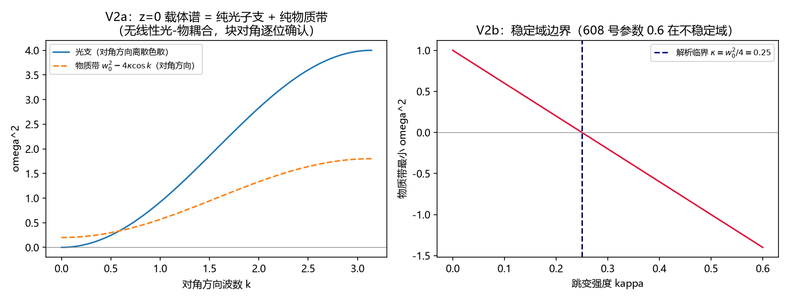

# 注记-跳变载体线性响应判别谱轮（第610号）：无凝聚则无介电响应与介质振子规范身份二选一

| 项目 | 内容 |
| --- | --- |
| 日期 | 2026-10-12 01:28:45（取系统当前时刻） |
| 主题 | D3p-3 谱轮（载体方案判据草案 D3p-3 的执行与结论改写） |
| 判据 | V2a/V2b/V2c（3/3） |
| 可逆性等级 | 判据敏感：换跳变项符号约定、换线性化平衡点（凝聚）、换块构造任一项即翻 |
| 图 | 图 1 见 §三 |
| 上游 | [[验证脚本/注记-介质物质项载体合法性判据轮（第608号）：U(1)链接与复物质场的联合规范不变性|第 608 号注记]]、[[内部草稿/注记-D3p二维规范检验的载体方案：Kogut-Susskind介质物质项与plaquette框架的衔接（2026-10-12）|D3p 载体方案注记]] |

## 一、要判什么与结论的改写

载体方案注记的 D3p-3 原判据草案是「矢量模型长波回归 Lorentz 介电函数」。执行前的解析审查改写了结论预期：绕 $z = 0$ 平衡点线性化时，跳变项的 $\theta$-物质交叉 $\theta\,\mathrm{Im}(z^*z')$ 中 $\mathrm{Im}(z^*z') = uv' - vu'$ 本身是场的二阶量，乘 $\theta$ 一阶后为**三阶**，在二阶能量（线性谱）中不存在：跳变型规范载体在无凝聚时对横向光**无线性响应**，Lorentz 偶极响应在该载体中缺位。本轮判据由此改为判别谱轮：把这个解析事实数值落定（V2a），刻画载体稳定域（V2b，顺带发现 608 号参数在不稳定域），配区分力齿（V2c）。

## 二、模型设定与判据结果

608 号载体补物质动能项 $\Pi^2/2$（规范不变显然），全盒介质，$N = 12$ 周期盒 k 空间块对角化（每 $k$ 一个 $4\times4$ Hermitian 位置块，动量块单位阵，$\omega^2 = \mathrm{eig}(Q)$），随机种子由解析构造替代（块构造确定性），脚本 `jump_coupling_spectrum.py`。

| 判据 | 内容 | 实测 | 判定 |
| --- | --- | --- | --- |
| V2a | $z=0$、$\kappa = 0.2$（稳定域内）：144 个 $k$ 块谱与「光子块 + 物质块」解析并集逐位对 | 最大偏差 $0.00e+00$（块对角构造级精确）；每 $k$ 含一个纵向规范零模 | PASS |
| V2b | 物质带最小 $\omega^2$ 符号随 $\kappa$ 翻转，解析临界 $\kappa_{crit} = \omega_0^2/4 = 0.25$ | $\kappa = 0.2/0.3/0.6$ 档 $\min\omega^2 = +0.2000/-0.2000/-1.4000$，符号三档全对；608 号参数 $0.6$ 在不稳定域 | PASS |
| V2c | 区分力齿：$\kappa = 0$ 时物质带退化为纯势平带 $\omega_0^2$、光支不变 | 144 块逐位对 | PASS |

## 三、图

## 四、结论：介质振子规范身份二选一正式成立

V2a 确认跳变载体在 $z=0$ 平衡点的谱是纯光子支加纯物质带，两者零耦合；耦合项的缺位是解析级事实（交叉项三阶）而非构造遗漏（V2c 排除构造错、608 号 V1a 已验构造不变）。对照第 581 条标量模型：其耦合 $-\beta Ap$ 是偶极型（电场-偶极，长波强，给 $n(0) = \sqrt{1+\beta^2/\omega_0^2}$），而跳变载体的线性响应通道需要物质凝聚 $z_0 \neq 0$（凝聚后出现 $\kappa z_0\theta(v'+v)$ 型交叉与 $\kappa z_0^2\theta^2/2$ 光子质量项，即 Anderson-Higgs 型结构）。**介质振子的规范身份由此二选一**：其一，相位型（荷）：介质响应需要凝聚背景（介质=有序相，Lorentz 响应来自凝聚上的流耦合），长波响应结构与第 581 条不同族；其二，偶极型（极化）：保留 Lorentz 振子结构与六轮判据资产，但载体需构造偶极物质项（如正负荷对或 $z + z^*$ 组合的非相对论偶极），其实现在规范不变框架内尚未立案。二选一交作者裁决，登记形态为「载体方案的结构性分歧，解析与数值双层确认」。

## 五、严格程度声明与边界声明

验证什么：跳变载体 $z=0$ 谱的解耦结构（块对角逐位）、稳定域边界与解析临界的一致、区分力齿。不验证什么：不验证凝聚相谱（V2b 只扫稳定域符号；凝聚载体的完整谱学在身份裁决后立项）；不验证偶极物质项的构造（未立案）；不改动第 581 条标量模型结论（其六轮判据在自身射程内维持）。

协议伪影分层：块构造为确定性代数（无随机性），V2a 逐位偏差为零属构造级；稳定域扫描为解析临界的数值重现。判据敏感等级见元数据表。

## 六、过程记录（两笔）

其一，执行前解析审查改写判据预期（D3p-3 从回归轮改为判别轮）：线性谱中三阶交叉消失的逐阶清点发生在写脚本之前，避免了在「预期 avoided crossing」的错误判据上烧轮，与第 607 号规范固定发现同型（纸面审查拦住错误判据）。其二，稳定域发现：608 号参数 $\kappa = 0.6$ 在 2D 全盒介质下物质带软模（$\min\omega^2 = -1.4$），608 号 V1 静态检验射程不含稳定性故未暴露；本轮载体的合法参数域为 $\kappa < 0.25$，已回写登记。

## 关联

[[验证脚本/注记-介质物质项载体合法性判据轮（第608号）：U(1)链接与复物质场的联合规范不变性|第 608 号注记]]、[[内部草稿/注记-D3p二维规范检验的载体方案：Kogut-Susskind介质物质项与plaquette框架的衔接（2026-10-12）|D3p 载体方案注记]]、[[介质中光的传播：慢化、折射与全反射的晶格机制]]、[[开放问题档案/开放问题-P1-50-光的发射率与介质折射的微观机制|P1-50 档案页]]
