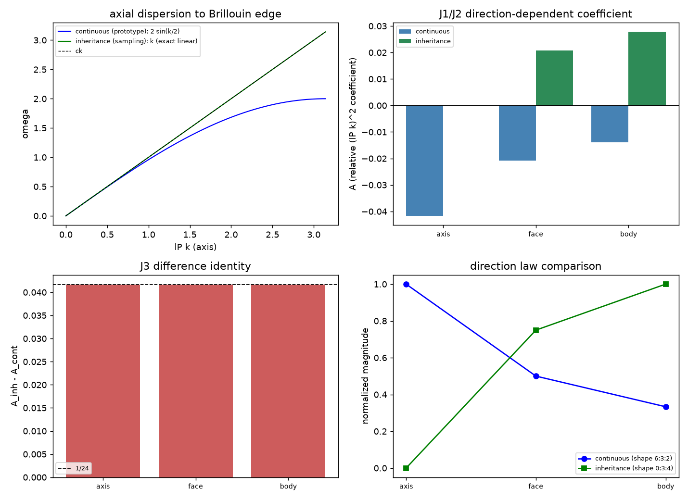

# 注记-轴向偏折的判决性判据（第440条）：两条色散路线的方向律与差异恒等式

- **日期**：2026-09-26 11:24:02
- **脚本**：`minimal_verification_axial_dispersion.py`（工作区根目录执行）
- **主题**：连续时间路线（原型层）与变率继承规则（采样层）的三维方向律对照：前者系数 $-F/24$、方向比 $6{:}3{:}2$，后者系数 $+(1-F)/24$、方向比 $0{:}3{:}4$（轴向精确为零），两者之差在任意方向恒为 $1/24$
- **判据结果**：3/3（J1、J2、J3），并附轴向数值演化核验
- **可逆性等级**：判据敏感（换色散构造或换时间层即翻）
- **图**：见 §3 图 1

## 1 模型设定

两路线的三维色散：连续时间（原型层）$\omega = \frac{2}{t_P}\sqrt{S}$，变率继承（采样层）$\omega = \frac{2}{t_P}\arcsin\sqrt{S}$，其中 $S = \sum_a\sin^2(k_a l_P/2)$。长波展开给出

$$\text{连续}: \omega = ck\left[1 - \frac{F\,l_P^2k^2}{24}\right],\qquad \text{继承}: \omega = ck\left[1 + \frac{(1-F)l_P^2k^2}{24}\right],\qquad F = \frac{\sum_a k_a^4}{k^4},$$

三方向取值 $F = 1$（轴向）、$1/2$（面对角）、$1/3$（体对角）。$A$ 指 $(l_Pk)^2$ 阶相对修正系数。

## 2 判据与结果

| 方向 | $F$ | 连续 $A$ 实测 | 连续期望 | 继承 $A$ 实测 | 继承期望 | 差（继承减连续） |
|---|---|---|---|---|---|---|
| 轴向 | $1$ | $-0.04166667$ | $-1/24$ | $+0.00000000$ | $0$ | $+0.04166667$ |
| 面对角 | $1/2$ | $-0.02083333$ | $-1/48$ | $+0.02083333$ | $+1/48$ | $+0.04166667$ |
| 体对角 | $1/3$ | $-0.01388889$ | $-1/72$ | $+0.02777778$ | $+1/36$ | $+0.04166667$ |

轴向数值演化核验（$l_Pk = 0.1$）：连续 Verlet 实测 $\omega = 0.09995840$ 对解析 $0.09995834$，相对差 $6.5\times10^{-7}$；继承递推实测 $0.10013044$ 对解析 $0.10000000$，相对差 $1.3\times10^{-3}$（过零量化）。

三条判据：J1 连续路线方向律 $-F/24$；J2 继承规则方向律 $+(1-F)/24$ 且轴向为代数零；J3 两路线之差恒为 $1/24$，与方向无关。

## 3 图

## 4 过程记录

其一，测频因子错。首版用过零间隔算频率，把"下降过零每周期一次"误当作半周期一次，读数恰为解析值的一半（连续 0.04997920 对 0.09995834）。修正后相对差 $6.5\times10^{-7}$。教训：过零法测频必须先确认过零事件的周期重数（上升与下降各一次，或只取一种）。

## 5 严格程度与边界声明

严格：J1、J2 的展开系数与 J3 的差异恒等式均为代数结果（提取残差在 $10^{-8}$ 量级，容差 $10^{-6}$）。

判据敏感：换色散构造（如三维各向异性差分、更远程耦合）或换时间层，三条判据的结论即翻。

验证什么：两条路线的三维方向律、差异恒等式、轴向两路线的数值演化一致性。

不验证什么：哪一层是物理层（该问题由层级裁决确定，见关联段的裁决记录）；观测层面的短波色散测量本身。

判决性读法：轴向是两条路线差别最大的方向（连续给 $-4.17\%$ 的相对修正，继承给零，差 $4.17\%$），而面对角与体对角两点上两者符号相反、量值相同。因此轴向偏折的观测是判别两层的判决性判据：若轴向存在 $(E/E_P)^2$ 量级的偏折，采样层描述被排除；若轴向偏折为零而斜向非零，则支持采样层。本轮的层级裁决（作者 2026-09-26，短波以连续时间方程为准）与此判据并行，不因本判据而改变。

## 6 关联

- 层级裁决与三判据：[[验证脚本/注记-惯性微观来源的三判据（第438条）：二阶性对照、惯性系数不可观测与两侧同源|第438条]]；[[内部草稿/注记-惯性的微观来源：变率继承与二阶动力学的结构必然性]]
- 时间层依据：[[时间的三层生成结构：原初连续、内生离散与次级连续的被采样]]
- 洛伦兹破坏的既有预言：[[元相子振荡晶格的色散关系：低能光速涌现与洛伦兹破坏首阶项]]
- 正稿：[[规范作用量的审计必然性：从净值审计到电磁场作用量的推导与数值验证]]
