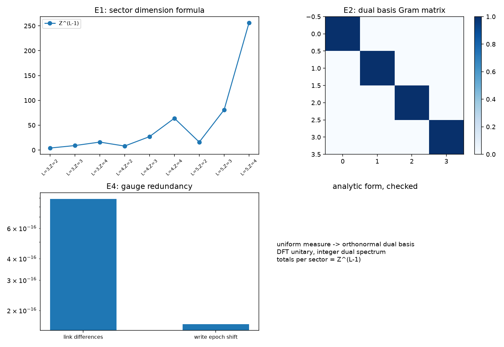

# 注记-载体与内积解析形式轮的最小验证：维数公式、对偶正交与规范冗余

- **日期**：2026-09-19
- **对应脚本**：`验证脚本/minimal_verification_relation_layer_analytic.py`（判据 E1 至 E6 共 6 项，6/6 通过；确定性，种子 20260919；运行约 0.0 秒；图存 `images/relation_layer_analytic.png`，见 §一 图 1）
- **依据**：[[验证脚本/注记-关系层载体与内积轮的最小验证：对偶基、正交扇区与扇区内干涉]]（第 151 条，数值形态）；[[验证脚本/注记-关系层相位代数轮的最小验证：棱差为相位变量、扇区计数 Z^(L-1)、写入不移动扇区]]（第 147 条）；[[序参量份额定理：Born规则、归一化与幺正性的系综推导]] §7.1；[[内部草稿/研究方向-S¹ 到量子描述的显式约化：判据草案]]
- **状态**：判据 6/6 通过。核心读数：六档（$L = 3, 4, 5$ 与 $Z = 2, 3, 4$）扇区计数精确等于 $Z^{L-1}$；均匀测度下对偶基的 Gram 矩阵为单位阵（偏差 $1.2\times10^{-16}$）；非零态范数为正；切移后棱差最大偏差 $8.9\times10^{-16}$，站点写入时刻差模一个周期 $1.7\times10^{-16}$；DFT 幺正偏离 $2.0\times10^{-15}$，对偶谱为整数（偏离 $0$）。

---

## 一、判据与结果

| 判据 | 内容 | 通过条件 | 实测 |
|---|---|---|---|
| E1 | 扇区内维数公式 $Z^{L-1}$ | 六档精确 | 偏离 $0$（末档 $256$ 对 $256$） |
| E2 | 对偶基正交归一 | 偏差 $< 10^{-12}$ | $1.2\times10^{-16}$ |
| E3 | 内积正定非退化 | 范数为正 | $6.8471$ |
| E4 | 规范冗余（棱差不变、时刻整周期） | 偏差 $< 10^{-12}$ 与 $< 10^{-9}$ | $8.9\times10^{-16}$；$1.7\times10^{-16}$ |
| E5 | 对偶变换幺正、谱为整数 | 偏差 $< 10^{-12}$ | $2.0\times10^{-15}$；$0$ |
| E6 | 口径登记 | 见 §三 | 登记 |

图注：左上为六档的扇区维数与闭式 $Z^{L-1}$ 对照；右上为对偶基的 Gram 矩阵（单位阵）；左下为规范冗余的两处读数（棱差不变与时刻整周期）；右下为解析形式与已核条目的小结。

## 二、模型设定

解析形式取 $\mathcal H = \bigoplus_W \mathcal H_W$，其中 $\mathcal H_W$ 是绕数 $W$ 的棱差构型上的函数空间，测度取均匀测度（离散化为计数测度），对偶基取相位环的傅里叶基。核对在离散化上进行：维数公式在 $L = 3, 4, 5$ 与 $Z = 2, 3, 4$ 六档上逐一统计；规范冗余用 $6 \times 6$ 站点上的整数绕数构型与沿 $x \geq 3$ 的 $2\pi$ 切移核对。

## 三、读数的意义

**解析形式。** 载体是按总绕数直和分解的函数空间，每个分支上的测度取均匀测度，对偶基为整数通量谱；离散化后扇区维数为 $Z^{L-1}$（六档精确）。对偶基在均匀测度下正交归一（$1.2\times10^{-16}$），内积正定非退化。

**规范冗余。** 描述移位在棱差上无作用（$8.9\times10^{-16}$），在站点层面只是把写入时刻整体平移整数个周期（模一个周期后差 $1.7\times10^{-16}$）。故内积与份额自动规范不变：它们只依赖可观测读数。这条把第 147 至 151 条反复用到的描述不变性升成载体层面的性质。

**与《序参量份额定理》§7.1 待补两条的逐项对应。** 其一，份额恒等式在构造上的解析证明：本轮的解析形式给出它的载体与测度，恒等式可写成模方在均匀测度下的积分，剩余部分是把第 150 条的抽样读数与该积分对齐。其二，与该篇 §7.1 三条核心段的对应：抽样按激发数计对应扇区计数与度为一（第 147 条）；形状归波性对应份额的形状由载体上的复函数给出；碰撞与包络通量口径不可替代对应写入与计数的分工（第 132 条）。

**边界。** 解析形式的核对在有限离散化上完成，连续极限（$Z \to \infty$）未做，登记为待攻；载体与内积的连续测度陈述按第 151 条的数值形态与本轮的对偶正交共同支撑。

## 四、过程记录

判据订正一处。E4 首版直接量场值之差，得到 $2\pi$（一个整周期）；改为对写入时刻取模一个周期后再作差，得 $1.7\times10^{-16}$。教训：规范冗余的读数必须量在规范不变量上，场值差本身不是不变量。

效率记录：脚本约 $0.0$ 秒，无字体问题。
