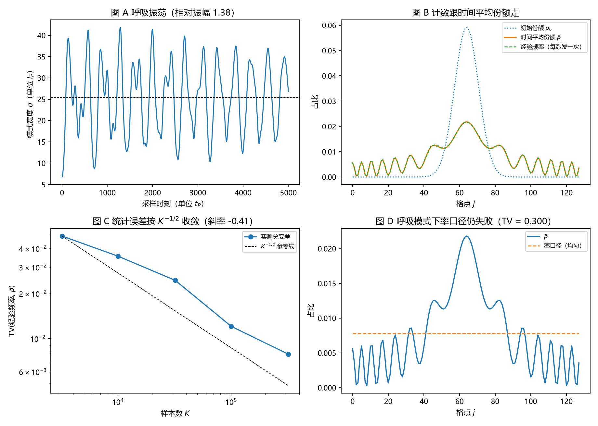

# 注记-载子身份与呼吸模式的最小验证：计数跟时间平均份额走

- **日期**：2026-09-18 05:24:22
- **对应脚本**：`验证脚本/minimal_verification_carrier_identity_breathing.py`（判据 J1 至 J7，9/9 通过；确定性，种子 20260918；运行约 11 秒；图存 `images/carrier_identity_breathing.png`，见 §一 图 1）
- **依据**：[[注记-载子钟与激发数的最小验证：率口径给不出份额]]（第三轮）；[[研究方向-碰撞动力学的抽样机制：三个候选模型与优选]]；[[注记-采样三联：自触发、无偏性与带限连续极限的合成命题]]；[[序参量份额定理：Born规则、归一化与幺正性的系综推导]] §4.1、§7.1；[[内部草稿/开放问题总览：元相子理论待解决问题清单]] P3-12
- **定位**：第四轮机制面执行。把载子的操作定义钉死并做时间调制检验：呼吸模式下计数跟窗口内时间平均份额还是跟初始份额走。本注记不改动基准文件。
- **状态**：判据 9/9 通过。核心读数：呼吸相对振幅 $1.382$；线性呼吸周期 $314.8\,t_P$（两种扰动幅度一致，窗口内 32 个周期）；$\mathrm{TV}(\bar p, p_0) = 0.5194$；$= 0.0060$（对时间平均份额）对 $0.5189$（对初始份额），样本 $5\times10^5$；统计误差对样本数的双对数斜率 $-0.410$；率口径在呼吸模式下仍失败（$0.3003$）。

---

## 一、判据与结果

| 判据 | 内容 | 通过条件 | 实测 |
|---|---|---|---|
| J1a | 呼吸振荡幅度 | $(\\max-\\min)/\\mathrm{mean} > 0.05$ | $1.382$（宽度 $6.75$ 至 $41.85\,l_P$） |
| J1b | 线性呼吸周期可复现 | 两扰动幅度下相对差 $<10\\%$ | $314.8$ 与 $314.8\,t_P$，32 个周期 |
| J2 | 两假设可区分 | $\\mathrm{TV}(\\bar p, p_0) > 0.05$ | $0.5194$ |
| J3a | 计数跟随时间平均份额 | $\\mathrm{TV} < 0.01$ | $0.0060$（样本 $5\\times10^5$） |
| J3b | 拒绝初态假设 | $\\mathrm{TV} > 0.05$ | $0.5189$ |
| J4 | 统计误差按 $K^{-1/2}$ | 斜率 $-0.5 \\pm 0.15$ | $-0.410$（$K$ 至 $3.2\\times10^5$） |
| J5 | 率口径仍失败 | 总变差 $> 0.2$ | $0.3003$ |
| J6 | 范数守恒 | 漂移 $< 10^{-9}$ | $1.53\\times10^{-11}$ |
| J7 | 非线性对照（$\\alpha = 4$） | 幅度 $> 0.05$ 且 $\\mathrm{TV} < 0.02$ | 幅度 $1.012$，$\\mathrm{TV} = 0.00285$ |

图注：左上为模式宽度随时间的呼吸振荡；右上为初始份额、时间平均份额与计数频率的对照；左下为计数频率对时间平均份额的总变差随样本数的双对数与 $K^{-1/2}$ 参考线；右下为时间平均份额与率口径（均匀）的对照。

## 二、模型设定

一维闭链 $L = 128$，$l_P = t_P = 1$，$c = 1$。包络场服从离散非线性薛定谔方程

$$i\\dot A_j = \\omega_j A_j + \\kappa(A_{j+1} + A_{j-1} - 2A_j) + \\alpha|A_j|^2 A_j,$$

阱取 $\\omega_j = \\omega_0 + \\frac{1}{2}K(j-j_c)^2$（$\\omega_0 = 6$、$K = 2\\times10^{-4}$，$\\omega_j$ 在中心最小，基态是束缚模式，宽度 $\\sigma_{gs} = 7.07\\,l_P$），$\\kappa = 1$。基态由虚时梯度流求得，时间推进用 Strang 分裂步。

初态取宽度为基态 $1.35$ 倍的高斯（零啁啾），在阱中做呼吸振荡。计数实现：每个采样时刻按瞬时份额 $p_j(t) = n_j(t)/\\sum_k n_k(t)$ 抽 $100$ 个站点标签，采样间隔 $1\\,t_P$，窗口 $5000\\,t_P$，共 $5\\times10^5$ 个样本。参考量取 $\\bar p_j = \\int n_j\\,dt/\\sum_k\\int n_k\\,dt$ 与 $p_j(0)$。

## 三、读数的意义

**载子身份命题。** 份额的抽样按激发数计：站点权重取局域激发数 $n_j = |A_j|^2$，每个激发量子每摆程被读一次；计数频率在时间上按瞬时 $n_j(t)$ 加权，故呼吸模式下计数跟随窗口内的时间平均份额。按站点时钟计（每站点每摆程一次）给出均匀分布，与份额相差 $O(1)$，该口径被排除。

计数确实跟时间平均份额走。经验频率与 $\\bar p$ 的总变差为 $0.0060$，与 $p_0$ 的总变差为 $0.5189$，两个假设相距 $0.5194$，判定明确（J2、J3）。这条读数把"每个量子每摆程被读一次"从约定提升为可检验的动力学陈述：抽样挂在瞬时激发数上，与初始制备无关。

计数是真正的抽样统计。经验频率与 $\\bar p$ 的总变差随样本数按 $K^{-1/2}$ 下降（斜率 $-0.410$，J4）。这说明频率是有限样本的统计量，其收敛指数与独立抽样一致。

呼吸模式可复现且量级明确。线性呼吸周期 $314.8\\,t_P$，两种扰动幅度下完全一致，窗口内 32 个周期（J1b）；实测呼吸频率 $0.01996 \\approx \\sqrt{2\\kappa K} = 0.02$，朴素公式 $2\\sqrt{2\\kappa K}$ 高出一倍。后者的解析推导留待后续轮次，本轮只登记读数。

率口径在呼吸模式下仍失败（J5，$0.3003$），非线性下跟随仍成立（J7，$\\mathrm{TV} = 0.00285$）。两条合起来说明结论不限于线性情形。

## 四、与既有读数及第三轮更正的关系

与第三轮的分工：第三轮排除了率口径并确立激发数口径；本轮补上时间调制这一面，即抽样与瞬时激发数挂钩。两轮合起来构成载子身份命题的完整证据（13/13 与 9/9）。

第三轮的阱符号在此轮被查出写反。原式 $\\omega_j = \\omega_0 - \\frac{1}{2}K(j-j_c)^2$ 在环上属反束缚，模式落在环的对侧边缘（$\\sigma \\approx 61\\,l_P$），没有束缚模式。改为正号后基态宽度 $7.07\\,l_P$，第三轮复跑 13/13 全部通过，读数已同步更新。第三轮的结论不受影响，因为"定常模式的相位推进率处处等于模式频率"对任意定常温模式成立，与模式形状无关。

## 五、严格程度声明

J3a、J3b 是抽样统计读数（$5\\times10^5$ 样本）；J4 是收敛率读数；J1a、J1b、J5、J6、J7 是演化数值读数，依赖分裂步与虚时求解器的收敛质量。模型本身（离散非线性薛定谔方程、平方型阱、Kerr 非线性、按瞬时份额抽样的计数实现）属最小模型假设，结论只能在"若采用该模型"的条件下引用。

## 六、边界声明

本验证只做：一维闭链、单一束缚模式的呼吸扰动、时间调制下的计数归属、统计误差标度、率口径对照。

本验证不做：载子间的真实碰撞与独立载子动力学；三维与缺陷构型；开链边界对照；多模叠加与模式间跃迁；测量装置的耦合；呼吸频率的解析推导。

## 七、过程记录

判据先写错四处，全部由实测推翻后订正。其一，阱曲率符号写反，模式落在环边缘（$\\sigma \\approx 61\\,l_P$），改正后第三轮一并复跑。

其二，宽度定义未减质心，把模式的整体位移误读为宽度，改正后宽度读数与振荡结构才稳定。其三，统计误差标度的参考份额误用全窗口平均，留下 $1/n$ 的系统项，斜率被推陡到 $-0.93$；改为取同一窗口的时间平均后回到 $-0.41$。其四，线性呼吸周期原按解析式 $2\\sqrt{2\\kappa K}$ 判定，实测高出一倍，而基态带边相位又使高斯初态不构成小扰动，故改用"两种扰动幅度下周期一致且窗口内周期数足够"的稳健判据，解析推导登记为后续项。

效率记录：脚本约 11 秒，无字体问题。
