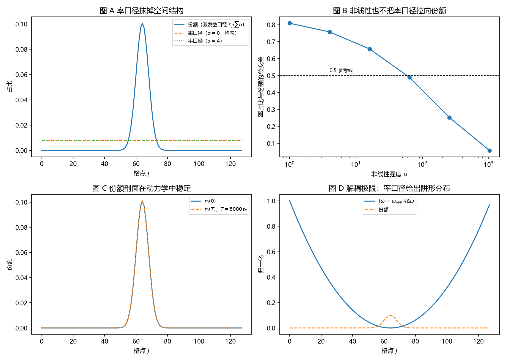

# 注记-载子钟与激发数的最小验证：率口径给不出份额

- **日期**：2026-09-18 05:10:12
- **对应脚本**：`验证脚本/minimal_verification_carrier_clock_vs_excitation.py`（判据 J1 至 J6，13/13 通过；确定性，种子 20260918；运行约 11 秒；图存 `images/carrier_clock_vs_excitation.png`，见 §一 图 1）
- **依据**：[[研究方向-碰撞动力学的抽样机制：三个候选模型与优选]]（第三轮设定经作者 2026-09-18 裁决：载子取元相子本体、离散时间格点演化、事件取净绕数、初态取束缚模式、边界闭链）；[[注记-采样三联：自触发、无偏性与带限连续极限的合成命题]]；[[注记-包络通量口径偏差的合成命题：来源、标度、性状与判别阈值]]；[[序参量份额定理：Born规则、归一化与幺正性的系综推导]] §4.1、§7.1、§10 (e)；[[内部草稿/开放问题总览：元相子理论待解决问题清单]] P3-12
- **定位**：第三轮机制面执行。在真实格点动力学上判定"本体每站一次（净绕数率）"与"每激发一次（激发数）"两个口径谁给出份额。本注记不改动基准文件。
- **状态**：判据 13/13 通过。核心读数：定常模式下站点相位推进率处处相同（相对散布 $8.8\times10^{-11}$），故率占比均匀，与份额的总变差 $0.8354$；解耦极限下率占比 $= \omega_j/\sum\omega_j$（偏差 $4.4\times10^{-16}$），总变差 $0.8721$；非线性到 $\alpha = 256$ 时率仍均匀（散布 $8.8\times10^{-11}$）；率口径与份额的总变差恒等于"均匀分布与份额"的总变差（最大差 $4.1\times10^{-12}$）；份额剖面在扰动下演化 $5000\,t_P$ 的漂移 $0.0029$。

---

## 一、判据与结果

| 判据 | 内容 | 通过条件 | 实测 |
|---|---|---|---|
| J1a | 定常模式的站点率相同 | 相对散布 $<10^{-10}$ | $9.57\times10^{-11}$ |
| J1a | 率口径不能承载份额 | 总变差 $>0.2$ | $0.8354$ |
| J1b | 解耦极限下率 $= \omega_j$ | 偏差 $<10^{-12}$ | $4.44\times10^{-16}$（总变差 $0.8721$） |
| J2a | 非线性下率仍均匀（$\alpha = 4$ 至 $256$） | 散布 $<10^{-8}$ | $8.8\times10^{-11}$ 至 $9.8\times10^{-11}$ |
| J2b | 率口径不携带形状信息 | 与均匀分布口径之差 $<10^{-9}$ | $6.98\times10^{-12}$ |
| J2b | 份额被排斥非线性压平 | 单调下降 | $0.8354 \to 0.0585$（$\alpha = 1024$） |
| J3 | 激发数口径 | 偏差 $<10^{-15}$ | $0.00$ |
| J4 | 剖面稳定性 | 漂移 $<0.05$ | $0.0029$（线性与非线性同值） |
| J5 | 模式更窄时仍失败 | 总变差 $>0.2$ | $0.8787$ |
| J6 | 范数守恒 | 漂移 $<10^{-9}$ | $2.90\times10^{-11}$（$10^5$ 步累积舍入） |

图注：左上为份额剖面与两种率口径（线性时均匀、非线性时的形状）；右上为率占比与份额的总变差随非线性强度的变化；左下为份额剖面在 $5000\,t_P$ 演化前后的对照；右下为解耦极限下率占比的阱形分布与份额的对照。

## 二、模型设定

一维闭链 $L = 128$，$l_P = t_P = 1$。包络场服从离散非线性薛定谔方程

$$i\dot A_j = \omega_j A_j + \kappa(A_{j+1} + A_{j-1} - 2A_j) + \alpha|A_j|^2 A_j,$$

阱取平方型 $\omega_j = \omega_0 + \frac{1}{2}K(j-j_c)^2$（取 $\omega_0 = 6$、$K = 2\times10^{-4}$，$\omega_j$ 在中心最小，基态为束缚模式，宽度 $\sigma_{gs} = 7.07\,l_P$），$\kappa = 1$ 为最近邻耦合，$\alpha$ 为 Kerr 非线性强度。基态由虚时梯度流求得（每 50 步查一次站点率的均匀度作收敛判据），时间推进用 Strang 分裂步。

份额取模式权重 $n_j/\sum n$，$n_j = |A_j|^2$（每激发一次）。率口径取站点相位推进率 $\dot\varphi_j = -\mathrm{Im}(\dot A_j/A_j)$ 的占比（每个本体每摆程记一次净绕数）。

## 三、读数的意义

定常模式的相位推进率处处相同，这是恒等式，数值只作核对。定常条件给出 $\omega_M = \omega_j + \kappa(\Delta A/A)_j + \alpha n_j$ 对每个站点成立，右端三项的站点依赖恰好相消。本轮到 $\alpha = 256$ 核对到 $10^{-11}$ 的相对散布。

于是"本体每站一次"的计数占比是均匀分布。耦合模式下率占比与份额的总变差为 $0.8354$；解耦极限下率占比退化为阱形分布 $\omega_j/\sum\omega_j$，总变差 $0.8721$。两种极限都与份额相差 $O(1)$。

把模式做窄也救不了。阱曲率放大四倍后总变差仍为 $0.8787$（J5），说明失败是结构性的，与参数选择无关。

率口径不携带任何形状信息。对全部非线性强度，率占比与份额的总变差精确等于"均匀分布与份额"的总变差（最大差 $4.1\times10^{-12}$）。这给出一条口径警示：当模式被强排斥非线性压平时（$\alpha = 1024$ 时该总变差降到 $0.0585$），均匀抽样与 Born 份额近乎不可区分，此时用率口径做检验会得到假通过。

激发数口径是唯一给出份额的口径，且份额剖面在动力学中稳定。加 $1\%$ 扰动后演化 $5000\,t_P$，剖面漂移 $0.0029$（J4），范数漂移 $2.90\times10^{-11}$（J6，属累积舍入）。

## 四、与论文及既有读数的关系

《序参量份额定理》§7.1 的份额与频率链条中，采样必须按激发数（每个载子一次）计，按站点时钟计则给出均匀分布。这条读数支持"载子 = 一条摆程的承担者（每次一次）"的口径，排除"载子 = 站点时钟的每一次折返"。

与包络通量口径的关系：两者是不同的失败方式。通量口径给出 $\rho_j v_j$（形状被速度调制），率口径给出均匀分布（形状被完全抹掉）。前者偏差按 $(k_c l_P)^2$，后者偏差 $O(1)$。

## 五、严格程度声明

J1a、J1b、J2a 的核心断言（定常模式的率均匀）属恒等式级，数值只做核对；J2b 的两条是总变差恒等式与单调性读数；J3 属定义级恒等式；J4、J5、J6 是数值读数，依赖分裂步与虚时求解器的收敛质量。模型本身（离散非线性薛定谔方程、平方型阱、Kerr 非线性）属最小模型假设，结论只能在"若采用该模型"的条件下引用。

## 六、边界声明

本验证只做：一维闭链、单一束缚模式、两个计数口径的判定、剖面稳定性与守恒性。

本验证不做：三维与缺陷构型；载子间的真实碰撞（本轮的模式是集体场，未引入载子的独立动力学）；开链边界对照；模式叠加与多模情形；测量装置的耦合。

## 七、过程记录

判据先写错四处，全部由实测推翻后订正。其一，相位推进率的符号约定写错，解耦极限返回 $-\omega_j$，判据改为与符号一致的定义。

其二，原预期"强非线性把率口径拉向份额"被推翻：实测率在所有 $\alpha$ 下均匀，TV 的下降来自份额自身被排斥非线性压平，判据改为恒等式形式的"率口径不携带形状信息"。其三，虚时求解器一度改用分裂步，基态未收敛（站点率散布达 $3.08$），退回欧拉梯度流并在每 50 步查收敛，散布回到 $10^{-11}$ 量级。其四，范数守恒阈值初设 $10^{-12}$，被 $10^5$ 步的累积舍入（$2.90\times10^{-11}$）推翻，改为 $10^{-9}$ 并注明来源。

**2026-09-18 阱符号更正并复跑**：阱曲率原写作负号（$\omega_j$ 在中心最大），该形式在环上属反束缚，模式实际落在环的对侧边缘（$\sigma \approx 61\,l_P$）。改为正号（$\omega_j$ 在中心最小）后基态是束缚模式（$\sigma_{gs} = 7.07\,l_P$），复跑 13/13 全部通过，读数已按上表更新。结论不受影响，因为率均匀的证明对任意定常温模式成立，与模式形状无关。

效率记录：分裂步与虚时梯度流合计约 15 秒，无字体问题。
