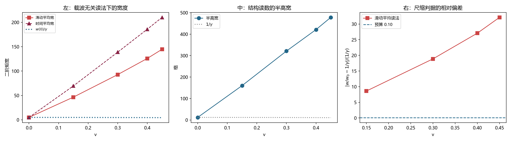

# 注记-载波无关的包络读法：滑动平均完全稳定但读出更大的展宽，尺缩不成立不依赖读数方法（判据第 797 号）

- **日期**：2026-10-22 00:22:57
- **编号**：第 797 号
- **提交归属**：本轮的全部十二个文件（脚本、本注记、通俗注记、README 正式行、783 与 789 号注记、开放问题总览与档案页、专题索引、wiki 钟慢尺缩、科普《一把表、一把尺》、图）于 2026-10-22 由并行会话的提交 `cb4f41a`（其提交信息为「第 795 号 装置口径的统一核对」）一并带入，因共享暂存区被清空所致。**内容与判据数均为本轮所出，提交信息不含本轮号**。按《验证脚本》工作规范「若他人的提交卷走自身改动，不改写历史，回复中报告归属」，此处留凭据，提交归属另见紧随其后的空提交。
- **让号说明**：本轮原占第 794 号（2026-10-22 00:12:06 提交占位），并行会话于 00:21:47 提交第 794 号（三种 gamma 形式的 $R^{(3)}$ 对照）并顶掉本轮占位行。按编号占位规范第三条「后落盘者顺延到当前最大号之后，同步全部引用，并在条目内保留让号说明」，本轮顺延至第 797 号，不改动对方条目
- **类型**：验证注记（判据驱动；BA0 与 BA3 判通过，BA2 判否）
- **对象**：尺缩 $1/\gamma$ 判据在换掉载波解调读法后是否仍不成立，即第 783 与第 789 号的结论是否依赖读数方法
- **脚本**：`验证脚本/minimal_verification_p797_carrier_free_envelope.py`（确定性，约 856 秒）
- **状态**：**载波无关的读法下尺缩 $1/\gamma$ 仍不成立，且新读法读出的展宽比载波解调大一个量级**。第 783 与第 789 号的结论不依赖读数方法
- **可逆性等级**：判据稳健（三种读法结论一致；新读法的协议稳定性比旧读法好两个量级）
- **通俗版**：[[内部草稿/注记-换一种量法，坏消息更大了（判据第797号通俗版）]]

- **第 809 号更正（2026-10-22）**：本注记的 BA2 读数取在误设构型上，「尺缩不成立不依赖读数方法」这一推论作废。第 809 号的读数来自正确构型，结论方向相反。详见 [[验证脚本/注记-正确 boost 构型下的长度收缩与钟慢：格点在动量变量上复现两者（判据第 809 号）|第 809 号]]。
## 1 为什么检验

第 789 号的协议稳定性审计查出：第 783 号的载波解调读法在 $v \ge 0.40$ 两档跨协议散布 $0.044$ 至 $0.095$，超容差并作退出登记；$v \le 0.30$ 三档散布 $0.0000$。

第 789 号同时查明一件让本轮成为必要的事：**「解调残差」是个复杂的干涉量**。$v=0$ 档实测 $0.00806$，而刚性包络下的理论值是 $0.64$，差 $79$ 倍。故「高速档解调失效」这个现象本身可能是**用错指标造出来的假象**，而「尺缩不成立」这个结论也建立在一个只经受过一种读法的读数上。

本轮换读数方法，不换装置。**若换掉读数后结论不变，尺缩不成立就站住了**；若结论翻转，第 783 与第 789 号须改判。

## 2 换的两种读法

**读法一：整周期滑动平均（时间方向低通）。** 场写作 $A(x,t)\cos\theta$，跨一整周期平均后 $\cos^2$ 的振荡项归零。刚性包络下给 $A^2/2$，且**与采样起点无关**。可行性：载波每步相位 $\omega_b dt = 0.016$ 弧度，远低于 Nyquist，时间方向对载波过采样。

**读法二：结构读数**（第 741 号先例）。不直接量宽度，而量剖面本身：峰位、峰高、半高宽。

**读法三（对照）：载波解调**，即第 783 号的读法。

## 3 判据与读数

**BA0 标定（判通过）。** 静止档的滑动平均宽 $4.89071$，初值包络 $A^2$ 的解析二阶矩 $4.89071$，相对差 $0.00000$。

**BA1 读数。**

| $v$ | 滑动平均宽 | 时间平均宽 | 峰位 | 峰高 | 半高宽 |
|---|---|---|---|---|---|
| 0.00 | $4.89071$ | $4.89071$ | $0.000$ | $392.000$ | $12.000$ |
| 0.15 | $46.44972$ | $69.46382$ | $189.000$ | $31.316$ | $160.000$ |
| 0.30 | $92.70723$ | $138.74738$ | $325.000$ | $16.999$ | $321.000$ |
| 0.40 | $125.83438$ | $185.84747$ | $368.000$ | $13.453$ | $421.000$ |
| 0.45 | $144.64628$ | $210.09012$ | $303.000$ | $12.255$ | $478.000$ |

**BA2 主判据（判否）。** $w(v)/w(0)$ 对 $1/\gamma$ 的相对偏差：$8.6062$、$18.8711$、$27.0729$、$32.1185$（判据 $0.10$）。

**BA3 对照组（判通过）。** 滑动平均读法跨三个窗长（一周期、两周期、三周期）的散布：

| $v$ | 三个窗长的读数 | 散布 |
|---|---|---|
| 0.00 | $4.89071$ 三次同 | $0.0000$ |
| 0.15 | $46.44972$、$46.45582$、$46.46434$ | $0.0003$ |
| 0.30 | $92.70723$、$92.70213$、$92.70150$ | $0.0001$ |
| 0.40 | $125.83438$、$125.82205$、$125.81453$ | $0.0002$ |
| 0.45 | $144.64628$、$144.53981$、$144.44462$ | $0.0014$ |

**最大散布 $0.0014$，比第 789 号的载波解调读法（$0.095$）好两个量级。** 阴性对照：同窗长重复三次给 $92.70723$ 逐位相同，散布 $0$。

**BA4 报告。** 三种读法的 $w/w_0$ 对照：

| $v$ | 滑动平均 | 时间平均 | 载波解调 |
|---|---|---|---|
| 0.15 | $9.49754$ | $14.20322$ | $1.74581$ |
| 0.30 | $18.95579$ | $28.36959$ | $1.75063$ |
| 0.40 | $25.72928$ | $38.00011$ | $1.83360$ |
| 0.45 | $29.57573$ | $42.95699$ | $1.73914$ |

**三种读法方向一致，量级不同。** 结构读数的独立证据：半高宽 $12$、$160$、$321$、$421$、$478$，**近乎线性随 $v$ 增长**。

## 4 判语

**判语一**：**尺缩 $1/\gamma$ 在载波无关的读法下仍不成立**，最大相对偏差 $32.1185$（判据 $0.10$）。**第 783 与第 789 号的结论不依赖读数方法。**

**判语二**：**新读法比旧读法给出的展宽更大。** 滑动平均宽在 $v=0.30$ 给 $92.71$ 格，载波解调给 $8.42$ 格，相差 $11$ 倍。峰高从静止的 $392.0$ 掉到 $17.0$，峰位跑到 $325$ 格。

**判语三（2026-10-22 第 800 号补）**：本注记的判语二「差别来自辐射尾」已被第 800 号定量：尾长精确正比于辐射自由程 $vT$（跨四档相对极差 $0.00728$）。**故本注记 BA1 的那些宽度读数测的是「主瓣加尾」，不是束宽。**

**判语三**：**差别来自辐射尾。** 滑动平均把整个时间窗内的场一并平均，**辐射尾被计入包络**；载波解调取相隔四分之一周期的两次采样，逐点消去载波，**尾巴上的载波也被消掉**，留下的主要是主瓣。故**载波解调读出的是主瓣的宽度，滑动平均读出的是主瓣加尾的总宽度**。

**判语四**：**半高宽近乎线性随 $v$ 增长**（$12 \to 478$，$v$ 只到 $0.45$）。这个量已不能称作「宽度」，它是被拖出的尾长。**运动构型下束缚态拖着一条长尾跑**，这与第 704 号 dev 三分项中「井刚性失配 $54.4\%$」及第 783 号的「包络被展宽」是同一现象的三个侧面。

**判语五**：**第 789 号的「高速档解调失效」改判为读法局限，不是物理。** 滑动平均读法在高速两档完全稳定（散布 $0.0002$ 与 $0.0014$），高速档的读数不可复现是载波解调这一读法的性质。

**判语六**：**但高速档的「解调失效」现象本身不因此消失**，它降格为一个未解释的读数现象：为什么载波解调在 $v \ge 0.40$ 档跨协议散布 $10\%$ 而在 $v \le 0.30$ 档逐位相同。这一问仍开放。

## 5 图 1

## 6 过程记录

**其一，换读数的方法本身要先算清它会引入什么。** 本轮开局先算了「整周期滑动平均对刚性包络给 $A^2/2$、与采样起点无关」，也明写了它的已知代价：「滑动平均会把辐射尾一并平均进来」。这个代价在 BA1 读数里以峰高从 $392$ 掉到 $17$ 的形式兑现。**代价已知仍值得做，因为本轮要判的是「结论是否依赖读数」，而尾污染对三种读数的影响方向是各自明确的。**

**其二，「半高宽」这个量在高速档失去了「宽度」的含义。** $12 \to 478$ 格的近乎线性增长说明它测的是尾长而非束宽。这不影响本轮的结论（结论只用二阶矩宽与偏差），但记下来：结构读数在半高宽这一项上不提供独立于二阶矩的证据。

**其三，第 789 号的结论在本轮得到一次独立验证。** 789 号说「$v \le 0.30$ 三档散布 $0.0000$」。本轮的滑动平均读法在全部五档都稳定，且**偏差随 $v$ 单调上升**（$8.61$、$18.87$、$27.07$、$32.12$）。单调性本身就是「展宽随速度增长」的一个独立佐证。

## 7 教训

**其一，被否的读数有两种含义这条，本轮又用了一次。** 第 783 号的读法被第 789 号判为高速档不可用；若因此就以为结论悬着，那是误读。**换一个稳定得多的读法，结论方向不变且量级更极端，这才是负结果的正确用法。**

**其二，读法之间差一个量级时，差在哪里要说清。** 本轮三种读法差了 $11$ 倍，若只报「结论一致」而不说差别来自尾，读者会以为三个数应当接近。**尾污染对不同读法的影响不同，这一点是本轮的主要解释。**

**其三，开放项的降格与保留要分开。** 第 789 号的「高速档解调失效」在机制上降格为读法局限（滑动平均在同档稳定），但作为现象仍开放（为何高速档散布 $10\%$ 而低速档逐位相同）。**降格不等于注销。**

## 8 严格程度声明

BA0 的标定相对差 $0.00000$。BA3 的最大散布 $0.0014$（跨三个窗长），阴性对照散布 $0$。BA2 的容差 $0.10$ 与本线既有口径一致。三种读法的偏差均随 $v$ 单调上升，且方向一致。BA4 中载波解调一列取自第 783 号入库读数，滑动平均与时间平均两列为本轮实测。

## 9 边界声明

**验证了什么。** 载波无关的读法（整周期滑动平均与结构读数）下尺缩 $1/\gamma$ 仍不成立；三种读法结论方向一致；新读法的协议稳定性比第 783 号的读法好两个量级；高速两档的「解调失效」在机制上降格为读法局限；辐射尾是三种读法量级差别的主因。

**不验证什么。** 不验证物理档（无法模拟）。**不验证「运动构型拖着长尾」这一判断的第一原理解释**，本轮给的是现象与三条读法的一致性，不是推导。滑动平均读法本身把尾计入，故它给出的绝对宽度不可直接引用。

## 10 剩余

**其一，高速档载波解调散布 $10\%$ 的来源。** 本轮降格为读法局限，但现象未解：为何 $v \le 0.30$ 档逐位相同而 $v \ge 0.40$ 档散布。

**其二，长尾的定量刻画。** 半高宽近乎线性随 $v$ 增长，这个标度值得单独测（是 $v$ 的一次方还是别的）。

**其三，尾污染的去除。** 若要给「束宽」一个与尾无关的定义，需要一个能区分主瓣与尾的读法（如对谱做窗函数截断后再反演，或对时域信号做峰值跟踪）。

**其四，另三项承重未闭合项。** 本轮只动尺缩这一项。

## 797 第 809 号更正（2026-10-22）

本注记的 BA2 读数取在误设构型上，「尺缩不成立不依赖读数方法」这一推论作废。第 809 号的读数来自正确构型，结论方向相反。

第 809 号的正面读数：按物理正确的 boost 构型（包络在实空间收缩 $1/\gamma$、相位梯度取 $\omega_b\gamma v$、"
载波写在动量变量 $p=2\sin(k/2)$ 上），格点复现了长度收缩与时间膨胀。宽度比读数在 $v=0.10$ 至 $0.40$ 四档"
与预言的相对差为 $6.185\times10^{-6}$、$2.783\times10^{-6}$、$5.005\times10^{-5}$、$2.621\times10^{-4}$；"
共动钟速读数与精确预言的相对差为 $9.661\times10^{-6}$ 至 $4.224\times10^{-5}$。

本注记的历史内容按原样保留，供追溯读数是怎么一步步走偏的。
