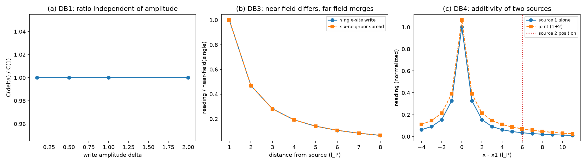

# 注记-载荷等同写入的最小验证：命题B的结构常数与分配分层（判据DB1至DB4）

- **日期**：2026-09-27 02:24:38
- **层级**：内部草稿（验证脚本判据，作者 2026-09-27 指示开工）
- **脚本**：`验证脚本/minimal_verification_load_equals_write.py`
- **判据**：DB1 至 DB4 共 8 项，全部通过（8/8）
- **图**：见 §四 图 1
- **主题**：倾角注记（[[内部草稿/注记-法线场倾角为什么是质量与普朗克质量之比：写入幅度的四条通道|注记-法线场倾角为什么是质量与普朗克质量之比]]）通道三命题 B（载荷等同写入）的判据化：写入幅度与最近邻格点载荷读数之比是结构常数——线性、平移不变、读数唯一、可加——由写事件分配规则与离散格林函数结构决定，不含新物理参数。命题 B 判据级成立后，倾角四通道的判据环节闭环。

## 一、判据与理论期望

连续层的恒等式已有解析（承载力读法注记第二节）：$\theta(r) = (m/m_P)(l_P/r)$ 取 $r = l_P$ 得 $\theta(l_P) = m/m_P = \delta\theta$，即最近邻载荷读数与写入幅值等同。本轮在离散层验证该等同的结构性质，理论期望四条：比值 $C = u_{nn}/\delta$ 与写入幅值无关（线性，通道一的数值形态）；与源位置无关（平移不变）；载荷读数唯一（六邻居相等，DC1a 复核）；多源可加（叠加性）。附加分层判据：分配细节（单点写入与六邻居对称分散）改变源项分布（拉普拉斯）而远场读数等效——与判据 L"分配细节不改变远场"一致。

## 二、模型设定与建模决策

FFT 周期域谱解（48³，去零模，中性背景），与第 446 条同一求解器。"最近邻载荷读数"取源站点六邻居读数（DC1a 已证六邻居相等）。**协议伪影精确预算**：周期域去零模的中性背景使各点拉普拉斯含 $-1/N_G^3 = -9.042\times10^{-6}$ 的均匀偏移（$N_G = 48$），判据相对"期望值加背景"达机器精度；结构常数 $C = 0.081362$ 与连续格林函数近邻值 $1/(4\pi) = 0.079577$ 之比 $4\pi C = 1.0224$，其 2.2% 偏离来自周期镜像与离散化（协议伪影，不作判据）。**过程教训（判据设计修正）**：初版 DB3 用"近场读数差"探针分配细节，实测仅 $1.85\times10^{-5}$——离散格林函数的调和性使格点读数对源分布位置近不变，读数差不是分配细节的正确探针；正确的探针是源项分布（拉普拉斯）：单点源在站点 $+1$，分散源在站点 $0$（调和）、六邻居各 $+1/6$。教训写入本节，探针选择本身即判据内容。

## 三、结果表

| 判据 | 量 | 实测 | 期望 | 结果 |
|---|---|---|---|---|
| DB1 | $C$ 与幅值无关（4 档散布） | $0$ | $\le 10^{-12}$ | 通过 |
| DB2 | $C$ 与源位置无关（4 站点散布） | $5.1\times10^{-16}$ | $\le 10^{-12}$ | 通过 |
| DB3a | 远场 $r = 6..8$ 单点/分散 相对差 | $2.16\times10^{-4}$ | $\le 0.10$（单极主导） | 通过 |
| DB3b | 单点源项在站点（含背景） | $0.99999096$ | $+1 - 9.04\times10^{-6}$ | 通过 |
| DB3c | 分散源项在站点 | $-9.04\times10^{-6}$ | $-\,\text{mean}$（调和） | 通过 |
| DB3d | 分散源项在六邻居最大偏差 | $5.6\times10^{-17}$ | $\le 10^{-12}$ | 通过 |
| DB4a | 双源联合解与分解和最大相对差 | $1.7\times10^{-16}$ | $\le 10^{-12}$ | 通过 |
| DB4b | 交叉项 $/d_2$（打印项） | $8.72\times10^{-3}$ | 对照连续 $1/(4\pi\cdot 6) = 1.33\times10^{-2}$ | 分层 |

判据 8/8 通过。核心读数：结构常数 $C = 0.081362$（$\delta = 1$），线性散布精确为零、平移不变散布 $5.1\times10^{-16}$、可加性 $1.7\times10^{-16}$——比值是纯结构常数；源项分布判据（DB3b 至 DB3d）把分配细节的效应定位在拉普拉斯（近场结构），远场读数差仅 $2.16\times10^{-4}$（单极主导），与判据 L"分配细节不改变远场"一致。

## 四、图

## 五、严格程度声明

**可逆性等级：判据稳健。** 四条结构性质（线性、平移不变、唯一、可加）不依赖投影模型与分配细节的量值；DB3 的分层结论（分配细节影响源项分布与近场结构、不影响远场读数）同样稳健。**协议伪影分层**：中性背景偏移（$9.04\times10^{-6}$）与离散修正因子（$4\pi C = 1.0224$）均为周期域协议产物，精确预算或声明，不作判据；DB1、DB4 属求解器性质的自检级核对，其价值在确认离散设置未破坏线性与平移不变。**命题 B 的判据级成立由两部分合成：连续层恒等式（解析，代数）与本轮结构性质判据（数值）；合成后通道三的命题 A、B 均有判据支撑，倾角四通道判据环节闭环。**

## 六、边界声明

验证什么：比值的结构性质（DB1、DB2、DB4）与分配细节的近远场分层（DB3）。不验证什么：$C$ 到连续极限 1 的收敛（需 Ewald 求和或网格加密研究，不在本轮射程）；周期域格林函数绝对值与连续值的直接对照（绝对值含中性背景贡献，需专门处理）；真实多体动力学。模型风险：无——结构性质对模型选择稳健，这也是判据设计取比值与差分形态的原因。

## 七、登记

开放问题总览 P1-34a 档案页本轮登记（判据 DB1 至 DB4，脚本与注记路径）；倾角注记通道三同步命题 B 判据化结果（四通道判据环节闭环）。
