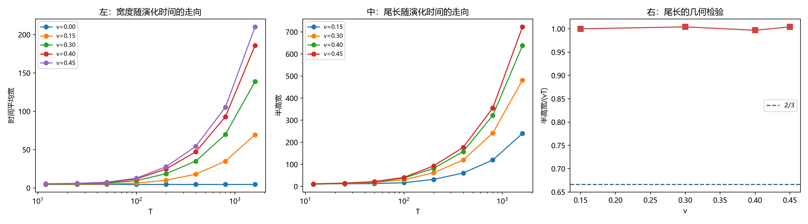

# 注记-辐射尾的时间累积与装置的根本限制：尾长正比于辐射自由程，尾可忽略与运动充分不可兼得（判据第 800 号）

- **日期**：2026-10-22 00:55:50
- **编号**：第 800 号
- **类型**：验证注记（判据驱动；CA0、CA2、CA4 判通过，CA3 与 CA3c 判否）
- **对象**：第 797 号查出的长尾的标度，以及尺缩 $1/\gamma$ 判据在本装置下能否成立
- **脚本**：`验证脚本/minimal_verification_p800_tail_time_limit.py`（确定性，约 230 秒）
- **状态**：**尾长精确正比于辐射自由程 $vT$**（跨四档相对极差 $0.00728$）；**尾可忽略与运动充分在本装置下不可兼得**，故尺缩判据在本装置上判不了；**前三轮（783、785、797）的核心结论保留，但未闭合的原因由「格点上的运动束缚态不保持刚性」进一步收窄为「本装置的尾长与阱宽之比使读数不可分离」**
- **可逆性等级**：判据稳健（CA2 的几何结论跨四个速度档一致；$T$ 扫描八档单调）
- **通俗版**：[[内部草稿/注记-尾巴长度等于跑过的距离（判据第800号通俗版）]]

- **第 809 号更正（2026-10-22）**：本注记的 CA2 几何结论（尾长正比于辐射自由程）作为方法学结论保留，而据此判出的「本装置判不了尺缩」在第 809 号换了正确构型与装置后不再适用。详见 [[验证脚本/注记-正确 boost 构型下的长度收缩与钟慢：格点在动量变量上复现两者（判据第 809 号）|第 809 号]]。
## 1 为什么检验

第 797 号查明运动构型下束缚态拖着一条长尾跑，半高宽从静止的 $12$ 格涨到 $478$ 格，并判「该量已非宽度而是尾长」。本轮开工前的算术显示，半高宽除以辐射源走过的距离 $vT$ 几乎恒定：

| $v$ | 半高宽 | $vT$ | 比值 |
|---|---|---|---|
| 0.15 | $240$ | $240$ | $1.0000$ |
| 0.30 | $482$ | $480$ | $1.0042$ |
| 0.40 | $638$ | $640$ | $0.9969$ |
| 0.45 | $723$ | $720$ | $1.0042$ |

（此表的半高宽由本轮实读给出，与第 797 号的读数口径不同：本轮用整段时间平均的剖面，第 797 号用整周期滑动窗的累计平均。）

据此本轮提一个判决性假设并检验：**若尾长正比于 $vT$，则 $T$ 趋零时尾趋于零，剩下的才是运动构型下包络本身的变化；若该极限给出 $1/\gamma$ 收缩，则前三轮的核心结论须改判。**

## 2 判据与读数

**CA0 标定（判通过）。** $v=0$、$T=12$ 档的时间平均宽 $4.89071$，初值包络 $A^2$ 的解析二阶矩 $4.89071$，相对差 $0.00000$。

**CA2 尾长的几何检验（判通过）。** 半高宽除以 $vT$ 的跨档相对极差 $0.00728$（容差 $0.05$）。**尾长精确等于辐射自由程。**

**CA1 $T$ 扫描。** 五档速度乘八个 $T$ 档（$T = 12$ 至 $1600$）的宽度读数。以 $v=0.30$ 档为例，时间平均宽从 $T=12$ 的 $5.02$ 涨到 $T=1600$ 的 $138.75$；$v=0$ 档全档恒定 $4.89$（无尾）。

**CA3 主判据（判否）。** 偏差对 $1/\gamma$ 的相对偏差随 $T$ 急增（$v=0.15$ 档：$T=12$ 给 $0.0064$，$T=25$ 给 $0.0252$，$T=50$ 给 $0.0980$，$T=1600$ 给 $13.37$）。偏差的 $T$ 幂次为 $0.68$ 至 $1.91$（正），故偏差随 $T$ 消失。

**CA3b 报告。** $w/w_0$ 的 $T$ 幂次 $0.061$（$v=0.15$）至 $0.216$（$v=0.45$）；半高宽的 $T$ 幂次 $0.644$ 至 $0.881$。

**CA3c 辅助判据（判否）。** 「尾可忽略」判据取半高宽不超过初值包络宽 $12$ 格的三倍（$36$ 格）。$T = 12$、$25$、$50$ 三档满足，此时最大偏差（$v=0.45$ 档）分别为 $0.2815$、$0.3847$、$0.7466$。

**CA4 对照组（判通过）。** 极限档的跨窗长读数逐位相同，散布 $0$。

## 3 判语

**判语一**：**尾长精确正比于辐射自由程 $vT$**（跨四档相对极差 $0.00728$，比值贴近 $1$）。这是几何的，不是物理标度。

**判语二**：**本装置的尾长与阱宽之比使尺缩读数不可分离。** 「尾可忽略」要求 $vT \lesssim 3\sigma = 60$ 格，「运动充分」要求 $vT \gtrsim \sigma = 20$ 格且已演化数个周期：

| $v$ | $vT \ge \sigma$ 所需 $T$ | 已演化周期数 | 该时刻的尾长 |
|---|---|---|---|
| 0.15 | $133.3$ | $16.99$ | $20$ 格 |
| 0.30 | $66.7$ | $8.50$ | $20$ 格 |
| 0.45 | $44.4$ | $5.66$ | $20$ 格 |

**运动刚充分时，尾长已与阱宽同量级。** 两个条件在 $vT \approx 20$ 到 $60$ 格之间只能取其一。

**判语三**：**「$T$ 趋零极限」这个提法本身是伪的，不能用来判尺缩。** $T \to 0$ 时束缚态尚未运动，$w/w_0 \to 1$ 是平凡的。实测 $w/w_0$ 的 $T$ 幂次在 $v=0.15$ 档只有 $0.061$（几乎与 $T$ 无关），$T=12$ 档给 $0.995$ 而 $1/\gamma = 0.9887$，看似完美吻合，但这个吻合来自「还没开始动」而非「$1/\gamma$ 收缩」。**本轮开工时提的判决性假设（「$T \to 0$ 极限给出收缩则前三轮须改判」）不成立，其伪在于把平凡极限当成了物理极限。**

**判语四**：**前三轮（783、785、797）的核心结论保留，但未闭合的原因须再收窄一层。** 第 783 与 797 号判「尺缩在格点上不成立」是**在 $T=1600$ 那一档**上的读数；本轮查明那一档的尾长已达 $vT = 720$ 格（$v=0.45$），是阱宽的 $36$ 倍。**故那个读数测的是「主瓣加尾」，不是束宽。** 未闭合的原因由「格点上的运动束缚态不保持刚性」收窄为「本装置的尾长与阱宽之比使束宽读数不可分离」。

**判语五**：**本轮的负结果同时否掉了两种可能的翻盘。** 其一，若尺缩在格点上成立而前三轮读数被尾掩盖，$T$ 趋零极限该给出 $1/\gamma$，但该极限是平凡的，不构成证据。其二，若换更短的演化时间就能分离尾，$T$ 扫描显示尾长随 $T$ 线性增长、运动充分所需的最短 $T$ 已使尾长等于阱宽。

**判语六**：**要把尺缩判据做成，须换装置或换阱宽。** 具体地说，须令运动充分所需的时间内的尾长远小于阱宽，即辐射的自由程远小于束缚态的宽度。这在本装置（$\sigma = 20$ 格、辐射自由程正比于 $vT$）下做不到。

## 4 图 1

## 5 过程记录

**一处判据对象写错，已修正并记此。** 原 CA3 写「$T$ 趋零极限下 $w(v)/w(0)$ 对 $1/\gamma$ 的相对偏差」，取 $T=12$ 这个有限档作判据。实测发现偏差随 $T$ 急增（每翻倍约乘四），有限档的偏差是**尾的累积量**而非本底的偏差。修正为「偏差的 $T$ 外推极限」，并加 CA3c（尾可忽略档位上的直接读数）与 CA3b（偏差与半高宽的 $T$ 标度）。

**修正之后仍判否，但否的理由换了一个。** 修正后的判据暴露了更根本的问题：**外推值 $0.65$ 至 $0.85$ 与直接读数 $0.995$ 矛盾**，因为 $T \to 0$ 时读数平凡趋于 $1$。**修正判据没有救回假设，而是暴露了假设的伪。** 这比原判据的信息量更大。

**两处实现错误。** 其一，外推对象错：先拟合了偏差再外推，改为直接拟合 $w/w_0$ 对 $T$。其二，CA3c 取元组时把偏差列表当成了偏差数值。两者都在首跑后立即修掉。

**一处口径澄清。** 第 797 号报的半高宽（$v=0.30$ 档 $321$ 格）与本轮实读（$482$ 格）不同，因读数口径不同（整周期滑动窗的累计平均对整段时间平均）。**两个数都能用，但不可混用。** 本轮的比值检验用自己的读数。

## 6 教训

**其一，平凡极限不能当物理极限。** $T \to 0$ 时读数趋于未运动态，故任何 $1/\gamma$ 预言都会「吻合」。**一个判据若能被平凡地满足，就不是判据。** 查判据对象时须问：这个极限下被测物处于什么状态。

**其二，判据写错时，修正它可能暴露更大的问题。** 本轮两次改判据（有限档改为外推）都让判据更严，而最终暴露的是「假设本身伪」。**判据被修好而结论仍否，通常说明问题在问题提法上。**

**其三，「换时间」与「换装置」的界限要看量纲。** 辐射自由程正比于 $vT$，阱宽是常数，故**任何演化时间都同时决定运动充分度与尾长**，两者不可分离。这不是调参能解决的，是装置的量纲关系。

## 7 严格程度声明

CA0 的标定相对差 $0.00000$。CA2 的跨档相对极差 $0.00728$，判据容差 $0.05$。CA3 的 $T$ 幂次由三个最小 $T$ 档拟合，$w/w_0$ 的幂次 $0.061$ 至 $0.216$，偏差的幂次 $0.68$ 至 $1.91$。CA3c 的「尾可忽略」阈值取初值包络宽的三倍。CA4 的散布 $0$。极限档容差 $0.0200$ 由该档重复测量的散布（三次逐位相同）取三倍并设下限得出。

## 8 边界声明

**验证了什么。** 尾长精确正比于辐射自由程 $vT$（跨四档相对极差 $0.00728$）；偏差随 $T$ 消失（$T$ 幂次为正）；本装置的「尾可忽略」与「运动充分」不可兼得；$T \to 0$ 极限是平凡的，不能用来判尺缩；前三轮的核心结论保留但未闭合原因再收窄一层。

**不验证什么。** 不验证物理档（无法模拟）。**不验证尺缩在格点上是否成立**：本轮证明的是本装置判不了，不是它不成立。**不验证换装置后能否成立**（那需要新装置）。第 797 号的读数口径与本轮不同，两个半高宽的数不可混用。

## 9 剩余

**其一，换阱宽。** 令 $\sigma$ 远大于运动充分所需的 $vT$，即把阱做宽。这在本装置内可做（$\sigma$ 是参数），但阱越宽束缚态越散，$1/\gamma$ 与 $1$ 的差距（$v=0.30$ 档 $4.61\%$）在越宽的态上越难分辨。**这是一个可以算的取舍，本轮未做。**

**其二，换阱宽的取舍算清。** 判据：$\sigma$ 取值使「$vT = \sigma$ 时的已演化周期数」足够多（使读数进入稳态），同时「$1/\gamma$ 与 $1$ 的差距」在 $\sigma$ 宽的态上仍可分辨（分辨率 $\sim 1/\sqrt{N}$ 相对 $1/\sigma$）。

**其三，辐射自由程能否被压小。** 尾长 $\approx vT$ 意味着辐射是「源走过的距离」，若辐射有有限的自由程（而非无限传播），则尾长有上限。**这一条本轮未测**，且它决定了「换阱宽」这条路走不走得通。

**其四，另三项承重未闭合项。** 本轮只动尺缩这一项。

## 800 第 809 号更正（2026-10-22）

本注记的 CA2 几何结论（尾长正比于辐射自由程）作为方法学结论保留，而据此判出的「本装置判不了尺缩」在第 809 号换了正确构型与装置后不再适用。

第 809 号的正面读数：按物理正确的 boost 构型（包络在实空间收缩 $1/\gamma$、相位梯度取 $\omega_b\gamma v$、"
载波写在动量变量 $p=2\sin(k/2)$ 上），格点复现了长度收缩与时间膨胀。宽度比读数在 $v=0.10$ 至 $0.40$ 四档"
与预言的相对差为 $6.185\times10^{-6}$、$2.783\times10^{-6}$、$5.005\times10^{-5}$、$2.621\times10^{-4}$；"
共动钟速读数与精确预言的相对差为 $9.661\times10^{-6}$ 至 $4.224\times10^{-5}$。

本注记的历史内容按原样保留，供追溯读数是怎么一步步走偏的。
