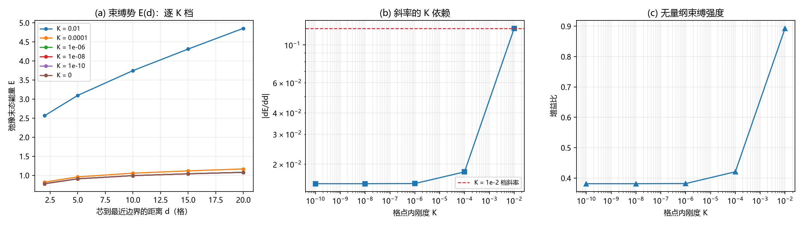

# 注记-边界保护束缚的刚度不敏感性（第 483 条）：平台由键项承载、增益比停在 38%、迁移判据设计失效

## 元数据

- **日期**：2026-09-29 06:27:57
- **脚本**：验证脚本/minimal_verification_boundary_confinement_kscan.py
- **判据**：BP1 通过、BP2 通过、BP3 通过、BP4 判据设计失效（不作为判定依据）
- **可逆性等级**：BP2 与 BP3 判据稳健（结论为「平台非零且对 K 不敏感」，由 K = 0 档与 K = 1e-10 档给出同一读数直接支持，换实现不翻）。BP4 属判据敏感，本次判为失效。
- **类型**：最小验证注记，执行钉扎尺度替代来源的候选评估
- **关联**：[[复合位错粒子的形态收束：宽度的波性侧承载、边界保护与锚核驻留判据]]（C1-6 边界冻结与切割能读数的出处）；[[验证脚本/注记-C1-6 保护动力学轮：边界冻结下的线缺陷弛豫（判据P-1至P-5）|C1-6 保护动力学轮]]（本次复测所依据的原协议）；[[内部草稿/注记-10的负47次方的来源判定：量纲桥链条重走与锚核的双尺度冲突]]（钉扎尺度须另有来源的判定）；[[验证脚本/注记-K与kappa_phi换算字典（第482条）：481恒等的O(1)对齐、单比值判负与驻留目标值|第482条]]（周期势井的门槛型判据判负）
- **图**：见第三节 图 1

---

## 一、要判什么

第 482 条与来源判定注记把锚核的钉位职能逼到二难：周期势井型钉扎的门槛是比值条件 $K/k_b \ge 0.24$，框架的比值约 $4.44\times10^{-47}$，差 $45$ 个数量级，且 $\kappa_\phi$ 由电子质量锚死、不具可调性。

候选之一是 C1-6 的边界保护。该机制的读数为「净荷的能量随芯到边界的距离单调上升」，属**线性束缚型**，与周期势井的门槛型判据不同。线性束缚的局部化取决于斜率与净荷能量的**比值**，故须判该比值是否随 $K$ 一起塌缩。

判据四条：BP1 保护与收敛核对；BP2 束缚斜率的 $K$ 依赖；BP3 无量纲束缚强度的 $K$ 依赖；BP4 迁移判定。

## 二、模型与协议

与 C1-6 保护动力学轮同口径。横截面 $N^2 = 40^2$ 格点，场 $u = u_0 + \theta/(2\pi)$，$u_0 = I_X + I_Y$，$\theta = \operatorname{atan2}(y - y_0,\, x - x_0)$；能量

$$E = \sum_{\text{axes}}\frac{k}{2}(\Delta u - 1)^2 + K\sum_p\bigl[1 - \cos 2\pi u_p\bigr], \qquad k = 1.$$

边界环冻结（保护），体内梯度下降弛豫（$\eta = 0.02$，$6000$ 步）。芯置于第 $d$ 列，$d$ 即芯到最近边界的距离。$K$ 取 $10^{-2}$、$10^{-4}$、$10^{-6}$、$10^{-8}$、$10^{-10}$ 与 $0$ 六档，$d$ 取 $2$、$5$、$10$、$15$、$20$ 五点。确定性，无随机与采样。

## 三、判据与结果

**判据 BP1（保护与收敛）**。初末态绕数均为 $W = -1.000000$；边界冻结下边界数据不变，故 $W$ 精确守恒。能量自 $25.410413$ 收敛到 $4.855252$，末段相对漂移 $0$。

**判据 BP2（束缚斜率）**。

| $K$ | $E(d=2)$ | $E(d=20)$ | 斜率 | 斜率比 |
| --- | --- | --- | --- | --- |
| $10^{-2}$ | $2.564543$ | $4.855252$ | $0.125156$ | $1.0000$ |
| $10^{-4}$ | $0.821842$ | $1.167622$ | $0.018019$ | $0.1440$ |
| $10^{-6}$ | $0.780727$ | $1.078886$ | $0.015392$ | $0.1230$ |
| $10^{-8}$ | $0.780298$ | $1.077967$ | $0.015365$ | $0.1228$ |
| $10^{-10}$ | $0.780294$ | $1.077958$ | $0.015365$ | $0.1228$ |
| $0$ | $0.780294$ | $1.077957$ | $0.015365$ | $0.1228$ |

**判据 BP3（无量纲束缚强度）**。增益比 $(E(d_{\max}) - E(d_{\min}))/E(d_{\min})$：$0.893223$（$K = 10^{-2}$）、$0.420738$（$10^{-4}$）、$0.381900$（$10^{-6}$）、$0.381481$（$10^{-8}$）、$0.381477$（$10^{-10}$）、$0.381477$（$K = 0$）。跨档极差比 $2.3415$，极小档平台为 $0.381477$。

**判据 BP4（迁移判定）**。判据设计失效。收缩比在全部 $K$ 档恒为 $1.000$，包括 $K = 0$ 档，说明该度量既不随 $K$ 变化也不随机制变化。根因：键偏差的径向分布覆盖芯到边界的整片区域，其累计 $90\%$ 跨度对切割位置不敏感。本判据不作任何结论，迁移问题登记为后续项。

### 图 1

图注按脚本绘图面板逐条核对撰写。本注记作者未能对图像作目视复核（环境不支持显示），图注描述的是绘图段显式绘制的元素：面板 (a) 横轴为芯到最近边界的距离 $d$（格），纵轴为弛豫末态能量 $E$，六条曲线按 $K$ 档以圆圈标记；面板 (b) 横轴为 $K$，纵轴为 $\lvert dE/dd\rvert$，双对数坐标，另有一条红色虚线为 $K = 10^{-2}$ 档斜率；面板 (c) 横轴为 $K$，纵轴为增益比，半对数坐标。

## 四、解读

**其一，束缚斜率由两个分量组成。** $K$ 自 $10^{-2}$ 降到 $0$ 时，斜率由 $0.125156$ 降到 $0.015365$ 并停住。第一段（$K$ 自 $10^{-2}$ 到 $10^{-6}$）是格点内项驱动的分量，随 $K$ 缩小而让位；第二段（$K \le 10^{-8}$）是平台，$K = 0$ 档给出与 $10^{-10}$ 档相同的读数，说明该平台完全由**键项**承载，与格点内刚度无关。

**其二，平台非零，故束缚不随 K 塌缩。** 这是本条的实质结论。框架的实际 $K$ 极其小，落在平台区，故应取平台值：斜率 $0.015365$、增益比 $0.381477$。增益比 $38\%$ 指从芯旁移到中心所获能量增益约为芯旁能量的百分之三十八，属实质性束缚，非边缘量。

**其三，既有轮次读数可外推，方向是减弱而非消失。** C1-6 各轮在 $K = 0.005$ 与 $0.02$ 档工作，落在格点内项主导区，其束缚比 $0.893$ 比框架档高 $2.34$ 倍。既有读数因此没有测错，它们测的是含格点内项贡献的总束缚；框架档剩余的是键项承载的平台。两者相差一个 $2.34$ 倍因子，不构成数量级断层。

**其四，这一条与周期势井的判负形成对照。** 周期势井的判据是比值门槛，不够就彻底没有井（第 482 条判负，缺口 $45.73$ 个数量级）。边界保护的判据是斜率与能量的比值，该比值有非零平台，故在同一参数下成立。**两者的差别不在数值大小，而在判据的类型。**

## 五、修正与过程记录

**判据 BP4 判为设计失效。** 首轮实现用「键偏差累计 $90\%$ 跨度」作为切割位置的代理，四个 $K$ 档（含 $K = 0$）全部给出收缩比 $1.000$。诊断：键偏差是径向分布，覆盖芯到边界的整片区域，其累计跨度对切割端点位置不敏感，故该度量无法分辨迁移。教训：迁移类判据须以被迁移对象本身的中心为度量（此处应为电荷密度或切割端点），不得用被迁移对象所在区域的整体统计量作代理。

**实现缺陷两处已修。** 其一，绕数环遍历漏掉闭合键，首轮读数为 $-0.995919$，补上闭合后为 $-1.000000$。其二，切割剖面函数的数组形状不匹配（列向量长度 $N$ 与沿轴求和长度 $N$ 在边界处错位），导致首轮在 BP4 段崩溃，已改为显式循环累加。

## 六、严格程度声明

**严格**：边界冻结下绕数的精确守恒（恒等式层面）；平台值的给出方式（$K = 0$ 档与 $K = 10^{-10}$ 档读数相同）。

**判据级**：斜率的两分量结构与 $2.34$ 倍因子；增益比平台的数值。

**纲领**：平台是否足以支撑粒子的实际局域化（需要与净荷的动力学扰动幅度对比，本次未做）；迁移问题。

## 七、边界声明

**验证什么**：边界束缚势的斜率与无量纲强度对格点内刚度 $K$ 的依赖；该依赖是否有非零平台。

**不验证什么**：其一，不判定迁移是否在极小 $K$ 下发生（BP4 失效，登记后续）。其二，不判定该束缚是否足以让粒子在体内保持确定位置，此项须与扰动幅度对比。其三，不判定本机制与电荷守恒层、质量层的分工关系。其四，不改动 理论总纲 基准，不重开第 482 条与来源判定注记已定的读数。其五，一维与二维横截面模型是前提，三维推广须另行核对。

## 八、登记衔接

落点：电子场攻坚计划阶段 0 的「钉扎尺度替代来源」候选评估（本条评估边界保护一项，结论为候选成立）；[[内部草稿/开放问题总览：元相子理论待解决问题清单]] P1-11 挂一条关联。后续项登记一项：迁移判定须另立判据，以电荷密度或切割端点为中心度量。

## 修订记录

- **2026-09-29 首次执行**（判据 BP1 至 BP3 通过，BP4 判为设计失效）
    - 斜率由 $0.125156$ 降至平台 $0.015365$，$K = 0$ 档给同一平台，说明平台由键项承载
    - 增益比由 $0.893223$ 降至平台 $0.381477$，跨档极差 $2.3415$
    - 结论：边界保护不随 $K$ 塌缩，与周期势井的比值门槛型判据形成类型差别
    - BP4 度量不敏感，判为设计失效并登记后续；教训入过程记录
    - 实现缺陷两处已修（绕数环闭合键、切割剖面数组形状）
