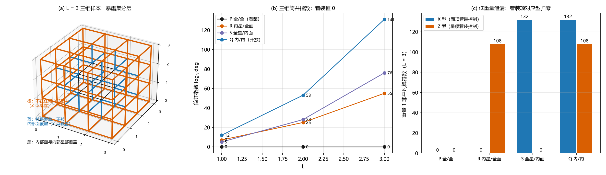

# 注记-边界模式轮三维：立方体样本的闭合面关系与周界回路锁定

- **日期**：2026-09-16
- **对应脚本**：`验证脚本/minimal_verification_toric_boundary_3d.py`（判据 B3D-0 至 B3D-6，确定性，纯组合精确计算与轨道计数核验，运行约 1.8 秒；图存 `images/toric_boundary_3d.png`）
- **依据**：[[注记-边界模式轮：缠绕守恒边界的量子层形态与总通量锁定]]（二维轮，全部判据形态的来源）；[[注记-三维谱与局域平凡性：3-环面的简并N³与局域算子分类]] 与 [[注记-三维结构核对：定向口径在三维环面上的对易代数与绕环膜清单]]（三维定向口径与最小膜 $L^2$）；[[评估-量子层保护结果的体系适用性：两侧互补、四座桥与O1接口]]（桥 3 剩余清单）
- **定位**：桥 3 的三维级：把二维盘面的三分结果（着装给唯一基态、朴素开放给距离 1、半着装分工）搬到 $L^3$ 个初等立方体组成的样本上。三维特有的新结构有两处：面项的闭合面关系（每个初等立方体的六面之积为恒等，即对偶高斯律），以及边界面上"通量 $=$ 周界回路"的三角关系。本注记不改动基准文件。
- **状态**：判据 37/37 通过（$N = 2, 3$；$L = 1, 2, 3$）。核心读数：着装样本满秩（$r_A = (L+1)^3 - 1$、$r_B = F - L^3$、$r_A + r_B = n$），$\deg = 1$；闭合面关系 $L^3$ 条全部落在保留面项内，只留内部面项时只剩 $(L-2)^3$ 条；六个边界面各自的 $L^2$ 个面之和等于该面周界回路（$4L$ 条键），面项全保留时它是稳定子，只留内部面项时降成重量 $4L$ 的逻辑算符；低重量泄漏继续由精确集合相等锁定；简并指数从二维的周长标度升为面积标度（$0$、$6L^2+1$、$12L^2-12L+4$、$18L^2-12L+5$）。

---

## 一、判据与结果

| 判据 | 内容 | 通过条件 | 实测 |
|---|---|---|---|
| B3D-0 | 对易代数：全部（星，面）对的共享边符号积之和 $\equiv 0$ | 全零 | 余数全零（四模型；$N = 2, 3$；$L = 1, 2, 3$） |
| B3D-1 | 着装满秩：$r_A = (L+1)^3 - 1$、$r_B = F - L^3$、$r_A + r_B = n$ | $\deg = 1$ | $L = 3$：$63 + 81 = 144 = n$；六组 $\deg$ 全为 $1$ |
| B3D-2a | 闭合面关系：初等立方体六面（带定向符号）之和为零；关系数 $L^3$，只留内部面项时保留 $(L-2)^3$ 条 | 逐点相等 | 关系数 $1/8/27$；保留数 $0/0/1$ |
| B3D-2b | 周界回路：边界面 $L^2$ 面之和 $=$ 该面周界 $4L$ 条键；着装时稳定子、朴素开放时重量 $4L$ 逻辑算符 | 六面全中 | 统一成立 |
| B3D-3 | 重量 1 泄漏：Z 型 $=$ 星项未覆盖键集；X 型 $=$ 面项未覆盖键集 | 集合相等 | 四模型全部相等 |
| B3D-4 | 简并指数：P 恒 $0$；R $6L^2+1$；S $12L^2-12L+4$；Q $18L^2-12L+5$（$L \ge 2$） | 逐点相等 | $7/25/55$、$5/28/76$、$12/53/131$ |
| B3D-5 | 体区读数：P 内部块键集重量 $\le 2$ 全零 | 是 | 四档在 $L = 3$ 均给 $0/0$ |
| B3D-6 | 轨道计数 $\lvert V_0\rvert/\lvert G_A\rvert$ 与秩公式一致 | 八组一致 | $N = 2, 3$；$L = 1$；四模型全部一致 |

## 二、模型与判据口径

### 模型与四档保留

顶点 $(i,j,k)$，$i,j,k \in 0..L$；键 $e^x(i,j,k)$ 连 $(i,j,k)$ 到 $(i+1,j,k)$（$i \in 0..L-1$），$e^y$、$e^z$ 类推，共 $n = 3L(L+1)^2$ 条。星项取顶点发散（出边 $+1$、入边 $-1$），边界顶点少边；面项取三族逆时针环绕，四边符号 $(+1, +1, -1, -1)$，共 $F = 3L^2(L+1)$ 个，初等立方体 $L^3$ 个。"内部"指相关坐标全部落在 $1..L-1$。

四档保留模式与二维轮逐字对应：P 全保留（着装）、R 只留内部星项加全部面项、S 全部星项加只留内部面项、Q 两者都只留内部（朴素开放）。

### 判据口径（三维新增三处）

其一，闭合面关系要带 $\partial_3$ 的定向符号。三个面族的固有朝向为：$xy$ 面朝 $+z$、$xz$ 面朝 $-y$、$yz$ 面朝 $+x$；立方体 $(i,j,k)$ 的六面取"下、前、左"取 $-1$，"上、后、右"取 $+1$。这样组合后六面之和为零，这正是对偶高斯律（闭合面上的净通量为零）。直接相加只能对 $N = 2$ 成立（见过程记录其一）。

其二，关系计数的口径是"六面齐全"的立方体。只留内部面项时，大多数立方体缺面，这类立方体不构成关系，也不参与求和检查。保留关系数因此等于 $(L-2)^3$（内部立方体数），其独立性由 $r_B = F - L^3$ 一并核验：面矩阵的秩比面数少掉的正是这些独立关系。

其三，周界回路的构造属于几何层面，与保留清单无关。六个边界面各自的 $L^2$ 个面项（按几何完整面集）之和给出该面的周界回路；它是否稳定子取决于面项是否着装。

## 三、主要读数

### 着装样本：唯一基态（B3D-1）

P 的读数在 $N = 2, 3$ 与 $L = 1, 2, 3$ 六组上一致：$r_A = (L+1)^3 - 1$（星项的唯一关系仍是全一函数），$r_B = F - L^3$（面项的独立关系恰为立方体数 $L^3$），两者之和等于 $n$，因此 $\deg = 1$。这个恒等式等价于 Euler 恒等式 $V - E + F = C + 1$（$C = L^3$ 为立方体数）：$r_A + r_B = (V-1) + (F-C)$，等于 $E$ 当且仅当 $V - E + F = C + 1$。二维轮对应的是 $V - E + F = 1$。

### 三维的绕数形态：闭合面关系与周界回路（B3D-2）

闭合面关系的读数是三维轮的新增量。每个初等立方体的六面（带定向符号）之和为零向量，共 $L^3$ 条（$1/8/27$），且全部由保留面项构成；只留内部面项时，能由保留面项构成的关系只剩 $(L-2)^3$ 条（$0/0/1$）。面项着装的意义在此显形：它把"闭合面"的关系结构补全，使对偶高斯律在整个样本上成立。

周界回路给出绕数的三维形态。六个边界面各自的 $L^2$ 个面项之和，支撑恰为该面的周界 $4L$ 条键、系数全为 $\pm 1$；在面项全保留的模型里它落进面项张成内，是稳定子，本征值被固定。在只留内部面项的模型里它不在保留面张成内，同时与全部保留星项对易，是重量 $4L$ 的非平凡逻辑算符。这与二维轮的边界回路逐项同型，区别只在载体：二维是盘面的外圈，三维是立方体六个面各自的周界。

### 低重量泄漏与边界印记（B3D-3）

集合相等继续成立：Z 型非平凡单边恰是不被任何保留星项覆盖的键，X 型恰是不被任何保留面项覆盖的键。$L = 3$ 的计数为：P 给 $(0, 0)$；R 给 $(0, 108)$；S 给 $(132, 0)$；Q 给 $(132, 108)$（$n = 144$）。$L = 2$ 给 P $(0,0)$、R $(0,48)$、S $(54,0)$、Q $(54,48)$；$L = 1$ 给 P $(0,0)$、R $(0,12)$、S $(12,0)$、Q $(12,12)$。

三维的印记形状与二维一致地"贴边"：星项未覆盖集就是与贴边层顶点相接的键（单立方体时即全部 $12$ 条键），面项未覆盖集是内部面块之外的键。着装项对应型归零的结构在三维原样成立。

### 简并的边界面积标度（B3D-4）

四档简并指数（$N$ 无关，$L = 1, 2, 3$）：P 恒 $0$；R 给 $7, 25, 55 = 6L^2 + 1$；S 给 $5, 28, 76$，$L \ge 2$ 时为 $12L^2 - 12L + 4$；Q 给 $12, 53, 131$，$L \ge 2$ 时为 $18L^2 - 12L + 5$。

二维轮的指数是线性的（$4L-1$、$4L-4$、$8L-5$），三维是二次的：边界自由度按边界维数标度，二维按周长、三维按面积。R 与 S 的指数之和等于 Q 的指数（$6L^2+1$ 加 $12L^2-12L+4$ 给 $18L^2-12L+5$，$L \ge 2$），即两把锁各自关掉的自由度互不重叠、数量可加。

### 局部性与独立核验（B3D-5、B3D-6）

体区读数在三维有一处与二维不同：$L = 3$ 时四档模型在内部块键集上的重量 $\le 2$ 非平凡计数全为 $0$，而二维轮里未着装模型的体区曾给出重量 2 计数（$L = 3$ 给 $4$）。差别来自约束密度：三维内部块的面项覆盖了块内全部键，重量 2 的组合都被面偶或星偶条件挡住。

独立核验走轨道计数：$L = 1$（单立方体，$n = 12$）时 $|V_0|/|G_A|$ 在 $N = 2, 3$ 与四档模型上共八组，全部等于秩公式值（例如 $N = 3$ 的 P 给 $|V_0| = |G_A| = 2187$、维度 $1$；Q 给 $|V_0| = 531441$、$|G_A| = 1$、维度 $531441$）。

## 四、与二维轮及经典层的对照

| 读数 | 二维（$L \times L$ 盘面） | 三维（$L^3$ 立方体样本） |
|---|---|---|
| 着装满秩 | $r_A = (L+1)^2-1$、$r_B = L^2$、和 $= n$ | $r_A = (L+1)^3-1$、$r_B = F-L^3$、和 $= n$ |
| 唯一基态 | $\deg = 1$ | $\deg = 1$ |
| 关系结构 | 无（$r_B = $ 面数） | 闭合面关系 $L^3$ 条 |
| 绕数算符 | 全体面项之积 $=$ 外圈回路（$4L$ 键） | 每个边界面 $L^2$ 面之和 $=$ 该面周界（$4L$ 键，六面） |
| 朴素开放泄漏 | $X = 8L-4$、$Z = 4L$ | $L = 3$ 给 $X = 132$、$Z = 108$ |
| 简并指数 | 线性（$4L-1$ 等） | 面积标度（$6L^2+1$ 等） |

经典层的对照维持二维轮的结论：FK 链的缠绕守恒边界固定绕数、留 kink 位置自由，量子层的对应物是"面项着装把通量算符纳入稳定子群"；三维新增的一层是"面项着装同时补全闭合面关系"（对偶高斯律），这正是三维规范理论里"通量线闭合"的代数形态，与 S3D 轮"最小非平凡膜 $= L^2$"配套。

## 五、严格程度声明

全部读数为组合精确事实（有限域线性代数、有限枚举与集合闭包），无抽样、无随机数、无浮点判据。判据 B3D-1 的秩公式与 Euler 恒等式互为解释；B3D-2a 中关系的独立性由 $r_B = F - L^3$ 核验；B3D-6 的轨道计数不依赖高斯消元与数值对角化。

## 六、边界声明

本注记验证 $L^3$ 个初等立方体样本上 $Z_N$ toric code（$N = 2, 3$；$L = 1, 2, 3$）在四档边界保留模式下的简并、闭合面关系、周界回路算符地位与低重量泄漏归属。

不验证：显式能谱与能隙；三维激发（通量环与电荷）的存在、统计与动力学；更大 $N$ 与 $L$（$L \ge 4$ 的分类与 $L \ge 2$ 的轨道计数未做）；带通量边界条件或非方形样本；体系实体映射（O1）；三维版"最小非平凡膜 $= L^2$"与本轮泄漏集的定量衔接（那是 S3D 轮的读数，本轮只给出集合归属）。

## 七、过程记录（三处修正）

**其一，闭合面关系的定向符号。** 首版把立方体六面直接相加，$N = 2$ 全过、$N = 3$ 失败（角的键被两个面同向覆盖，和给 $2 \ne 0$）。按 $\partial_3$ 的定向符号（各族面朝向：$xy$ 为 $+z$、$xz$ 为 $-y$、$yz$ 为 $+x$；立方体下、前、左面取 $-1$）组合后，$N = 2, 3$ 全为零。教训与二维轮相同：关系判据必须过 $N \ge 3$，$N = 2$ 的通过说明不了符号约定。

**其二，关系计数只算"六面齐全"的立方体。** 首版把缺面的立方体也纳入"六面之和为零"的检查，在只留内部面项的档上给出假失败。修正后：只有六面全在保留集内的立方体才计入关系数并做求和检查，其余跳过。

**其三，周界回路改用几何完整面集构造。** 首版用保留面项构造回路，在朴素开放档直接报 KeyError（贴边面不在保留集内）。修正后回路由几何面集给出，判据变成"该几何回路是否落在保留面项张成内"。这一步同时把语义写清楚：回路是几何对象，稳定子身份来自面项着装。

## 八、登记衔接

本轮登记：`验证脚本/README.md` 第 73 条；[[开放问题总览：元相子理论待解决问题清单]] 超选择层条目（桥 3 三维级完成）；[[评估-量子层保护结果的体系适用性：两侧互补、四座桥与O1接口]] 桥 3 段附状态句。

注记、脚本、登记三者一致；本注记不改动 `理论总纲/` 基准，方案定案由作者裁决。
