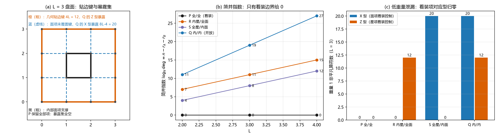

# 注记-边界模式轮：缠绕守恒边界的量子层形态与总通量锁定

- **日期**：2026-09-16
- **对应脚本**：`验证脚本/minimal_verification_toric_boundary.py`（判据 BND-0 至 BND-6，确定性，纯组合精确计算与轨道计数核验，运行约 1.5 秒；图存 `images/toric_boundary.png`）
- **依据**：[[评估-量子层保护结果的体系适用性：两侧互补、四座桥与O1接口]]（桥 3 的缺口清单）；[[注记-定向口径下的Z_N扇区重建：绕数算符代数、简并N²与Q4复验]]（定向口径）；[[注记-量子层Q5：弦算符的可形变完成（同调不变、局域算子标量化与最小支撑）]]（弦形变自由度）；[[注记-三维谱与局域平凡性：3-环面的简并N³与局域算子分类]]（局域平凡性形态）；[[注记-FK链：从Frenkel-Kontorova模型到元相子时空晶格的一维代理]] 与 `理论总纲/术语表.md`（经典层缠绕守恒边界）
- **定位**：桥 3：把保护从环面（"绕得过去"）搬回有限、有边界的晶格，检验量子层是否存在经典层那种"缠绕守恒边界"。同一 $(L+1)\times(L+1)$ 顶点方形盘面、同一手续，四种保留模式：P（全部顶点星项与全部面项）、R（只保留内部星项与全部面项）、S（全部星项与只保留内部面项）、Q（只保留内部星项与内部面项，即朴素开放）。本注记不改动基准文件。
- **状态**：判据 21/21 通过。核心读数：着装边界（P）给唯一基态（$\deg = 1$，$N = 2, 3$ 与 $L = 2, 3, 4$ 六组），总通量算符（全体面项之积）等于定向边界回路、支撑恰为 $4L$ 条几何贴边键，且落进稳定子群，本征值被固定；朴素开放（Q）把边界回路降成重量 $4L$ 的非平凡逻辑算符，并让重量 1 的贴边键本身成为逻辑算符（距离 $1$）；低重量泄漏的归属由精确集合相等锁定：Z 型 $=$ 不被保留星项覆盖的键，X 型 $=$ 不被保留面项覆盖的键。

---

## 一、判据与结果

| 判据 | 内容 | 通过条件 | 实测 |
|---|---|---|---|
| BND-0 | 对易代数：全部（星，面）对的共享边符号积之和 $\equiv 0\ (\mathrm{mod}\ N)$ | 全零 | 余数全零（$N = 2, 3$；$L = 2, 3, 4$；四模型） |
| BND-1 | 着装盘面满秩：$r_A = (L+1)^2 - 1$、$r_B = L^2$、$r_A + r_B = n$ | $\deg = 1$ | $L = 3$：$15 + 9 = 24 = n$；六组 $\deg$ 全为 $1$ |
| BND-2 | 总通量算符地位：面项全保留时全体面项之积 $=$ 定向边界回路且为稳定子；只留内部时回路非稳定子但仍是逻辑算符 | 两读并立 | P/R 锁定；S/Q 为重量 $4L$ 逻辑算符 |
| BND-3 | 重量 1 泄漏：Z 型非平凡单边集 $=$ 星项未覆盖键集；X 型 $=$ 面项未覆盖键集 | 集合相等 | 四模型全部相等；计数 $0/0$、$4L$、$8L-4$、$(8L-4, 4L)$ |
| BND-4 | 简并指数：P $0$、R $4L-1$、S $4L-4$、Q $8L-5$ | 逐点相等 | $L = 2, 3, 4$：$0/0/0$、$7/11/15$、$4/8/12$、$11/19/27$ |
| BND-5 | 局域平凡性分层：P 体区（中心面块）重量 $\le 2$ 全零 | 是 | P 给 $0,0$；未着装模型如实收录（S、Q 在 $L = 3$ 给重量 2 计数 $4$） |
| BND-6 | 轨道计数 $|V_0|/|G_A|$ 与秩公式一致 | 八组一致 | $N = 2, 3$；$L = 2$；四模型八组全部一致 |

## 二、模型与判读口径

### 模型与四档保留

盘面取 $(L+1)\times(L+1)$ 个顶点，$h(i,j)$ 为 $x = i$ 处 $y = j$ 到 $j+1$ 的竖键，$v(i,j)$ 为 $y = j$ 处 $x = i$ 到 $i+1$ 的横键，共 $n = 2L(L+1)$ 条。星项取顶点发散（出边 $+1$、入边 $-1$），角顶点 $2$ 条边、边顶点 $3$ 条边、内顶点 $4$ 条边；面项取逆时针环绕 $\{v(i,j), h(i+1,j), v(i,j+1), h(i,j)\}$ 带符号 $(+1, +1, -1, -1)$。几何贴边键指外圈 $4L$ 条键，也就是只被一个完整面项覆盖的键。

四档保留模式的差别只在"贴边的项要不要保留"：P 全保留（着装），R 只把内部顶点上的星项留下，S 只把内部面项留下，Q 两者都只留内部（朴素开放）。$L = 3$ 时内部星项 $4$ 个、内部面项 $1$ 个，边界自由度因此全部裸露。

### 判读口径（本轮的关键）

一条 Z 型算符 $\prod_{e \in S} Z_e$ 是稳定子，当且仅当边集 $S$ 落在面项张成内。落在星项张成内的是另一个 X 型算符，与 Z 型算符属于不同的 Pauli 元素，两者不能混算。X 型算符对称：它与全部面项对易（面偶条件）且边集不在星项张成内，才是非平凡逻辑算符。本轮 BND-2 的判据按这一口径写，过程记录第五处记下了起因。

简并计数用稳定子秩公式 $\deg = N^{\,n - r_A - r_B}$，其中 $r_A$、$r_B$ 为星矩阵与面矩阵在 $\mathrm{GF}(N)$ 上的秩。公式的前提是生成元两两对易（BND-0）且生成元作为 Pauli 元素独立，后者由 X 型与 Z 型属于不同 Pauli 型自动成立。

## 三、主要读数

### 着装边界：唯一基态与绕数锁定（BND-1、BND-2）

P 的读数在 $N = 2, 3$ 与 $L = 2, 3, 4$ 六组上一致：$r_A = (L+1)^2 - 1$、$r_B = L^2$，两者之和恰等于 $n$，因此 $\deg = N^0 = 1$。唯一基态意味着没有任何逻辑自由度，环绕数不再有选择的余地。

总通量算符的读数是这一轮的枢纽。全体面项之积等于定向边界回路：$v(i,0)$ 与 $h(L,j)$ 取 $+1$、$h(0,j)$ 与 $v(i,L)$ 取 $-1$，支撑恰为 $4L$ 条几何贴边键。该回路落在面项张成内，因此是稳定子，本征值被固定为 $+1$。绕数由此从"可自由选择的自由度"变成"边界条件给定的数据"。

$\deg = 1$ 还有一条更强的推论：稳定子群的秩达到 $n$，与全部保留项对易的算符只能是稳定子乘积（含相位），于是全重量上都不存在逻辑算符，距离这个量在本模型里不再适用。低重量读数（BND-3 的 P 列）与这条推论一致：重量 1 的两型计数都是零，贴边面区、贴边星区与体区也都是零。

### 朴素开放：绕数自由与距离 1（BND-2、BND-3）

Q 把贴边项全部丢弃，边界回路随即失去稳定子身份。只保留内部面项时，全体保留面项之积退化为"内环"（围绕内部块的一圈），边界回路不在其中，也不在星项张成内。回路与全部保留星项仍然对易，于是它是重量 $4L$ 的非平凡逻辑算符：改总通量需要整圈闭合，代价 $4L$ 条键。

重量 1 的读数更尖锐。Z 型非平凡单边恰好是不被任何保留星项覆盖的键，只留内部星项时这就是 $4L$ 条几何贴边键；X 型非平凡单边恰好是不被任何保留面项覆盖的键，只留内部面项时计数为 $8L - 4$。实测：$L = 2$ 给 $X = 12$、$Z = 8$；$L = 3$ 给 $X = 20$、$Z = 12$；$L = 4$ 给 $X = 28$、$Z = 16$。单条贴边键即可充当逻辑算符，距离为 $1$。

### 半着装：绕数锁定与保护距离是两把锁（BND-3、BND-4）

R 保留全部面项，于是边界回路仍是稳定子，绕数照旧锁定；但简并指数为 $4L - 1$（$L = 2, 3, 4$ 给 $7, 11, 15$，对应 $\deg = N^{4L-1}$），$4L$ 条贴边键仍是 Z 型非平凡逻辑算符，距离依旧是 $1$。

S 保留全部星项，Z 型低重量暴露归零，X 型暴露为 $8L - 4$ 条，简并指数 $4L - 4$（给 $4, 8, 12$）；边界回路此时落在保留面项张成之外，绕数重新成为自由量。

两档合起来给出分工：面项着装负责"总通量（绕数）锁定"，星项着装负责把顶点侧的低重量暴露关掉。缺面项则绕数自由，缺星项则距离退化为 $1$。两把锁都要，$\deg = 1$ 才是完整保护的充分条件。

### 局部性与边界印记（BND-5）

P 的体区（中央面块，即离边界最远的一圈键）重量 $1$ 与重量 $2$ 的非平凡计数都是零，边界邻域也全零。未着装模型里体区读数可以非零：S 与 Q 在 $L = 3$ 的中央块给出重量 $2$ 计数 $4$，$L = 4$ 给 $2$。这说明"体区局域不可分辨"随项覆盖率而定，未着装模型里逻辑算符可以藏进体区，并不局限在边界。

边界印记的归属因此有确切答案。Z 型印记落在外圈 $4L$ 条几何贴边键上；X 型印记落在不被保留面项覆盖的 $8L - 4$ 条键上（贴边键加上贴边内一环）。体区本身不带印记。

### 独立核验（BND-6）

简并公式另给一条不依赖高斯消元、也不依赖数值对角化的核验路径：共同 $+1$ 本征空间的维度等于面约束解空间的基数除以星项群的阶，即 $|V_0| / |G_A|$。$|V_0|$ 用穷举计数，$|G_A|$ 用生成元集合闭包精确枚举。$N = 2$ 与 $N = 3$、$L = 2$、四模型八组全部与秩公式一致（例如 $N = 3$ 的 P 给 $|V_0| = 6561$、$|G_A| = 6561$、维度 $1$；Q 给 $|V_0| = 531441$、$|G_A| = 3$、维度 $177147$）。

## 四、与经典层缠绕守恒边界的同型对照

经典层（FK 链）用 $u_{N-1} = u_0 + N$ 固定缠绕数，同时让 kink 位置自由（见术语表"缠绕守恒边界"条目）。量子层的对应物在 P 里逐项对上：固定缠绕数对应"总通量算符落进稳定子群、本征值固定"；kink 位置自由对应弦的形变自由度，后者在 Q5 轮已核为同调不变的规范冗余，不计入简并。

朴素开放则是"两端不钉住"的量子版：缠绕数成为自由量（边界回路是逻辑算符），而且边界自由度裸露（重量 1 的贴边键逻辑算符）。环面版读数（简并 $N^2$、最小支撑 $L$）依赖"绕得过去"的非平凡环；带边界版本把绕数的约束交给边界条件，代价是引入边界自由度，必须由星项着装一并关掉。

## 五、严格程度声明

全部读数为组合精确事实：对易代数、矩阵秩、集合相等、轨道计数都在有限域上精确计算，无抽样、无随机数、无浮点判据。简并公式为稳定子秩的闭式（推导与三维轮同源：基态投影的迹给 $N^{\,n - r_A - r_B}$），并另有轨道计数独立核验。低重量读数为区域内全枚举（重量 1 对全部键枚举；体区对重量 $\le 2$ 全枚举）。

## 六、边界声明

本注记验证 $(L+1)\times(L+1)$ 顶点方形盘面上 $Z_N$ toric code（$N = 2, 3$；$L = 2, 3, 4$）在四档边界保留模式下的简并、总通量算符地位与低重量泄漏归属。

不验证：显式能谱与能隙；激发（任意子）的存在、统计与动力学；三维带边界版本；更大 $N$ 与 $L$ 的枚举；"边界回路是唯一一类绕数自由度"这一更强陈述；体系实体映射（O1）；经典层 FK 链与其量子对应物之间的严格映射（本节只给出同型对照）。

## 七、过程记录（五处修正）

**其一，面项符号约定破坏对易，且只在 $N \ge 3$ 暴露。** 首版脚本的面项取了"镜像"符号（竖键符号与星项相反），于是同一索引的（星，面）对共享边符号积之和给 $\pm 2$。$N = 2$ 下 $\pm 2 \equiv 0$，检查全过；$N = 3$ 下余数为 $1$，星项与面项不再对易（这正是探路轮在无向口径上踩过的坑）。改为与既有轮次一致的定向口径后，四模型在 $N = 2, 3$ 全零。教训：对易余数检查必须把 $N \ge 3$ 纳入基础判据，$N = 2$ 的通过说明不了符号约定正确。**本轮已把 BND-0 提为基础判据，$N = 2, 3$ 同时检查。**

**其二，简并公式误用合并秩。** 中间诊断曾用"星矩阵与面矩阵合并后的秩"计算简并，得 P 的指数 $2$（$8 + 4 = 12$ 而合并秩 $10$）。这个量算的是把全部约束当成对角约束时的解空间维数，与稳定子码的基态维度有两个不同的含义：X 型与 Z 型即使共享支撑集，也是不同的 Pauli 元素，可以同时进入稳定子群。正确的稳定子计数是 $\deg = N^{\,n - r_A - r_B}$，另有轨道计数核验。$N = 2$、$L = 2$、$P$ 的轨道计数给 $|V_0| = |G_A| = 256$、维度 $1$，与秩公式一致，合并秩的 $2$ 被排除。

**其三，BND-2 的通量判据起初用"星与面合并张成"。** 那样写在 $N = 2$ 的 P、S 上给假通过（$N = 2$、$L = 2$ 时边界回路作为边集也落在星项张成内，属于 $Z_2$ 自正交的巧合），在 $N = 3$ 上暴露。已按 Pauli 型分开：Z 型回路算符是否稳定子，只看它的边集是否落在面项张成内；落在星项张成内的是另一个 X 型算符，不改变结论。

**其四，BND-5 的预期写错。** 首版预期"体区读数与边界条件无关、四模型全零"，实测 S 与 Q 的中央块给出重量 $2$ 非平凡计数 $4$（$L = 3$）与 $2$（$L = 4$）。修正陈述：体区局域平凡性由项覆盖率提供，未着装模型里逻辑算符可以局域到体区中心；P 的读数仍为零。这项修正进 [[开放问题总览：元相子理论待解决问题清单]] 时按"测量式读数"登记。

**其五，数值对角化核验不可靠，改为轨道计数。** 首版用 $2^{12}$ 维稀疏矩阵的迭代对角化（窗口 $k = 8$、容差 $10^{-9}$）比对简并，高简并谱下窗口打满且计数对容差敏感（$S$ 给 $6$、$R$ 给 $8$，两者均非 $2$ 的幂）。改为轨道计数 $|V_0|/|G_A|$：穷举面约束解空间、集合闭包枚举星项群，得到整数且与秩公式在八组上一致。教训：高简并谱不要用打满窗口的迭代对角化做计数判据。

## 八、登记衔接

本轮登记：`验证脚本/README.md` 第 70 条；[[开放问题总览：元相子理论待解决问题清单]] 超选择层条目（桥 3 状态更新）；[[评估-量子层保护结果的体系适用性：两侧互补、四座桥与O1接口]] 桥 3 段附状态句。

注记、脚本、登记三者一致；本注记不改动 `理论总纲/` 基准，方案定案由作者裁决。
