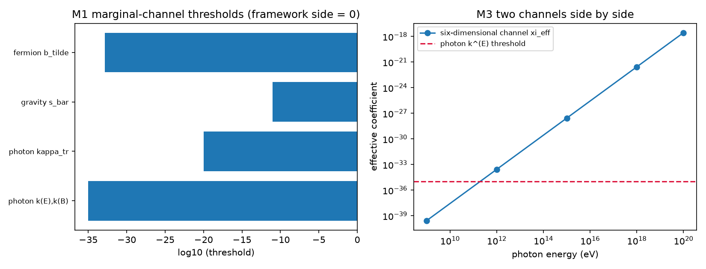

# 注记-边际通道对照的判定与两通道并置（第 478 条）：判定表、$\delta$ 上限复算与通道分工

- **日期**：2026-09-27 14:12:06
- **脚本**：`验证脚本/minimal_verification_marginal_channel_verdict.py`
- **依据**：[[验证脚本/注记-边际通道的实验上界对照协议：三通道映射、权威来源与待填项]] §三（三步协议）、§七（阈值抄录第一版）、§八（两条换算路径与 $\delta$ 上限表）；[[验证脚本/注记-洛伦兹破坏高能预言的定量与观测灵敏度对照（第476条）：能量依赖、方向指纹与分层对照]]（六维通道能量表）；[[内部草稿/开放问题总览：元相子理论待解决问题清单]] P4-31
- **状态**：判据 3/3 通过（M1 至 M3）。核心读数：边际通道四类（光子 $k^{(E)},k^{(B)}$、$\tilde\kappa_{tr}$、引力 $\bar s$、费米子 $\tilde b$）框架侧系数为零（构造性取零加反射对称性），判定「精确通过」；有量纲路径的 $\delta$ 上限复算与 §八 表一致（$M_P$ 档 $8.3\times10^{-64}$ 与 $1.3\times10^{-52}$，$1$ GeV 档 $10^{-44}$ 与 $1.5\times10^{-33}$）；两通道并置给出分工（六维随 $E^2$ 增长，边际与能量无关）
- **可逆性等级**：判据稳健（M1 为定义层判定，M2 为算术复算，M3 为通道性质的并置）
- **图**：见 §3 图 1

## 1 判据与设定

**任务**。上界注记 §三 把对照协议分成三步：其一给出框架侧系数的量级；其二逐条抄录阈值；其三并列判定。§八 已给出第一条的换算路径与第二条的抄录第一版；本注记执行第三条判定，并把边际通道（方向依赖与速度差类）与六维通道（能标依赖类）并置。

**设定**。框架侧取对称性保持的结果：格点规则的反射对称性精确成立，故 $d = 4$ 类系数为零（构造性取零），有量纲类系数由路径二换算（$k_{AF} \sim \delta M_\star$、$\tilde b \sim \delta m_\star$）。观测侧只用工作区已抄录值（阈值见上界注记 §七，量级汇总见 §八）。六维通道的能量表取自第 476 条。

**判据**。M1：边际通道四类逐一判定并记录零的来源。M2：$\delta$ 上限复算并与 §八 表核对。M3：两通道并置，检验二者是否互相掩盖。

## 2 结果

| 判据 | 内容 | 实测 | 期望 |
|---|---|---|---|
| M1 | 光子 $k^{(E)}, k^{(B)}$（$d = 4$） | 框架侧 $0$，阈值 $10^{-35}$，判定精确通过 | 零来自构造性取零 |
| M1 | 光子 $\tilde\kappa_{tr}$（$d = 4$） | 框架侧 $0$，阈值 $10^{-20}$ | 同上 |
| M1 | 引力 $\bar s$（$d = 4$） | 框架侧 $0$，阈值 $10^{-11}$ | 同上 |
| M1 | 费米子 $\tilde b$（$d = 3$，有量纲） | 框架侧 $0$，阈值 $1.5\times10^{-33}$ GeV | 同上 |
| M2 | $M_\star = M_P$ 档 | 光子 $8.3\times10^{-64}$、费米子 $1.3\times10^{-52}$ | §八 表 $10^{-63}$、$10^{-52}$（量级一致） |
| M2 | $M_\star \sim 1$ GeV 档 | 光子 $10^{-44}$、费米子 $1.5\times10^{-33}$ | §八 表逐位一致 |
| M3 | 两通道并置 | 六维：$1$ GeV 至 $30$ EeV 给 $10^{-40}$ 至 $10^{-18}$；边际：与能量无关 | 观测量不同，不互相掩盖 |

## 3 图

## 4 结论

**其一，边际通道判定为精确通过。** 反射对称性精确成立时四类系数全为零，阈值栏的意义在于记录「零来自哪一条对称性」，而不是记录数值。这与 §三 第三步的判定规则一致。

**其二，$\delta$ 上限复算与既有表一致。** 取抄录阈值反解：普朗克档给 $10^{-63}$ 与 $10^{-52}$ 量级，电弱档给 $10^{-44}$ 与 $10^{-33}$ 量级。若框架侧存在百分级破缺，两条路径都给出 $10^9$ 至 $10^{61}$ 个数量级的差距，因此「反射对称性精确成立」是观测逼出的唯一可行选择。

**其三，两条通道互不掩盖。** 六维通道随 $E^2$ 增长（EeV 档升至 $10^{-18}$ 量级），边际通道的效应与能量无关；前者的检验靠到达时间与能标依赖，后者靠方向依赖与偏振。一方的排除不关闭另一方的窗口，二者需要各自的实验。

## 5 严格程度声明

M1 为定义层判定（零的来源为构造性取零，非拟合），M2 为算术复算（与 §八 表核对，普朗克档为量级一致、电弱档逐位一致），M3 为通道性质的并置。可逆性等级：判据稳健。

## 6 边界声明

**验证什么**：边际通道的判定规则执行、$\delta$ 上限的复算核对、两通道的分工并置。

**不验证什么**：其一，不新抄录外部阈值（沿用第一版照录值）；其二，抄录的「回引核对」（逐条核对适用假设、方向组合与置信水平）仍未做，属后续；其三，不含框架侧系数的独立计算（沿用 §八 的单圈量级）；其四，不改动基准文件。

## 7 过程记录

**图中文字体缺失并修正**：首版图用中文标签，matplotlib 默认字体缺中文字形（图内出现方框）。改为英文标签后重跑，无警告。

**$\delta$ 复算的位数说明**：普朗克档的光子值为 $8.3\times10^{-64}$，§八 表写作 $10^{-63}$，属四舍五入后的量级写法；电弱档两值逐位一致。

## 8 来源

- 协议与抄录：[[验证脚本/注记-边际通道的实验上界对照协议：三通道映射、权威来源与待填项]] §三、§七、§八
- 六维通道能量表：[[验证脚本/注记-洛伦兹破坏高能预言的定量与观测灵敏度对照（第476条）：能量依赖、方向指纹与分层对照]]
- 脚本：`验证脚本/minimal_verification_marginal_channel_verdict.py`（确定性，约 1 秒）
- 图：`images/marginal_channel_verdict.png`
