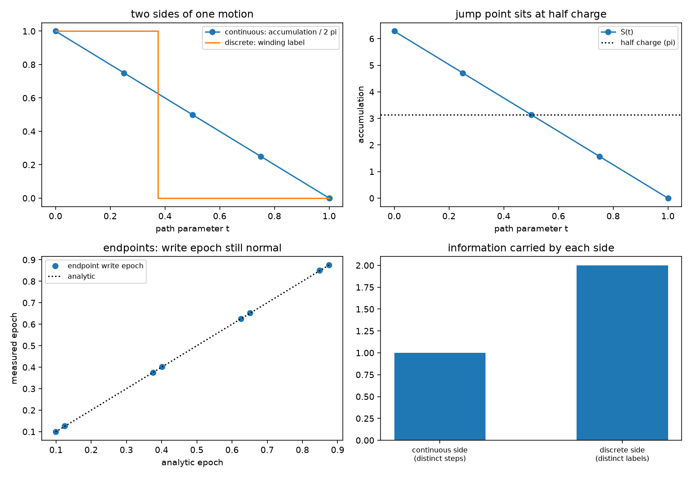

# 注记-运动双侧轮的最小验证：连续累加与离散绕数在同一条过程上

- **日期**：2026-09-19
- **对应脚本**：`验证脚本/motion_two_sided.py`（判据 Y1 至 Y6 共 7 项，7/7 通过；确定性，无随机数；运行约 0.2 秒；图存 `images/motion_two_sided.png`，见 §一 图 1）
- **依据**：[[验证脚本/注记-缺陷动力学耦合轮的最小验证：站点层拓扑阻塞、阈值穿越等于电荷对生成、棱层插值与半荷分裂]]（第 142 条，本轮改其框架）；作者 2026-09-19 指出：缺陷的移动同样是离散跃迁，且运动本质是连续与离散的互补、波性侧与粒性侧的双侧协同
- **状态**：判据 7/7 通过。核心读数：闭合回路的相位累加相邻差值恒为 $-1.5708$（偏差 $0$）；绕数标签序列 $[1, 1, 0, 0, 0]$ 只变化一次，位置为 $t = 0.5$；跃迁点的累加为 $3.141593$（半荷）；连续侧的差值取值数为 $1$（$5$ 个参数点），离散侧标签取值数为 $2$；端点写入时刻对解析式最大偏差 $0.0130\,t_P$，中点的绕核回路和为 $3.141593$。

---

## 一、判据与结果

| 判据 | 内容 | 通过条件 | 实测 |
|---|---|---|---|
| Y1 | 连续侧：累加连续且差值恒定 | 偏离 $< 10^{-12}$ | $0$；差值 $[-1.5708]$ 共四个 |
| Y2 | 离散侧：标签只变一次且位置正确 | 变化于 $t = 0.5$ | 序列 $[1,1,0,0,0]$ |
| Y3 | 跃迁点定位在半荷 | 偏离 $\pi$ 小于 $10^{-12}$ | $3.141593$ |
| Y4 | 双侧互补（信息量） | 连续 $1$ 档、离散 $2$ 值 | 差值取值 $1$；标签取值 $2$ |
| Y5 | 端点写入时刻正常 | 偏差小于 $5\%$ | $0.0130\,t_P$ |
| Y5 附 | 中点不可定义站点写入时刻 | 回路和为 $\pi$ | $3.141593$ |
| Y6 | 口径登记 | 见 §三 | 登记 |

图注：左上为同一条过程的两侧读数（连续曲线为相位累加除以 $2\pi$，阶梯为绕数标签）；右上为累加曲线与半荷线的交点，即跃迁落点；左下为端点写入时刻的实测与解析对照；右下为两侧各自携带的信息量。

## 二、模型设定

格点取 $7 \times 7$ 站点，核由 $(2,2)$ 面元移到相邻的 $(3,2)$ 面元，路径参数 $t$ 取五档。棱差在起点构型与终点构型之间线性插值；连续侧读数取绕核闭合回路的相位累加 $S(t)$（未折回的实数和），离散侧读数取绕数标签 $W = {\rm round}(S/2\pi)$。端点写入时刻用站点写入动力学测量（相位环 $255$ 点、脉冲宽 $0.12$、窗口 $1.0$），采样四个远离核的站点。

## 三、读数的意义

**同一条过程，两侧同时在场。** 累加 $S(t)$ 连续下降且相邻差值恒定（$-1.5708$，偏差 $0$），绕数标签 $W$ 只变化一次（$[1,1,0,0,0]$）。第 142 条把这两件事分读成两套机制，那是单侧写法；它们是同一条过程的两个读数。

**跳的落点由连续侧给出。** 标签的变化发生在 $t = 0.5$，而那一刻的累加恰为 $\pi$（半荷）。粒性侧的跃迁位置由波性侧的连续量在 $\pi$ 的交叉点确定，这是双侧协同的第一条具体内容：离散落在连续的半整数处。

**中段必须由棱层承载。** 端点上写入时刻照常（偏差 $0.0130\,t_P$），中点的绕核回路和为 $\pi$，站点方向场写不出来，须带一条弦。运动的头尾在站点层可读，中段在棱层可读，两侧接续才覆盖整条路径。

**两侧的信息量互补。** 连续侧给出恒定步长（轨迹可恢复），离散侧只给两个标签值（$5$ 个参数点压成 $2$ 个取值）。单读连续侧则位置没有定义，单读离散侧则路径信息丢失，合读才是一条完整的运动描述。

**口径。** 运动 = 粒性侧的离散跃迁加波性侧的连续流动，两侧同时在场（作者 2026-09-19）。本轮把跃迁落在半荷处落成读数；跃迁的持续时间与跃迁率仍未定，属待攻项。

## 四、过程记录

本轮判据一次通过，无订正。前一轮（第 142 条）的框架已按作者指出改写为双侧协同，其注记与索引条目各加一条更正说明。

效率记录：脚本约 $0.2$ 秒，无字体问题。
