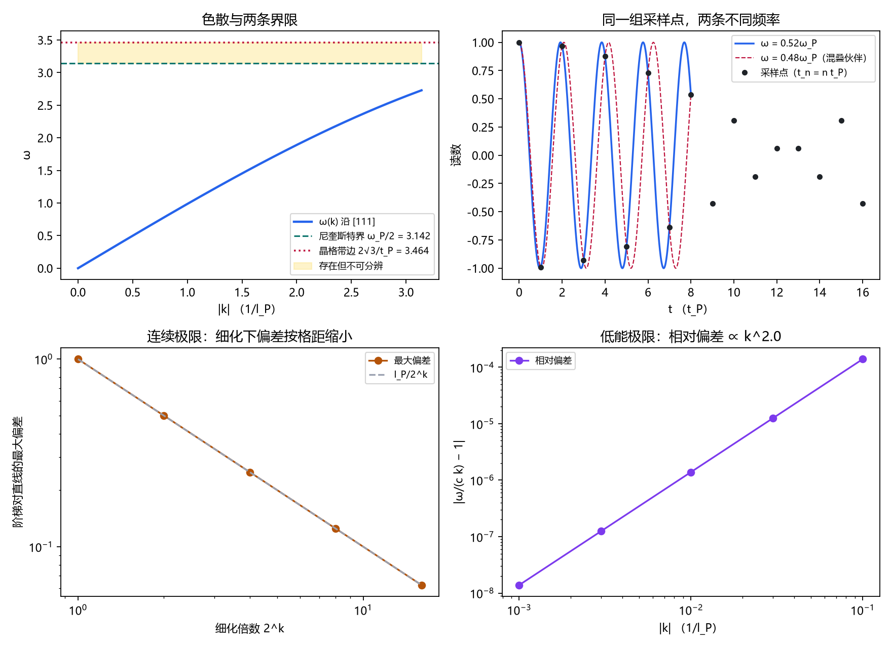

# 注记-连续极限与带限的最小验证：尼奎斯特界与晶格带边的作用域

- **日期**：2026-09-18 04:21:40
- **对应脚本**：`验证脚本/continuous_limit_bandlimit.py`（判据 J1 至 J6，11/11 通过；确定性；运行约 1 秒；图存 `images/continuous_limit_bandlimit.png`，见 §一 图 1）
- **依据**：[[元相子振荡晶格的色散关系：低能光速涌现与洛伦兹破坏首阶项]] §3、§4（色散精确式与低能极限）；[[内部草稿/开放问题总览：元相子理论待解决问题清单]] P3-12 与 P3-26；[[注记-采样无偏性的最小验证：计数口径决定偏置]]（同轮前一节）
- **定位**：把 P3-12 判据 (iii)（连续极限与带限）做出读数，并处理 P3-26 的调和问题：尼奎斯特界与晶格色散带边各管什么。本注记不改动基准文件。
- **状态**：判据 11/11 通过。核心读数：晶格带边 $\omega_{\max} = 2\sqrt{3}/t_P = 0.551329\,\omega_P$（数值误差 0）；尼奎斯特界 $\omega_P/2 = 0.5\,\omega_P$；两界之比 $2\sqrt{3}/\pi = 1.102658$；两者之间存在"存在但不可分辨"的频段，宽 $0.322509/t_P$，占带边 $9.31\%$；阶梯对连续直线的最大偏差恰为一个格距 $l_P$，细化下按 $2^{-k}$ 收敛（斜率 $-1.0000$）；低能相对偏差按 $k^2$ 收敛（斜率 $2.0000$）。

---

## 一、判据与结果

| 判据 | 内容 | 通过条件 | 实测 |
|---|---|---|---|
| J1a | 晶格带边（[111] 角点） | 相对误差 $<10^{-12}$ | $0.00$ |
| J1b | 带边换算为 $\omega_P$ 单位 | $0.5513 \pm 0.001$ | $0.551329$ |
| J2a | 整频 $\omega_P$ 的采样序列 | 恒为常数（$<10^{-12}$） | $0.00$ |
| J2b | 半频 $0.5\omega_P$ 可分辨 | 振幅 $\ge 1$ | $1.000000$ |
| J3 | 混叠映射 $\omega \leftrightarrow \omega_P-\omega$ | 序列偏差 $<10^{-12}$ | 三对均为 $10^{-14}$ 量级 |
| J4a | 频段存在性 | 带边 $>$ 尼奎斯特界 | $3.4641 > 3.1416$ |
| J4b | 频段内不可分辨 | 与 $0.48\omega_P$ 序列相同 | $2.40\times10^{-14}$ |
| J4c | 两界之比与频段占比 | $1.1027 \pm 0.001$ | $1.102658$；占带边 $9.31\%$ |
| J5a | 阶梯对直线最大偏差 | $= l_P$ | $1.000000$ |
| J5b | 细化下的收敛 | 斜率 $-1.0 \pm 0.05$ | $-1.0000$ |
| J6 | 低能极限相对偏差 | 斜率 $2.0 \pm 0.1$ | $2.0000$ |

图注：左上为沿 [111] 方向的色散曲线与两条界限，阴影区是"存在但不可分辨"的频段；右上为同一组采样点对应两条不同频率（$0.52\omega_P$ 与 $0.48\omega_P$）；左下为细化下阶梯对直线的最大偏差与其 $2^{-k}$ 参考线；右下为低能极限的相对偏差随波数的双对数（斜率 2）。

## 二、模型设定

晶格色散取《元相子振荡晶格的色散关系》§3 的精确式，单位取 $l_P = 1$、$t_P = 1$、$c = l_P/t_P = 1$，故 $\omega_P = 2\pi$：

$$\omega^2(\mathbf{k}) = \frac{4}{t_P^2}\sum_{a=x,y,z}\sin^2\frac{k_a l_P}{2}.$$

布里渊区 [111] 角点 $k_a = \pi/l_P$ 给出带边 $\omega_{\max} = 2\sqrt{3}/t_P$。读数发生在离散节点 $t_n = n\,t_P$，采样率 $\omega_s = 2\pi/t_P = \omega_P$，尼奎斯特上界 $\omega_N = \pi/t_P$。阶梯取 $Z_{\text{粒}}(t) = l_P\lfloor \omega_P t/2\pi\rfloor$，连续量取 $Z_{\text{连续}}(t) = c\,t$（因 $l_P\omega_P/2\pi = c$）。

## 三、读数的意义

其一，可分辨与存在是两个不同来源的界限。可分辨上界来自采样率，等于采样率的一半（$\pi/t_P \approx 0.5\,\omega_P$）；存在上界来自晶格色散，等于带边（$2\sqrt{3}/t_P \approx 0.5513\,\omega_P$）。后者比前者高 $10.27\%$。

其二，两个界限之间有一段"存在但不可分辨"的频段，宽 $0.322509/t_P$，占带边 $9.31\%$。频段内的模式在晶格上确实存在，但站点读数无法把它与一个低频模式区分开：$0.52\,\omega_P$ 的采样序列与 $0.48\,\omega_P$ 完全相同（偏差 $2.4\times10^{-14}$）；整频 $\omega_P$ 更是混叠到直流。

其三，连续极限方面，阶梯对连续直线的最大偏差恰为一个格距 $l_P$，细化时按 $2^{-k}$ 下降（斜率 $-1$），所以格距趋零时阶梯还原连续螺旋。低能极限的相对偏差按 $k^2$ 收敛（斜率 2），这个二次方指数就是洛伦兹破坏的首阶签名。

## 四、严格程度声明

色散式、带边数值、阶梯偏差与低能展开属精确代数或恒等式级，可解析核对；混叠映射与尼奎斯特界属标准采样定理的直接后果；"哪一界管什么"的作用域陈述属对齐式判定，不改变任何既有结论。

## 五、边界声明

本验证只做：单方向（[111]）色散与带边、两条界限的数值、混叠映射、连续极限与低能极限的收敛指数。

本验证不做：束缚势对高频模式的修正（论文 §10 已登记）；三维全方向谱与各向异性的完整读数；真实碰撞动力学的抽样口径（机制面，P3-12 判据 (ii) 的实质内容）；单体与集体谱的合法机制（P3-13）。

## 六、过程记录

判据 11/11 一次通过，未修正判据预期。绘图直接设中文字体，未出现缺字。前一轮（采样无偏性轮）的字体教训已在本脚本中预先处理。
