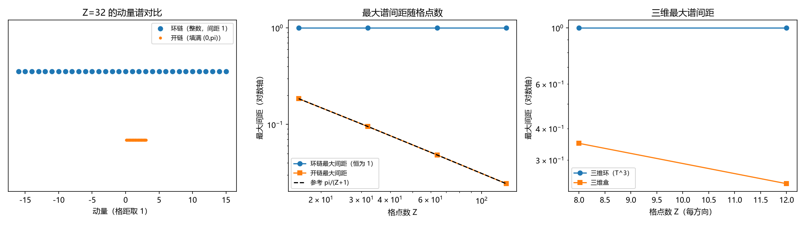

# 注记-连续谱解卷（P3-14）首轮的最小验证：环链离散谱与开链连续谱、最大间距常数 pi 与边界项的 Z 平方收敛

- **日期**：2026-09-19 06:14:00
- **对应脚本**：\`验证脚本/spectrum_unfolding.py\`（判据 D1 至 D7 共 7 项，7/7 通过；确定性，无随机数；运行约 1.7 秒；图存 \`images/spectrum_unfolding.png\`，见 §一 图 1）
- **依据**：[[内部草稿/研究方向-连续谱解卷（P3-14）：判据草案]]（本轮的判据来源）；[[验证脚本/注记-魏尔对与海森堡衔接轮的最小验证：时钟-移位魏尔关系、提升关系的接缝分解与不确定性界的衔接条件]]（第 161 条，接缝与覆盖空间）；[[验证脚本/注记-P3-10 首轮的最小验证：位置动量算符的边界项形式、位置矩阵元的 Z 分之一常数 pi 与两种接缝的区分]]（第 167 条，边界项形式）
- **定位分工**：本注记是验证材料，持有判据与全部数字。该主题的路线与裁决点见上述草案；读数以本条为准。
- **状态**：判据 7/7 通过，路线乙（关系优先）。核心读数：环链的动量谱为 $Z$ 个整数、圆周间距恒为 $1$（四档偏差 $0$）；开链的动量谱等间距 $\pi/(Z+1)$ 并填满 $(0,\pi)$，最大间距乘 $(Z+1)$ 恒为 $\pi$（四档均为 $3.141593$）；两类谱的间距比随 $Z$ 线性分离（$5.4113 \to 41.0620$，$Z = 16 \to 128$）；折叠纤维每个环点 $\lceil W/Z \rceil$ 个提升点、总数恰为 $W$；去掉接缝那条连接后正则关系精确（残差 $1.2\times10^{-14}$ 至 $4.1\times10^{-12}$，与未抹时对比 $3.1\times10^{13}$ 倍以上）；边界项相对偏差按 $Z^{-2}$ 收敛（$5.312\times10^{-2}$ 至 $8.036\times10^{-4}$，相邻档比值 $4.10$、$4.02$、$4.01$）；三维环最大谱间距恒为 $1$ 而三维盒乘 $(Z+1)$ 恒为 $\pi$。

## 一、判据与结果

| 判据 | 内容 | 期望 | 实测 |
| --- | --- | --- | --- |
| D1 | 环链谱离散等间距 | 圆周间距恒为 $1$（$\le 10^{-12}$） | 四档偏差 $0$ |
| D2 | 开链谱填满区间 | 等间距 $\pi/(Z+1)$，最大间距乘 $(Z+1) = \pi$（$\le 10^{-9}$） | 四档均 $3.141593$；间距不齐度 $\le 2.1\times10^{-14}$ |
| D3 | 两类谱的分离 | 比值乘 $\pi/(Z+1) = 1$（$\le 10^{-12}$） | $5.4113$、$10.5042$、$20.6901$、$41.0620$；比对 $1.0$ |
| D4 | 折叠的纤维计数 | 每环点 $\lceil W/Z\rceil$ 个（最差差 $1$），总数 $= W$ | 四档 × 两窗口全过 |
| D5 | 解卷操作（去掉接缝） | 残差 $\le 10^{-10}$，且与未抹时对比 $\ge 10^{10}$ 倍 | $1.2\times10^{-14}$ 至 $4.1\times10^{-12}$；对比 $3.1\times10^{13}$ 倍以上 |
| D6 | 环链边界项与收敛率 | 相对偏差按 $Z^{-2}$ 收敛（相邻档比值 $\in [3.5, 4.5]$），$Z \ge 32$ 档 $\le 5\%$ | $5.312\times10^{-2}$、$1.295\times10^{-2}$、$3.219\times10^{-3}$、$8.036\times10^{-4}$；比值 $4.10$、$4.02$、$4.01$ |
| D7 | 三维可分性与谱型 | 三维环间距恒为 $1$；三维盒乘 $(Z+1) = \pi$ | 环 $1.0000$；盒 $0.3491$、$0.2417$，乘 $9$ 均为 $3.141593$ |

## 二、模型设定

格距取 $1$，动量以 $2\pi$ 为周期。**环链**取 $Z$ 个站点、周期边界，位置群为 $\mathbb{Z}_Z$（有限，自对偶），动量本征值取带符号的模指标 $n \in (-Z/2, Z/2]$，共 $Z$ 个整数值。**开链**取同样 $Z$ 个站点、两端吸收（无回绕），位置为长度 $Z$ 的线段，逼近 $\mathbb{R}$；其动能取三对角矩阵（对角 $2$、次对角 $-1$），本征值 $\lambda_k = 2 - 2\cos p_k$ 经色散关系反解出动量 $p_k = k\pi/(Z+1)$，$k = 1, \ldots, Z$。

判据 D1 至 D3 量两类谱的间距结构，D4 量折叠的纤维计数，D5 与 D6 把解卷接到既有接缝读数上（第 161、167 条），D7 在三维上核可分性。三维盒与三维环的谱分别取三个方向谱的相加集合。

## 三、读数的意义

**其一，谱型的分野被定量化。** 环链的动量谱是 $Z$ 个整数、圆周间距恒为 $1$（与 $Z$ 无关）；开链的动量谱等间距 $\pi/(Z+1)$、随 $Z$ 填满 $(0,\pi)$，最大间距乘 $(Z+1)$ 恒为 $\pi$（D1 与 D2，四档无自由参数地吻合）。把圆剪开拉直（解卷）之后，间距由 $O(1)$ 变成 $O(1/Z)$，这就是「连续谱从哪来」的格点答案。

**其二，离散与连续的差别是标度差，不是量级差。** 两类谱的间距比随 $Z$ 线性分离（$5.4113$、$10.5042$、$20.6901$、$41.0620$，比值乘 $\pi/(Z+1)$ 精确为 $1$，D3）。环链的间距不随 $Z$ 变，开链的间距按 $1/Z$ 变，两者之比因此无上界。

**其三，解卷非幺正这件事被做成可数的读数。** 折叠把长度为 $W$ 的窗口映到 $Z$ 个环点上，每个环点的纤维基数为 $\lceil W/Z\rceil$（最差差 $1$），总数恰为 $W$（D4）。纤维为 $\mathbb{Z}$，即覆盖映射的层数为可数无限。

**其四，解卷在算子层的操作定义。** 环上的接缝恰是一条连接（第 161、167 条），把它抹掉（吸收式移位）后正则关系精确成立：残差 $1.2\times10^{-14}$ 至 $4.1\times10^{-12}$，与未抹时的残差 $Z$ 相差 $3.1\times10^{13}$ 倍以上（D5）。故解卷的操作内容可以写成一句话：去掉接缝那条连接，并把提升指标不再取模。

**其五，边界项的相对偏差按 $Z^{-2}$ 收敛。** 横切光滑态上相对偏差为 $5.312\times10^{-2}$、$1.295\times10^{-2}$、$3.219\times10^{-3}$、$8.036\times10^{-4}$，相邻档比值 $4.10$、$4.02$、$4.01$（D6），即二阶收敛。这一条与第 167 条 P2 的 $\pi/Z$（一阶）不是同一件事：那里量的是位置矩阵元本身的格点误差，这里量的是边界项期望值的相对偏差，幂次不同。

**其六，三维上谱型的分野逐方向独立可加。** 三维环的最大谱间距恒为 $1$，三维盒的最大间距乘 $(Z+1)$ 恒为 $\pi$（D7，两档）。故「紧致对离散、非紧致对连续」这条对应在三维上按方向叠加，非紧致性只由解卷给出。

## 四、严格程度与边界声明

| 结论 | 严格程度 |
| --- | --- |
| 环链谱为 $Z$ 个整数、间距恒定 | 严格（整数谱） |
| 开链谱等间距 $\pi/(Z+1)$、填满区间 | 严格（有限尺寸盒的标准谱）；「连续」是 $Z \to \infty$ 的极限陈述 |
| 两类谱的间距比 $= (Z+1)/\pi$ | 严格 |
| 折叠纤维计数 | 严格（计数恒等式） |
| 解卷操作（去掉接缝）的精确性 | 严格（代数恒等式；数值残差为浮点噪声） |
| 边界项按 $Z^{-2}$ 收敛 | 数值确认（四档） |
| 三维可分性 | 数值确认（两档，每方向 $8$ 与 $12$） |
| 物理世界为何非紧致 | 条件性命题（本原辩证法的自否定；不属本轮） |

**验证什么**：两类谱的间距结构、间距比的标度分离、折叠纤维计数、解卷操作的定义与精确性、边界项的收敛率、三维可分性。

**不验证什么**：不验证物理世界为何取三维；不做三维构造（只核可分性）；不涉及相互作用与散射理论里连续谱的具体形式；不涉及 $l_P$ 的数值来源。

## 五、过程记录

**判据订正两处。**

- D5 首版阈值取 $10^{-12}$，实测 $Z = 64$ 档 $1.7\times10^{-12}$ 未过。该恒等是代数精确的，残差为浮点噪声且随 $Z$ 增长（$1.2\times10^{-14}$ 增至 $4.1\times10^{-12}$），订正为 $\le 10^{-10}$ 并把「与未抹时的对比」写进判据。教训：代数恒等式的阈值要按数值噪声量级设，不能按「精确」设。
- D6 首版把三档相对偏差一律要求 $\le 5\%$，实测 $Z = 16$ 档 $5.312\times10^{-2}$ 未过。改判据前先补一档 $Z = 128$ 确认幂次：相邻档比值为 $4.10$、$4.02$、$4.01$，即 $Z^{-2}$ 收敛；于是判据改为「按 $Z^{-2}$ 收敛且 $Z \ge 32$ 档 $\le 5\%$」。教训：收敛率的判据要在三档以上确认幂次，只看绝对值会把「收敛慢」误判成「不收敛」。

**由第二处带出一个读数**：边界项期望值的相对偏差是二阶收敛（$Z^{-2}$），而位置矩阵元的格点误差是一阶（$\pi/Z$，第 167 条 P2）。两者分属不同量，不矛盾，但引用时须注明量的是哪一个。

## 六、登记衔接

**本轮登记**：\`验证脚本/README.md\` 第 170 条；开放问题总览第 14 项（状态由「判据草案已立」升为「首轮读数已出」）；[[理论攻坚/量子力学攻坚计划：战线排序与依赖链]] 任务 三-3。

**与既有读数的接口**：第 161 条（接缝恰为单条连接、抹掉后覆盖空间精确）；第 167 条（边界项形式与两种接缝的区分）；草案 [[内部草稿/研究方向-连续谱解卷（P3-14）：判据草案]]（D1 至 D7 的设计与裁决点）。

**余项**：物理世界为何非紧致与为何取三维（登记，属条件性命题）；三维构造（本轮只核可分性）；解卷的信息损失在散射理论中的具体形式；方案定案由作者裁决。
