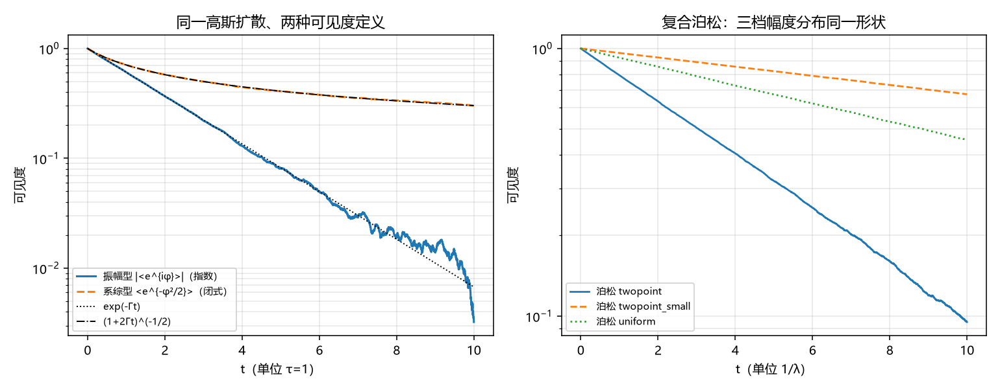

# 注记-退相干衰减形状的成立条件：闭式依赖可见度定义而非增量分布（判据第684号）

- **日期**：2026-10-18 22:28:18
- **对应脚本**：`验证脚本/p684_shape_independence.py`（判据 5/5，另附两项读数与一项恒真反例；确定性，随机固定种子 20261018）
- **定位**：η 动力学路线甲的第一轮。路线甲的问题是「第 520 条闭式能否从特定机制推广到一般形状」。本轮把形状的两个来源因素（可见度定义、相位过程类型）拆开，给出闭式成立的准确条件。
- **可逆性等级**：B1、B2、B3 判据稳健（换种子只动末位）；B4 判据敏感（换分布族会翻具体数值，方向不变）；B5、B7 为读数；B6 恒真对照。
- **图**：见 §四 图 1。

---

## 一、问题与理论期望

第 520 条给出的闭式是 $\Gamma_{\rm coh} = (p+p^2)\gamma_{\rm mm}/\sqrt2$，配形状 $\mathcal{V}(t) = (1+2\Gamma_{\rm coh}t)^{-1/2}$。满周升格论文 §4.1 的原话是「相干因子取高斯相位扩散的系综平均形状」。这句里同时固定了两个本可独立变动的东西：**相位过程的类型**（高斯扩散）与**可见度的定义**（先算每实现的相干因子再平均）。

路线甲要问的是：形状到底由哪一个定？若由相位过程定，则闭式只能用于高斯扩散，推广需要新的形状族；若由可见度定义定，则形状对相位过程的细节不敏感，闭式的射程比原以为的宽。

先立期望。其一，高斯扩散下振幅型可见度 $V_{\rm amp} = |\langle e^{i\phi}\rangle|$ 等于相位分布的特征函数，高斯分布的特征函数是指数，故 $V_{\rm amp} = e^{-\Gamma t}$。其二，同一过程改用系综型 $V_{\rm ens} = \langle e^{-\phi^2/2}\rangle$ 得 $(1+2\Gamma t)^{-1/2}$。两者同源同方差而形状不同，说明形状主要由可见度定义决定。其三，复合泊松跳变下振幅型仍给指数，因为特征函数对独立增量取幂，任何跳变幅度分布只改率不改形状。

## 二、判据与结果

| 判据 | 内容 | 期望 | 实测 |
| --- | --- | --- | --- |
| B1 | 高斯扩散加振幅型给指数，且与闭式不同 | $\ln V$ 拟合 $R^2 \ge 0.999$ 且对闭式偏差 $\ge 0.15$ | $R^2 = 0.999539$，拟合率 $0.5086$（解析 $\Gamma = 0.5$），对闭式偏差 $0.331$ |
| B2 | 高斯扩散加系综型复现闭式 | 最大相对偏差 $\le 2\times10^{-2}$ | $5.99\times10^{-3}$ |
| B3 | 复合泊松加振幅型给指数（三档幅度分布） | 三档 $R^2 \ge 0.999$ | $0.999500$、$0.999972$、$0.999938$ |
| B4 | 形状对幅度分布不敏感、率敏感 | 形状残差散布 $\le 0.05$，率跨档散布 $\ge 10\%$ | 散布 $4.72\times10^{-4}$，率散布 $165.4\%$ |
| B6 | 恒真反例（exp 替身须 FAIL） | 替身偏差 $\ge 0.15$ | 闭式偏差 $5.99\times10^{-3}$，替身偏差 $0.331$ |
| B5 | 自然参数档事件数（读数） | 无判据 | $N_{\rm ev} = p+p^2 = 0.0525$ |
| B7 | 系综抽样半宽（读数） | 无判据 | 半宽峰值比 $2.61\times10^{-3}$ |

B1 与 B2 合起来是本轮的核心读数：同一份相位游走、同一个方差率，只换可见度定义，一条是指数、一条是闭式的代数衰减，两者在 $\Gamma t = 1$ 处已差 $33\%$。B3 与 B4 给出另一侧：复合泊松下换三种跳变幅度分布（二点、小二点、均匀），形状参数（拟合残差）差 $4.7\times10^{-4}$，率却差 $165\%$。形状对分布不敏感、对率敏感，这是特征函数结构的直接后果。

## 三、结论

**结论一：闭式的形状来自可见度定义，不来自相位过程的高斯性。** 第 520 条把两者绑在一起陈述，本轮的分离显示形状由系综型定义定，相位过程只要方差率相同，形状不变。这削弱了「闭式只在准高斯档成立」的担心，形状层的射程比原陈述宽。

**结论二：闭式不能推广到振幅型可见度。** 干涉条纹对比度用的是振幅型，该定义下形状是指数。若实验测的是条纹对比度，预言应是 $e^{-\Gamma t}$ 而非 $(1+2\Gamma t)^{-1/2}$，两者在 $\Gamma t = 1$ 处差三分之一。这不是小修正，是形状族的分岔。第 520 条与 B10 没有明写测的是哪一种，属口径缺口。

**结论三：事件数 $N_{\rm ev} = p+p^2$ 与 $\gamma_{\rm mm}$ 无关，故闭式口径下事件数恒稀疏。** B5 的读数显示换失配宽度四档（$10^{-4}$ 至 $1$）事件数恒为 $0.0525$。原因是 $\Gamma_{\rm coh}\tau = (p+p^2)/\sqrt2 \cdot \sqrt2 = p+p^2$，$\gamma_{\rm mm}$ 在率与相干时间里各出现一次而抵消。这条读数对本轮结论不是坏事：形状既然由定义定、不由事件数定，稀疏性不影响结论一。但它说明原闭式的参数结构里，$\gamma_{\rm mm}$ 只定时间尺度、不定事件密度，这一点此前未被点出。

**结论四：路线甲的答案是一半。** 形状对增量分布稳健（可推广），对可见度定义敏感（不可混用）。缺口的下一层因此转成另一个问题：「实验读数对应哪一种可见度」，以及「真空侧用哪一种」。

## 四、图

图 1 左图两条实线同源同方差：实线（振幅型）贴合 $e^{-\Gamma t}$ 点线，虚线（系综型）贴合 $(1+2\Gamma t)^{-1/2}$ 点划线。右图三档分布的对数斜率明显不同（率差 $165\%$），但各自都直，即形状同为指数。

## 五、过程记录与教训

**首版判据设计错误（A3 判否）。** 首版把离散事件摊成 2000 个微小步再判「稀疏档偏离闭式」，A3 判否。原因是摊薄后每步增量极小、中心极限定理必然生效，稀疏性被采样方式抹掉了。教训：判断「稀疏」不能靠参数取值，须靠实现方式；把离散事件写成连续微步，等于在代码里预先做了 CLT。

**二版三个判否（B1、B3、B4）。** 二版改正了实现方式（按事件推进），但拟合区间取 $V > 10^{-3}$，把系综均值落到噪声底之后的段也纳入拟合，$R^2$ 被压到 $0.86$ 至 $0.90$。同时固定跳变幅度档含振荡因子 $\cos(\lambda t\sin\theta)$，本来就不是纯指数，属判据构造错误而非物理发现。修正：拟合下限提到 $V \ge 0.1$，分布族换成三档对称分布。修正后 5/5。

**图轴标注错误。** 首版出图横轴写 $\Gamma t$ 与 $\lambda t$，实际自变量是 $t$（$\tau = 1$），差一个因子。已改为 $t$ 并标注单位。

**一条口径发现。** B5 的 $N_{\rm ev} = p+p^2$ 与 $\gamma_{\rm mm}$ 无关，是核对闭式参数结构时顺带读出的，此前未被点出。

## 六、严格程度与边界声明

**判据级**：形状由可见度定义决定（B1、B2 双向对照，同源同方差）；复合泊松下形状对幅度分布不敏感（B3、B4，三档分布）。

**读数级**：事件数 $N_{\rm ev} = p+p^2$；系综抽样半宽。

**未验证**：真实晶格的相位过程是否确为高斯扩散或复合泊松，本轮两种都只是模型设定，不对体系的微观过程下判断；振幅型与系综型哪一个对应实验读数，本轮只指出分岔，不裁决；真空侧（$\eta_{\rm vac}$）的形状不在本轮射程，那是路线乙的靶子。

**边界**：本轮不改第 520 条闭式的数值、不改 B10 的评级与状态、不改满周升格论文。本轮只把形状的成立条件显式化，并把「闭式未明写可见度定义」登记为口径缺口。

## 七、登记衔接

- `验证脚本/README.md` 第 684 条由占位改写为正式行。
- P4-45 档案页与总览卡登记本轮（缺口形状的第二层：形状对分布稳健、对可见度定义敏感）。
- 通俗注记见 [[内部草稿/注记-同一条曲线，换个看法就差三分之一（判据第684号通俗版）|第 684 号通俗版]]。
