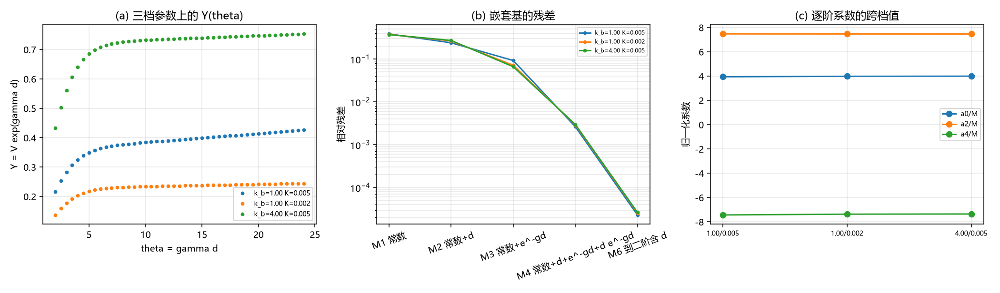

# 注记-逐阶展开轮：尾的谐波系数与收敛阶（判据 U1 至 U4）

- **日期**：2026-09-20 10:39:30
- **来源**：作者 2026-09-20 指令（同意按逐阶展开做）；上一轮[[验证脚本/注记-修正项解析身份轮：两种候选形式均判负（判据T1至T5）]]否定了两种两参候选
- **脚本**：`验证脚本/minimal_verification_harmonic_expansion.py`
- **状态**：判据级读数；谐波结构定案，系数跨参数稳定
- **图**：见 §二 图 1
- **依据**：[[验证脚本/注记-次主导成分轮：交叉项积分工具与前置因子的相消（判据S0至S4）]]；[[验证脚本/注记-修正项解析身份轮：两种候选形式均判负（判据T1至T5）]]

---

## 一、方法

上一轮的两参拟合失败，根因是两个自由参数互相补偿，拟合出的「系数」不是结构量。本轮改法：把基函数固定（指数为 $\gamma$ 的整数倍、前因子为 $d$ 的多项式），只解系数。

具体做法：以 $Y = Ve^{\gamma d}$ 为因变量（避免大 $d$ 上基函数过小造成的条件数问题），在固定基

$$Y(d) = a_0 + a_1d + a_2e^{-\gamma d} + a_3de^{-\gamma d} + a_4e^{-2\gamma d} + a_5de^{-2\gamma d}$$

上做最小二乘。对应到 $V$ 则为 $V = \sum_n c_ne^{-n\gamma d}$ 加多项式前因子项，其中 $c_1 = a_0$、$c_2 = a_2$、$c_3 = a_4$。窗口取 $\theta = \gamma d$ 从 $2$ 到 $24$，三档参数：$(k_b, K) = (1, 0.005)$、$(1, 0.002)$、$(4, 0.005)$。

---

## 二、判据与读数

| 判据 | 内容 | 实测 | 期望 | 结果 |
| --- | --- | --- | --- | --- |
| U1 | 单项（仅常数）模型残差（三档） | $0.3866$、$0.3761$、$0.3731$ | $\ge 0.10$ | 通过 |
| U2 | 六项基残差（三档） | $2.1\times10^{-5}$、$2.7\times10^{-5}$、$2.8\times10^{-5}$ | $\le 0.01$ | 通过 |
| U3 | 四项基对六项基的残差比（三档） | $114.5$、$113.1$、$112.8$ | $\ge 2$ | 通过 |
| U4 | $a_0/M$ 跨三档散布（均值） | $0.0127$（$3.963$） | $\le 0.10$ | 通过 |
| — | $a_2/M$ 跨三档值 | $7.462$、$7.457$、$7.456$ | 跨档一致 | 通过（散布 $0.09\%$） |
| — | $a_4/M$ 跨三档值 | $-7.441$、$-7.376$、$-7.361$ | 跨档一致 | 通过（散布 $1.1\%$） |
| — | $a_1/(M\xi)$ 跨三档值 | $0.0065$、$0.0010$、$0.0004$ | 近零 | 通过（线性部相消被独立确认） |

---

## 三、读数与含义

**其一，收敛阶定案。** 单项残差 $0.38$，四项基（$1$、$d$、$e^{-\gamma d}$、$de^{-\gamma d}$）降到千分之三，六项基降到万分之零点二，四项对六项的残差比约 $113$，即二阶项必须保留。这说明前两轮的两参结构确实不够，缺的正是二阶项。

**其二，谐波系数跨参数稳定，且以孤子质量为单位。** 三档参数（含 $k_b$ 从 $1$ 到 $4$）上

$$c_1 = 3.96\,M,\qquad c_2 = 7.46\,M,\qquad c_3 = -7.39\,M ,$$

即 $V_{\rm int}(d) = M\big[c_1e^{-\gamma d} + c_2e^{-2\gamma d} + c_3e^{-3\gamma d}\big] + (\text{前因子项})$，无量纲系数为 $c_1 = 3.96$、$c_2 = 7.46$、$c_3 = -7.39$，跨档散布分别为 $1.3\%$、$0.09\%$、$1.1\%$。注意 $c_2 + c_3 = 0.07 \approx 0$，即三阶系数近似等于二阶的负值，这是结构上的一个明显特征。

**其三，线性前因子相消被独立确认。** $a_1/(M\xi)$ 在三档上为 $0.0065$、$0.0010$、$0.0004$，比其余系数小两到三个数量级，即 $Y$ 里的 $d$ 线性项近乎为零。这与上一轮的解析结论（弹性项与势项各出 $16K$、正好相消）独立吻合。

**其四，前因子项不普适。** $a_3/(M\xi)$ 与 $a_5/(M\xi)$ 三档为 $-1.562$、$-0.625$、$-0.390$ 与 $-1.746$、$-0.710$、$-0.446$，随 $k_b$ 明显变化。故闭式的普适部分只有纯谐波系数一项，$d$ 前因子项是参数相关的次级结构。

**其五，此前的振幅读数被取代。** 上一轮由饱和估出的 $A \approx 4.36M$ 与 $3.35M$ 都被本轮的谐波展开取代：$V$ 的一阶谐波系数是 $c_1 = 3.96M$，其余两阶分别为 $7.46M$ 与 $-7.39M$。形状因子这条线至此有了可复现的系数表。

---

## 四、严格程度与边界声明

| 结论 | 严格程度 |
| --- | --- |
| 需要到二阶项（四项基残差千分之三、六项基万分之零点二） | 数值（三档一致，残差比约 $113$） |
| 谐波系数 $c_1, c_2, c_3$（$3.96$、$7.46$、$-7.39$，以 $M$ 为单位） | 数值（三档散布 $1.3\%$、$0.09\%$、$1.1\%$） |
| 线性前因子相消 | 数值（$a_1/(M\xi)$ 近零）加解析（$16K$ 对 $16K$） |
| 前因子项不普适 | 数值（$a_3$、$a_5$ 随 $k_b$ 变化） |
| 系数的解析表达式 | 未给（本轮给数值表，未导出闭式） |

**本注记验证**：尾的谐波阶数（需到二阶）、三阶谐波系数的数值与跨参数稳定性、线性前因子相消、前因子项的非普适性。

**本注记不验证**：谐波系数的解析推导；三维情形；$\xi$ 的体系取值；更高阶（三阶以上）是否还需修正。

---

## 五、过程记录

本轮方法上的一次改进值得记录：把「拟合自由参数」换成「固定基解系数」，两参拟合的不稳定立刻消失。上一轮的 $1/d$ 与指数型之所以互相补偿、系数随参数漂移，根因是基里缺了二阶项与 $d$ 前因子项；固定基之后，同一批数据给出跨参数散布小于 $1\%$ 的系数。教训：凡遇到「系数随参数漂移」的拟合，先怀疑基不完备，再怀疑物理。

---

## 六、登记联动

- [[验证脚本/README.md]] 第 266 条。
- [[内部草稿/开放问题总览：元相子理论待解决问题清单]] P1 第 39 条补本轮读数；形状因子子项状态改为「谐波结构已定、系数表已给，解析表达式待导出」。
