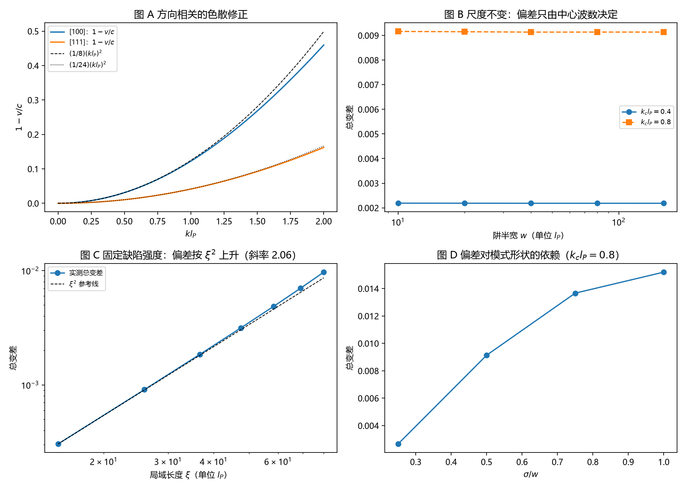

# 注记-通量加权的三维各向异性与局域长度：方向依赖与尺度不变性

- **日期**：2026-09-18 04:59:13
- **对应脚本**：`验证脚本/minimal_verification_flux_weighting_3d_defect.py`（判据 J1 至 J7，8/8 通过；确定性；运行约 0.4 秒；图存 `images/flux_weighting_3d_defect.png`，见 §一 图 1）
- **依据**：[[注记-碰撞通量加权的最小验证：锁速载子口径闭合与包络群速口径的偏差]]（首轮）；[[研究方向-碰撞动力学的抽样机制：三个候选模型与优选]]（计划中的 J5 与 J6）；[[元相子振荡晶格的色散关系：低能光速涌现与洛伦兹破坏首阶项]] §3；[[内部草稿/开放问题总览：元相子理论待解决问题清单]] P3-12、P1-25
- **定位**：执行通量加权轮的后两项扩展：三维 [111] 方向的速度各向异性与局域长度扫描。读数同时给 P1-25（三维晶格各向异性复算）提供首阶系数的方向依赖。本注记不改动基准文件。
- **状态**：判据 8/8 通过。核心读数：色散修正系数沿 [100] 为 $0.124781$（$1/8$）、沿 [111] 为 $0.041642$（$1/24$），各向异性比 $2.9965$，份额偏差之比 $3.1218$；偏差与阱半宽无关（相对散布 $2.18\times10^{-3}$，属格点离散化）；固定缺陷强度下偏差对局域长度 $\xi$ 的双对数斜率 $2.0641$；形状依赖给出 $0.00266$ 至 $0.01520$ 的单调上升。

---

## 一、判据与结果

| 判据 | 内容 | 通过条件 | 实测 |
|---|---|---|---|
| J1 | [100] 方向速度衰减系数 | $1/8 \pm 0.001$ | $0.124781$ |
| J2 | [111] 方向速度衰减系数 | $1/24 \pm 0.001$ | $0.041642$ |
| J3 | 群速分量（三维一般方向） | 相对误差 $<10^{-8}$ | $8.58\times10^{-10}$ |
| J4a | 两方向系数之比 | $3.0 \pm 0.05$ | $2.9965$ |
| J4b | 两方向份额偏差之比 | $3.0 \pm 0.15$ | $3.1218$（$0.009137$ 对 $0.002927$） |
| J5 | 偏差与阱半宽无关 | 相对散布 $<1\%$ | $2.18\times10^{-3}$ |
| J6 | 固定缺陷强度下偏差对 $\xi$ 的斜率 | $2.0 \pm 0.3$ | $2.0641$ |
| J7 | 形状依赖单调 | 单调 | $0.00266 \to 0.01520$ |

图注：左上为 [100] 与 [111] 两个方向的 $1-v/c$ 及其 $(k l_P)^2$ 系数参考线；右上为总变差随阱半宽的变化（两条中心波数曲线均水平）；左下为固定缺陷强度下总变差对局域长度 $\xi$ 的双对数与 $\xi^2$ 参考线；右下为总变差对模式形状比 $\sigma/w$ 的依赖。

## 二、模型设定

三维精确色散 $\omega^2 = (4/t_P^2)\sum_a \sin^2(k_a l_P/2)$ 给出群速分量

$$v_a = \frac{\partial\omega}{\partial k_a} = \frac{c\,\sin(k_a l_P)}{t_P\,\omega}.$$

一维特例还原 $v/c = \cos(k l_P/2)$；沿 [111] 取 $k_a = k/\sqrt{3}$，得 $|v|/c = \cos\big(k l_P/(2\sqrt{3})\big)$，即色散修正的辐角被 $1/\sqrt{3}$ 压低。

份额偏差沿用首轮构造：频率平方型阱 $\omega_j = \omega_0\sqrt{1-u_j^2}$、$u_j = (j-j_c)/w$，高斯模式密度 $\rho_j \propto e^{-(j-j_c)^2/(2\sigma^2)}$、$\sigma = w/2$；比较载子锁速口径 $p^A_j \propto \rho_j$ 与包络群速口径 $p^B_j \propto \rho_j v_j$，偏差取总变差。局域长度扫描固定阱曲率参数 $\Omega$，令 $w = \omega_0/\Omega$。

## 三、读数的意义

方向依赖被确定下来。色散修正的首阶系数沿 [100] 为 $1/8$、沿 [111] 为 $1/24$，两者之比恰为 3（J1、J2、J4）。原因是体对角线上每个分量的波数只有 $k/\sqrt{3}$，色散辐角因此被压低 $\sqrt{3}$ 倍，二阶修正缩小 3 倍。这条读数直接回答 P1-25 提出的问题：洛伦兹破坏的首阶项由立方对称性组织成一组方向相关的离散系数，份额偏差也按同一比值变化。

偏差只由中心波数决定。固定 $k_c$ 而把阱半宽从 $10$ 变到 $160\,l_P$，总变差不变（J5）。原因是速度剖面在 $u = (j-j_c)/w$ 上自相似。含义很直接：想找这种偏差，要找中心波数大的模式，与模式多大无关。

固定缺陷强度下偏差随局域长度上升。以曲率为 $\Omega$ 的阱为缺陷模型，$w = \omega_0/\Omega$，于是 $\xi \propto \omega_0 \propto k_c$，偏差按 $(k_c l_P)^2$ 走，故对 $\xi$ 的斜率是 2（J6）。这条读数与我原先的设定相反：原设想紧束缚模式（$\xi$ 小）偏差更大，实测的驱动量是中心波数，局域长度只经由它与中心波数的正比关系间接进入。差别值得记住，因为"局域化更强"与"色散修正更大"在本框架里可以互相分离。

形状依赖给出偏差的第三个性状。固定 $k_c$，把模式分布从 $\sigma/w = 0.25$ 放宽到 $1.0$，总变差从 $0.00266$ 升到 $0.01520$（J7）。分布越铺向折返点，速度非均匀的权重越大，同一条偏差通道因此有约 5.7 倍的形状调制空间。

## 四、严格程度声明

J1、J2、J3 是解析式的数值核对（低阶展开与偏导数），J4 的比例关系可由辐角的 $1/\sqrt{3}$ 直接给出，三者属精确级。J5 的残差 $2.18\times10^{-3}$ 来自格点离散化（阱越窄残差越大），不属物理效应。J6 与 J7 是参数扫描的数值读数，斜率精度约 $\pm 0.05$。模型假设（频率平方型阱、高斯模式、$\rho v$ 形式的动力学计数）与首轮相同，属最小模型，结论只能在"若采用该模型"的条件下引用。

## 五、边界声明

本验证只做：一维模式剖面在三维精确色散下的方向修正、各向异性比、尺度不变性、局域长度标度与形状依赖。

本验证不做：三维各向异性阱下模式形状的求解；缺陷的微观构造（$\xi$ 与缺陷强度 $\Omega$ 的关系是模型参数化，未从晶格缺陷作用量导出）；碰撞事件在排除体积与净绕数口径下的微观实现；真实多体碰撞动力学。

## 六、过程记录

判据 8/8 一次通过，未修正判据预期，绘图无缺字。读数一处与原设定相反（固定缺陷强度下偏差随 $\xi$ 上升），原因在中心波数与局域长度的正比关系，已写入 §三 并同步进研究方向文档的后续项。J5 的残差来源（格点离散化）经把 $w$ 加倍核对后确认，未当作物理效应登记。
