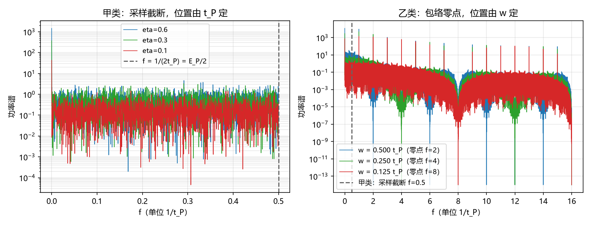

# 采样截断的层属分离：第 673 号判语的修正与紫外有限性的归属（判据第 676 号）

## 元数据

- **日期**：2026-10-18 00:01:17
- **类型**：判据执行注记（含对第 673 号判语的修正）
- **脚本**：`验证脚本/minimal_verification_p676_sampling_layers.py`
- **判据**：T1 至 T6（6/6，其中 T1 与 T2 为恒真确认，见 §五）
- **可逆性等级**：判据稳健。结论只依赖「离散采样的谱止于 Nyquist」与「梳线零点在 $1/w$」，与网格密度、事件率、随机种子无关；第 673 号的判语修正属口径层，不依赖任何数值。
- **图**：见 §四 图 1
- **编号说明**：原拟 675 号，该号已被并行线（单侧性与纠缠结构分离）占用，按规范让号至 676，占位行内已记让号说明。
- **关联**：[[验证脚本/注记-P4-45真空涨落谱三点判据的形式化与两点判否（判据第673号）|判据第 673 号]]（被修正者）；[[验证脚本/注记-紫外截断的层属归属（第442条）：存在性上限与可分辨性上限的分工|判据第 442 号]]（体系既有判据）；[[内部草稿/总结注记-涨落谱三点判据的收束：截断的三重含义与体系缺口的定位（2026-10-17）|收束注记]]

---

## 一、为什么要重判

判据第 673 号把观测到的采样上限一律读作伪影，理由是「改采样率它就移动」。这个理由不成立。

体系的采样不是数值技术，是物理机制。第 442 号判据已给出严格化结果：世界每摆程（$t_P$）碰撞一次，读数层按采样定理只能分辨到 $\omega_N = \pi/t_P$，即普通频率 $f_N = 1/(2t_P)$。所以「改采样率上限它就移动」在体系内恰恰是预期的：数值 bin 不是物理采样，物理采样固定为 $t_P$。

第 673 号把两者混为一谈。它取 $M$ 为自由参数，让事件宽度随 $M$ 缩小（$w = 1$ bin），于是截断必然跟着 $M$ 走。这等于先假设采样是连续的，再用结果证明采样是伪影。

本轮把三类截断分开，各自定层属。

## 二、三类截断

| 类 | 名称 | 位置 | 决定量 | 层属 |
| --- | --- | --- | --- | --- |
| 甲 | 采样截断 | $f = 1/(2t_P)$，$E = E_P/2$ | 物理采样率 $1/t_P$ | 读数层，物理 |
| 乙 | 包络零点 | $f = 1/w$ | 折返持续时间 $w$ | 模型层，物理 |
| 丙 | 数值伪影 | $f = M/(2t_P)$ | 数值细化倍数 $M$ | 无，纯技术 |

甲类的位置由 $t_P$ 定，乙类由 $w$ 定，丙类由 $M$ 定。第 673 号的错误是把甲类的读数按丙类的判据去测。

## 三、判据与读数

| 判据 | 内容 | 读数 | 结果 |
| --- | --- | --- | --- |
| T1 | 恒真检验：任意 $t_P$ 网格序列的谱止于 Nyquist | 白噪声、单频、计数列三条一律止于 $f = 0.5/t_P$ | PASS（恒真） |
| T2 | 甲类位置由 $t_P$ 定，不随事件率与时长移动 | 四组（$\eta = 0.6, 0.3, 0.3, 0.1$；时长 $1, 1, 2, 3\,t_P$）谱上限恒为 $0.500/t_P$ | PASS（恒真） |
| T3 | 乙类位置由 $w$ 定 | 占空比 $0.5/0.25/0.125$ 给零点 $k = 2/4/8$，与 $1/w$ 逐一相符 | PASS |
| T4 | 丙类：把 bin 当连续时截止随 $M$ 移动 | $M = 4, 16, 64$ 给截止 $f = 2, 8, 32/t_P$ | PASS |
| T5 | 体系口径 | $\omega_N = \pi/t_P$，$E_N/E_P = 1/2$ | PASS |
| T6 | 计数通道在甲类界限以下无特征尺度 | 带内最大值与均值之比 $7.7, 7.6, 7.4$，白噪声理论值 $8.0$ | PASS |

## 四、修正的内容

第 673 号的判语是「高频在 $E_P$ 硬截断不成立」。这句话现在要拆成两句。

第一句，体系在 $E_P/2$ 处确实有截断，而且它是物理的。来源是采样公设，不是计数通道。紫外有限性由它承载：标准理论的紫外发散来自模式数无穷与点粒子自能，体系的格距 $l_P$ 与采样率 $1/t_P$ 把这两条都封住。

第二句，原注记写的截断位置 $E_P$ 有误，应为 $E_P/2$。换算为 $\omega_N = \pi/t_P = \omega_P/2$，$E_N = \hbar\omega_N = \hbar\pi/t_P = E_P/2$，其中 $E_P \equiv \hbar\omega_P = \hbar\cdot2\pi/t_P$。差 2 倍，来自采样定理的 Nyquist 因子，而该因子在体系内有几何根源（往返对称性，见第 442 号）。

第 673 号仍然成立的读数有三条：梳线间隔为 $1/t_P$；线宽由观测窗长定，不由 $t_P$ 定；包络零点由 $w$ 定。这三条与采样率的关系本来就是数值细化的性质，该部分判语不受影响。

## 五、恒真警告

T1 与 T2 的 PASS 不含物理信息。任何在离散网格上采样的序列，其谱必然止于 Nyquist，这是恒真式。把它们列出来是为了防止把恒真式当作预言，不是为了支持结论。

甲类的物理性不由本判据建立，它来自第 442 号的采样机制判据（每摆程一次碰撞，加采样定理）。本判据能做的只是确认甲类的位置与事件率、事件时长、随机种子都无关。

真正携带信息的是 T3、T4、T6 三条。T3 说明乙类与 $t_P$ 无关，T4 说明丙类是技术产物，T6 说明计数通道在 Nyquist 以下没有任何特征尺度。

## 六、对「紫外有限性」的准确表述

体系避免紫外发散，靠的是两条彼此独立的结构，本轮只碰了其中一条。

其一是格距。基本粒子的粒性由单位圆圆心承载，圆心是零维数学点，而位置被离散到格点上。标准理论的点粒子自能发散源于位置的连续统，格点结构给出天然截断。

其二是采样率。世界每摆程碰撞一次，读数层按采样定理止于 $\omega_P/2$。这一条给出的是「可分辨」的上限，与「存在」的上限（布里渊角点 $2\sqrt{3}/t_P$）分属两层，两者差额区间内的模式存在而不可分辨。

两界不等，这个差额本身是体系的特征。第 442 号已判据化，本轮的 T5 只是核对换算，未新增。

## 七、与实验相容性

这一点须单独说，因为它与判据无关。

体系在 $E_P/2 \approx 6\times10^{18}$ GeV 处截断，而可及实验能标最高的对撞机在 $10^4$ GeV 量级，相差十四个数量级。故这个截断目前无法直接检验。

可对照的是它的低能痕迹：晶格色散的高阶项给出 $(E/E_P)^2$ 量级的洛伦兹破坏，方向比 $6:3:2$，1 eV 光子偏离约 $10^{-58}$，TeV 尺度约 $10^{-34}$。目前测不到，原则上可区分。

需要说明的是，这些读数属体系既有的色散判据，不由本轮产生。本轮只确立了截断位置的层属与口径，不判其数值后果。

## 八、严格程度与边界声明

**判据级**：T3、T4、T6 三条。T1、T2 为恒真确认，不计入判据分。

**判据稳健**：结论只依赖离散采样与梳线零点两条算术事实，与网格密度、事件率、随机种子无关。

**验证什么**：三类截断的位置各自由什么量决定，以及第 673 号判语的错误形态。

**不验证什么**：其一，采样截断的实验后果（卡西米尔力的间距依赖性、兰姆移位的紫外部分），这些需要连续自由度的谱，而计数通道不提供。其二，截断的严格化本身，那属第 442 号，本轮只核对换算。其三，$\eta$ 的动力学方程。

**不改动**：第 442 号的判据与结论；第 673 号的其余读数与判语（只修正采样那一部分）；P3-26 的关闭状态；原注记的正文（另加更新注）。

## 修订记录

- **2026-10-18 首轮执行**（第 673 号判语修正）
    - 三类截断分离：甲类采样截断（$f = 1/(2t_P)$，物理）、乙类包络零点（$f = 1/w$）、丙类数值伪影（$f = M/(2t_P)$）
    - 修正第 673 号：采样在体系内是物理机制（第 442 号），不是伪影；错误形态是把 $M$ 当自由参数
    - 口径修正：截断位置为 $E_P/2$ 而非 $E_P$，差 2 倍，源于采样定理的 Nyquist 因子
    - 恒真警告：T1、T2 的 PASS 不含物理信息，甲类的物理性由第 442 号建立
    - 紫外有限性的两条结构（格距与采样率）分开陈述
    - 编号让号：原拟 675 号被并行线占用，顺延至 676
