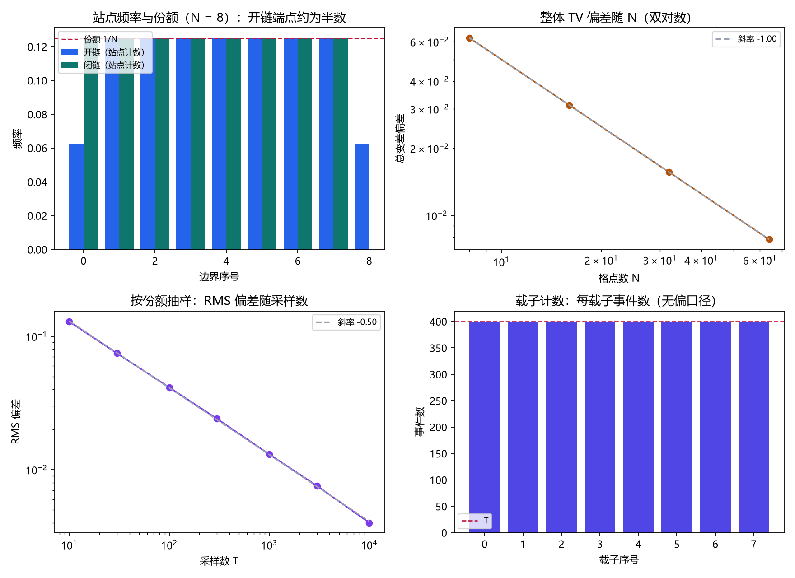

# 注记-采样无偏性的最小验证：计数口径决定偏置

- **日期**：2026-09-18 04:17:34
- **对应脚本**：`验证脚本/minimal_verification_sampling_unbiasedness.py`（判据 J1 至 J5，8/8 通过；确定性加固定种子；运行约 1 秒；图存 `images/sampling_unbiasedness.png`，见 §一 图 1）
- **依据**：[[理论总纲/元相方程]]（摆程与层数跳格）；[[元相子几何动力学——束缚振荡修订整合版]]（束缚振荡往返、碰撞即快照抄写）；[[序参量份额定理：Born规则、归一化与幺正性的系综推导]] §7 与 §10 (e)（抽样无偏性的晶格论证）；[[内部草稿/开放问题总览：元相子理论待解决问题清单]] P3-12；[[内部草稿/注记-采样的客观义与两层用法：自铭刻与快照抄写的区分]]
- **定位**：把 P3-12 的三段式判据中第 (ii) 条（无偏性）做一次最小验证。要问的问题是：格点上的抽样落点是否按份额分布。本注记不改动基准文件，不含新科学断言。
- **状态**：判据 8/8 通过。核心读数：载子计数下每载子每摆程恰一次事件、对两条相邻边界的到访严格各半（200 与 200）；开链站点计数的端点频率恰为内部的 0.5（$N = 8/16/32/64$ 四点不变），整体总变差偏差按 $1/N$ 收敛（双对数斜率 $-1.0000$）；闭链站点计数严格均匀（各 400，极差 0）；按份额抽样时 3σ 覆盖率 99.50%、偏差均方根按 $T^{-1/2}$ 收敛（斜率 $-0.5008$）。

---

## 一、判据与结果

| 判据 | 内容 | 通过条件 | 实测 |
|---|---|---|---|
| J1a | 载子计数：每载子事件数 | 恰为 $T$ | 全为 400 |
| J1b | 载子计数：对两邻到访数 | 各 $T/2$（差 $\le 1$） | 200 与 200 |
| J2 | 开链站点计数的端点偏置 | 端点比内部 $= 0.500 \pm 0.02$ | $0.500000$ |
| J3a | 端点偏置的尺度行为 | $N = 8/16/32/64$ 均为 0.5 | 四点均为 $0.5000$ |
| J3b | 整体总变差偏差随 $N$ | 双对数斜率 $-1.0 \pm 0.05$ | $-1.0000$ |
| J4 | 闭链站点计数 | 全部严格相等 | 各 400，极差 0 |
| J5a | 按份额抽样的 3σ 覆盖率 | $\ge 99\%$ | $99.50\%$ |
| J5b | 偏差均方根的收敛率 | 斜率 $-0.5 \pm 0.1$ | $-0.5008$ |

图注：左上为站点频率与份额的对照（开链端点约为份额的一半，闭链与份额贴合）；右上为整体总变差偏差随格点数的双对数（斜率约 $-1$）；左下为按份额抽样时偏差均方根随采样数的双对数（斜率约 $-0.5$）；右下为载子计数下每载子的事件数（全等于 $T$）。

## 二、模型设定

一维链，$N$ 个单元，载子 $i$ 在相邻两条边界 $b_i$ 与 $b_{i+1}$ 之间往返，全体同频（同相）。每个摆程每个载子恰在它的一条边界上留下一次读数，两邻交替：第 $k$ 摆程载子 $i$ 位于 $b_i$（$k$ 偶）或 $b_{i+1}$（$k$ 奇）。

一次"事件"定义为载子与站点的配对，于是有两种计数口径。载子计数按载子归属，每个载子每摆程一次；站点计数按站点归属，统计每条边界收到多少次到访。开链指端点 $b_0$、$b_N$ 只有一侧邻居；闭链指 $b_N$ 与 $b_0$ 认同（周期边界）。

第二段另加按份额的随机抽样：块份额取 $1:2:3:4$，每轮做 $T$ 次多项式抽样，比较频率与份额，并统计 3σ 覆盖率与偏差均方根的收敛率。

## 三、读数的意义

其一，无偏性由"一次抽样"的定义决定，不由格子自动给出。载子计数下落点严格均匀；站点计数下开链端点恰好收到内部站点的一半，因为端点只有一侧邻居。

其二，端点偏置是 O(1) 的单站效应，但它不随体系变大而消失（$N$ 从 8 到 64 恒为 0.5）；受影响站点占比是 $2/N$，所以整体偏差按 $1/N$ 收敛。周期边界下该偏置完全消失。

其三，份额到观测频率那一段的统计性质（无偏、偏差按 $T^{-1/2}$ 收敛）在"落点按份额抽样"这一前提下成立。这一步是本验证的输入假设，不是它的结论。

## 四、严格程度声明

几何部分（事件计数、端点比例、闭链均匀性）为精确恒等式级，可解析核对；统计部分（3σ 覆盖率、$T^{-1/2}$ 收敛率）为标准抽样理论的直接后果。第三句中的前提假设属机制面，本验证不涉及。

## 五、边界声明

本验证只做：最小链上两种计数口径的事件分布、闭链与开链的差别、按份额抽样的统计性质。

本验证不做：真实碰撞动力学是否按份额抽样（机制面，P3-12 判据 (ii) 的实质内容）；三维与缺陷构型下的相应读数；带限与晶格带边的调和（P3-26）；连续极限。

## 六、过程记录

绘图初版未设中文字体，图中标签缺字，已设 Microsoft YaHei 并复跑，判据预期未改。其余判据一次通过。
