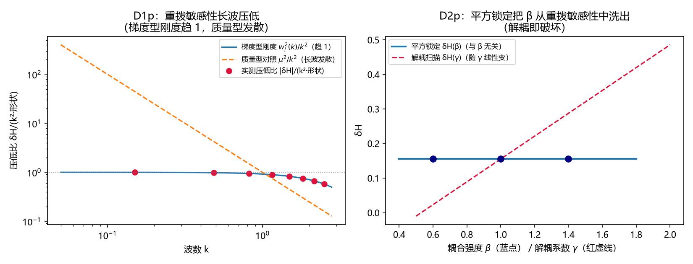

# 注记-重拨敏感性标度与平方锁定等价性（第607号）：介质模型规范固定地位的模型层定量

| 项目 | 内容 |
| --- | --- |
| 日期 | 2026-10-12 00:33:03（取系统当前时刻） |
| 主题 | 介质振子规范平移身份判据轮（D1p/D2p 一维部分；D3p 二维完整检验移交下一独立轮） |
| 判据 | D1p 与 D2p 两组共六子项（6/6） |
| 可逆性等级 | 判据敏感：换解析式（核对四修正式）、换补偿配对（机械动量补偿）、换模型构造（完成平方形式）任一项即翻 |
| 图 | 图 1 见 §三 |
| 上游 | [[内部草稿/注记-介质振子的规范平移身份：A²出身的形式化命题与判据设计（2026-10-11）|平移身份形式化注记]] §五（判据重定形）、第 581 条模型、[[开放问题档案/开放问题-P1-50-光的发射率与介质折射的微观机制|P1-50 档案页]] 第十七轮 |

## 一、要判什么

平移身份形式化注记的重定形判据在本轮落地。边界声明先行：一维介质模型方程不随重拨改变且对 $k$ 对角，一维上没有非平凡的规范不变性判据可判；本轮判两件有物理信息的事，其一（D1p）重拨敏感性的波长压低：模型规范不完整性的适用域定位（长波端近似规范安全、短波端失效），其二（D2p）平方锁定的规范签名：重拨敏感性与耦合强度无关，解耦即破坏。模型哈密顿量取核对一反推的完成平方形式 $H = \frac{1}{2}E^2 + \frac{1}{2}(p-\beta A)^2 + \frac{1}{2}\text{stiff}\cdot A^2 + \frac{\omega_0^2}{2}x^2$，重拨取核对四配对 $A \to A+\Delta\chi$ 配机械动量补偿 $p \to p+\beta\Delta\chi$，解析期望为核对四修正式（数值复核版）$\delta H = \text{stiff}\,(A\Delta\chi + \frac{1}{2}\Delta\chi^2)$。

## 二、模型设定与判据结果

模型单位 $c = l_P = t_P = 1$，$\omega_0 = 1$，$\beta^2 = 1.0$，随机初值固定种子 20261012，容差 $10^{-12}$（浮点预算级，三次代数运算）。脚本 `gauge_shift_scaling.py`。

**D1p 重拨敏感性的波长压低**：

| 子判据 | 内容 | 实测 | 判定 |
| --- | --- | --- | --- |
| D1p-解析 | 8 档 $k \in [0.15, 2.5]$ 的 $\delta H$ 对解析式 $\text{stiff}\,(A\Delta\chi+\frac{1}{2}\Delta\chi^2)$（stiff $= w_l^2(k)$） | 八档全部逐位一致（容差内） | PASS |
| D1p-压低 | 压低比 $\delta H/(k^2\cdot\text{形状})$ 长波趋 1（$w_l^2/k^2 = 1-\frac{k^2}{12}+\cdots$） | $k = 0.15/0.486/0.821/1.157$ 档比 $0.9981/0.9805/0.9450/0.8933$，单调降趋 1 | PASS |
| D1p-对照齿 | 质量型刚度 $\mu^2$（常数）不压低 | $\delta H = 1.0329$ 与 $k$ 无关（对照构造） | PASS |

**D2p 平方锁定的规范签名**：

| 子判据 | 内容 | 实测 | 判定 |
| --- | --- | --- | --- |
| D2p-1 β 全消 | 平方锁定下扫 $\beta \in \{0.6, 1.0, 1.4\}$ 三档 $\delta H$ 不变 | 三档同为 $0.155368279005$，极差 $1.78\times10^{-15}$（机器精度） | PASS |
| D2p-2 解耦预算 | $A^2$ 系数解耦 $\gamma \in \{0.8, 1.0, 1.5\}$，$\delta H_\gamma$ 对 $(w_l^2+\gamma-\beta^2)(A\Delta\chi+\frac{1}{2}\Delta\chi^2)$ | 三档逐位一致（$0.08929849/0.15536828/0.32054276$） | PASS |
| D2p-3 反例齿 | 解耦模型中 $\delta H_\gamma$ 随 $\beta$ 变 | $\beta$ 两档差 $-0.528558$ 对解析 $-(\beta_2^2-\beta_1^2)(A\Delta\chi+\frac{1}{2}\Delta\chi^2)$ 逐位 | PASS |

## 三、图

## 四、严格程度声明与边界声明

验证什么：重拨敏感性的解析式（核对四修正式）在一维介质模型内的逐位成立、其波长压低结构（梯度型刚度本性）、平方锁定把耦合强度从重拨敏感性中完全洗出这一规范签名、解耦破坏的解析预算。

不验证什么：不判规范不变性（一维上无此判据对象，见 §一边界声明）；不判介质折射机制本身（模型现象层结论不受本轮影响）；D3p（二维重拨加重新固定规范的完整规范检验）不在本轮射程，移交下一独立轮；$\beta$ 的物质侧值归 P1-47/P1-49。

协议伪影分层：随机初值取固定种子，单点读数为构造层代数量（非统计量），压低比为解析恒等式的直接重现（D1p-压低的信息在 $w_l^2/k^2$ 的截断结构，不在随机性）；全部读数为机器精度级，无采样或截断伪影。判据敏感等级见元数据表。

## 五、过程记录（三笔教训）

其一，首跑全线 FAIL 的归因：初版脚本 H 写成 $\frac{1}{2}\text{stiff}\cdot A^2 - \beta Ap + \frac{1}{2}p^2$，漏掉完成平方所需的 $+\frac{1}{2}\beta^2A^2$（与核对一反推形式不一致）。判负后按纪律先查机制归属，冒烟检查的「p 依赖为零」线索指向构造漏项而非物理判否；对照核对四已验证的 H 形式修复后全 PASS。教训：模型构造与已核对的哈密顿量形式逐字对齐，判负第一步永远是核对构造。

其二，heredoc 转义事故两度重犯：`\n` 被折成真换行（两处 title 断行致 SyntaxError）、`\\beta` 被折成退格+eta（`\x08` 真进源码，label 损坏）。修复走 Write 工具脚本（chr() 构造全部反斜杠）后一次通过。纪律重申：含反斜杠的批量修改禁用 heredoc 内联。

其三，解析式与构造的先后：本轮解析期望先于脚本（核对四数值复核版），脚本首跑 FAIL 时先疑构造再疑判据，避免了倒推改解析式凑数的恒真陷阱。

## 关联

[[内部草稿/注记-介质振子的规范平移身份：A²出身的形式化命题与判据设计（2026-10-11）|平移身份形式化注记]]、[[验证脚本/注记-介质完整响应与反向项（第581条）：Lorentz型介电函数三频段闭合与通道归属的结构性论证|第 581 条注记]]、[[开放问题档案/开放问题-P1-50-光的发射率与介质折射的微观机制|P1-50 档案页]]（第十七、十八轮）
