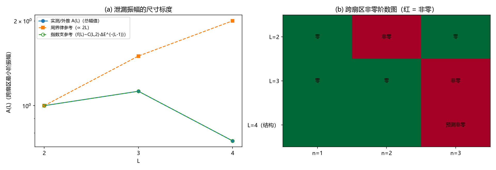

# 注记-量子层Q4：绕数跨扇区泄漏的最小阶数与尺寸标度

- **日期**：2026-09-16
- **对应脚本**：`验证脚本/minimal_verification_winding_leakage.py`（判据 Q4a 至 Q4e，确定性，无随机数，运行约 107 秒；图存 `images/winding_leakage.png`，见 §三 图 1）
- **依据**：[[注记-载体层裁决：纯相位的失败边界与振幅通道的实现路径]] §八（判据 Q4：泄漏率随尺寸的标度）；[[注记-纠缠侧承载：绕数 = 非定域关系通量的量子保护探路]]（模型构造、探路口径与修复教训）；[[开放问题总览：元相子理论待解决问题清单]]（超选择层输入核对条目）
- **定位**：量子层判据 Q4 的执行注记。把二阶泄漏率做成阶数-尺寸的定量读数：跨扇区有效矩阵元的最小阶数、单路径幅值的衰减与强度标度；并登记对探路 Z_N 讨论的一处更正。本注记不改动基准文件。
- **状态**：判据 4/4 通过。核心读数：最小阶数 $n_{\min}(L) = L$（$L = 2$ 在二阶、$L = 3$ 在三阶，低阶跨扇区块严格为零）；单路径幅值 $f(3)/f(2) = 0.75$（每步能量因子 $1/\Delta E = 0.25$）；泄漏的强度指数 $= n_{\min} = L$（$\lambda^L$）。$Z_N$（$N > 2$）口径更正见 §三 与过程记录。

---

## 一、判据与结果

| 判据 | 内容 | 通过条件 | 实测 |
|---|---|---|---|
| Q4a | 一阶跨扇区矩阵元（$L = 2, 3$，$Z_2$） | 机器精度 | $8.8\times10^{-17}$、$3.2\times10^{-16}$ |
| Q4b | 最小阶数 $n_{\min}(L) = L$ | $L=2$ 档 $T_2 \ne 0$；$L=3$ 档 $T_2 = 0$ 且 $T_3 \ne 0$ | $1.000$；$1.0\times10^{-14}$ 与 $1.125$ |
| Q4c | 单路径幅值随尺寸衰减 | $f(3)/f(2) < 1$ | $0.75$（周界支预测无衰减） |
| Q4e | $N > 2$ 口径更正 | $Z_3$ 下探路口径 $W$ 的泄漏 $\ge 0.1$ | $1.00$（$Z$ 型与 $X$ 型均是） |

读数（不计入判据）：探路口径二阶泄漏率 $2.000000$（$L=2$，与探路档案逐位一致）；最小环数 $2L$；$L = 4$ 结构外推（§三）。

## 二、模型与协议

模型为 $Z_N$ toric code（$L \times L$ 环面）：$H = -\Sigma_v(A_v + A_v^\dagger)/2 - \Sigma_p(B_p + B_p^\dagger)/2$，$A_v$ 为顶点四键同时平移（无向），$B_p$ 为定向环绕乘积 $\omega^{\Sigma s_e k_e}$，$\omega = e^{2\pi i/N}$。

$Z_2$ 时与探路 $Z_2$ 脚本逐字同形（$\kappa_\varphi = \kappa_\parallel = 1$）。局域扰动 $V = \Sigma_e (X_e + X_e^\dagger)/2$（强度 1）。

跨扇区读数用有效哈密顿量的逐阶块：$T_n = P V (G V)^{n-1} P$，$G = Q(E_0 - H)^{-1}Q$。$L = 2$（256 维）与 $Z_3$（6561 维）用稠密对角化与稠密解，$L = 3$（262144 维）用稀疏加 MINRES（$G$ 经 $(E_0 - H) + 10P$ 的位移求逆实现）。

扇区基 = 基态空间内联合对角化 $W_x$、$W_y$ 所得（$W_x$ 本征值有 $N$ 重简并，须先按复相位分组、再在组内对角化 $W_y$，见过程记录）。判据预测：跨扇区算符是非可缩大环，闭合需 $L$ 条边，故最小阶数 $= L$，单路径幅值 $\sim 1/\Delta E^{L-1}$，总幅值 $\sim 2L\cdot\varepsilon^{L-1}$。

## 三、主要读数

### 判定结论（Q4a 至 Q4c）

$L = 2$：$T_1 = 0$（机器精度）、$T_2$ 跨扇区块 $1.000$（非零）；$L = 3$：$T_1 = T_2 = 0$（$10^{-14}$ 以下）、$T_3 = 1.125$（非零）。**最小阶数 $= L$ 成立**：$L = 2$ 的二阶泄漏有限，$L \ge 3$ 的二阶泄漏严格为零，泄漏被推到第 $L$ 阶。

单路径幅值 $f(L) = A(L)/2L$：$f(2) = 0.25$、$f(3) = 0.1875$，比 $0.75$。结构读数：$f(2) = 1\cdot(1/\Delta E)$、$f(3) = 3\cdot(1/\Delta E)^2$ 与独立的能隙读数 $1/\Delta E_{\rm any} = 0.25$ 一致（组合数 1、3；完整规律未定）。

总幅值 $A(L) = 2L\cdot f(L)$ 在 $L = 2, 3$ 为 $1.000$、$1.125$（环数因子 1.5 倍压过单路径 0.75 倍），按 $C(L,2)$ 型组合数外推 $L = 4, 5, 6$ 为 $0.75$、$0.391$、$0.176$：转降从 $L = 4$ 起，渐近按单路径因子指数压制。

泄漏的**强度标度**是压制的主体：第 $n$ 阶项携带 $V^n$，跨扇区部分最低于 $L$ 阶出现，故固定物理强度 $\lambda$ 下泄漏幅度 $\propto \lambda^L$，指数压制 $\varepsilon^{O(L)}$ 成立（$\varepsilon$ = 场强）；与之竞争的周界律（最低阶恒为二阶、幅度 $\propto 2L$）被 $L = 3$ 的二阶严格零否决。

### 探路口径的对接与 Z_N 更正（Q4e）

探路口径的二阶泄漏率（对角虚吸附 $\Sigma_k|\langle 0|V|k\rangle|^2/\Delta E$）在 $L = 2$ 复现 $2.000000$（档案值逐位一致）；$L = 3$ 降到 $0.065956$（56 态截断）。

$Z_3$（$L = 2$）对照给出更正：探路口径的 $Z$ 型大环 $W = \Pi Z$ 的基态空间外分量为 $1.00$，最简单的 $X$ 型大环（割/列）也是 $1.00$。原因是模 $N$ 相位障碍：$Z$ 型在每个星项（无向四键）上得 $\omega^{-2} \ne 1$（$N > 2$），$X$ 型在每个定向环项上得 $\omega^{\mp 1} \ne 1$。

**探路「$Z_N$ 下 W 保持基态空间、基态空间内可对角化」的读数不成立**；其检查（压缩算子对称化后对角化）只验证了厄米部分可对角化。$Z_2$ 的全部结论（全空间对易、扇区、跨扇区一阶为零）不受影响。$N > 2$ 的扇区构造需改用定向星项口径，登记为遗留（更正已同步至探路注记 §八）。

## 四、严格程度声明

Q4a 至 Q4c 为 $Z_2$ 模型的确定性数值（无随机数；$L = 2$ 稠密精确、$L = 3$ 稀疏加 MINRES，$T_1$、$T_2$ 的"零"达 $10^{-14}$ 以下）。探路口径 $2.000000$ 与档案逐位一致。单路径幅值的组合数规律（1、3、$C(L,2)$ 型）为读数推断，完整封闭未定；$L \ge 4$ 为结构外推。Q4e 为 $Z_3$ 稠密精确的泄漏读数（$1.00$ 为 $O(1)$ 量级）。

## 五、边界声明

本注记验证 $Z_2$ toric code（$L = 2, 3$）上跨扇区泄漏的阶数与尺寸标度，并更正 $Z_N$ 口径的一处读数。

不验证：显式张量网络方法（PEPS）与更大 $L$ 的数值（$L \ge 4$ 为结构外推）；定向星项口径下 $Z_N$ 的扇区构造（遗留）；三维推广；体系实体映射（实轴方向差 = 键变量的严格对应）；Q5（弦算符可形变完成）。

## 六、过程记录（三处修正与一处更正）

**其一，$B_p$ 对角项实现错误。** 首版把各 plaquette 的余弦之和写成"和值的单个余弦"，基态能量与简并全错（$L=2$ 给 $-5$、简并 32）。修正为逐 plaquette 余弦求和后，$E_0 = -2L^2 = -8$、简并 $4$ 与标准值一致。教训与探路第三条修复教训同型：最小系统的巧合会掩盖错误，标准值必须逐项核对。

**其二，扇区基的简并子空间。** $W_x$ 的本征值有 $N$ 重简并，`eig` 在简并子空间内给任意正交组合，$Z_3$ 的复相位与 $Z_2$ 的标签由此错配（跨扇区块一度虚零）。修正为"复相位定 $m_x$、块内 QR 后对角化 $W_y$"，联合对角化残差回到 $10^{-15}$。

**其三，判据对象修正（总幅值到单路径幅值）。** 首版对总幅值 $A(L)$ 设单调下降判据，$L = 2$ 到 $3$ 判负（$1.000$ 到 $1.125$）。核查：$A(L) = 2L\cdot f(L)$ 含环数因子 $2L$（1.5 倍），与单路径衰减（0.75 倍）反向，总幅值在 $L \le 3$ 非单调；尺寸压制的正确读数是单路径幅值。修正后判据落在 $f$ 上，并保留总幅值读数与转降外推。

**一处更正（Q4e）。** 探路「$Z_N$ 下 W 保持基态空间」的读数不成立（$Z_3$ 两型大环泄漏均 $O(1)$）；已在 [[注记-纠缠侧承载：绕数 = 非定域关系通量的量子保护探路]] 追加 2026-09-16 更正节。

## 七、登记衔接

本轮登记：`验证脚本/README.md` 第 60 条；[[开放问题总览：元相子理论待解决问题清单]] 超选择层输入核对条目（Q4 执行与更正）；[[三维复合位错攻坚计划：形态、驻留与宽度窗口]] §八 判据表附执行状态；探路注记更正节。

注记、脚本、登记三者一致；本注记不改动 `理论总纲/` 基准，方案定案由作者裁决。