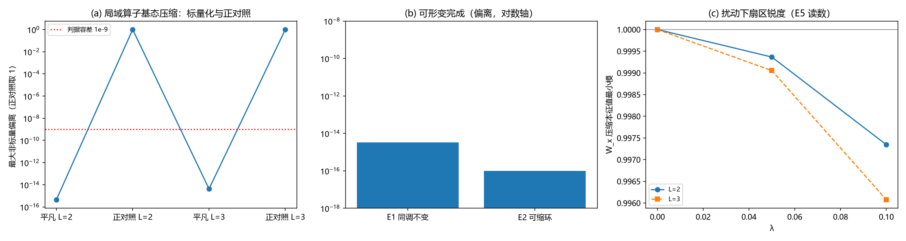

# 注记-量子层Q5：弦算符的可形变完成（同调不变、局域算子标量化与最小支撑）

- **日期**：2026-09-16 07:27:07
- **对应脚本**：`验证脚本/minimal_verification_string_deform.py`（判据 E1 至 E4、E5 读数，确定性，无随机数，运行约 133 秒；图存 `images/string_deform.png`，见 §三 图 1）
- **依据**：[[注记-载体层裁决：纯相位的失败边界与振幅通道的实现路径]] §八（判据 Q5：弦算符的可形变完成，TQO-2 型）；[[注记-定向口径下的Z_N扇区重建：绕数算符代数、简并N²与Q4复验]]（定向口径装置）；[[注记-量子层Q4：绕数跨扇区泄漏的最小阶数与尺寸标度]]（Q4 与探路口径）
- **定位**：量子层判据 Q5 的执行注记。把「局域扰动下绕数环算符可形变而不改变基态空间内的作用」拆成四条数值陈述：同调不变性、可缩环平凡性、局域算子标量化（TQO-2 核心）与最小非平凡支撑；附扰动读数。本注记不改动基准文件。
- **状态**：判据 4/4 通过。核心读数：同一同调类内相邻弦在基态空间的作用差为相位（$\le 2.4\times10^{-15}$）；**不含完整非可缩环的区域上全部局域算子（广义 Pauli 基全枚举）的基态压缩为标量**（$\le 4.2\times10^{-15}$）；含完整环的区域上非标量压缩恰为逻辑算符（计数 $6/6/1$（$Z_2$）、$24/24/2$（$Z_3$））；最小非平凡支撑 $= L$。

---

## 一、判据与结果

| 判据 | 内容 | 通过条件 | 实测 |
|---|---|---|---|
| E1 | 同调不变：相邻弦（$Z$ 列、$X$ 割）作用矩阵差相位 | $\lVert M_j^\dagger M_k - c I\rVert \le 10^{-9}$ | $\le 2.4\times10^{-15}$（三档模型） |
| E2 | 可缩环：plaquette 边界环 $= B_p$（算子恒等）；压缩为标量 | 恒等且标量 | 偏差 $2.4\times10^{-16}$；标量偏离 $\le 4.2\times10^{-15}$ |
| E3 | 局域算子标量化：不含完整非可缩环的区域，全部广义 Pauli 算子压缩为标量 | $\le 10^{-9}$ | $\le 4.2\times10^{-15}$；正对照非标量数 $\ge 1$ |
| E4 | 最小非平凡支撑 $= L$ | 相等 | $2$（$L=2$）、$3$（$L=3$） |

读数（不计入判据）：E5 扰动读数（$\lambda = 0.05, 0.10$：扰动基态内 $W_x$ 压缩本征值最小模 $0.996$ 至 $0.998$）。

## 二、模型与协议

模型为定向口径 $Z_N$ toric code（`minimal_verification_zn_sectors.py` 装置）：星项出边 $+1$、入边 $-1$，plaquette 逆时针环绕；四类绕数算符（$Z$ 型原胞环两族、$X$ 型对偶割两族）全部与 $H$ 对易（前轮已核）。域：$N = 2$（$L = 2, 3$）与 $N = 3$（$L = 2$）。

判据的数值形态：把区域 $A$ 上的全部广义 Pauli 基算子 $O = \Pi_{e \in A}(X_e^{a_e}Z_e^{b_e})$（共 $N^{2|A|}$ 个）作用于基态空间，检验压缩 $C = gs^\dagger O\, gs$ 是否为标量（$\lVert C - (\operatorname{tr}C/\deg)I\rVert$）。区域分类按「是否含完整非可缩环」判定（与面积、形状无关）。

## 三、主要读数

### 可形变完成（E1、E2）

同一同调类内、相邻位置的弦（$Z$ 型列 $\{v(i,j_0)\}$ 与 $\{v(i,j_0+1)\}$；$X$ 型对偶割 $\{h(i,j_0)\}$ 与 $\{h(i,j_0+1)\}$）在基态空间的作用矩阵两两只差一个相位：最大偏离 $7.8\times10^{-16}$ 至 $3.3\times10^{-15}$。形状不同的同调弦同理（差值为可缩区域内的 $B_p$ 乘积）。

可缩环平凡：单个 plaquette 的定向 $Z$ 环与 $B_p$ 逐点相等（偏差 $2.4\times10^{-16}$），其基态压缩为标量；$1\times2$ 块周界（两个 $B_p$ 之积）压缩亦为标量。可形变完成的精确层因此闭合：**弦的作用在同调类内不变，可缩部分在基态空间内不产生任何作用**。

### 局域算子标量化（E3，TQO-2 核心）

不含完整非可缩环的区域上，全部局域算子的基态压缩为标量：$L = 2$ 的角部两边（16 个算子）与弯折三边路径（64 个）；$L = 3$ 的单 plaquette 四边（256 个）、单星四边（256 个）、五边路径（1024 个）与角部两边。最大偏离 $4.4\times10^{-16}$ 至 $4.2\times10^{-15}$。

正对照（含完整环的区域，非标量压缩恰为逻辑算符）：$L = 2$ 的 plaquette 四边（非标量 6 个（$Z_2$）、24 个（$Z_3$）：该区域在 $2\times2$ 环面上已含完整的 2 边对偶割）、星四边（同数：含完整原胞环）、2 边非可缩列（1 个（$Z_2$）、2 个（$Z_3$））。

含义：**任何局域操作在基态空间内都是平凡的；非平凡作用的最小承载尺度是 $L$**（E4：最小非平凡支撑 $= L$：$L = 2$ 给 2、$L = 3$ 给 3）。这与 Q4 的最小阶数 $n_{\min}(L) = L$ 同构：一个说"要 $L$ 阶微扰"，一个说"要 $L$ 条边的支持"。局域扰动因此不能改变弦的作用，弦只能在同调类内形变。

### 扰动读数（E5）

$H + \lambda V$（$V = \Sigma_e(X_e + X_e^\dagger)/2$）下，扰动基态空间内 $W_x$ 压缩的本征值最小模：$\lambda = 0.05$ 给 $0.9991$ 至 $0.9996$，$\lambda = 0.10$ 给 $0.9961$ 至 $0.9983$（三档模型同量级）。

解读：扰动引起的扇区退化主要由二阶对角自能（$O(\lambda^2)$，各 $L$ 都有）承担；跨扇区的阶数 $=L$ 混合在此 $\lambda$ 下不占主导（$L = 3$ 的三阶混合 $\sim \lambda^3$ 量级）。该量属读数；保护随 $L$ 增强的定量形态由 Q4 的阶数与振幅标度承担。

## 四、严格程度声明

E1 至 E4 为最小模型的确定性数值（无随机数）：$L = 2$ 与 $Z_3$ 稠密精确，$L = 3$ 稀疏加 MINRES；局域算子枚举为全枚举（非抽样），"标量"判定到 $10^{-15}$ 量级。正对照的非标量计数为整数计数。E5 为扰动读数（$\lambda$ 二点）。

## 五、边界声明

本注记验证定向口径 $Z_N$ toric code（$N = 2$：$L = 2, 3$；$N = 3$：$L = 2$）上的弦可形变完成与局域算子标量化。

不验证：更大 $L$ 与 $N$ 的数值；含完整环但更复杂区域上的非标量结构分类（只给计数与存在性）；三维推广；体系实体映射（实轴方向差 = 键变量的严格对应）；"扰动下保护随 $L$ 增强"的定量标度（属 Q4 已给形态，E5 只作读数）。

## 六、过程记录（两处修正）

**其一，E3 的区域分类修正。** 首版把 $L = 2$ 的 plaquette 四边与星四边判为"无完整环"，实测各出现 6 个（$Z_2$）/24 个（$Z_3$）非标量。核查后确认：在 $2\times2$ 环面上，plaquette 的四个边已包含完整的 2 边对偶割 $\{h(0,0), h(1,0)\}$，星四边已包含完整的 2 边原胞环 $\{v(0,0), v(1,0)\}$。

非标量恰为这两类逻辑算符的乘积（每个区域非标量数 $= 2(N-1)$：$Z_2$ 给 6、$Z_3$ 给 24，与计数一致）。修正为按"是否含完整非可缩环"分类，平凡区改用角部两边与弯折三边路径。教训：区域是否"局域到看不出拓扑"必须按环的完整性判定，$2\times2$ 环面的面积直觉失效。

**其二，E5 的读数对象修正。** 首版测裸本征态的 $\langle W_x\rangle$，三档模型都给出 $\approx 0$。核查后确认这是简并子空间内基底的任意性（对易算符在退化本征空间里没有确定期望），与扰动无关。修正为对扰动基态空间内的 $W_x$ 压缩矩阵求本征值模：无扰动为 1，扰动下按上述读数下降。教训：在简并子空间里测任何期望值之前，必须先对角化目标算符固定基底。

## 七、登记衔接

本轮登记：`验证脚本/README.md` 第 63 条（同期修正 BH4a 条目重号 60 到 62，含其注记内引用一字修正）；[[开放问题总览：元相子理论待解决问题清单]] 超选择层条目（Q 组执行完毕）；[[三维复合位错攻坚计划：形态、驻留与宽度窗口]] §八 执行状态追加。

Q4 与 Q5 合起来给出「电荷绝对守恒」在最小模型上的量子层定量形态：跨扇区泄漏的最低阶 $= L$、振幅 $\propto \lambda^L$（Q4）；局域算子在不含完整环的区域上全部平凡、非平凡作用的最小支撑 $= L$（Q5）。注记、脚本、登记三者一致；本注记不改动 `理论总纲/` 基准，方案定案由作者裁决。