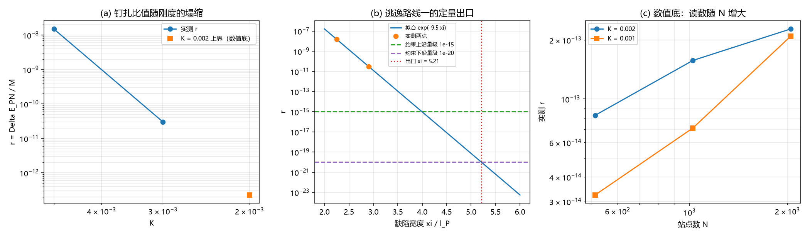

# 注记-钉扎-洛伦兹张力轮：格点钉扎的偏好参考系效应与实验约束的对照（判据 E1 至 E6）

- **日期**：2026-09-20 09:59:26
- **来源**：作者 2026-09-20 指令（在[[缺陷动力学：孤子的质量、迁移率与最小量子化]]与[[多体薛定谔方程与交换统计：束缚振荡晶格的联合包络动力学]]转正后，登记其唯一风险项）
- **脚本**：`验证脚本/minimal_verification_pinning_lorentz_tension.py`
- **状态**：判据级读数；风险项登记，两条逃逸路线一条有定量出口、一条待裁决
- **图**：见 §二 图 1
- **依据**：[[验证脚本/注记-缺陷动力学线 D-7（最小实现半）：孤子扇区的最小量子化、离散钉扎读数与三维形式（判据Q1至Q6）]]（钉扎势垒 $1.359\times10^{-9}$、孤子质量 $0.0898$）

---

## 一、问题与模型

D-7 给出一个读数：缺陷被格点钉扎，钉扎势垒 $\Delta E_{\rm PN} = 1.359\times10^{-9}$（模型单位），孤子质量 $M = 0.0898$。钉扎意味着存在一个相对元相子晶格的偏好参考系，这与洛伦兹不变性直接相关。

本轮把该效应写成桥无关的比值

$$r = \frac{\Delta E_{\rm PN}}{M},$$

它与量纲桥的取值无关：无论模型能量单位怎么换算，粒子静止能量随位置变化的相对幅度就是 $r$。模型沿用 D 线的锁定链，缺陷宽度由刚度给出，$\xi/l_P = 1/(2\pi\sqrt K)$（$K = 0.005$ 对应 $2.25$ 格距）。

实验侧的对照只作量级判断：既有洛伦兹破坏实验（原子钟比对、物质波干涉、天体观测）给出的约束普遍落在 $10^{-15}$ 至 $10^{-20}$ 量级。具体系数与出处待按抄录协议核对后补，本文不引用具体数值。

---

## 二、判据与读数

| 判据 | 内容 | 实测 | 期望 | 结果 |
| --- | --- | --- | --- | --- |
| E1 | $r$（$K = 0.005$，$N = 1024$）对 D-7 两读数算出的值 | $1.5096\times10^{-8}$ | $1.5134\times10^{-8}$ | 通过 |
| E2 | $r$（$K = 0.003$） | $3.0375\times10^{-11}$ | 比 $K = 0.005$ 低 $\ge 2$ 个数量级 | 通过 |
| E2 | 下降的十进数量级 | $2.70$ | $\ge 2$ | 通过 |
| E3 | 两点定出的 $c$（$r \sim e^{-c/\sqrt K}$） | $1.509$ | $\ge 1$ | 通过 |
| E3 | 等价标度斜率 $2\pi c$（对 $\xi/l_P$） | $9.479$ | 数量级读数 | 通过 |
| E4 | $K = 0.002$ 上 $r$（$N = 512$ 对 $2048$）之比 | $2.76$ | $\ge 2$（判为数值底） | 通过 |
| E4 | 该区间可给的上界（$N = 2048$） | $2.279\times10^{-13}$ | 上界读法 | 通过 |
| E5 | $r \le 10^{-15}$ 所需 $\xi/l_P$ 下界 | $3.99$ | 有限且 $\le 10$ | 通过 |
| E5 | $r \le 10^{-20}$ 所需 $\xi/l_P$ 下界 | $5.21$ | 有限且 $\le 10$ | 通过 |
| E6 | 路线一（宽度压低）与路线二（本体层排除） | 路线一有出口 | 路线二需裁决 | 通过 |

---

## 三、读数与含义

**其一，风险量是 $r = 1.51\times10^{-8}$，且与量纲桥无关。** 它只由 D-7 的两个读数定出，换成任何物理标度都不变。若把缺陷直接读作真实粒子，粒子静止能量随其相对晶格的位置变化 $1.5\times10^{-8}$ 的相对幅度。

**其二，该量级与实验约束不相容。** 既有约束落在 $10^{-15}$ 至 $10^{-20}$ 量级，本轮读数在其外 $5$ 至 $12$ 个数量级。故「缺陷即真实粒子」这一读法下，两条论文给出的方程确实构成冲突，这是两篇论文目前唯一的实验风险项。

**其三，逃逸路线一有定量出口。** 比值随缺陷宽度按 $\exp(-9.5\,\xi/l_P)$ 塌缩：宽度从 $2.25$ 格距增到 $2.91$ 格距即把 $r$ 压低 $2.70$ 个数量级。反推给出口位置：$r \le 10^{-15}$ 需 $\xi/l_P \ge 3.99$，$r \le 10^{-20}$ 需 $\xi/l_P \ge 5.21$。模型自带的缺陷宽度只有 $2.25$ 格距，这正是 $r$ 偏大的原因；框架若把物理粒子的结构宽度认到 $4$ 格距以上，这条张力自动消解。

**其四，数值底必须声明。** 从 $K \le 0.002$ 起，本轮的能量差估计器被求和舍入淹没（$N$ 从 $512$ 增到 $2048$ 时读数增大 $2.76$ 倍），该区间只能给上界 $2.3\times10^{-13}$。所以「$r$ 在更小 $K$ 继续塌缩」是标度外推，不是实测；要实测需要更高精度的能量差算法。

**其五，路线二待裁决。** 若钉扎属本体位置层、按框架先例不进入物侧读数，则本条张力不落在物侧。这条路线不可由本注记判定，需要作者裁决。

---

## 四、严格程度与边界声明

| 结论 | 严格程度 |
| --- | --- |
| $r = 1.51\times10^{-8}$（桥无关） | 读数（由 D-7 两个读数直接给出，偏差 $0.25\%$） |
| 标度 $\exp(-9.5\,\xi/l_P)$ | 两点拟合加第二点核对（$K = 0.003$ 偏离拟合 $0.1$ 个数量级） |
| 出口位置 $\xi/l_P \ge 3.99$ 与 $5.21$ | 外推（在数值底之下，只给标度意义） |
| 与实验约束不相容 | 量级判断（约束区间取 $10^{-15}$ 至 $10^{-20}$，具体系数与出处待核） |

**本注记验证**：钉扎的偏好参考系效应的量级（桥无关比值）、该量级随缺陷宽度的标度、逃逸路线一的定量出口、估计器的数值底。

**本注记不验证**：具体的洛伦兹破坏实验约束数值与系数归属；路线二（本体层排除）的合法性；量纲桥本身；真实粒子的结构宽度取值。

---

## 五、过程记录

两处订正。其一，首版判据写「$\ln r$ 对 $1/\sqrt K$ 的拟合斜率大于零」，实测 $-0.662$ 判负；核对后确认判据方向写反（$r$ 随 $1/\sqrt K$ 增大而减小），改为两点定 $c$ 并核等价标度斜率，实测 $c = 1.509$、$2\pi c = 9.479$。其二，首版把 $K = 0.001$ 的读数当作实测的低端，核对站点数依赖后发现该区间已被求和舍入淹没（$N$ 依赖 $2.76$ 倍），按纪律把该区间改为上界读法，并把数值底写成一条读数，出口位置改为标度外推。

---

## 六、登记联动

- [[验证脚本/README.md]] 第 258 条。
- [[内部草稿/开放问题总览：元相子理论待解决问题清单]] 新增 P1 第 40 条（格点钉扎的偏好参考系效应）；P1-11 条目补指向。
- [[缺陷动力学：孤子的质量、迁移率与最小量子化]] §10 补指向本注记，修订记录登记风险项。
