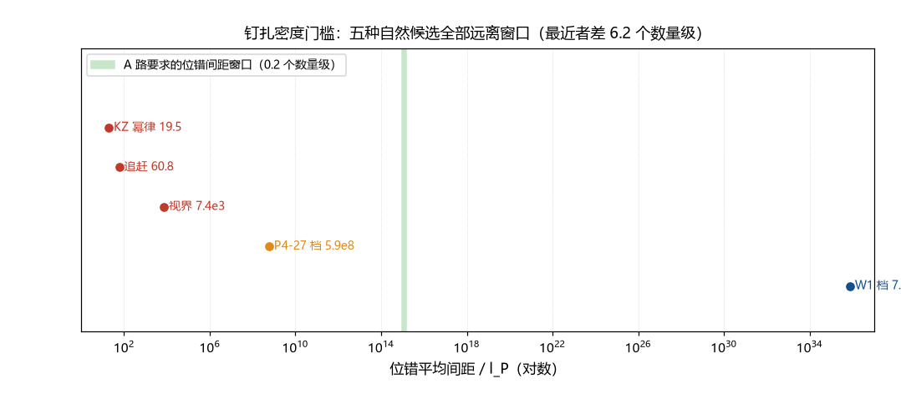

# 注记-钉扎密度的门槛（第386条）：位错间距窗口与自然候选的距离

- **日期**：2026-09-24 04:30:09
- **类型**：判定轮（吸附动力学首轮）
- **脚本**：`验证脚本/minimal_verification_pinning_density_gate.py`（第 386 条）
- **图**：见 §3 图 1（`images/pinning_density_gate.png`）
- **依据**：[[验证脚本/注记-凝固时间的最小动力学（第384条）：三候选时标估算与 A 路的单参数压缩]]（捕获率窗口与截面档）；[[粒子与时空的同生：凝固波前的缺陷形成机制]] §3.4（晶格位错为钉扎中心；吸附动力学未建模）；[[验证脚本/注记-KZ 适用性判定（第381条）：临界冻结不适用、注入-接缝机制与畴尺度候选]]（畴尺度候选档）
- **状态**：判定完成。门槛反解、自然候选对照与结构性论证三条齐备；吸附动力学首轮判负

## 1 判据与设定

第 384 条把朗道-齐纳路线压缩为捕获率窗口 $\Gamma = 0.0147$ 至 $0.0589$ 每拍，其两个参数（位错密度、缺陷迁移速度）未建模。本轮给该参数做首轮估计：G1 由捕获率窗口反解位错间距窗口；G2 把五种相变自然候选档（畴尺度候选与时标档）换算成捕获率并与窗口对照；G3 给位错密度的结构性论证（位错作为畴内畸变的上界）；G4 综合判定。迁移速度取光速档 $v = 1$ 格每拍（上界档，对捕获最有利）。

## 2 结果

G1（门槛反解）：捕获截面 $\sigma = \pi w_{\rm def}^2 = 4.5365\times10^{43}\,l_P^2$ 给钉扎密度窗口 $n_{\rm pin} = 3.245\times10^{-46}$ 至 $1.298\times10^{-45}\,l_P^{-3}$，等价位错间距窗口 $9.17\times10^{14}$ 至 $1.455\times10^{15}\,l_P$（约 $1.48\times10^{-20}$ 至 $2.35\times10^{-20}$ 米）。窗口宽度仅 $0.20$ 个数量级。

G2（自然候选对照）：五种候选全部远离窗口。KZ 幂律（$19.5$ 格）给 $\Gamma = 6.15\times10^{39}$ 每拍，超窗口 $41.0$ 个数量级；追赶（$60.8$ 格）超 $39.5$；视界间距（$7.38\times10^3$ 格）超 $33.3$；P4-27 上界时标档（$5.87\times10^8$ 格）超 $18.6$；W1 档视界（$7.59\times10^{35}$ 格）低于窗口 $62.2$ 个数量级（太稀，捕获太慢）。最近者（P4-27 上界档）仍差 $6.2$ 个数量级。

G3（结构性论证）：位错是畴内畸变（凝固时序错配的空间尺度不超过畴尺度），故位错间距至多为畴尺度；A 路要求位错间距落在 $[9.17\times10^{14}, 1.455\times10^{15}]$ 格，必要条件为畴尺度大于 $9.17\times10^{14}$ 格。同时位错间距的自然估计由涨落相关长度定（同样不超过畴尺度），要落入窗口需要该长度与畴尺度同量级且恰好为 $10^{15}$ 格量级。

G4（综合）：波前动力学档距窗口 $11.1$ 至 $13.7$ 个数量级（太密，捕获过快）；P4-27 上界档差 $6.2$ 个数量级；W1 档超窗口 $20.7$ 个数量级（太稀）。五种自然候选全部远离窗口。**吸附动力学首轮判负。**

## 3 图

## 4 结论与判句移交

门槛的物理读法：该路要求钉扎中心的平均间距恰好落在约 $10^{-20}$ 米的窄窗口（比质子小四至五个数量级），窗口宽度 $0.2$ 个数量级。相变时空结构给出的自然尺度跨越 $3\times10^{-34}$ 至 $12$ 米（$19.5$ 格至 W1 档视界），其中没有任何一个落在该窗口；最近者仍差 $6.2$ 个数量级。

首轮判负的含义：第 384 条的「未建模参数」由此换成一个严苛的定量门槛，且在自然候选集合下无满足者。该路若要复活，需要位错密度比「畴尺度⁻³」稀疏 $6$ 个数量级以上（即凝固时序错配被压制到远超自然图景的规则性）。

判句移交：该路的判定链（第 360 至 386 条）至此完整；存活因子机制转热冻结路线（势垒身份候选为定居密度，两项代价已登记）或瞬子路线（首轮未执行）。若将来引入非常规钉扎机制（例如位错密度与畴尺度解耦的构造），须重新走 G3 的上界论证。

## 5 严格程度与边界声明

严格程度：G1、G2 为算术（判据级）；G3 为结构性论证（位错作为畴内畸变的上界，条件性命题级）；G4 的判负为「自然候选集合」下的判定，不声称逻辑穷尽。

边界：不建立吸附动力学模型；不重算第 384 条；迁移速度取光速档（上界，对捕获最有利的取法）；捕获截面取第 384 条的截面档；畴尺度候选的档位沿第 381 条的登记；本判定不排除非常规钉扎构造。

## 6 过程记录

触发：论文《存活因子S的朗道-齐纳路线》§7 其一登记的「钉扎捕获两参数未建模」，本轮为首轮估计。判定路径：先反解门槛（发现窗口窄至 0.2 个数量级），再把自然候选逐档换算对照（全部远离），最后补结构性上界论证（位错间距不超过畴尺度）。首轮估计即判负是本轮的实质读数；「门槛的窄」与「候选的远」两个读数互相独立，共同支撑判定。
