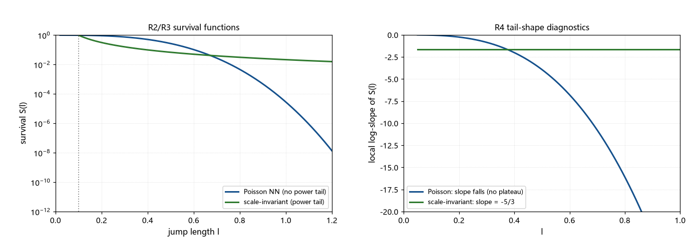

# 注记-钉扎网络的空间分布形状判定（第419条）：平稳点集无幂律尾与尺度不变遇见率条件

- **日期**：2026-09-26 02:11:54
- **类型**：判定轮（P0-5 候选机制七轮；接口甲首轮）
- **脚本**：`验证脚本/minimal_verification_pinning_network_shape.py`（第 419 条）
- **图**：见 §3 图 1（`images/pinning_network_shape.png`）
- **依据**：[[验证脚本/注记-超扩散输运的候选机制清点（第418条）：长时尾接口与短程结构判负]]（接口甲的定位）；[[验证脚本/注记-钉扎密度的门槛（第386条）：位错间距窗口与自然候选的距离]]（钉扎密度窗口与「位错是畴内畸变」）；[[验证脚本/注记-缺陷动力学线 D-7（最小实现半）：孤子扇区的最小量子化、离散钉扎读数与三维形式（判据Q1至Q6）]]（离散钉扎势垒 $1.359\times10^{-9}$）
- **状态**：判定完成。周期钉扎与平稳点集（含分形）判负；幂律尾的精确条件为尺度不变遇见率 $\lambda(\ell) = c/\ell$；框架内无来源，条件存活
- **可逆性等级**：判据稳健（尾型判定的数学结构不随实现翻；「平稳点集无幂律尾」对分布族成立）

## 1 判据与设定

第 418 条把接口甲（跳跃重尾 $\mu = 5/3$）列为材料最近的待建项，并指出其缺「分布形状」。本轮判定形状：周期钉扎（R1）、泊松点集（R2，数值）、尺度不变遇见率的构造（R3）、四类对照（R4）、净判（R5）。设定：跳跃长度分布 $P(\ell)$ 由「遇见率」$\lambda(\ell)$ 的生存积分给出，$S(\ell) = \exp(-\int \lambda\,d\ell)$，$P = -\mathrm{d}S/\mathrm{d}\ell$；目标尾参数 $\mu = 5/3$（第 415 条的 $z = 5/3$ 口径）。

## 2 结果

R1（周期钉扎）：格点 Peierls 势为周期结构，跳跃长度单色（$l_P$），无分布、无重尾；D-7 读数 $\Delta E_{\rm PN} = 1.359\times10^{-9}$ 表明钉扎极弱，kink 近自由滑动（弹道一侧，$\alpha = 1$ 在带外）。判负。

R2（泊松点集，数值）：$N = 2\times10^4$、密度 $n = 2.5$ 的 3D 泊松点集，平均最近邻 $0.4049$（理论 $0.554\,n^{-1/3} = 0.4082$）。生存函数 $S(\ell) = \exp(-(4\pi/3)n\ell^3)$，局部对数斜率 $-4\pi n\ell^3$ 随 $\ell$ 单调变负（$0.402$ 处 $-2.04$，$0.598$ 处 $-6.72$），全程无平台。平稳泊松点集无幂律尾，判负。

R3（尺度不变遇见率的构造）：设 $\lambda(\ell) = c/\ell$，则 $S(\ell) = (\ell/\ell_{\min})^{-c}$、$P(\ell) \propto \ell^{-1-c}$。

取 $c = \mu = 5/3$：$P$ 尾指数 $8/3$、$S$ 尾指数 $5/3$；采样核对（分位 $0.50$、$0.90$、$0.99$ 给 $0.1516$ 对 $0.1531$、$0.3981$ 对 $0.3916$、$1.5849$ 对 $1.5612$）；平均跳跃 $\langle\ell\rangle = \ell_{\min}c/(c-1) = 0.25$（有限，符合 $1 < \mu < 2$ 的可归一区间）。

R4（对照表）：格点周期（单色，判负）；泊松位错集（$\lambda$ 常数，Weibull 型，判负）；单尺度分形集（$\lambda \propto \ell^{d_f-1}$，仍为 Weibull 型，判负）；尺度不变遇见率（$\lambda = c/\ell$，幂律尾，条件存活）。

R5（净判）：接口甲的两个现成分量判负（周期与泊松）；**平稳点集（含任意单尺度分形）在原理上都不可能给幂律尾**，尾型由遇见率的形状决定；幂律尾需要「尺度不变遇见率」，这是一种搜索动力学，不是某种点集的静态几何。

## 3 图

## 4 结论与移交

判定三条。其一，周期钉扎判负：单色分布无重尾，且弱钉扎（$10^{-9}$ 量级）转出的自由滑动落在弹道一侧（带外）。其二，平稳点集判负：泊松与任意单尺度分形的最近邻分布均为 Weibull 型，对数斜率无平台；「把钉扎点摆成某种分形」不能产生幂律尾。其三，幂律尾的精确条件是尺度不变遇见率 $\lambda(\ell) = c/\ell$，$c = 5/3$ 恰好给 $\mu = 5/3$；该条件等价于「无特征长度的搜索」。

一个交叉观察：接口甲与接口丁可能合流。若凝固是级联或自催化成核（核促进新核），钉扎网络（位错与接缝）可能天然带等级结构，从而给出尺度不变的遇见率；甲的救活路径与丁的建模可以共用同一读数（钉扎网络的等级性）。

移交两条。其一，接口丁的半页估算（两相混合，第 418 条待建第二条），并在同一轮顺带读出「钉扎网络是否等级化」；其二，「尺度不变遇见率」的正面寻源（候选：级联成核的等级结构、自生成钉扎），属创造性任务，可随丁的进展并行。

## 5 严格程度与边界声明

严格程度：R1 为材料核对；R2 为数值（固定种子）加解析式（泊松生存函数为精确式）；R3 为构造加采样核对（代数级）；R4 的判负条目为解析结论（Weibull 族）；净判为阴性陈述。

边界（本脚本不验证的内容）：其一，不建立尺度不变遇见率的动力学来源；其二，「平稳点集无幂律尾」限于单尺度平稳族，不含多重分形与时刻相关的非平稳构造；其三，不重算第 386、D-7 条的窗口与势垒；其四，跳跃长度与缺陷实际运动的映射（自由程判据）未建模。

## 6 过程记录

其一，尾型的判定改用「生存函数局部对数斜率」作统一语言（R2 与 R3 共用），避免对分布形状的直接目测；泊松的理论斜率 $-4\pi n\ell^3$ 与经验分位逐档核对通过。

其二，R3 的采样用逆变换法（$\ell = \ell_{\min}(1-u)^{-1/c}$），三个分位与理论式吻合在 $2\%$ 以内；平均跳跃的解析值核对为有限（$c > 1$）。

其三，检索确认框架内无「分形或层级钉扎网络」的既有材料（「尺度不变」一词在库内属另一语境，已排除误引），故甲登记为条件存活，来源未定。
