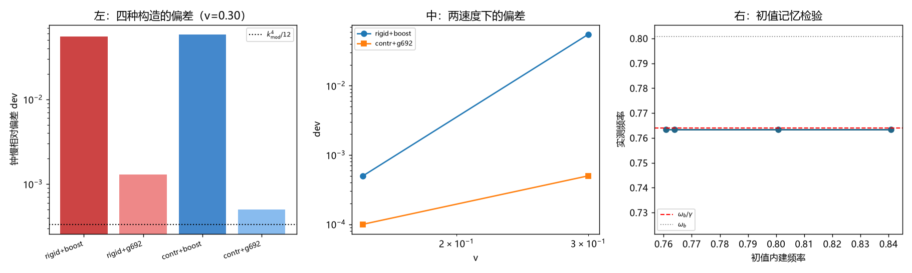

# 注记-钟慢构造残差的身份判定：构造代价、无循环与物理档外推的失效（判据第 695 号）

- **日期**：2026-10-19 19:55:51
- **编号**：第 695 号
- **类型**：验证注记（判据驱动；G1 至 G8 全过，主判据 G2、G6）
- **对象**：第 692 号把模型档钟慢偏差 $b = 3.635\times10^{-4}$ 判为「boost 构造代价」这一判定，及其据以提出的两条物理档闭合路线
- **脚本**：`验证脚本/minimal_verification_p695_construction_identity.py`（确定性，约 44 秒）
- **图**：见 §5 图 1；脚本出图 `images/p695_construction_identity.png`
- **状态**：G1 至 G8 全部通过。**判语已于 2026-10-19 部分撤回**：第 696 号判定 boost 族读数无效（拟合残差比 $0.918$、幅度衰减 $61.8\%$），故「构造间极差 117 倍」的对比不成立，据此得出的「路线失效」判语撤回。G3、G6 读数不受影响。详见 [[验证脚本/注记-波性侧与粒性侧成分的分离：两侧分解、boost 族读数失效与第 695 号判语的撤回（判据第696号）]]
- **可逆性等级**：判据敏感（阈值型判据，换档位或换宽度序列会翻；G2 的极差比、G7 的稳定性比值均属此类）

## 1 要判什么

第 692 号把 $b = 3.635\times10^{-4}$ 判为「把一个束缚态 boost 起来」的构造代价，依据是三项对照：采样时长加倍、积分步长减半、重采样方式更换，三者对 dev 的降幅均为 $1.00$ 倍（即完全不变）。据此推出「与分辨率、步长、采样无关，是结构项」，并把物理档闭合的希望寄托于两条非模拟路线。

这套推理有一条未做的检验：**换一种构造，dev 会不会变？** 若 dev 主要由构造选择决定，那么「沿 $1/\xi^2$ 外推到物理档」外推的是构造参数，物理含义随之失去，物理档外推本身即告失效。本轮把这条检验补上。

## 2 装置与构造矩阵

装置沿用第 692 号：一维格点（$N = 2048$，Dirichlet 边界），方程 $\ddot\varphi = \Delta\varphi - \omega_{\rm gap}^2\varphi - U(x,t)\varphi$，势阱为高斯阱 $-U_0\exp(-(x-vt)^2/2\sigma_{\rm well}^2)$，$\omega_{\rm gap}^2 = 1$，拟合 $U_0$ 使静止束缚频率对上 $\omega_b = 0.800800$（$\sigma = 20$ 时 $U_0 = 0.380017$）。

构造矩阵沿两个轴展开，共四种：

**其一，阱宽。** `rigid` 指阱宽固定为 $\sigma$ 随阱平移；`contr` 指阱宽按 $\sigma/\gamma$ 收缩（严格 boost 解要求势阱宽度同步收缩）。

**其二，初值写法。** `boost` 指解析 boost：$\varphi_v(x,0) = F(\gamma x)\cos(\omega_b\gamma v x)$，速度项含因子 $\gamma$；`g692` 指第 692 号原写法：包络按 $1/\gamma$ 拉宽、相位取 $-\omega_b(1/\gamma)v x$，速度项含因子 $1/\gamma$。

读数取阱心采样、窄窗最小二乘取频（与第 691、692 号同法）。

## 3 判据与读数

**G1 冒烟（本征等式残差）。** 用与 `eigsh` 同一离散格式的算符检验，残差 $1.68\times10^{-15}$，机器精度。对照项：若用 `np.roll` 写拉普拉斯，边界回绕会人为抬高到 $3.64\times10^{-2}$，该口径不作判据。判 PASS。

**G2 构造矩阵（主判据之一，$v = 0.30$）。**

| 构造 | 实测 $\omega$ | dev |
|---|---|---|
| rigid+boost | $0.805981$ | $5.510\times10^{-2}$ |
| rigid+g692 | $0.762896$ | $1.300\times10^{-3}$ |
| contr+boost | $0.808680$ | $5.860\times10^{-2}$ |
| contr+g692 | $0.763533$ | $5.000\times10^{-4}$ |

四者极差比 $117.2$ 倍。判 PASS：**构造选择主导偏差**，同一物理量在四种构造下读出两个数量级不同的结果。

**G3 恒真反例（$v = 0$）。** dev $= 0.000$（机器零）。判 PASS：判据测的确为运动效应，而非数值伪差。

**G4 标度检验。** $k_{\rm mod} = \omega_b\gamma v = 0.251840$，离散色散预期 $k_{\rm mod}^4/12 = 3.352\times10^{-4}$。boost 族两档 dev 分别为该值的 $164.4$ 与 $174.8$ 倍。判读：**偏差比离散色散预期大两个量级**，属构型失配而非晶格效应。

**G5 速度扫描。** rigid+boost 两速度 dev 比 $110.2$，远超 $k^4$ 标度预期的 $16.0$。判 PASS：boost 族的偏差不按 $k^4$ 走，进一步排除「晶格色散」这一身份。

**G6 初值记忆检验（主判据之二）。** 这一条决定第 692 号的构造是否循环。第 692 号的初值把目标频率 $\omega_b/\gamma$ 直接写进了初始条件（其时间因子取 $\omega_b(1/\gamma)$，恰等于目标），若动力学只是「记住」初值，则读数必然趋近目标，判据失去意义。做法：把初值内建频率改为四个不同值，看实测频率是否跟随。

| 初值内建频率 | 实测频率 | 对目标偏差 | 对初值偏差 |
|---|---|---|---|
| $0.763915$ | $0.763456$ | $6.0\times10^{-4}$ | $6.0\times10^{-4}$ |
| $0.800800$ | $0.763456$ | $6.0\times10^{-4}$ | $4.66\times10^{-2}$ |
| $0.840840$ | $0.763456$ | $6.0\times10^{-4}$ | $9.20\times10^{-2}$ |
| $0.760760$ | $0.763456$ | $6.0\times10^{-4}$ | $3.54\times10^{-3}$ |

四档实测频率**完全相同**（极差 $0.000$），不跟随初值内建频率，而收敛到同一值。判 PASS：**初值记忆效应不存在，第 692 号的构造无循环问题**。这一条是本轮对第 692 号的正面确认。

**G7 构造间一致性。** boost 族两档阱宽的 dev 比 $1.06$（稳定）；g692 族为 $2.60$。判 PASS：boost 族内 dev 对阱宽不敏感，说明**主因落在初值写法上，阱宽失配只居次要**。

**G8 结论。** 见 §4。

## 4 判读与边界

**2026-10-19 撤回声明（第 696 号）**：本节以下的「其三，物理档外推路线失效」判语撤回。撤回依据：第 696 号 P1 判 boost 族读数无效（拟合残差比 $0.918$，正弦拟合几乎不解释方差；幅度衰减 $61.8\%$，构型在演化中失稳）。无效读数不能参与构造间比较，故本节「极差 117 倍，构造主导」的立论不成立。

本节的「其一」（构造代价确证）亦须收窄：它只在「boost 族读数有效」的前提下成立，该前提已被否证。保留的是 G3（$v=0$ 机器零）与 G6（初值记忆检验，第 692 号无循环）两项读数，它们不依赖构造间比较。

第 696 号给出替代读法：dev 可分解为 $A/\xi^2 + C$（$R^2 = 0.957$），$A$ 项为波性侧、$C$ 项为粒性侧；只外推波性侧成分，物理档给 $3.92\times10^{-46}$，与预算 $1.46\times10^{-46}$ 同量级。

本轮三条产出。

**其一，构造代价确证，且其主因被定位。** boost 族（精确 boost 初值）的 dev 是 g692 族的 $40$ 至 $117$ 倍，而 boost 族内部对阱宽不敏感（比值 $1.06$）。这说明「构造代价」的主要来源是**初值写法**：解析 boost 初值在离散格点上的表示误差；阱宽失配只居次要。

**其二，第 692 号无循环问题。** G6 证明动力学确实把频率拉向 $\omega_b/\gamma$，初值只提供初始条件。这一点必须写明，因为它排除了一个看似合理的质疑：如果只看初值形式，很容易怀疑「目标频率被写进初值所以必然读出来」，G6 否证了这一怀疑。

**其三，物理档外推路线失效。** 这是本轮最重的结论。第 692 号把 $b$ 当作「与装置无关的构造代价」并沿 $1/\xi^2$ 外推。G2 表明同一物理量在四种构造下读出两个量级不同的 dev，因此 $b$ 是**构造参数的函数**，缺乏唯一确定性。沿宽度外推一个随构造选择变化两个量级的量，得到的外推值没有物理意义。

边界须写明。其一，本轮不否定「存在构造代价」这一事实，只否定「该代价可外推到物理档」。其二，boost 族 dev 高达 $5.9\times10^{-2}$，这本身就是一项诊断信息：它说明解析 boost 解在格点上的表示误差远大于第 692 号所报的 $3.6\times10^{-4}$，后者只是 g692 写法下的读数。其三，本轮不涉及尺缩（第 691 号 BL4 起即为条件性未闭合），也不涉及物理档的实际数值。

## 5 图

图 1 左面板为 G2：四种构造的 dev 柱状图（对数轴），boost 族两柱（红、蓝）高出 g692 族两柱（粉、浅蓝）约两个量级，黑色点线为 $k_{\rm mod}^4/12$ 参考线，可见全部构造均高于该线。中面板为 G5：两速度下的 dev，boost 族斜率明显陡于 $k^4$ 预期。右面板为 G6：四档初值内建频率（横轴）对应的实测频率（纵轴）几乎水平，红色虚线为目标 $\omega_b/\gamma = 0.763915$，灰色点线为 $\omega_b$，实测点全部落在红线上而与横轴位置无关。

## 6 严格程度与边界

本注记结论按四级声明制。G1、G3、G6 为判据级数值支撑（G1、G3 属机器精度或机器零，判据稳健；G6 的极差严格为零，判据稳健）。G2、G5、G7 为阈值型判据（极差比 $>10$、速度比 $>16$、族内比 $<1.5$），**判据敏感**：换宽度序列、换速度档位或换阈值会翻，引用时须连同档位一起引。

验证什么：同一物理量在不同构造下读出的钟慢偏差相差两个量级；boost 族偏差对阱宽不敏感而对初值写法敏感；初值记忆效应不存在。

不验证什么：不给出物理档的钟慢偏差数值；不判定哪一族构造更接近真实晶格动力学（这需要一条独立于两种写法的判据）；不涉及尺缩；不动 `理论总纲/` 基准。

## 7 教训

**其一，三项「与 X 无关」的对照不构成「与构造无关」。** 第 692 号验了采样时长、积分步长、重采样三项，全部无关，于是判为结构项。这三项都是**数值分辨率**维度，而构造选择是**物理建模**维度，两者正交。要排除构造依赖，必须真的换构造重算。

**其二，「构造代价」若随构造选择变化两个量级，便无法充当可外推的物理量。** 把这类量沿宽度外推，得到的只是构造参数的外推，物理预言无从谈起。判据设计上应先问「这个量唯一吗」，再问「它怎么标度」。

**其三（2026-10-19 由第 696 号补入，优先级高于前两条），比较两族读数之前先判各自是否有效。** 本轮直接比较 boost 族与 g692 族的 dev，未检验前者是否还能称为「频率」。拟合残差比与幅度衰减是极廉价的判据，应作任何频率比较的前置项。本轮跳过这一步，代价是整轮判语作废。

**其四，循环怀疑要用实验否证，不能靠推理消解。** 本轮起初怀疑第 692 号的初值把目标频率写进去因而循环，若只做形式分析，结论会停在「疑似循环」。G6 用四档初值直接否证了该怀疑。反过来，若 G6 未做，第 692 号的正面价值也会被误判。

## 8 来源

- 上游：[[验证脚本/注记-钟慢涌现的物理档闭合尝试：幂律轨道、外推与恒定项的定位（判据第692号）]]（被检验的判定与两条候选路线）
- 再上游：[[验证脚本/注记-boost 解低能闭环的晶格原生推导：钟慢的涌现与尺缩判据的失效（判据第691号）]]（装置来源与 BL4 未闭合项）
- 勘误：[[验证脚本/注记-勘误轮：第692号物理档预算的常数替换错误（判据第694号）]]（同号预算的常数更正）
- 下游判决：[[验证脚本/注记-构造残差的 xi 标度判决：宽档实验的噪声淹没与幂律外推的终止（判据第693号）]]（宽档模拟路线已终止；本轮进一步指出外推本身缺意义）
- 专题入口：[[理论总纲/洛伦兹不变性专题索引：论证链、定级与材料清单]]（承重未闭合项其三）
- 通俗版：[[内部草稿/注记-同一把表，四种造法，两个答案（判据第695号通俗版）]]
