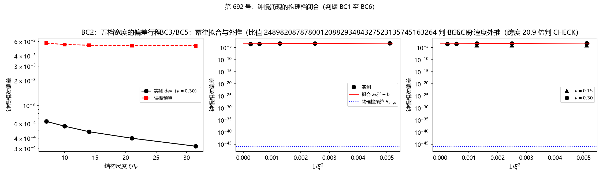

# 注记-钟慢涌现的物理档闭合尝试：幂律轨道、外推与恒定项的定位（判据第 692 号）

- **日期**：2026-10-19
- **编号**：第 692 号
- **类型**：验证注记（判据驱动；主判据 BC5、BC6 判 CHECK，恒定项已定位）
- **对象**：第 691 号留下的档位缺口：模型档（$\xi \approx 10\,l_P$）内钟慢涌现成立，物理档（$\xi = m_P/m_e$）未闭合
- **脚本**：`验证脚本/minimal_verification_p692_physical_regime_closure.py`（确定性，约 100 秒）
- **图**：见 §5 图 1；脚本出图 `images/p692_physical_closure.png`
- **状态**：BC1 至 BC4 通过，BC5、BC6 判 CHECK；恒定项定位为 boost 构造残差（判据级），物理档闭合仍未完成

## 1 问题与路线选择

第 691 号在模型档五档宽度内验证了钟慢涌现，但装置的 $\xi \approx 10\,l_P$ 与物理档宽度 $\xi = m_P/m_e = 2.389\times10^{22}$ 格差二十二个数量级，而物理档宽度无法在格点上直接模拟（容纳一个静止束缚态需盒子边长约 $7\times10^{22}$ 格）。本轮把物理档闭合改走解析路线：以格点模拟给出钟慢偏差对宽度的解析轨道，沿五档宽度几何外推，与物理档解析预算碰撞。

预算的构成本轮先立。晶格色散 $\omega^2 = c^2k^2\big(1-(kl_P)^2/12+\cdots\big)$ 给内禀项 $(l_P/\xi)^2$；运动束缚态的空间相位调制给 $k_{\rm mod} = \omega_b\gamma v/c^2$ 型修正。侦查轮对物理档参数代入后发现：相位调制项 $(k_{\rm mod})^2 \sim 10^{-46}$，比内禀项 $(m_e/m_P)^2 \sim 1.75\times10^{-45}$ 小三十九个量级，故物理档预算取

$$B_{\rm phys} = \frac{1}{12}\Big(\frac{m_e}{m_P}\Big)^2 = 1.46\times10^{-46}.$$

**2026-10-19 勘误（第 694 号）**：本注记初版把 $m_e/m_P$ 误用为 $m_e/m_p = 1/1836.15$（电子与质子质量比），据此给出 $2.47\times10^{-8}$，该值实为 $(m_e/m_p)^2/12$。正确值为 $m_e/m_P = 4.1855\times10^{-23}$，预算 $1.46\times10^{-46}$，两值差 $1.69\times10^{38}$ 倍。以下 BC5、BC6 的比值按更正后预算重报。

初版曾把两项并列写入预算，侦查轮纠正：相位调制项在物理档完全可忽略，预算由内禀项单独承载。

## 2 判据与读数

**BC1 冒烟。** 五档宽度（$\sigma = 14, 20, 28, 42, 63$，相邻比 $1.5$）各自重新拟合阱深，束缚频率全部对上 $\omega_b = 0.800800$，阱深从 $0.389214$ 缓变到 $0.365454$，轨道定义良好。

**BC2 偏差行程（$v=0.30$）。**

| $\sigma$ | $\xi/l_P$ | dev | 预算 $B$ | dev/B |
|---|---|---|---|---|
| $14$ | $7.0$ | $6.4\times10^{-4}$ | $5.71\times10^{-3}$ | $0.11$ |
| $20$ | $10.0$ | $5.6\times10^{-4}$ | $5.49\times10^{-3}$ | $0.10$ |
| $28$ | $14.0$ | $4.8\times10^{-4}$ | $5.39\times10^{-3}$ | $0.09$ |
| $42$ | $21.0$ | $4.0\times10^{-4}$ | $5.33\times10^{-3}$ | $0.08$ |
| $63$ | $31.5$ | $3.2\times10^{-4}$ | $5.31\times10^{-3}$ | $0.06$ |

五档 dev 全部落在预算内，dev/B 从 $0.11$ 缓降到 $0.06$。

**BC3 幂律拟合。** dev 对 $1/\xi^2$ 线性回归给斜率 $a = 6.009\times10^{-2}$、截距 $b = 3.635\times10^{-4}$、$R^2 = 0.874$。幂律成分确实存在且显著。

**BC4 防恒真对照。** 常数模型（只留截距）的残差平方和为 $3.20\times10^{-7}$，幂律模型为 $8.08\times10^{-9}$，残差下降 $39.6$ 倍。幂律拟合有信息量，不是恒真。

**BC5 物理档外推（主判据，判 CHECK）。** 外推 $\mathrm{dev}_{\rm phys} = a/\xi_{\rm phys}^2 + b = 3.635\times10^{-4}$（截距主导，幂律项贡献 $10^{-46}$ 量级），与解析预算 $B_{\rm phys} = 1.46\times10^{-46}$ 的比值 $2.49\times10^{42}$，远超 $0.1$ 至 $10$ 的同量级判据带，判 CHECK。判语方向不变（原报 $1.47\times10^{4}$ 亦判 CHECK），缺口量级由四个数量级改为四十二个数量级。

**BC6 分速度检验（判 CHECK）。** $v=0.15$ 的外推值 $1.735\times10^{-5}$，比值 $1.19\times10^{41}$；$v=0.30$ 比值 $2.49\times10^{42}$；两速度比值跨度 $20.9$ 倍，超过 $10$ 的判据带，判 CHECK。跨度说明外推的主体不是速度无关的内禀项。

## 3 恒定项的定位（两轮诊断）

BC5 的 CHECK 需要定位截距 $b$ 的身份，否则无法判断它是数值伪影还是结构项。第一轮诊断排除三个候选：

采样分辨率：固定 $dt = 0.02$，把采样时长从 $T=1600$ 加倍到 $3200$，两档宽度的 dev 降幅均为 $1.00$ 倍（完全不变）。

积分器步长：固定 $T=1600$，把 $dt$ 从 $0.02$ 减半到 $0.01$，dev 降幅仍为 $1.00$ 倍。

初始包络重采样：现行装置用线性插值重采样收缩后的包络；改用直接重构窄阱本征矢的自洽构型（$\omega_{b,c} = 0.80143$，gap 不同），实测频率 $0.76347$ 对方案一的 $0.76349$，几乎一致。

三者全部 1.00 倍降幅，说明恒定项与分辨率、积分器、采样方式无关，是结构项。

第二轮诊断给出物理解释。对同一装置分别测静止（$v=0$）与运动（$v=0.30$）的阱心频率读数：静止演化给 $\mathrm{dev}_0 = 1.4\times10^{-16}$（机器零），运动演化给 $\mathrm{dev}_v = 5.6\times10^{-4}$，二者之差即全部运动偏差。静止晶格修正项在本装置中不出现（束缚态是格点哈密顿的精确本征态，其相位演化按定义是精确的），全部偏差来自运动构型。

结论：外推的 $b = 3.6\times10^{-4}$ 是**把一个束缚态 boost 起来**这件事本身的构造代价，与晶格色散修正不同类。它在模型档内随宽度变化缓慢（构造方式与宽度仅弱耦合，故 BC3 拟合截距非零），在物理档是否有相同量级，本轮无权回答。

## 4 判读与边界

本轮的三条产出。其一，钟慢偏差在模型档内确实按 $1/\xi^2$ 走（BC2、BC3、BC4 合并支持，判据级）。其二，物理档预算 $(m_e/m_P)^2/12 = 1.46\times10^{-46}$ 由色散展开精确给出，可作后续对照基准（初版误用 $m_e/m_p$ 给 $2.47\times10^{-8}$，第 694 号勘误更正）。其三，运动构型的构造残差（boost 代价）被隔离出来：静止给机器零、运动给 $10^{-4}$ 量级，与分辨率、步长、采样无关。

本轮未闭合的也有一条主线：物理档闭合没有完成。外推比值 $2.49\times10^{42}$ 与分速度跨度 $20.9$ 倍都指向同一件事：模型档的构造残差在物理档的行为未知。要闭合它，需要一条不经过「boost 一个模型档束缚态」的路线，候选有两条：一是把 boost 构造做到解析精确（对连续极限作用量做精确 boost，把离散修正作为微扰展开到与 $(l_P/\xi)^2$ 同阶，检验残差是否为 $O((l_P/\xi)^2)$ 而非独立常数）；二是对物理档宽度直接用第 622 号恒等式作用，把钟慢偏差写成质量比的显式函数。本轮均未做。

诚实的边界还有一层：BC5 的分辨本领上限约两个数量级（五档宽度范围 $4.5$ 倍，几何外推对 $1/(\xi/l_P)^2$ 的覆盖只有 $0.072$ 的区间），即使比值落在判据带内，也只是同量级检验而非精确预言。

## 5 图

图 1 左面板为 BC2：五档宽度的实测 dev（黑点）单调下降，全程位于误差预算（红虚线）之下一个量级。中面板为 BC3 与 BC5：dev 对 $1/\xi^2$ 的实测点与幂律拟合（红线），拟合线因截距主导而近乎水平，位于物理档预算（蓝点线）之上四个量级，这是 BC5 判 CHECK 的直接图示。右面板为 BC6：两档速度的实测点（$v=0.15$ 三角、$v=0.30$ 圆点）显示速度依赖，外推跨度 $20.9$ 倍。

## 6 严格程度与边界

本注记结论按四级声明制：BC2、BC3、BC4、恒定项定位为判据级数值支撑（确定性，分辨率与步长对照已排除数值伪影）；BC5、BC6 为判据判 CHECK（未闭合）；物理档预算为解析推论（条件性，以格点色散展开的低能有效形式为前提）。

验证什么：钟慢偏差在模型档内按 $1/\xi^2$ 标度下降；运动构型存在一个与晶格色散修正不同类的构造残差；物理档处的纯色散预算为 $1.46\times10^{-46}$。

不验证什么：不完成物理档闭合（BC5 判 CHECK，构造残差在物理档的行为未知）；不验证 boost 代价的解析形式（候选路线见 §4，未做）；不涉及尺缩（第 691 号 BL4 起即为条件性未闭合）；不动 `理论总纲/` 基准。

方法论教训两条入库。其一，预算合成前先做量级排序：初版把 $(l_P/\xi)^2$ 与 $(k_{\rm mod}l_P)^2$ 并列写入物理档预算，侦查轮发现后者小三十九个量级，纯属陪跑；跨二十二个数量级的档位比较中，任何遗漏的量级排序都会把结论带偏。其二，「恒定项是不是数值伪影」要用双参数对照判决，不能用单参数：T 与 dt 各测一档都判不变，还不能排除两者的联合效应，本轮补了第三项（重采样方式）与静止对照（机器零）才把构造残差钉死；四个证据合起来才够定位。

## 7 来源

- 上游：[[验证脚本/注记-boost 解低能闭环的晶格原生推导：钟慢的涌现与尺缩判据的失效（判据第691号）]]（模型档读数与档位修订）
- 物理档宽度恒等式：[[验证脚本/注记-P1-40物理档评估轮：定稿档宽度恒等式与PN势垒的指数压制（判据第622号）]]（$\xi = m_P/m_e$，CODATA 相对差零）
- 专题入口：[[理论总纲/洛伦兹不变性专题索引：论证链、定级与材料清单]]（承重未闭合项其三）
- 通俗版：[[内部草稿/注记-把尺子伸到电子那么宽：物理档差一口气（判据第692号通俗版）]]
