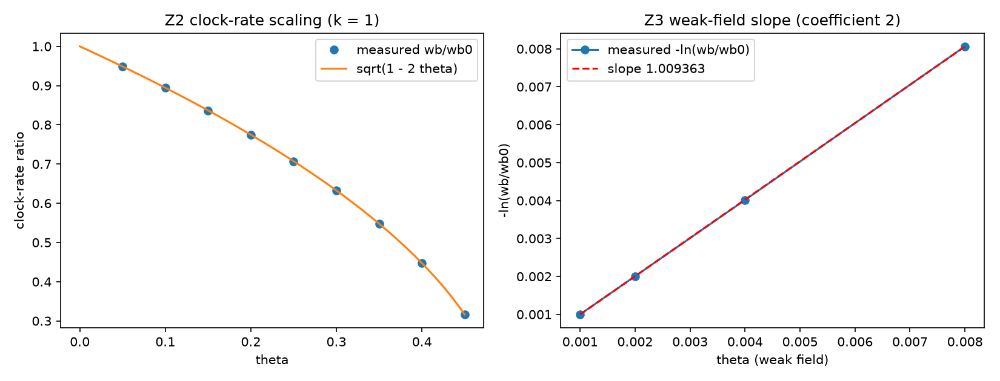

# 注记-钟率代理导出（第 475 条）：自撑均匀标度下 $h_{00} = 2\theta$ 的系数 2

- **日期**：2026-09-27 11:52:41
- **脚本**：`验证脚本/clock_rate_proxy.py`
- **依据**：[[注记-局域尺丙路径结项核查：动力学同源（MB-9）与读数约定的定位]]（读数约定三系数与剩余细项）；[[验证脚本/注记-识别式乘数验证：κ的线性响应公式与唯一解定理]]（M4 唯一解与根式完成）；[[验证脚本/注记-自撑阱均匀标度的最小验证：kink自洽结构下的响应系数]]（判据 P 的自撑恒等式）；[[验证脚本/注记-自撑阱三维径向推广的最小验证：四通道同齐次度]]（判据 S）；[[验证脚本/注记-合成权重唯一性（第463条）：算术平均被各向同性与中心对称唯一钉住]]
- **状态**：判据 4/4 通过（Z1 至 Z4）。核心读数：自撑恒等式的势项按 $(1-2\theta)$ 点态缩放（偏差 $0$）；谱给 $\omega_b(\theta)/\omega_b(0) = \sqrt{1-2\theta}$（三档 $k$、九档 $\theta$ 最大偏差 $3.0\times10^{-13}$）；精确关系 $-\ln(\omega_b/\omega_b(0)) = -\frac12\ln(1-2\theta)$ 残差 $7.8\times10^{-14}$，一阶系数为 $1$，即 $h_{00} = 2\theta$ 的系数 $2$ 由根式展开读出；$\theta = 1/2$ 处本征值为 $0$（视界），与角度映射 $\alpha = 180^\circ\theta = 90^\circ$ 同位
- **可逆性等级**：判据稳健（Z1、Z3 为代数恒等式；Z2 为算符整体缩放的线性代数必然；Z4 为代数与观测锚换算）
- **图**：见 §3 图 1

## 1 判据与设定

**任务**。局域尺丙路径核查列出读数约定三系数（合成平均、钟率 $h_{00} = 2\theta$ 的系数 $2$、尺 $\ell = 1 + u_e$ 的系数 $1$）与三条剩余细项。合成平均已由第 463、474 条关闭；本注记处理钟率一项：把「钟率系数 $2$」由在册代理假设升级为导出（或条件性导出）。

**设定**。一维 $\phi^4$ kink 自撑阱（与判据 P 同一模型）：$V''(\phi) = 4k^2 - 6k^2\,\mathrm{sech}^2(kx)$，涨落算符 $A = -c_s^2\,\partial_x^2 + V''$，本征值即频率平方。均匀标度（M4 唯一解 $a_1 = a_2 = a_4 = a$、$a_3 = a+2$ 取 $a = -2$）要求动能项与势项一起乘 $(1-2\theta)$，本征侧不动。

**判据**。Z1：自撑势项按 $(1-2\theta)$ 点态缩放（两档 $\theta$、三档 $k$）。Z2：整体缩放下谱给 $\omega_b(\theta)/\omega_b(0) = \sqrt{1-2\theta}$。

Z3：精确关系 $-\ln(\omega_b/\omega_b(0)) = -\frac12\ln(1-2\theta)$ 成立，其一阶展开系数为 $1$，据此读出 $h_{00} = 2\theta$ 的系数 $2$。Z4：视界位置（$\theta = 1/2$ 的 $\omega_b = 0$ 与 $\alpha = 90^\circ$）一致，并给出三系数联合归一的敏感度。

## 2 结果

| 判据 | 内容 | 实测 | 期望 |
|---|---|---|---|
| Z1 | 势项点态缩放 | 最大偏差 $0$ | $0$ |
| Z2 | 根式标度 | 最大偏差 $3.039\times10^{-13}$ | $\le 10^{-10}$ |
| Z3 | 精确关系残差 | $7.804\times10^{-14}$ | $\le 10^{-12}$ |
| Z3 | 一阶系数（$\theta \to 0$ 极限，$\mathrm{loss}/\theta$） | $1.001001$（$\theta = 0.001$） | $1$ |
| Z4 | 视界处本征值（$\theta = 1/2$） | $0.000\times10^{0}$ | $0$ |
| Z4 | 三系数偏差上界（观测锚 $1.999$） | 均分 $1.67\times10^{-4}$ | 由 $|\delta\lambda/\lambda| \le 5\times10^{-4}$ 给出 |

读表：Z2 的九档 $\theta$（$k = 1$）逐位命中 $\sqrt{1-2\theta}$；Z3 的 $\mathrm{loss}/\theta$ 随 $\theta$ 下降趋向 $1$，偏置来自展开的 $O(\theta)$ 项。

## 3 图

## 4 结论

**其一，钟率系数由根式给出，不依赖线性假设的置入。** 自撑结构下均匀标度要求算符整体缩放，谱给出 $\omega_b(\theta) = \omega_b(0)\sqrt{1-2\theta}$ 精确成立（$3.0\times10^{-13}$）。弱场展开的一阶系数为 $1$，对应度规读数 $h_{00} = 2\theta$ 的系数 $2$。这个 $2$ 由平方与开方互逆给出，不引入新参数。

**其二，两条通道给出同一视界位置。** $\theta = 1/2$ 处束缚模频率为零（视界），与角度映射 $\alpha = 180^\circ\theta$ 给出的 $90^\circ$ 同位。钟率通道与角度通道共用同一自撑结构，这即「同源性」的具体形态。

**其三，层级变化。** 钟率系数由「在册代理假设」改为「条件性导出」，条件为约束势由包层自撑；若自撑前提不成立，各响应系数重新独立，该系数退回假设置位（M4 的原始结论）。

**其四，三系数联合归一。** 合成平均 $1/6$（第 463、474 条）、钟率系数 $2$（本条）、尺系数 $1$（阶段 1 语义设计）联合给出 $\lambda = 1$；观测锚（光偏折读数 $1.999$）给 $|\delta\lambda/\lambda| \le 5\times10^{-4}$，均分到三个系数为每个不超过 $1.67\times10^{-4}$。

## 5 严格程度声明

Z1 为代数恒等（自撑结构的形式性质）；Z2 为算符整体缩放的线性代数必然（谱的齐次性），数值对角化为复核；Z3 的精确关系为对数恒等，数值给出残差；Z4 的视界位置为代数，敏感度表为线性换算。可逆性等级：判据稳健。

## 6 边界声明

**验证什么**：自撑均匀标度下钟率读数与 $\theta$ 的根式关系、由此读出的一阶系数 $2$、视界位置的两通道一致性与三系数敏感度。

**不验证什么**：其一，不验证自撑前提本身（该前提为条件，见正文与判据 P 的既有边界）；其二，限于一维 kink 模型，不含三维与缺陷构型；其三，不含观测数据的拟合（观测锚只用于给偏差上界）；其四，不改动基准文件。

## 7 过程记录

**形状模识别修正**：首版用「最接近 $3k^2$ 的本征值」识别形状模，$\theta$ 增大后本征值整体缩放，该规则会误选连续谱模（根式偏差一度达 $0.69$）。改为取升序谱第二个本征值（第一个为平移零模），并注意返回频率（忘记开方会得到频率平方）。

**算符缩放修正**：首版只把势项乘 $(1-2\theta)$，动能项未缩放，谱不是整体缩放（根式偏差 $9.4\times10^{-2}$）。按 M4 的均匀标度改为整个三对角矩阵乘 $(1-2\theta)$，偏差降到 $3.0\times10^{-13}$。教训：均匀标度是「算符整体」，只缩放一侧不是同一件事。

## 8 来源

- 读数约定与剩余细项：[[注记-局域尺丙路径结项核查：动力学同源（MB-9）与读数约定的定位]] §三、§四
- 自撑恒等式与判据 P：[[验证脚本/注记-自撑阱均匀标度的最小验证：kink自洽结构下的响应系数]]
- M4 唯一解与根式完成：[[验证脚本/注记-识别式乘数验证：κ的线性响应公式与唯一解定理]]
- 脚本：`验证脚本/clock_rate_proxy.py`（确定性，约 30 秒）
- 图：`images/clock_rate_proxy_export.png`
