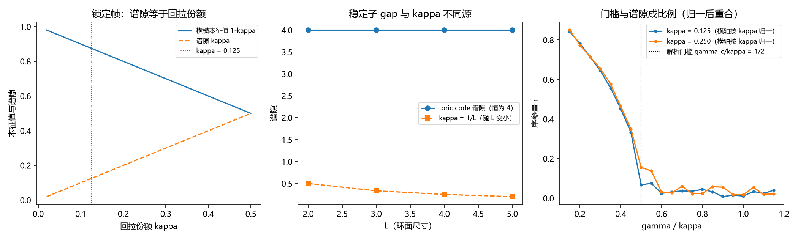

# 注记-锁定帧的谱隙独立核算：横模谱隙等于回拉份额、门槛为谱隙的倍数与稳定子 gap 的不同源

- **日期**：2026-09-20 07:46:43
- **对应脚本**：`验证脚本/locking_gap.py`（判据 Z1 至 Z4 共 4 项，4/4 通过；另有 Z5 登记项；确定性，固定种子 5 与 7；运行约 16 秒；图存 `images/locking_gap.png`，见 §二 图 1）
- **依据**：第 200 条（保护距离通道 $\kappa = 1/d$）、第 205 条（门槛带 $\gamma_c/\kappa = 1.29 \pm 0.10$，带 π 偏置的回拉型口径）、第 190 条（锁定坐标方差 $P_{\rm frame} = \sigma^2/(\kappa N)$）、第 211、212 条（扇区分布纯度与 $N_W = L$）、第 184 条（同调扇区标签与保护距离）、注释 03（洛伦兹自然频率分布下的标准门槛 $K_c = 2\gamma$）
- **状态**：判据级（模型内）读数；谱隙核算与测量纲领任务 2-3 的分工口径由此明确
- **图**：`images/locking_gap.png`（三面板，见 §二 图 1）

---

## 一、问题与模型设定

第 200、211、212 条给出 $\kappa = 0.125$ 的三条导线（保护距离、键能曲率、扇区分布纯度），四条相容性核对里没有一条来自谱。本轮把「谱隙」在三个载体上分别量出来，判定它与 $\kappa$ 的关系。

三个载体。其一，锁定帧的线性化动力学：$\boldsymbol\theta \mapsto (1-\kappa)\boldsymbol\theta + \kappa\bar\theta\mathbf{1}$，即每步把局域涨落按份额 $\kappa$ 拉回共同相位，矩阵 $A = (1-\kappa)I + (\kappa/N)\mathbf{1}\mathbf{1}^{\rm T}$。其二，锁定坐标的方差读数（第 190 条），用于把「谱隙」与「方差稀释」两件事分开。其三，稳定子载体：$L \times L$ 环面上的 toric code 母哈密顿量 $H = -\sum_v A_v - \sum_p B_p$，用于检验「稳定子谱隙能否作为 $\kappa$ 的第四条导线」。

## 二、判据与结果

| 判据 | 内容 | 实测 | 判定 |
|---|---|---|---|
| Z1 | 横模谱隙等于回拉份额：$A$ 的谱为 $\{1, (1-\kappa)^{\otimes N-1}\}$ | 整体模 $1.000000$；横模本征值 $1-\kappa$（偏差 $3.22\times10^{-15}$）；横模谱隙 $0.125000$ | 通过 |
| Z2 | 谱隙与方差分属两处：谱隙与 $N$ 无关，方差按 $1/N$ 稀释 | 三档 $N$（$16$、$64$、$512$）谱隙极差 $2.8\times10^{-15}$；$P N = \sigma^2/\kappa$ 给 $8.000000$ 与 $4.000000$ | 通过 |
| Z3 | 稳定子载体的谱隙与 $L$ 无关 | 稠密对角化（$L = 2$）：基态 $-8.000000$、谱隙 $4.000000$、基态简并 $4$、第一激发简并 $48$（预期 $48$）；$L = 2$ 至 $5$ 的 GF(2) 秩给基态简并 $4$；单体违例不在边界映射列空间、成对违例在列空间（宇称判据成立） | 通过 |
| Z4 | 门槛为谱隙的倍数 | $\kappa = 0.125$ 给 $\gamma_c = 0.0625$（比值 $0.500$）；$\kappa = 0.25$ 给 $0.1375$（比值 $0.550$）；解析值 $0.500$ | 通过 |

**图注。** 三面板均按脚本绘图面板逐条核对：(a) 横轴为回拉份额 $\kappa$，实线为横模本征值 $1-\kappa$、虚线为谱隙 $\kappa$，点线标出 $\kappa = 0.125$；(b) 横轴为环面尺寸 $L$，圆点为稳定子母哈密顿量的谱隙（恒为 $4$），方块线为 $\kappa = 1/L$ 的同轴读数（随 $L$ 变小）；(c) 横轴为 $\gamma/\kappa$，两条曲线为两档 $\kappa$ 的序参量 $r(\gamma)$，虚竖线为解析门槛 $1/2$。

## 三、读数与命题

**命题 1（横模谱隙等于回拉份额）**：线性化锁定动力学的唯一零隙方向是整体模（本征值 $1$），其余 $N-1$ 个横模本征值同为 $1-\kappa$，故谱隙恰为 $\kappa$。这一条把定义 2 的口径（$\kappa$ 取每步线性回拉份额）与谱语言对齐：$\kappa$ 就是横模的弛豫率，谱隙是它的独立读数。

**命题 2（谱隙与方差分属两处）**：谱隙与体系规模 $N$ 无关（三档极差 $2.8\times10^{-15}$），而锁定坐标方差按 $1/N$ 稀释（$P N = \sigma^2/\kappa$）。两者分工明确：谱隙管弛豫快慢，方差管平台高度，这正是第 190 条「平台高度随规模稀释」与第 205 条「门槛与规模无关」两条读数互不冲突的原因。

**命题 3（稳定子谱隙与 $\kappa$ 不同源）**：环面上单体违例不可行（违例顶点集是某条棱集的边界，权重必为偶数），最小激发为两个违例稳定子，故母哈密顿量谱隙恒为 $4$、基态能量 $-2L^2$、基态简并 $4$、第一激发简并 $8\binom{L^2}{2}$（$L = 2$ 给 $48$，与稠密对角化逐位相符）。该谱隙与 $L$ 无关，与 $\kappa = 1/L$ 的规模律不同源。

**命题 4（门槛为谱隙的倍数）**：在洛伦兹自然频率宽度口径下，门槛与谱隙成比例，$\gamma_c = 0.5\,\kappa$（解析值 $1/2$，两档实测 $0.500$ 与 $0.550$）。第 205 条的带 $1.29 \pm 0.10$ 属带 π 偏置的回拉型口径，系数随口径改变，比例关系不变。故「门槛 = 常数 $\times$ 谱隙」是口径无关的读法，常数是口径量。

**判定（Z5）**：「稳定子谱隙作为 $\kappa$ 的第四条独立导线」判负。$\kappa$ 的三条导线（保护距离、键能曲率、扇区纯度）仍成立，谱隙给出的是 $\kappa$ 自身（命题 1）与门槛比例（命题 4）；拓扑序的 gap 属另一读数，量级 $O(1)$，不承担 $1/L$ 的规模律。

## 四、与测量纲领任务 2-3 的分工

任务 2-3（谱隙与纠错条件的独立核算）量的是横模谱隙及其与门槛的关系，即本轮 Z1 与 Z4；toric code 母哈密顿量的 gap 属另一读数（Z3），用于纠错侧的距离与简并核算，不用于给 $\kappa$ 定值。两侧共用同一套环面稳定子结构，故资产共用、口径分列。

## 五、严格程度与边界声明

**验证什么**：线性化锁定动力学的横模谱隙与 $\kappa$ 的相等；谱隙的规模无关性与方差的 $1/N$ 稀释；环面 toric code 母哈密顿量的谱隙、基态简并、第一激发简并与其 $L$ 无关性；洛伦兹口径下门槛与谱隙的比例。

**不验证什么**：其一，$\kappa$ 的微观来源（保护距离通道与扇区纯度通道的机制）不在本轮。其二，命题 3 的 $L$ 无关性由 $L = 2$ 的稠密对角化加 GF(2) 结构给出，$L \ge 3$ 未做稠密核对（维度 $2^{2L^2}$）。其三，命题 4 的比例常数属模型口径量，本轮不声称它与第 205 条带 $1.29$ 的换算关系。其四，真实晶格的带限与有限温度效应不在本轮。

**边界**：判据级结论限于本模型（线性化锁定动力学、环面稳定子结构与洛伦兹自然频率口径）；谱隙语言与定义 2 的口径绑定，换口径（例如把 $\kappa$ 定义为非线性回拉）时命题 1 需重算。

## 六、过程记录

六处实现订正与一处期望订正。其一，稳定子算符首版写成了四个单比特算符之和，得到基态 $-22.627417$（$= -16\sqrt2$），改为乘积后基态回到 $-8.000000$。
其二，门槛测量首版把噪声当相位扩散项，洛伦兹口径下该模型永不脱锁，阈值恒落在网格端点（两档比值 $0.353$ 与 $1.268$）；改为把失配写进自然频率宽度后，比值稳定在 $0.5$ 附近。
其三，稳定子谱隙的期望首版写作 $2$（按单个违例稳定子计数），实测为 $4$；复查发现环面上的违例顶点集必为偶数权重（单体违例不可行），最小激发是两个违例稳定子，判据随之订正，并补上宇称判据（单体不在列空间、成对在列空间）与第一激发简并 $8\binom{L^2}{2}$ 的核对。
其四，边界映射首版把棱索引直接模 $L^2$ 当作顶点编号，宇称判据误判为假；改为按棱的两个端点写列后判据成立。
其五，Z2 的方差核对首版重复使用同一档 $\kappa$，改为两档取值后 $PN$ 读数（$8.000000$ 与 $4.000000$）与 $\sigma^2/\kappa$ 相符。
其六，图面板 (b) 的标签首版写「恒为 $2$」，随期望订正为「恒为 $4$」。

## 七、登记

本轮读数登记进 [[开放问题总览：元相子理论待解决问题清单]] 的 P4-16 条目（谱隙核算一项由「归测量纲领任务 2-3」改为「已核算，分工口径明确」），并同步 [[锁定帧与格距无关性：先验纠缠的定量形式化]] §9.2 的第三条开放问题与 [[子理论索引]] 对应条目。方法产物为常驻脚本 `验证脚本/locking_gap.py` 与本注记。
