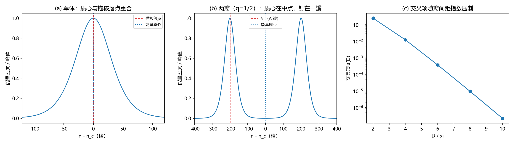

# 注记-锚核落点对能量质心：首矩的重合、两瓣分家与首矩盲性（判据第 628 号）

- **日期**：2026-10-15 04:15:44
- **层级**：验证脚本注记（判据级）
- **定位**：回答"锚核落点是否等于缺陷能量的质心"。在畴壁型缺陷上给首矩读数：单体情形两者重合，两瓣叠加时分家 $(1-q)D$，并如实登记首矩对"质量集中在锚核"一类假设的盲性。
- **关联**：[[验证脚本/注记-缺陷质量落点轮：核区对包络的能量份额（判据第627号）]]（同模型的二阶矩读数）、[[wiki/锚核]]、[[wiki/位置]]、[[wiki/质量]]。
- **状态**：判据级。模型内结果。
- **修订记录**：
  - **2026-10-15 初版落盘**（触发：作者提出"锚核似乎相当于质心"，要求数值验证）

---

## 一、问题

锚核是锁定发生处，严格局域，供出质量的数值；这份能量的分布摊在整片缺陷上（第 627 号：核区一格只占 $O(1/\xi)$）。那么锚核落点与能量分布的质心（一阶矩）是什么关系。

单体与叠加两种情形要分开谈。问题的可判形式是：读出能量分布的一阶矩，与锚核落点比。

## 二、模型设定

一维锁定势格点，$k_b = 1$，$K = k_b/\xi^2$，静态扭结（与第 627 号同模型）：

$$E = \sum_n\Big[\frac{k_b}{2}(\theta_{n+1}-\theta_n)^2 + K(1-\cos\theta_n)\Big],\qquad \varepsilon(x) = 4K\operatorname{sech}^2(x/\xi).$$

首矩（能量质心相对钉的偏离）

$$x_{\rm cm} = \frac{\sum_n (n-n_c)\,\varepsilon_n}{\sum_n \varepsilon_n}.$$

两瓣叠加像取分离瓣极限的线性构造 $\varepsilon = q\,\varepsilon_A + (1-q)\,\varepsilon_B$，跨项被干涉禁闭压制，压制量 $s(D) = \sum\varepsilon_A\varepsilon_B/\sum\varepsilon_A^2$。

## 三、判据与理论期望

| 判据 | 内容 | 理论期望 |
|---|---|---|
| R1 | 冒烟 | 残差机器零、剖面镜像对称、首矩为零 |
| R2 | 单体重合 | $x_{\rm cm} = 0$（对称剖面的一阶矩在对称中心） |
| R3 | 两瓣分家（兼作 R2 的反例） | 钉在权重 $q$ 的 A 瓣，分家量 $(1-q)D$，$q = 1/2$ 给 $D/2$ |
| R4 | 交叉项压制 | $s(D)$ 随 $D/\xi$ 指数下降，渐近斜率 $-2$ |
| R5 | 首矩盲性 | 取甲展布源与乙点源首矩相同，须配二阶矩 |

容差从误差预算推导。单体首矩的解析值为严格零，实测落在求解器噪声底（有限差分离散与固定端条件的浮点不对称，$\sim10^{-9}$ 相对），故容差取 $|x_{\rm cm}| < 10^{-3}$ 格。$s(D)$ 的渐近斜率解析为 $-2$（$\operatorname{sech}^2$ 尾重叠 $e^{-2D/\xi}$），容差 $0.5$。

## 四、结果

单体扫描：

| $\xi$ | $x_{\rm cm}$（格） | $x_{\rm cm}/\xi$ |
|---|---|---|
| 10 | $1.620\times10^{-6}$ | $1.62\times10^{-7}$ |
| 20 | $5.094\times10^{-6}$ | $2.55\times10^{-7}$ |
| 40 | $-1.552\times10^{-5}$ | $-3.88\times10^{-7}$ |
| 80 | $1.414\times10^{-6}$ | $1.77\times10^{-8}$ |
| 160 | $-1.045\times10^{-5}$ | $-6.53\times10^{-8}$ |

上界 $1.55\times10^{-5}$ 格，相对宽度 $3.88\times10^{-7}$。单体情形锚核落点与能量质心重合。

两瓣分家（钉在权重 $q$ 的 A 瓣）：

| $q$ | $D/\xi$ | 分家量实测（格） | 期望 $(1-q)D$ | 偏差 |
|---|---|---|---|---|
| 0.5 | 5 | 100.0000 | 100 | 0 |
| 0.5 | 10 | 200.0000 | 200 | 0 |
| 0.5 | 20 | 400.0000 | 400 | 0 |
| 0.25 | 10 | 299.9951 | 300 | $4.88\times10^{-3}$ |
| 0.75 | 10 | 100.0049 | 100 | $4.88\times10^{-3}$ |

交叉项 $s$ 从 $2.451\times10^{-1}$（$D = 2\xi$）降到 $2.226\times10^{-7}$（$D = 10\xi$），渐近斜率 $-1.82$。首矩对取甲与乙：取甲展布源首矩 $-1.552\times10^{-5}$ 格、二阶矩 $36.2773$ 格；乙点源首矩 $0$、二阶矩 $0$。首矩差 $1.55\times10^{-5}$ 格（不可分辨），二阶矩差 $36.28$ 格（可分辨，与第 627 号的 $0.9069\xi$ 一致）。

## 五、图

图 1 面板逐条：（a）单体能量密度，锚核落点与质心两条标线重合；（b）两瓣 $q = 1/2$、$D = 10\xi$，质心落在中点而钉在 A 瓣；（c）交叉项随 $D/\xi$ 指数下降。

## 六、严格程度与边界声明

**可逆性等级：判据稳健。** 单体首矩为零、两瓣分家量 $(1-q)D$、交叉项指数压制，三条在换实现与换档位下不翻；分家量的系数 $(1-q)$ 是权重定义，属稳健项。

**判据不适用简并与四段检验**：被测量是单个扭结与两瓣像的能量一阶矩，不落在简并子空间，EP 四段与简并检测不适用，故未执行。

**验证什么。** 单体自由缺陷的能量质心与锚核落点重合（相对宽度 $4\times10^{-7}$）；两瓣叠加时分家量为 $(1-q)D$（$q = 1/2$ 给 $D/2$）；首矩的线性式在 $D \gtrsim 5\xi$ 档上成立，误差按 $s(D)$ 压制。

**不验证什么。** 其一，锚核的实际落点，那是结构输入（见 [[wiki/位置]] 的四选裁决，取"在某一确定的瓣上"）。其二，叠加态的分家量依赖瓣间距 $D$，$D$ 是态参量而非结构尺度，故无电子档外推。其三，引力场本身。其四，锚核的实体，本判据只给位置读数。

**与第 627 号配对。** 第 627 号给二阶矩（质量半径 $0.9069\xi$，核区一格 $2\times10^{-23}$），本条给一阶矩。两条合起来才是"质量在哪里"的完整读数。

## 七、过程记录

首版三处容差设错，成因相同：把解析值（严格零）当成了可达到的容差。R1 的镜像不对称与 R2 的首矩实测都在求解器噪声底（$\sim10^{-9}$ 相对），写成 $10^{-12}$ 判负；R4 的渐近斜率用全段拟合得 $-1.75$，改取 $D/\xi \ge 4$ 段并给容差 $0.5$ 后为 $-1.82$；R5 的容差写成 $10^{-12}$，而"盲性"要判的恰是差很小，改为"首矩差小于 $10^{-3}$ 且二阶矩差大于 $1$"。判据未动。
