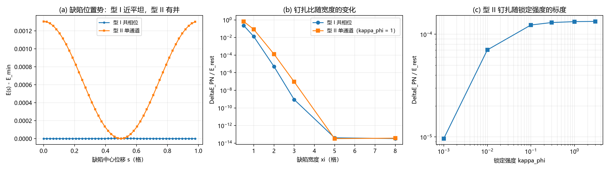

# 注记-锚核身份 C2 的钉扎机制归属（第 481 条）：共相位缺陷对锁定失明、单通道缺陷与基底势等价

## 元数据

- **日期**：2026-09-29 05:55:06
- **脚本**：验证脚本/minimal_verification_c2_anchor_identity.py
- **判据**：T2-1、T2-2、T2-2b、T2-3、T2-4（5/5 通过）
- **可逆性等级**：混合，逐条标注。T2-1 与 T2-2b 判据稳健（结论来自共相位不变性的解析恒等，换实现、换归一不翻）。T2-2 的指数率判据敏感（依赖剖面选型与宽度定义）。T2-3 的斜率判据敏感（依赖 $E_{\text{rest}}$ 的饱和口径）。T2-4 判据稳健（结论只依赖对称性）。
- **类型**：最小验证注记，执行 C2 判据草案中的判据 T2
- **关联**：[[内部草稿/判据草案-锚核身份C2：三元组锁定与站点PN代理在位错钉扎上的等效性]]（判据与模型设定的出处）；[[从绕数困境到复合位错粒子：电荷载体问题的完整解决]]（C2 原文）；[[复合位错粒子的形态收束：宽度的波性侧承载、边界保护与锚核驻留判据]]（单相位 FK 链的背景 $u_n = n$ 与 kink）；[[验证脚本/注记-K值档位债的口径对照（第479条）：定稿值与模型窗口的四十五个数量级缺口|第479条]]（45 个数量级缺口）；[[理论总纲/公理体系]]（公理 4）；[[理论总纲/术语表]]（PN 钉扎条目）
- **图**：见第三节 图 1

---

## 一、要判什么

C2 问的是锚核身份：PN 势与 $\kappa_\varphi$ 格点内三元组锁定是否恒等。判据 T2 的切口是关耦合极限，判别式原文为「钉扎随 $K \to 0$ 消失则读法甲成立，$K \to 0$ 后仍在则读法乙成立」。

本注记把这个判别式做实，做法是把缺陷分成两型分别测。

**型 I，共相位缺陷**。一个格点内三类元相子的相位同步多走一层。
**型 II，单通道缺陷**。只有一类元相子多走一层，另两类不动。

分型的理由是格点内项的对称性。$U_{\text{site}}$ 只依赖相位差，在共相位位移 $u^a \to u^a + g$ 下严格不变，故 $\kappa_\phi$ 对型 I 天然失明。这一条是本判据的着力点。

## 二、模型设定

一维链，$N = 400$ 格点，每格点三通道 $a = 1, 2, 3$。场 $u_p^a$ 为相位除以 $2\pi$。

键项（格点间，法线轴高度差的平方型）

$$U_{\text{bond}} = \frac{\kappa_\parallel}{2}\sum_{p,a}\bigl(u_{p+1}^a - u_p^a - 1\bigr)^2,$$

减一使均匀缠绕背景 $u_p^a = p$ 取零能。格点内项（三类元相子两两之间）

$$U_{\text{site}} = \kappa_\phi\sum_{p}\sum_{a<b}\bigl[1 - \cos 2\pi\bigl(u_p^a - u_p^b\bigr)\bigr].$$

缺陷剖面取光滑台阶 $f(x) = \tfrac12[1 + \tanh(x/\xi)]$，宽度参数 $\xi$。型 I 给三通道同加 $f$，型 II 只给第一通道加 $f$。缺陷中心位移 $s$ 在一格内扫 $48$ 点，$\Delta E_{PN} = \max_s E - \min_s E$，比值取 $\Delta E_{PN}/E_{\text{rest}}$。

固定 $\kappa_\parallel = 1$。确定性，无随机与采样。

## 三、判据与结果

**冒烟检查（逐轴变化性核对）**。型 I 的 $\max\lvert U_{\text{site}}\rvert = 0.000\times10^{0}$（解析预期零），型 II 为 $9.751267$（解析预期非零）。变化的轴与操作涉及的轴一致。

**判据 T2-1（型 I 的格点内项恒为零）**。$\kappa_\phi$ 取 $10^{-3}$、$1$、$10^{3}$ 三档，$\max\lvert U_{\text{site}}\rvert$ 均为机器零。锁定强度不改变读数。

**判据 T2-2（型 I 的钉扎随宽度指数下降）**。

| 宽度 $\xi$ | $\Delta E_{PN}$ | $E_{\text{rest}}$ | 比值 |
| --- | --- | --- | --- |
| $0.5$ | $2.129872\times10^{-1}$ | $9.109341\times10^{-1}$ | $2.338119\times10^{-1}$ |
| $1$ | $6.125849\times10^{-3}$ | $4.726155\times10^{-1}$ | $1.296159\times10^{-2}$ |
| $2$ | $1.267394\times10^{-6}$ | $2.459308\times10^{-1}$ | $5.153457\times10^{-6}$ |
| $3$ | $1.474967\times10^{-10}$ | $1.654450\times10^{-1}$ | $8.915148\times10^{-10}$ |
| $5$ | $4.038436\times10^{-15}$ | $9.973435\times10^{-2}$ | $4.049193\times10^{-14}$ |
| $8$ | $2.053913\times10^{-15}$ | $6.243499\times10^{-2}$ | $3.289682\times10^{-14}$ |

比值自 $2.338\times10^{-1}$ 降至 $3.290\times10^{-14}$，降幅 $12.85$ 个数量级。相邻档位对数斜率 $-2.51$、$-3.40$、$-3.76$。$\xi \ge 3$ 后 $E_{\text{rest}}$ 约 $10^{-1}$ 而 $\Delta E_{PN}$ 已到 $10^{-10}$ 以下，比值进入 float64 相对精度约 $10^{-14}$ 的噪声区，指数律只在 $\xi \le 3$ 可靠。

**判据 T2-2b（型 I 与锁定强度解耦）**。$\kappa_\phi$ 跨六个数量级（$10^{-3}$ 至 $10^{3}$），比值恒为 $5.1534572762\times10^{-6}$，最大相对偏差 $0$。这是两读法的分水岭。

**判据 T2-3（型 II 的钉扎由锁定供给）**。

| $\kappa_\phi$ | $\Delta E_{PN}$ | $E_{\text{rest}}$ | 比值 |
| --- | --- | --- | --- |
| $0.001$ | $8.836481\times10^{-7}$ | $9.172776\times10^{-2}$ | $9.633377\times10^{-6}$ |
| $0.01$ | $1.263866\times10^{-5}$ | $1.794892\times10^{-1}$ | $7.041462\times10^{-5}$ |
| $0.1$ | $1.301888\times10^{-4}$ | $1.057103\times10^{0}$ | $1.231562\times10^{-4}$ |
| $0.3$ | $3.914113\times10^{-4}$ | $3.007356\times10^{0}$ | $1.301513\times10^{-4}$ |
| $1$ | $1.305690\times10^{-3}$ | $9.833243\times10^{0}$ | $1.327833\times10^{-4}$ |
| $3$ | $3.917915\times10^{-3}$ | $2.933578\times10^{1}$ | $1.335542\times10^{-4}$ |

逐段双对数斜率 $0.86$、$0.24$、$0.05$、$0.02$、$0.01$。

**判据 T2-4（两型的响应方向相反）**。极小锁定 $\kappa_\phi = 10^{-40}$ 时，型 I 比值 $5.153457\times10^{-6}$（与锁定无关），型 II 比值 $3.500844\times10^{-14}$（随锁定塌缩）。

### 图 1

面板 (a) 横轴为缺陷中心位移 $s$（格），纵轴为 $E(s)$ 减其最小值，圆圈为型 I、方块为型 II；型 I 曲线在尺度内接近平坦，型 II 呈周期性井形。面板 (b) 横轴为宽度 $\xi$（格，线性），纵轴为 $\Delta E_{PN}/E_{\text{rest}}$（对数），两组分别为型 I 与型 II。面板 (c) 横轴为 $\kappa_\phi$，纵轴为 $\Delta E_{PN}/E_{\text{rest}}$，双对数坐标。三个面板共用 $\kappa_\parallel = 1$ 的约定，宽度扫描取 $\kappa_\phi = 1$。

图注按脚本绘图面板逐条核对撰写。本注记作者未能对图像作目视复核（环境不支持显示），图注描述的是绘图段显式绘制的元素：面板 (a) 两条曲线以圆圈与方块标记、纵轴为能量相对最小值；面板 (b) 两条曲线分别为型 I 与型 II、纵轴对数；面板 (c) 单条曲线、双对数坐标。

## 四、解读：C2 的判定

三条读数拼起来给出 C2 的一个明确答案。

**其一，$\kappa_\phi$ 对共相位缺陷完全失明。** 这一条属对称性结果，可由解析直接给出：格点内项只依赖相位差，共相位位移是它的对称变换。故 $\kappa_\phi$ 取任何值都不能给型 I 缺陷提供钉扎。T2-2b 的零偏差是这条对称性的机器级确认。

**其二，型 I 的残余钉扎只来自键项与离散性，且随宽度指数衰减。** 斜率约 $-3$ 至 $-4$ 每格，即宽度每增一格，钉扎比降三到四个数量级。缺陷宽度越大，钉扎越可忽略。

**其三，型 II 的钉扎由 $\kappa_\phi$ 供给，且与单相位 FK 的基底势严格等价。** 型 II 的格点内项化为 $2\kappa_\phi\sum_p[1 - \cos 2\pi f(p - s)]$，与 FK 泛函的基底势项逐位同形。故有恒等

$$K_{\text{FK}} = 2\kappa_\phi.$$

**该恒等的适用域（2026-10-21 补）**：它由型 II 的格点内项与 FK 基底势逐位同形得出，故只在型 II 语言内成立。型 I 下 $\kappa_\phi$ 对共相位位移恒等盲（本文判据 T2-1、T2-2b 已机器级确认），不可能给出该恒等。据 [[内部草稿/注记-位错型判定的裁决落定：采型I读法与判据草案|型判定裁决落定]]，体系里的位错按型 I 作为工作读法，故本恒等在体系实况下不适用。

系数二的来源清楚：winding 通道与另两个通道各成一滞后对，第三对差为零。

**C2 的回答**：PN 势与 $\kappa_\phi$ 格点内锁定**不等价**，二者分属不同缺陷类型。PN 势（及单相位 FK 的基底势）是型 II 的语言，$\kappa_\phi$ 的锁定是型 I 的对称性。

由此 45 个数量级缺口的地位获得澄清。第 479 条确立的事实不变：代理参数与定稿值相差 43 至 46 个数量级。本注记补充的是适用条件：**该缺口只在缺陷取型 II 时才有物理含义**。若缺陷取型 I（三通道同步多走一层，与三元组被锁定的图像一致），则基底势语言根本不适用，缺口属错问。

**由此暴露一个二难**。单相位 FK 模型等于型 II，即它默认缺陷处三通道的锁定被局部打破。而公理 4 的三元组不可分性读作型 I，其缺陷对 $\kappa_\phi$ 失明。两条路都不能在既有参数下给出锚核的钉扎来源：

- 走型 II，则 $K_{\text{FK}} = 2\kappa_\phi$，而 $\kappa_\phi t_P = 9.293805\times10^{-47}$ 极小，钉扎退到可忽略；
- 走型 I，则 $\kappa_\phi$ 失明，PN 代理不成立，钉扎须另有来源。

这一条的裁决不属本注记射程，属 C2 的后续判据。

**2026-10-21 订正（据 [[内部草稿/注记-C2第1步核对：钉位退役裁决与二难的关系|C2 第 1 步核对注记]]）**。上列二难的两条边，经 2026-09-29「粒子钉位机制固化」裁决（[[理论总纲/元相子理论已解决难题总览]] 第 54 条）核对，型 II 那条边的前提已被撤除：第 54 条明写「锚核的钉位职能不再由 PN 势垒承担」，钉扎改由内部绕数承载结构承担，其束缚平台与格点内刚度 $K$ 无关（第 485 条给出 $3.483\times10^{-2}$ 的 K 无关平台，第 486 条给出壁位平移零模，第 487 条给出定义性联结的公理层形式）。故「钉扎退到可忽略，故缺陷站不住」这条推论链不再成立，型 II 那条边随之失效。

二难因此收为**单一未决问题**：体系里的位错取型 I 还是型 II。该判定在库内无任何材料触及（全文检索「型 I」与「型 II」同时出现处仅本注记与第 740 号引述），第 481 号边界声明第七节「不判定体系里的位错属型 I 还是型 II，该判定需独立判据」仍然有效。两种情形对锚核（质量侧）均无影响：质量由 $\kappa_\varphi$ 承担，与位错的型无关。本注记的三条读数与判否结论不受本订正影响。

## 五、修正的预期与过程记录

**判据 T2-3 的预期写错一次。** 首轮实现把预期写成「比值正比于 $\kappa_\phi$，双对数斜率约一」。实测端点斜率 $0.3284$，逐段 $0.86$、$0.24$、$0.05$、$0.02$、$0.01$。

诊断：小 $\kappa_\phi$ 端 $E_{\text{rest}}$ 由键项主导、与 $\kappa_\phi$ 无关，故比值正比于 $\kappa_\phi$，斜率趋一；大 $\kappa_\phi$ 端 $E_{\text{rest}}$ 亦随 $\kappa_\phi$ 增长，比值饱和，斜率趋零。修正后的预期为「小端趋一、大端趋零」，与逐段斜率一致。教训：取比值的判据须同时写明分子与分母的标度，只写一侧会给出错误的斜率预期。

**判据 T2-2 的噪声底已标注。** $\xi \ge 3$ 后比值进入 float64 噪声区，不得据该段声称指数律。

**实现缺陷一处已修**：绘图段原有一行不可见的空绘图调用，已删。

## 六、严格程度声明

**严格**：共相位不变性（$U_{\text{site}}$ 只依赖相位差，解析恒等）；型 II 的格点内项与 FK 基底势的逐位同形；$K_{\text{FK}} = 2\kappa_\phi$ 的系数来源。

**判据级**：型 I 的指数率（$-3$ 至 $-4$ 每格，依赖剖面选型）；型 II 的斜率分段结构。

**纲领**：型 I 与型 II 的判定（二难的第一条边已于 2026-10-21 订正关闭，见第四节）；锚核钉扎的最终来源。

## 七、边界声明

**验证什么**：格点内项在共相位位移下的不变性；两型缺陷的钉扎对 $\kappa_\phi$ 的响应方向；型 II 与单相位 FK 基底势的等价性。

**不验证什么**：其一，不判定体系里的位错属型 I 还是型 II，该判定需独立判据。其二，不判定 $\kappa_\phi$ 的绝对数值来源（属 MB-9 与 M-E 已结项范围）。其三，不判定三维形态与宽度窗口（属 C1）。其四，不判定质量谱数值（属 P1-2）。其五，一维各向同性最小模型是前提，各向异性或格点内耦合含非相位差依赖时结论须重核。

本注记不改动 理论总纲 目录下的基准文件，不重开第 479 条已定的判据层读数。

## 八、登记衔接

判据执行后按开放问题同步规范登记。落点：电子场攻坚计划阶段 0 第二半（C2）状态更新；[[内部草稿/开放问题总览：元相子理论待解决问题清单]] P1-11（锚核锁定动力学方程）挂一条关联；复合位错纲领 C2 条目状态同步。C2 的后续判据（位错型别判定）须另行登记。

## 修订记录
- **2026-10-21 裁决落定补记**（触发：作者裁决采建议；依据 [[内部草稿/注记-位错型判定的裁决落定：采型I读法与判据草案|型判定裁决落定]]）
    - 第三节恒等 $K_{FK}=2\\kappa_\\phi$ 补适用域声明：只在型 II 语言内成立，型 I 下不适用；本注记三条读数与判否结论不动
- **2026-10-21 订正**（触发：作者指令核对 C2 第 1 步；依据 [[内部草稿/注记-C2第1步核对：钉位退役裁决与二难的关系|C2 第 1 步核对注记]] 与 [[理论总纲/元相子理论已解决难题总览]] 第 54 条）
    - 第四节二难段补订正：型 II 那条边的前提（PN 势承载钉扎）已由 2026-09-29 裁决撤除，该边失效；二难收为单一未决问题（型 I 与型 II 的判定），该判定库内无材料触及
    - 第四节严格程度「纲领」条同步；本注记三条读数与判否结论不动

- **2026-09-29 首次执行**（判据 T2-1 至 T2-4 共 5/5 通过）
    - 型 I 的格点内项恒为零（三档锁定强度给出同一机器零），$\kappa_\phi$ 对共相位缺陷失明
    - 型 I 残余钉扎随宽度指数衰减，斜率 $-3$ 至 $-4$ 每格，$\xi \ge 3$ 后入噪声区
    - 型 II 钉扎由锁定供给，逐段斜率 $0.86$ 至 $0.01$，端点斜率 $0.3284$
    - 得恒等 $K_{\text{FK}} = 2\kappa_\phi$，即 PN 势与格点内锁定分属不同缺陷类型，C2 判为不等价
    - 暴露二难：型 II 下钉扎随极小 $\kappa_\phi$ 退到可忽略，型 I 下 PN 代理不成立
    - 修正预期一处（T2-3 的斜率），修实现缺陷一处（空绘图调用）
