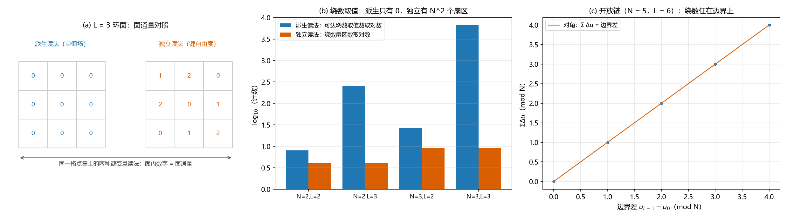

# 注记-键身份轮：键变量取实轴方向差的两读法对照与保护前提

- **日期**：2026-09-17 02:53:00
- **对应脚本**：`验证脚本/minimal_verification_bond_identity.py`（判据 BID-1 至 BID-6，确定性，纯组合精确计算，运行约 2 秒；图存 `images/bond_identity.png`，见 §一 图 1）
- **依据**：[[评估-量子层保护结果的体系适用性：两侧互补、四座桥与O1接口]]（桥 1 的缺口清单）；[[注记-量子层Q4：绕数跨扇区泄漏的最小阶数与尺寸标度]] 与 [[注记-量子层Q5：弦算符的可形变完成（同调不变、局域算子标量化与最小支撑）]]（独立读法下的保护读数）；[[注记-边界模式轮：缠绕守恒边界的量子层形态与总通量锁定]] 与 [[注记-边界模式轮三维：立方体样本的闭合面关系与周界回路锁定]]（边界把绕数变成边界条件给定的数据）；[[注记-FK链：从Frenkel-Kontorova模型到元相子时空晶格的一维代理]]（一维链与缠绕守恒边界）；[[注记-载体层裁决：纯相位的失败边界与振幅通道的实现路径]]（位形侧否定链）
- **定位**：桥 1（键自由度身份）。作者已裁定弦网棱自由度 = 实轴方向差（独立键自由度读法），本注记把该身份的两个读法做成可复算对照：派生读法（键变量 = 相邻格点法线轴读数之差，即单值场）与独立读法（键变量独立取值）。判据回答两个问题：保护结构需要哪一种读法；体系的格点内锁定与格点间关系两个耦合各自缺席时会怎样。本注记不改动基准文件。
- **状态**：判据 22/22 通过。核心读数：派生读法下面通量与绕数恒零（枚举全部构型；$L = 2, 3$、$N = 2, 3$），面约束独立条数为零，荷在那里"根本不存在非零构型"；独立读法下绕数取遍 $N^2$ 个取值对且均匀（每对各 $N^{\,n-2}$ 个构型）、面通量图案均匀（每图案 $N^{\,n-F+1}$ 个）、简并 $= N^2$；开放链上绕数 = 边界差（可任意取值），周期链上恒零；两个耦合各自单独在场时简并指数远大于 $2$。

---

## 一、判据与结果

| 判据 | 内容 | 通过条件 | 实测 |
|---|---|---|---|
| BID-1 | 派生读法下全部面的通量与两类非可缩环的绕数 | 恒零 | 全零（枚举 $16/512/81/19683$ 个构型） |
| BID-2 | 独立读法下面通量图案数与均匀性 | $N^{F-1}$ 种、每 $N^{\,n-F+1}$ | $8$ 种（每 $32$）、$256$ 种（每 $1024$）、$27$ 种（每 $243$）；$N{=}3,L{=}3$ 取秩 $8 = F-1$ |
| BID-3 | 一维链：开放链 $\sum \Delta u = $ 边界差；周期链 $\sum \Delta u = 0$ | 精确 | $N = 3$ 与 $5$、$L = 5$ 与 $6$ 四组全中 |
| BID-4 | 独立读法下的约束秩与简并 | 面 $F-1$、星 $V-1$、指数 $2$ | 四组全中（简并 $= N^2$） |
| BID-5 | 绕数取值可达性与均匀性 | $N^2$ 个值、每 $N^{\,n-2}$ | $4$ 种（每 $64$）、$4$ 种（每 $65536$）、$9$ 种（每 $729$） |
| BID-6 | 两个耦合各自单独在场时的简并指数 | 远大于 $2$ | $L = 2$ 给 $5$ 与 $5$；$L = 3$ 给 $10$ 与 $10$ |

## 二、模型与口径

二维 $L \times L$ 环面：格点读数 $\phi(i,j) \in Z_N$；键取 x 向与 y 向的相邻格点差。派生读法把键变量定义为 $\delta\phi$（单值场，闭路和受约束）；独立读法让键变量在 $Z_N$ 上自由取值。面通量取环绕四键的定向和，绕数算符取两类非可缩环的键和。一维链另设开放与周期两种边界。

两种读法的差别只有一处：键变量是否被写成某个格点变量的差。这一处差别决定了后面全部读数。

## 三、主要读数

### 派生读法：荷不存在非零构型

枚举全部 $\phi$ 后，每一个面的通量为零、两条非可缩环的绕数为零。这不是"荷被钉在零"，而是"带非零绕数的构型根本不在这个读法的构型空间里"：单值场沿任何闭路的提升和恒为零。落到算子层，面项与绕数算符在这个受限空间上都是恒等，面约束的独立条数为零。

### 独立读法：扇区结构完整

键变量自由取值时，面通量图案有 $N^{F-1}$ 种、每种 $N^{\,n-F+1}$ 个构型（全体面通量之和恒零，这是唯一的约束）；绕数取遍 $N^2$ 个取值对、每对各 $N^{\,n-2}$ 个构型。约束秩为面 $F-1$、星 $V-1$，简并指数 $2$，即 $N^2$，与既有七轮读数一致。

### 一维链：绕数住在边界上

开放链上 $\sum \Delta u$ 恰好等于两端读数之差，可以取任意值；周期链上同类求和恒为零。这条读数把"绕数住在边界上"写成恒等式：有边界时它是边界数据，没有边界时它不存在。边界两轮给出的"边界面周界回路"与"着装后唯一基态"，正是这条恒等式的量子层形态。

### 两个耦合：缺一不可

只保留星项（格点间关系关闭）时简并指数为 $n-(V-1)$，$L = 2$ 给 $5$、$L = 3$ 给 $10$；只保留面项（格点内锁定关闭）时同值。两者都远大于 $2$，即格点内锁定与格点间关系任何一方缺席，保护即退化。这条读数把身份问题和体系的两个耦合接上：保护不是任一耦合单独给出的。

## 四、身份结论

键变量取实轴方向差这一裁定，与保护读数一致的前提是"独立键自由度读法"。派生读法虽也把键写成相邻读数之差，却因闭路约束把绕数整个消掉，与位形侧四重否定的结论一致，且形态更根本：那里是"环塌缩、绕数丢失"，这里是"非零构型不存在"。

由此得到桥 1 的答复：实轴方向差可以承担键变量（独立读法下保护读数原样成立），但承担的方式必须是关系侧的独立变量，不能退化成某个体变量的差；两个耦合（格点内锁定与格点间关系）必须同时在场。边界条件是唯一能给出确定绕数的机制（开放链读数为证），这与边界两轮的着装读数合流。

## 五、严格程度声明

全部读数为组合精确事实：构型枚举（最大 $19683$ 个）与有限域线性代数，无抽样、无浮点判据。一维链为恒等式核验。

## 六、边界声明

本注记验证二维环面（$L = 2, 3$；$N = 2, 3$）与一维链上键变量两读法的通量、绕数、约束秩与简并读数。

不验证：连续（非紧致）高度差的 $U(1)$ 极限（属桥 4 方向）；弱耦合下的定量保护标度（能隙与最小支撑随耦合比的变化，属谱与激发轮）；三维与带边界样本上的两读法对照（本轮在二维环面与一维链上做）；体系映射的其余环节（O1）。

## 七、过程记录

本轮判据一次通过，无预期修正。一处增补：BID-6 于首轮通过后补入，用于把键身份读数与体系两个耦合的物理判读（格点内锁定与格点间关系）接上；首轮的四条判据（BID-1 至 BID-4 与 BID-5）读数未变。

## 八、登记衔接

本轮登记：`验证脚本/README.md` 第 80 条；[[开放问题总览：元相子理论待解决问题清单]] 超选择层条目（桥 1 完成）；[[评估-量子层保护结果的体系适用性：两侧互补、四座桥与O1接口]] 桥 1 段附状态句。

注记、脚本、登记三者一致；本注记不改动 `理论总纲/` 基准，方案定案由作者裁决。
