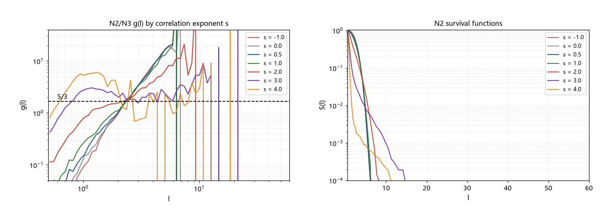

# 注记-长程关联点集的遇见率实验（第422条）：幂律谱关联族全档无平台与候选乙首轮判负

- **日期**：2026-09-26 05:25:37
- **类型**：判定轮（P0-5 跨线启发候选乙首轮）
- **脚本**：`验证脚本/minimal_verification_correlated_point_set.py`（第 422 条）
- **图**：见 §3 图 1（`images/correlated_point_set.png`）
- **依据**：[[内部草稿/注记-超扩散缺口的跨线启发：波性侧转向与三条候选（读电磁与电荷线最新进展）]]（候选乙的定位）；[[验证脚本/注记-钉扎网络的空间分布形状判定（第419条）：平稳点集无幂律尾与尺度不变遇见率条件]]（平稳点集判负与此条的谱系）；[[验证脚本/注记-级联簇精扫（第421条）：离散级联的振荡判负与三分之五信号的收回]]（平台检测口径与「瞬时值非平台」的教训）
- **状态**：判定完成。幂律谱关联族（$s \in [-1, 4]$）全档无平台；候选乙（先验纠缠关联调制）首轮判负（限于幂律谱替身）
- **可逆性等级**：判据稳健（阴性结论跨全谱档位与两条测量口径；生成器逐点核对通过）

## 1 判据与设定

候选乙的假设是「尺度不变的长程关联调制遇见率」。本轮用标准替身实现该假设：3D 高斯随机场（功率谱 $P(k) \propto k^{-s}$）阈值化到目标密度 $\rho = 0.01$，格点占位加亚格随机偏移；$s$ 从 $-1$（反关联、蓝谱）扫到 $4$（强聚簇），$s = 0$ 为白噪声（泊松极限）。诊断与第 419/421 条一致：$g(\ell) = -\mathrm{d}\ln S/\mathrm{d}\ln\ell$，平台检测取滑动窗口（$10$ 点、散布不超过 $12\%$）。

## 2 结果

N2/N3（全档无平台）：七档 $s = -1$、$0$、$0.5$、$1$、$2$、$3$、$4$ 全部未通过平台检测。平均最近邻随 $s$ 单调下降（$2.64$、$2.59$、$2.51$、$2.38$、$1.84$、$1.03$、$0.73$ 格），即聚簇把最近邻主体尺度压缩，但分布尾部始终为截断型。

N1（生成器核对）：$s = 0$ 与同密度泊松逐点对照吻合（抽样：$\ell = 1.11$ 给 $0.161$ 对 $0.167$；$2.37$ 给 $1.664$ 对 $1.662$；$3.47$ 给 $5.075$ 对 $5.019$），生成器判定正确。$s = 0$ 的中位 $g$（$1.52$）与泊松（$1.14$）的差异经逐点诊断归因于「中位」指标自身：$g$ 序列在饱和段含大量零值，中位对该污染敏感。中位 $g$ 自此登记为弱指标。

N4（一个必须拒绝的诱惑）：泊松与 $s = 0$ 的 $g$ 曲线在 $\ell = 2.4$ 格处恰好取 $1.66$（与 $5/3$ 差 $0.2\%$ 以内）。该值来自精确式 $g = 4\pi n \ell^3$ 在特定密度处的瞬时取值，随 $\ell$ 单调上升（$3.5$ 格处为 $5.1$，$5$ 格处为 $16$），非平台、非信号。此例并入第 421 条的教训：瞬时值与中位值都不是平台读数。

## 3 图

## 4 结论与移交

判定：候选乙（先验纠缠关联调制）首轮判负，限于「幂律谱关联」替身族。反关联、白噪声、长程聚簇全谱都没有尺度不变段；关联强度改变的是最近邻主体尺度与曲线陡度，不产生平台。与第 419 条的谱系合并：平稳点集（泊松、单尺度分形）与长程关联（幂律谱）两类均判负。

边界一处：先验纠缠的形式化（P4-16）未完成，本实验用幂律谱关联作替身；若先验纠缠的真实关联形式不属此族，本结论不覆盖。非平稳构造（第 419 条边界内）仍未测，但其通常引入特征尺度（中心、边界），与尺度不变目标的动机相反，列为低优先。

移交：候选甲（带电缺陷与自身规范场的耦合，自场/辐射反作用对象）升为下一个执行项；候选丙（转换波通道）暂缓。

## 5 严格程度与边界声明

严格程度：N2/N3 为数值扫描（固定种子，判据级）；N1 为逐点对照核对；N4 为解析式核对（泊松的 $g$ 有精确式）。阴性结论限于高斯随机场幂律谱族。

边界（本脚本不验证的内容）：其一，不含非高斯关联（如对数正态密度场、双曲分布）与多重分形；其二，不含非平稳构造；其三，密度档只取 $\rho = 0.01$；其四，亚格偏移只取均匀分布（不检验偏移分布的影响）。

## 6 过程记录

其一，首版绘图在生存函数面板存在差一维的数组错配（$63$ 对 $64$），修正为直接以网格点绘制；同时补入 $s = -1$（反关联）档，扫描覆盖由 $[0, 4]$ 扩为 $[-1, 4]$。

其二，中位差（$s = 0$ 的 $1.52$ 对泊松的 $1.14$）经逐点诊断判定为中位指标自身的问题（饱和段零值污染）；逐点对照吻合确认生成器无偏；该指标被正式降级。

其三，本轮识别并拒绝了一个「瞬时值恰为 $5/3$」的诱惑（泊松曲线在 $2.4$ 格处的 $1.66$），避免重复第 420 条的取样误判。该教训与第 421 条合并为一条纪律：**平台必须由「跨尺度保持」验证，任何单点值（瞬时值、中位值、极值）都不构成信号**。
