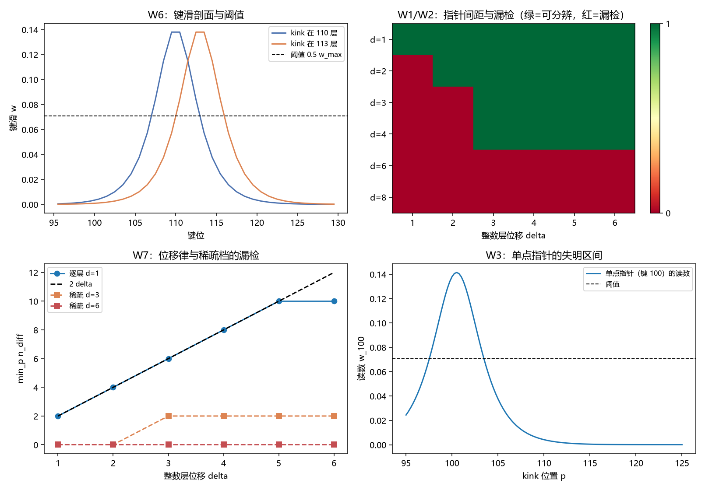

# 注记-限制二收口的最小验证：逐层指针与阈值读出的可分辨性

- **日期**：2026-09-24 03:49:56
- **层级**：验证注记（对应 `验证脚本/pointer_granularity.py`，`验证脚本/README.md` 第 383 条）
- **图**：见 §三 图 1
- **定位**：执行 [[研究方向-限制二收口：逐层指针与阈值读出的可分辨性判据（判据草案）]] 的判据 W1 至 W8，把限制二的两条（一层一指针、阈值读出衔接）从建模选择改为记录判据的推论。
- **依据**：[[研究方向-限制二收口：逐层指针与阈值读出的可分辨性判据（判据草案）]]；[[测量的三层判据：从相互作用分层到单次测量机器]]（§2.2 限制二、§3.1 阈值判读）；[[注记-记录判据的最小验证：独立性的定义域、反例与判据级表述]]（$\Delta = G\sqrt{n_{\text{diff}}}$ 的来源）；[[验证脚本/注记-相互作用分层判据的最小验证：两协议可见度与生死闸门]]（v1 单点锚井共模失败）
- **关联**：[[开放问题总览：元相子理论待解决问题清单]]（测量塌缩的元相子机制）；[[理论攻坚/测量问题攻坚纲领：三条承重墙的闭合]]（裁决点 2 限制二）
- **状态**：模型内判据级。收口附前提 P1（被记录量为逐层占据），该前提不属本注记的待办。
- **2026-09-24 补记**：本文的"附前提 P1"字样为当时口径，予以保留。该前提已由 [[注记-前提 P1 独立性审查的最小验证：被记录量的分辨单元恰为一层]]（验证脚本 README 第 385 条）**审查为距离归粒与层位份额语义的合取**（判据级），故限制二的收口此后不再带外挂前提；§六 表末行同此补记，不追改原文。

---

## 一、模型与探测器族

键滑剖面取解析 kink 解 $w_j(p) = (\pi\ell)^{-1}\operatorname{sech}((j+0.5-p)/\ell)$，其中 $\ell = \sqrt{k}/(2\pi\sqrt{K}) = 2.2508$ 格距（$k=1$）。总绕数 $\sum_j w_j = 1$ 与 kink 位置无关，峰值 $w_{\max} = (\pi\ell)^{-1} = 0.1414$。

探测器族三种。逐层档的指针格等于全部键位（间距 $d = 1$）。稀疏档取间距 $d$ 的键位。单点档固定一个键位作指针。读出取图样 $P_j = \Theta(w_j - \theta)$，差异数 $n_{\text{diff}}$ 取两支图样的对称差大小，偏离由 $\Delta = G\sqrt{n_{\text{diff}}}$ 给出（$G$ 为写入深度）。检索范围取 kink 位置 $p \in [100, 120]$、步长 $0.05$，层位移 $\delta = 1$ 至 $6$。

## 二、判据结果

| 判据 | 判据量 | 实测 | 期望 | 结论 |
| --- | --- | --- | --- | --- |
| W6 峰值校验 | 解析峰值对既有实测的相对偏差 | $1.09\%$ | $< 2\%$ | 通过 |
| W1 逐层无漏检 | $d = 1$ 的漏检集 | 空 | 空 | 通过 |
| W2 稀疏有漏检 | $d \ge 2$ 各档漏检集非空 | $5/5$ 档非空 | 非空 | 通过 |
| W3 单点失明 | 单点档漏检集 | $\{1,2,3,4,5,6\}$ | 全部考察位移 | 通过 |
| W4 漏检即不成立 | 漏检处的 $\Delta$ | $0$ | $0$ | 通过 |
| W5 阈值关系 | $\theta < w_{\max}$ 与 $\theta \ge w_{\max}$ 的 $n_{\text{diff}}(\delta=1)$ | $2$ 与 $0$ | $2$ 与 $0$ | 通过 |
| W7 位移律 | $d = 1$ 时 $n_{\text{diff}}$ 对 $\delta$ | $2, 4, 6, 8, 10, 10$ | 小位移段 $2\delta$ | 读数 |

漏检集逐档：$d = 1$ 空；$d = 2$ 为 $\{1\}$；$d = 3$ 与 $d = 4$ 为 $\{1, 2\}$；$d = 6$ 与 $d = 8$ 覆盖全部考察位移；单点档同样覆盖全部。

## 三、图 1

四面板与脚本绘图面板逐条对应：左上为 W6 的剖面，右上为 W1 与 W2 的漏检矩阵，左下为 W7 与稀疏档对照，右下为 W3 的失明区间。

## 四、读数分解

剖面校验先立住口径：解析峰值 $0.1414$ 对既有实测 $0.1399$ 的相对偏差 $1.09\%$，差值来自键滑取相邻层差与连续轮廓的离散化口径。

逐层档的漏检集为空，位移律在小位移段精确等于 $2\delta$：$\delta = 1$ 至 $5$ 依次给出 $2, 4, 6, 8, 10$，对应的偏离 $\Delta = G\sqrt{n_{\text{diff}}}$ 在 $\delta = 1$ 处为 $5\sqrt{2} = 7.0711$，与记录判据轮在周期往返档上的读数 $7.0711 = 5\sqrt{2}$ 一致，两轮互为独立印证。$\delta = 6$ 处 $n_{\text{diff}}$ 停在 $10$ 而非 $12$，原因是键滑峰宽约 $5.9$ 格距，位移增大后两支的越阈区间开始分离，线性段随之饱和。

稀疏与单点两族给出必要性。间距 $d = 2$ 已存在漏检位移 $\delta = 1$；$d = 3$ 与 $d = 4$ 漏检 $\{1, 2\}$；$d = 6$ 与 $d = 8$ 时峰宽已不足以跨过任一指针间隔，漏检覆盖全部考察位移。单点指针的失明区间更彻底：kink 一旦移出该点附近，读数在两支都落到阈值以下，漏检集覆盖全部位移。按前提 P2，漏检处 $n_{\text{diff}} = 0$ 给出 $\Delta = 0$，记录不成立。

阈值衔接单独成立。$\theta$ 取 $0.5 w_{\max}$ 时 $n_{\text{diff}}(\delta = 1) = 2$；$\theta$ 取 $1.05 w_{\max}$ 时读数归零，因无键越阈。

## 五、结论与对限制二的收口

限制二的两条都从建模选择落为记录判据的推论。逐层性：给定被记录量为逐层占据（前提 P1）且要求一切整数层位移可分辨，指针间距必须为 $1$ 层；$d \ge 2$ 一律存在漏检位移，单点指针的漏检集覆盖全部位移。阈值衔接：读出须取 $\theta < w_{\max}$，否则无键越阈、$n_{\text{diff}} \equiv 0$。两条合起来与记录判据的条件 $\Delta > 0$ 同源，故它们属记录成立的必要条件，而非可自由选择的建模细节。

三条限定随结论引用。其一，前提 P1（被记录量为逐层占据）不属本注记的待办，其物侧地位由既有层位份额与定案判据承担。其二，若把被记录量放宽为连续位置，逐层性降为"指针间距须细于源的分辨尺度"，本注记给出的形态是漏检集随间距增长（$d = 6$ 已达全线漏检），故该条件下的间距上界可由峰宽与阈值共同定出。其三，指针的物理实现（真实探测器阵列的读出量与阈值来源）不在本注记，与限制一的三分中"读数门限归协议约定"一致。

## 六、严格程度声明

| 结论 | 档位 |
| --- | --- |
| 剖面与峰值校验（W6） | 数值验证级（偏差 $1.09\%$） |
| 逐层档无漏检与位移律（W1、W7） | 模型内判据级，逐档枚举 |
| 稀疏档与单点档的漏检集（W2、W3） | 模型内判据级，逐档枚举 |
| 阈值关系（W5） | 模型内判据级 |
| 漏检即不成立（W4） | 恒等式（$\Delta = G\sqrt{n_{\text{diff}}}$ 的下游） |
| 限制二的收口 | 判据级推论，附前提 P1 |

## 七、边界声明

**验证什么**：指针间距与整数层位移的漏检关系；单点指针的失明区间；阈值位置与读出可分辨性的关系；位移律的线性段与饱和点。

**不验证什么**：前提 P1 本身；指针的物理实现；三维与复合体上的层格定义；退相干速率的绝对值。本注记不改动 [[理论总纲/子理论索引]] 与任何基准文档。

## 八、过程记录

W7 的预期首版写成"六档皆为 $2\delta$"，实测 $\delta = 6$ 处读 $10$ 而非 $12$，判为读数并补记饱和行为。原因是键滑峰宽约 $5.9$ 格距，位移增大后两支越阈区间开始分离，线性段长度由源的分辨尺度决定。教训：位移律的预期须写明适用段，把饱和点一并给出，否则会把正常的几何饱和读成判据失败。
