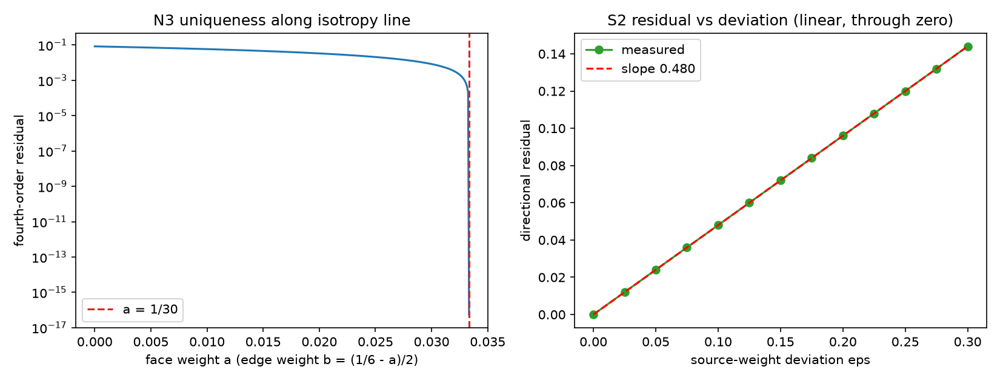

# 注记-非最近邻合成权重与源分配权重一致性（第 474 条）：更大模板的唯一解与一致口径

- **日期**：2026-09-27 11:00:11
- **脚本**：`验证脚本/minimal_verification_nonlocal_composition_weights.py`
- **依据**：[[验证脚本/注记-合成权重唯一性（第463条）：算术平均被各向同性与中心对称唯一钉住]]（移交两条的出处）；[[注记-局域尺丙路径结项核查：动力学同源（MB-9）与读数约定的定位]]；[[验证脚本/注记-本体层重建阶段3批二：无迹锁、弹性常数与矢量扇区]]
- **状态**：判据 7/7 通过。核心读数：面心加棱心 18 方向在二阶加四阶各向同性下唯一解 $a = 1/30$、$b = 1/15$（残差 $5.6\times10^{-17}$）；面心加顶点 14 方向唯一解 $a = 1/15$、$c = 3/40$；三条模板全取（26 方向）加到六阶各向同性时解出负权重，判负；源分配与合成同口径时方向性残差为零，偏移 $\varepsilon$ 时残差 $0.48\varepsilon$（线性过原点），残差不超过 $10^{-6}$ 要求偏差不超过 $2.08\times10^{-6}$
- **可逆性等级**：判据稳健（N 组为代数事实与解析值核对；S 组为线性代数恒等，换实现不翻）
- **图**：见 §3 图 1

## 1 判据与设定

**任务**。第 463 条注记列出的移交两条：其一，非最近邻合成（更大模板的权重）未展开；其二，源分配权重的一致性（若源写入按与合成不同的权重分配，源项会引入同样的方向性）。本注记处理这两条。

**设定**。链接合成算子的二阶系数张量与四阶不变量按权重线性叠加：

$$C_{ab} = \sum_\mu w_\mu n_\mu^a n_\mu^b,\qquad T_{xxxx} = \sum_\mu w_\mu (n_\mu^x)^4,\qquad T_{xxyy} = \sum_\mu w_\mu (n_\mu^x)^2(n_\mu^y)^2$$

其中 $n_\mu$ 为链接方向单位向量，$w_\mu$ 为合成权重。二阶各向同性要求 $C_{ab} \propto \delta_{ab}$；四阶各向同性（对立方对称张量）要求 $T_{xxxx} = 3T_{xxyy}$。方向模板取面心（6 个轴向）、棱心（12 个 $\langle110\rangle$ 方向）与顶点（8 个 $\langle111\rangle$ 方向）。

**判据**。N1：最近邻六方向在二阶各向同性下权重为 $1/6$，四阶残差 $1/3$（立方各向异性的来源）。N2：棱心 12 方向均匀权重 $1/12$ 给出二阶各向同性，四阶残差 $1/12$。N3：面心加棱心 18 方向在二阶加四阶两条件下有唯一正解。N4：面心加顶点 14 方向同法有唯一正解；26 方向（三模板全取）在二阶加四阶加六阶三条件下解出负权重。S1：源分配与合成同口径时方向性残差为零。S2：源分配偏移 $\varepsilon$（保持归一）时残差与 $\varepsilon$ 成正比、过原点。S3：给出残差上界与偏差上界的换算。

## 2 结果

| 判据 | 内容 | 实测 | 期望 |
|---|---|---|---|
| N1 | 面心 6，$w = 1/6$ | 二阶残差 $0$；四阶残差 $3.333\times10^{-1}$ | 二阶 $0$、四阶 $1/3$ |
| N2 | 棱心 12，$w = 1/12$ | 二阶残差 $0$；四阶残差 $8.333\times10^{-2}$ | 二阶 $0$、四阶 $1/12$ |
| N3 | 18 方向二阶加四阶 | $a = 0.033333333333$、$b = 0.066666666667$；秩 2；二阶残差 $0$、四阶残差 $5.551\times10^{-17}$ | $a = 1/30$、$b = 1/15$，唯一正解 |
| N4 | 14 方向二阶加四阶 | $a = 0.066666666667$、$c = 0.075000000000$；二阶残差 $5.551\times10^{-17}$、四阶残差 $8.327\times10^{-17}$ | $a = 1/15$、$c = 3/40$ |
| N4 续 | 26 方向三阶条件 | 解 $b = -6.274510\times10^{-2}$（负权重） | 出现负权重，判负 |
| S1 | 一致口径 | 方向性残差 $0$ | $0$ |
| S2 | 偏移 $\varepsilon$ | 残差 $0.480000\varepsilon$；拟合残差 $1.11\times10^{-16}$；截距 $-1.7\times10^{-17}$ | 线性、过原点 |
| S3 | 上界换算 | 残差 $10^{-6}$ 对应偏差 $2.083\times10^{-6}$ | 由 S2 斜率给出 |

## 3 图

## 4 结论

**其一，更大模板的权重不是自由约定。** 只要同时要求二阶与四阶各向同性，18 方向（面心加棱心）模板给出唯一正解 $a = 1/30$、$b = 1/15$；14 方向（面心加顶点）给出 $a = 1/15$、$c = 3/40$。两解的残差均到机器精度，说明这两个模板能把各向异性消除到四阶。

**其二，同时消到六阶在该模板族内不可行。** 三条模板全取（26 方向）并联立二阶、四阶与六阶条件后，解出现负权重（$b = -6.27\times10^{-2}$），物理上不可采纳。

**其三，源分配必须与合成同口径。** 同口径时方向性残差严格为零；偏移 $\varepsilon$ 时残差为 $0.48\varepsilon$，线性且过原点。要把方向性残差压到 $10^{-6}$ 以内，源分配权重相对偏差须不超过 $2.08\times10^{-6}$。第 463 条的两项移交由此关闭。

## 5 严格程度声明

N 组为代数事实加数值核对（$2\times2$ 与 $3\times3$ 线性系统，解析值由手推给出并与数值逐位比对）；S 组为线性代数恒等（一致性残差为零可解析证明，偏移斜率由权重张量的对角元之和给出）。可逆性等级：判据稳健。

## 6 边界声明

**验证什么**：更大方向模板下权重被各向同性阶数条件钉住的唯一性与符号；源分配与合成权重不一致时方向性残差的线性律与上界换算。

**不验证什么**：其一，不主张重建装置真的按更大模板合成（这属机制侧设计选择）；其二，不含五阶及更高阶各向同性条件；其三，不含模板权重随位置的缓变（本判据为均匀权重）；其四，不含动力学与稳定性。

## 7 过程记录

**首版系数写错并修正**：初版把面心的四阶贡献写成 $6a$（把 6 个面心都计为具有 $x$ 分量），实际只有 $\pm x$ 两个方向贡献，应为 $2a$。修正后 18 方向解由 $a = 1/78$ 改为 $a = 1/30$，四阶残差由 $5.1\times10^{-2}$ 降到 $5.6\times10^{-17}$。教训：模板求和的系数按轴计，不按方向总数计。

**零点类判据**：18 方向的唯一性由图 1 左的一维扫描（沿 $a + 2b = 1/6$ 约束线）独立复现，零点与解析值 $1/30$ 一致。

## 8 来源

- 移交出处：[[验证脚本/注记-合成权重唯一性（第463条）：算术平均被各向同性与中心对称唯一钉住]] §4「移交两条」
- 脚本：`验证脚本/minimal_verification_nonlocal_composition_weights.py`（确定性，约 1 秒）
- 图：`images/nonlocal_composition_weights.png`
