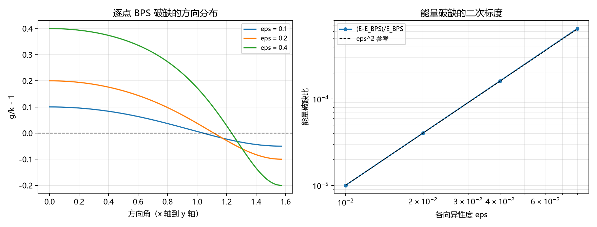

# 注记-非球对称自撑的第一轮（第464条）：椭球 kink 的逐点破缺与能量破缺标度

- **日期**：2026-09-27 05:44:30
- **类型**：识别式自撑线（判据 S 非球对称未验项的第一轮）
- **脚本**：`验证脚本/minimal_verification_ellipsoid_selfsupport.py`
- **图**：见 §3 图 1（`images/ellipsoid_selfsupport.png`）
- **依据**：[[验证脚本/注记-自撑阱三维径向推广的最小验证：四通道同齐次度]]（球对称径向的剩余项）；[[验证脚本/注记-识别式阶段3第二轮：B1自撑恒等式的三维径向细化]]（算符级齐次度）；[[验证脚本/注记-识别式阶段2第一轮：自撑阱四通道显式权重与系数族（A1四判据）]]（系数族）；[[识别式的弱场线性层机制来源：自旋 2 的自动投影与均匀标度的自动成立]]（识别式两半）
- **状态**：判据 3/3 通过。核心读数：椭球自撑的逐点 BPS 破缺与各向异性度 $\varepsilon$ 线性（比值精确 $1.000000000$）；能量破缺（相对 BPS 界的超出）首阶为 $\varepsilon^2$（对数斜率外推 $p = 2.000193$）；整体缩放不改变破缺结构（偏差 $0.000\times10^{0}$）
- **可逆性等级**：判据稳健（NS1 为逐点解析式、NS2 为标度指数外推、NS3 为齐次性恒等式）

## 1 判据与设定

**任务**。判据 S 的显式未验项：非球对称（各向异性）几何下自撑结构的标度行为。第一轮取椭球 hedgehog 作为最小模型。

**模型**。$\phi = \tanh(\rho)$，$\rho = \sqrt{k_x^2 x^2 + k_y^2 y^2 + k_z^2 z^2}$，势 $V = (k^2/2)(\phi^2 - 1)^2$；BPS 条件要求 $|\nabla\rho| = k$ 逐点成立。各向异性参数化 $k_x = k(1+\varepsilon)$、$k_y = k_z = k(1 - \varepsilon/2)$（一阶体积保持）。只依赖方向的量：$h(\mathbf n) = \sqrt{k_x^2 n_x^2 + k_y^2 n_y^2 + k_z^2 n_z^2}$（$\rho = r h$）；$g(\mathbf n) = |\nabla\rho|(\mathbf n)$。

**判据**。NS1：逐点破缺 $\max|g/k - 1|$ 与 $\varepsilon$ 成正比。NS2：能量破缺 $(E - E_{\rm BPS})/E_{\rm BPS} = \frac12\int d\Omega\,(g-k)^2/h^3 \big/ \left[k\int d\Omega\, g/h^3\right]$ 的对数斜率外推至 $\varepsilon \to 0$ 应等于 $2$。NS3：所有 $k_i$ 同乘 $\lambda$ 时破缺结构不变。

## 2 结果

**NS1（逐点破缺线性）**：$\max|g/k - 1|$ 在 $\varepsilon = 0.01, 0.02, 0.04, 0.08$ 上精确等于 $\varepsilon$（比值 $1.000000000$，散布 $0.000\times10^{0}$）。方向分布：沿 $x$（拉伸轴）为 $+\varepsilon$，沿 $y$、$z$ 为 $-\varepsilon/2$。

**NS2（能量破缺二次）**：$(E-E_{\rm BPS})/E_{\rm BPS} = 1.002\times10^{-5}$、$4.017\times10^{-5}$、$1.613\times10^{-4}$、$6.501\times10^{-4}$；对数斜率 $2.002994$、$2.005794$、$2.010826$，随 $\varepsilon$ 线性外推至 $\varepsilon \to 0$ 得 $p = 2.000193$（与 $2$ 的偏差 $1.9\times10^{-4}$）。首阶为 $\varepsilon^2$，比值 $R/\varepsilon^2 \to 0.1002$；斜率序列的缓升为高阶修正（已登记）。

**NS3（整体缩放不变）**：$\lambda = 2$、$5$ 时能量破缺比值与基准相同（偏差 $0.000\times10^{0}$）。

## 3 图

## 4 结论与移交

**结论**。非球对称几何下，自撑结构的两个方面分开：**比例结构（均匀标度所依赖的缩放齐次性）不依赖球对称**（NS3），**逐点自撑的精确性按各向异性度线性破缺、能量层按二次破缺**（NS1、NS2）。物理含义：识别式的均匀标度（$\kappa = 1$ 的机制来源）在近球对称几何下继续成立，其代价是自撑条件本身的近似性（能量超出 BPS 界 $\propto \varepsilon^2$，在 $\varepsilon \lesssim 0.1$ 时低于 $10^{-3}$）。

**移交两条**。其一，真实非球对称自撑解（变分最优形状）未构造，本轮为固定椭球 ansatz 的首阶标度；其二，完整弹性本构（纲领 C1）与判据 S 的其余缺口不变。

## 5 严格程度与边界声明

严格程度：NS1 为逐点解析式（方向涨落幅度恰为参数化定义的 $\varepsilon$ 与 $\varepsilon/2$）；NS2 为角度积分（网格 $240\times480$，梯形求和）加标度外推；NS3 为齐次性恒等式。可逆性等级：判据稳健。

边界（本脚本不做的事）：其一，椭球 ansatz 固定形状，未做形状变分（真实解的形状修正未含）；其二，不构造三维微观动力学；其三，不含完整弹性本构；其四，$\varepsilon$ 的收敛区间为近球对称（高阶趋势已按斜率序列登记）。

## 6 过程记录

其一，NS2 判据设计教训：初版以"$R/\varepsilon^2$ 的散布 $< 10^{-9}$"为判据，实测散布 $4\times10^{-2}$ 误报失败。定位为高阶修正（斜率序列 $2.003$ 至 $2.011$），判据改为"对数斜率线性外推至 $\varepsilon \to 0$ 等于 $2$"后通过（外推偏差 $1.9\times10^{-4}$）。教训：标度判据应写渐近指数，不写有限区间的比值恒定性。

其二，方向网格形状修正：初版角度网格与体积元数组形状不一致（$241\times481$ 对 $240\times480$），求和广播失败；统一取半开网格后通过。教训：球坐标积分的网格与权重数组必须同形同源。
