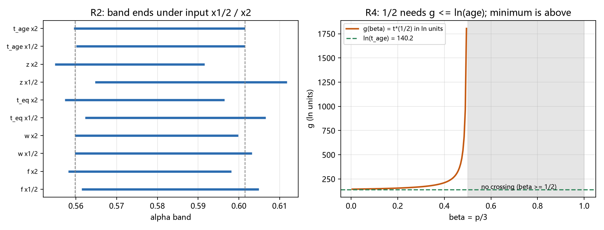

# 注记-靶的重审（第433条）：α 带的输入灵敏度与二分之一通道的排除

- **日期**：2026-09-26 09:13:39
- **类型**：判定轮（出口其三：换算与靶的重审）
- **脚本**：`验证脚本/alpha_band_review.py`（第 433 条）
- **图**：见 §3 图 1（`images/alpha_band_review.png`）
- **依据**：[[注记-ξ 生长律族的联立判定（第413条）：从单参数曲线到三分之五候选]]（带的定义与数值）；[[注记-ξ 的独立依据（第408条）：单参数曲线结构与扩散建立的对照]]（曲线结构 $\xi_c \propto t^{\beta}$）；[[注记-口径链判定与缺陷几何的浴维数（第432条）：驻点结构、图像维数的错位与段三判负]]（链条侧判定）；[[内部草稿/总结报告-格点尾链条：从意外读数到解析化（2026-09-26）]]
- **状态**：判定完成。α 带对输入（$f$、$w_{\rm def}$、$t_{\rm eq}$、$z_{\rm eq}$、$t_{\rm age}$）在 $\pm2$ 倍扰动下只移动 $\pm0.005$ 至 $\pm0.01$；$\alpha = 1/2$ 被结构性排除，且对一切稀释指数 $p > 0$ 成立；「2D 通道」（$\gamma_F = 1$）不可达，格点尾链条与靶之间无桥的判定最终确认
- **可逆性等级**：判据稳健（R1 逐位复核第 413 条；R4 为闭式结构核；R2 与 R3 为扫描表，结论为「区间不相交」）

## 1 判据与设定

段三判负（第 432 条）后，剩下三条出口。本轮做出口其三：重审靶本身。要回答的问题写成一个：链条可实现的尾指数集合 $\{1/2, 1, 3/2\}$ 中，最近的可实现值是 $\gamma_F = 1$（即 $d = 2$、$\alpha = 1/2$、$\gamma_v = 1$）。靶区间是否真的把它排除，这个排除有多硬。

三条链的换算：$\gamma_v = 2(1-\alpha)$（生长律与速度尾）、$\gamma_F = 2\alpha$（与第 426 条的换算规则联立）、$d = 4\alpha$（与 $\gamma_F = d/2$ 联立）。靶区间 $\alpha \in [0.5598, 0.6015]$ 对应 $\gamma_F \in [1.12, 1.20]$。

模型为闭式。链条曲线 $\xi_c(t) = C(t/t_{\rm eq})^{\beta}$，$C = (z_{\rm eq}^{-3}/f)^{1/3}$，稀释指数 $\beta = p/3$（$p$ 为相变至 $t_{\rm eq}$ 期间的膨胀稀释指数，辐射期 $p = 3/2$）。

生长律 $\xi = t^{\alpha}$，交点 $t_* = \exp[B/(\alpha-\beta)]$，$B = \ln C - \beta\ln t_{\rm eq}$。带端由两条不等式给出：年龄约束 $t_* \le t_{\rm age}$ 给 $\alpha_{\min} = \beta + B/\ln t_{\rm age}$；健全性 $\xi_* \ge w_{\rm def}$ 给 $\alpha_{\max} = \beta\ln w_{\rm def}/(\ln w_{\rm def} - B)$。

$\alpha = 1/2$ 的可行性分两支：$\beta \ge 1/2$ 时同标度（无交点）；$\beta < 1/2$ 时比较 $g(\beta) = B/(1/2 - \beta)$ 与 $\ln t_{\rm age}$。

## 2 结果

**R1（基准复核）**：标准口径（$f = 2.12\times10^{-105}$、$w_{\rm def} = 3.80\times10^{21}$、$t_{\rm eq} = 2.745\times10^{55}$、$z_{\rm eq} = 3400$、$t_{\rm age} = 8.068\times10^{60}$ 拍、$p = 3/2$）给 $C = 2.2895\times10^{31}$、$B = 8.3825$、带 $[0.5598, 0.6015]$，与第 413 条逐位一致。

**R2（输入灵敏度）**：五个输入各乘 $1/2$ 与 $2$。$f$ 给 $[0.5581, 0.5981]$ 至 $[0.5614, 0.6048]$；$w_{\rm def}$ 下 $a_{\min}$ 不动、$a_{\max}$ 移 $\pm0.003$；$t_{\rm eq}$ 给 $[0.5573, 0.5965]$ 至 $[0.5622, 0.6066]$；$z_{\rm eq}$ 给 $[0.5548, 0.5915]$ 至 $[0.5647, 0.6117]$；$t_{\rm age}$ 下 $a_{\min}$ 移 $\pm0.001$。

**R2 的读法**：最大移动 $\pm0.01$。带的硬度来自「大对数」（$\ln C = 72.2$、$\ln w = 49.7$、$\ln t_{\rm age} = 140.2$），输入的量级扰动只挪动小量。

**R3（稀释指数变体）**：$p = 1/2$ 给带 $[0.5298, \infty)$；$p = 1$（动能主导）给 $[0.5448, 0.8269]$；$p = 3/2$（辐射）给 $[0.5598, 0.6015]$；$p = 2$ 与 $3$ 给空带（$B \le 0$，交点落到 $t < 1$ 的非物理支）。五档下 $\alpha = 1/2$ 全部不可行。

**R4（结构核）**：$\beta < 1/2$ 时 $g(\beta)$ 递增（导数 $= (\ln C - (1/2)\ln t_{\rm eq})/(1/2-\beta)^2$，分子 $8.38 > 0$），最小值在 $\beta \to 0$：$g_{\min} = \ln C/0.5 = 144.42$，比 $\ln t_{\rm age} = 140.24$ 高 $4.17$。**所以 $t_*(1/2)$ 对一切 $\beta \in (0, 1/2)$ 都超过宇宙年龄**；$\beta \ge 1/2$ 一支已无交点。两支合起来，$\alpha = 1/2$ 无出路。

**R5（判定）**：$\alpha = 1/2$ 被排除，且排除不依赖相变时期、稀释指数与输入口径。与第 432 条合并：链条可实现的 $\{1/2, 1, 3/2\}$ 全部落在靶区间 $[1.12, 1.20]$ 之外。$1$ 在下方 $0.12$（且被本轮的年龄约束独立排除），$3/2$ 在上方 $0.30$。**格点尾链条与 f 线靶之间无桥，判定最终确认。**

## 3 图

## 4 结论与移交

结论三件。其一，靶的硬度确认：带对输入的 $\pm2$ 倍扰动只移 $\pm0.01$，它是「大对数锁定」的量，输入精度不是风险。其二，最接近的可实现值 $\alpha = 1/2$（即「2D 通道」）被结构性排除：$\beta \ge 1/2$ 同标度无交点，$\beta < 1/2$ 交点晚于宇宙年龄，且后者对一切正稀释指数成立。其三，链条与靶无桥的判定最终确认，第 432 条的段三判负由此闭环。

出口最终清点四条。甲：浴的色散非二阶（框架公理固定二阶驻点，堵死）。乙：非格点浴（连续或分形介质，等于开新模型）。丙：换算链改变（第 426 条的线性耦合、平衡浴、惯性可忽略三假设之一失效，需要新物理的重算）。丁：相变时期与稀释指数（本轮排除，对一切 $p$ 成立）。

对 f 线的净移交两条。其一，靶的稳健性是好消息：$\alpha$ 带不需要担心宇宙学输入的精度。其二，「格点尾」作为 f 线候选的死亡不等于 f 线的死亡：需要另找能给 $\alpha \in (0.56, 0.60)$ 的机制，判据与脚本（第 418、419、421 条）可直接复用。

## 5 严格程度与边界声明

严格程度：R1 为对第 413 条的逐位复核；R2 与 R3 为闭式扫描（确定性算术）；R4 为单调性加极限的代数核；R5 为区间不相交的直接判定。全部为定义加代数级。

边界（本脚本不验证的内容）：其一，$\alpha$ 带的物理前提（KZ 图像、纯幂律生长、辐射期相变的标准宇宙学）不在本轮重审；其二，稀释指数 $p$ 的物理取值域（本轮只扫了 $1/2$ 至 $3$）；其三，第 408 条曲线的结构未重推（沿用其登记形式）；其四，f 线的新候选筛选不属本链条。

## 6 过程记录

其一，临界支的处理曾写反：$\beta = 1/2$ 是「$\alpha = 1/2$ 同标度无交点」的临界，但 $\alpha > 1/2$ 的正常解仍存在（带端公式有效）。首版把 $\beta \ge 1/2$ 一律早退为「无交点」，导致基准档取不到带端；改为「$\alpha = 1/2$ 的可行性」与「带的存在性」分开判定后修正。教训：临界情形要区分「解的临界」与「某特定值 $\alpha_0$ 的临界」。

其二，无上界分支：$B \ge \ln w_{\rm def}$（曲线截距高于健全性下界）时 $\xi_*$ 的下确界 $e^{B}$ 已满足健全性，$\alpha_{\max} = \infty$，带为 $[\alpha_{\min}, \infty)$。首版按空带处理，修正为「无上界」。该分支出现在 $p = 1/2$ 档。

其三，单位与口径：时间拍、长度格（$l_P = t_P = 1$）；$t_{\rm age} = 4.35\times10^{17}$ 秒 / $5.391247\times10^{-44}$ 秒 $= 8.068\times10^{60}$ 拍，与第 413 条一致。
