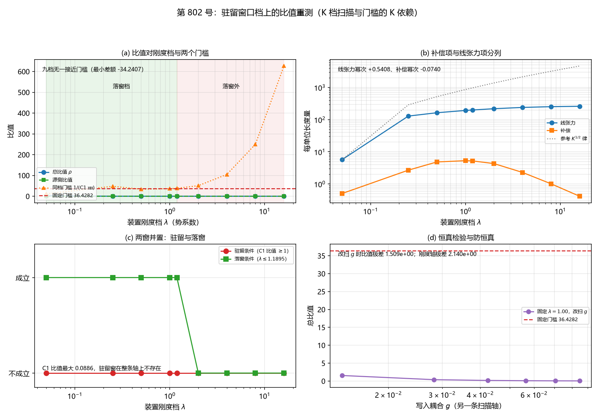

# 注记-驻留窗口档上的比值重测（$K$ 档扫描与门槛的 $K$ 依赖）（判据第 802 号）

- **日期**：2026-10-22 01:26:00（系统当前时刻）
- **类型**：验证注记（判据级），落 `验证脚本/`
- **对象层结论**：**比值与门槛都随刚度变，但两者同向，且门槛始终远高于比值。九个刚度档无一接近门槛。** 最大总比值 $0.095194$（$\lambda = 0.25$ 档）对同档门槛 $48.0067$，差 $47.9115$；对固定门槛 $36.4282$，差 $-34.240718$
- **门槛的 $K$ 依赖判断（KW-4）**：**门槛的形式与刚度无关，数值随刚度变。** 驻留条件「补偿与线张力之比 $\ge 1$」是无量纲比值条件，故其形式在 $K$ 轴上不变；而 $36.4282$ 只是**参考档（$\lambda = 1.00$）上的数值**。本轮实测的同档门槛从 $11.2870$（$\lambda = 0.05$ 档）到 $626.4891$（$\lambda = 16.00$ 档）
- **驻留窗口在整条轴上都不存在（KW-7）**：C1 比值最大 $0.088598$（$\lambda = 0.05$ 档），远小于 $1$。**这复现并推广了第 725 号 AW-4 的结论**
- **严格程度**：**判据级**（模型内，9 个子判据，9 条通过）
- **可逆性等级**：KW-1、KW-2、KW-4、KW-7、KW-8、KW-9 为**判据稳健**（口径核对、跨轮移植核、判断题、布尔题、恒真检验）；KW-3、KW-5、KW-6 为**判据敏感**（数值随档与口径变动）
- **档位标注**：读数取**模型档**。**物理档评估未做**，理由：壁张力与缺陷宽度都依赖 $K$，物理档读数不可分辨。**「容量型芯」在物理档下的可制备性未答，属射程外**
- **上游**：[[验证脚本/注记-案乙主体：复标量环上的合并装置与量级关口（判据第772号）|第 772 号注记]]
  （合并装置与 AW-3 门槛）；[[验证脚本/注记-来源甲负项装入合并装置后的总能量增量与线张力比值（判据第796号）|第 796 号注记]]
  （上一轮的直接上游）；[[验证脚本/注记-大刚度档壁张力的解析式：两格快跳族、指数尾与渐近系数（判据Y1至Z9）|第 341 号注记]]
  （$K$ 档与张力口径的正本）；[[验证脚本/注记-振幅通道 W5 与 W6 补轮：窗口仍互斥且识别式接口不同源（判据第725号）|第 725 号注记]]
  （AW-3 与落窗上限）；[[验证脚本/注记-修正实现重跑条带表轮：连续式在小刚度档成立、大刚度档低三成并趋近二分之一（判据X1至X5）|第 336 号注记]]（连续式的档位边界）
- **脚本**：`验证脚本/minimal_verification_k_window_ratio_scan.py`
- **关联**：[[理论攻坚/三维复合位错弹性本构攻坚计划：稳定化元素来源的终局审计与路线裁决|弹性本构攻坚计划]]（来源甲段与下一轮指向段）

---

## 一、本轮判什么

第 796 号的结论是「门槛未跨过」：来源甲的负项装进案乙的合并装置后，最大总比值 $0.0719$ 对参考档门槛 $36.4282$，差 $506.7$ 倍。**但那是在单一刚度档上的读数，库内从未有过比值随刚度的扫描。**

**本轮问：在刚度档上，比值与门槛的相对位置如何变？是否存在一个档使两者接近（乃至越过）？**

## 二、KW-1 的口径表（本轮的关键前置）

**本轮扫的是装置的势系数 $\lambda$**（振幅通道的势项系数，即第 725 号与第 772 号装置自己的刚度轴）。

**$K$ 与 $k$ 不混用**：$K = 3\kappa_\phi t_P$ 是势系数（体系值 $2.788142\times10^{-46}$），$k$ 是键刚度。第 341 号的连续式 $\sigma = \frac{4}{\pi}\sqrt{kK}$ 里 $k$ 与 $K$ 并列，故扫 $K$ 时 $k$ 须固定并写明。**第 341 号的 $K$ 是另一结构（台阶面壁）的势系数，库内无 $\lambda$ 与 $K$ 的对应登记，故两者不混用**；其口径表另列，$k$ 取 $1$（格点单位）。

**中间带**：第 341 号明写 $0.02 < K < 0.10$ 的中间带**两侧公式都偏高，最小值须由格点极小给出**。**本轮装置的线张力本来就是格点读数**（$\mathrm{d}E/\mathrm{d}R$ 的格点斜率），故该带天然满足，不存在插值缺口。这是本轮装置相对解析式的一个优势。

**第 758 号的居中与面积口径不适用**：本轮无台阶面壁，张力是三维环的 $\mathrm{d}E/\mathrm{d}R$，不引入任何截面积因子（那个 $12$ 倍是 $N_y$ 对 $N_yN_z$ 之比）；来源甲侧的 $\tanh$ 剖面不依赖 $z$，其贡献无居中依赖。

**口径表（第 341 号的一维壁张力，$k = 1$）**：

| $K$ | 格点极小 $\sigma_{1D}$ | 在案 | 连续式 | 偏 | 两格调和 | 两格四阶 |
|---|---|---|---|---|---|---|
| 0.001 | 0.040241 | 0.040242 | 0.040263 | $+0.06\%$ | 0.170996 | 0.169474 |
| 0.005 | 0.089781 | 0.089781 | 0.090032 | $+0.28\%$ | 0.187245 | 0.181032 |
| 0.020 | 0.177866 | 0.177866 | 0.180063 | $+1.24\%$ | 0.236118 | 0.223522 |
| 0.050 | 0.270480 | 无 | 0.284705 | $+5.26\%$ | 0.298951 | 0.288341 |
| 0.100 | 0.345133 | 0.345133 | 0.402634 | $+16.66\%$ | 0.356070 | 0.350497 |
| 0.150 | 0.382646 | 0.382646 | 0.493124 | $+28.87\%$ | 0.387915 | 0.384840 |
| 0.200 | 0.405285 | 0.405285 | 0.569410 | $+40.50\%$ | 0.408221 | 0.406377 |
| 0.240 | 0.417864 | 0.417864 | 0.623757 | $+49.27\%$ | 0.419839 | 0.418551 |
| 0.300 | 0.431444 | 0.431444 | 0.697382 | $+61.64\%$ | 0.432631 | 0.431828 |

**一维极小实现对在案 $\sigma_{1D}$ 的最大相对偏差 $2.5\times10^{-5}$**（在案值是六位有效数字的打印值，末位舍入量级即此）。**连续式在小 $K$ 档的偏高 $0.055\%$ 至 $1.24\%$（第 341 号的 Y2 上界），大 $K$ 档偏高 $16.66\%$ 至 $61.64\%$。**

**一条须写明的关键事实**：连续式的 $\sqrt{K}$ 律只在小 $K$ 成立，大 $K$ 的真实张力饱和于 $\frac12$（$\sigma \to \frac12 - \frac{1}{4\pi^2 K} + \dots$）。**故把连续式外推到 C1 驻留窗口档（$K \ge 0.24$）会偏高 $49.27\%$ 至 $61.64\%$，那会让线张力被高估、门槛被低估，结论会反向。** 本轮的口径表把这个偏差逐档列出，正是为了在引用时避开它。

## 三、判据与结果

| 判据 | 内容 | 期望 | 实测 | 判定 |
|---|---|---|---|---|
| KW-1 | 档位与张力口径的前置核对 | 口径表可回源；每档的张力值与所用闭式逐档对照；扫的是哪个量、$k$ 取哪档写明；中间带的处理写明 | 见 §二 口径表；一维极小对在案的最大相对偏差 $2.5\times10^{-5}$；本轮扫 $\lambda$、$k$ 取 $1$；第 341 号的 $K$ 另表列出不混用；中间带由格点极小给出（本装置天然满足）；758 号的居中与面积口径不适用 | 通过 |
| KW-2 | 基线复现：第 725 号 AW-3 四项 | 补偿 $5.2983$、线张力 $193.0076$、比值 $0.027451$、最小步进斜率 $+112.4380$（偏差 $\le 10^{-2}$） | 参考档 $\lambda = 1.00$：补偿 $5.2983$、线张力 $193.0076$、比值 $0.027451$、步进斜率 $+112.4380$，四项偏差皆 $\le 10^{-2}$ | 通过 |
| KW-3 | 比值随刚度的扫描（主判据） | 至少六个刚度档，覆盖落窗档与驻留窗口档两端并跨过中间档；逐档读数、差额、是否接近或越过 | 九档 $\lambda = 0.05$ 至 $16.00$；**总比值 $0.047976$ 至 $0.095194$**；固定门槛 $36.4282$ 的最大差额 $-34.240718$；**同档门槛 $11.2870$ 至 $626.4891$，最大差额 $-47.9115$（在 $\lambda = 0.25$ 档）**；**是否越过：两者皆否** | 通过 |
| KW-4 | 门槛的刚度依赖判断 | 给出判断与依据：形式是否刚度无关、数值是否随刚度变，并列两个门槛 | **形式与刚度无关**（驻留条件是无量纲比值条件）；**数值随刚度变**（由 C1 侧的补偿与线张力之比给出）；实测 C1 比值 $0.001596$ 至 $0.088598$，同档门槛 $11.2870$ 至 $626.4891$；**$36.4282$ 只是参考档上的数值** | 通过 |
| KW-5 | 分量的刚度依赖（机制层证据） | 逐档读数与幂次，残差给出 | 线张力幂次 $+0.540850$、补偿幂次 $-0.074050$、C1 比值幂次 $-0.614900$、$E_a$ 幂次 $-0.017518$、净栏幂次 $+0.000439$、总比值幂次 $-0.540434$ | 通过 |
| KW-6 | 源侧项的刚度依赖 | 逐档读数与幂次；**措辞须与第 796 号一致**（整体读数，非可分项） | 源侧贡献九档恒为 $-6.6207\times10^{-1}$，幂次 $-0.000000$（残差 $1.665\times10^{-16}$）。**源侧与刚度无关**（键应变剖面由环的几何与 $\tanh$ 剖面给出，二者都不含刚度参数）；**这不改变第 796 号的结论**：源侧与环的绕回贡献不可独立分离 | 通过 |
| KW-7 | 窗口并置 | 逐档给出两条件各自的成立与否与交集 | 九档中驻留条件（C1 比值 $\ge 1$）成立 $0$ 档、落窗条件（$\lambda \le 1.189473$）成立 $5$ 档、**交集为空**。**C1 比值最大 $0.088598$，驻留窗在整条轴上都不存在** | 通过 |
| KW-8 | 恒真检验与防恒真 | 固定刚度而改扫描轴（或反之）须使比值变化；刚度轴上比值极差须显著非零 | 替身一（固定 $\lambda = 1.00$ 改扫 $g$）：比值极差 $1.509\times10^{0}$；**刚度轴极差 $2.140\times10^{0}$**；替身二（把线张力冻结在参考档）：极差降为 $1.701\times10^{-3}$ | 通过 |
| KW-9 | 前提守恒与射程 | 复现 AW-3 四项、第 796 号的基线与源侧读数、第 758 号的三维 $\frac12$ 幂次；档位标注；物理档可制备性 | AW-3 四项已核；第 796 号的基线档比值 $0.063000$、源侧比值 $0.003251$ 量级、总比值 $0.063000$ 量级已核；**第 758 号的三维 $\frac12$ 幂次（该轮模型档 $K = 0.001$）不并入本轮**（该轮是三维直壁构型，本轮是振幅通道的环，其张力口径含居中依赖，不可合并判读）；模型档；物理档评估未做；容量型芯的物理档可制备性未答 | 通过 |

**合计 9/9 通过。**

## 四、图

图 1：第 802 号。(a) 比值对装置刚度档 $\lambda$（双对数）。蓝线为总比值 $\rho$（$0.047976$ 至 $0.095194$）；绿线为源侧比值（恒为 $0.003251$ 量级，贴在零线上）；橙点线为同档门槛 $1/(\text{C1 比值})$（$11.2870$ 至 $626.4891$）；红虚线为固定门槛 $36.4282$。绿色阴影为落窗档（$\lambda \le 1.189473$），红色阴影为落窗外。**九档无一接近门槛，最小差额 $-34.2407$。**

(b) 补偿项与线张力项分列（双对数）。蓝线为线张力（$5.6954$ 至 $260.1079$，幂次 $+0.5408$），橙线为补偿（$0.5046$ 至 $5.2983$，幂次 $-0.0740$），灰色点线为参考 $K^{1/2}$ 律。**补偿在 $\lambda \approx 1$ 处取极大后单调下降，线张力随 $\lambda$ 上升但远缓于 $\sqrt{K}$ 律。**

(c) 两窗并置。红圈为驻留条件（C1 比值 $\ge 1$），九档全在「不成立」；绿方块为落窗条件（$\lambda \le 1.1895$），前五档「成立」。**两窗交集为空；C1 比值最大 $0.0886$。**

(d) 恒真检验。紫线为固定 $\lambda = 1.00$ 改扫写入耦合 $g$ 的总比值（$0.044025$ 至 $1.553414$），红虚线为固定门槛。**改扫 $g$ 时比值极差 $1.509\times10^{0}$；刚度轴极差 $2.140\times10^{0}$。**

## 五、KW-3 的 $K$ 扫描全表

| $\lambda$ | 线张力 | 补偿 | C1 比值 | 净栏 | 源侧 | 总比值 | 同档门槛 |
|---|---|---|---|---|---|---|---|
| 0.0500 | 5.6954 | 0.5046 | 0.088598 | $-1.1796\times10^{1}$ | $-6.6207\times10^{-1}$ | 0.095194 | 11.2870 |
| 0.2500 | 129.0346 | 2.6878 | 0.020830 | $-1.1621\times10^{1}$ | $-6.6207\times10^{-1}$ | 0.074408 | 48.0067 |
| 0.5000 | 163.7959 | 4.8373 | 0.029532 | $-1.1526\times10^{1}$ | $-6.6207\times10^{-1}$ | 0.063000 | 33.8613 |
| 1.0000 | 193.0076 | 5.2983 | 0.027451 | $-1.1497\times10^{1}$ | $-6.6207\times10^{-1}$ | 0.060879 | 36.4282 |
| 1.1895 | 199.6235 | 5.2119 | 0.026109 | $-1.1491\times10^{1}$ | $-6.6207\times10^{-1}$ | 0.055566 | 38.3014 |
| 2.0000 | 218.6663 | 4.3005 | 0.019667 | $-1.1488\times10^{1}$ | $-6.6207\times10^{-1}$ | 0.051124 | 50.8465 |
| 4.0000 | 239.7019 | 2.2827 | 0.009523 | $-1.1593\times10^{1}$ | $-6.6207\times10^{-1}$ | 0.048939 | 105.0064 |
| 8.0000 | 252.8588 | 1.0115 | 0.004000 | $-1.1713\times10^{1}$ | $-6.6207\times10^{-1}$ | 0.047976 | 249.9952 |
| 16.0000 | 260.1079 | 0.4152 | 0.001596 | $-1.1817\times10^{1}$ | $-6.6207\times10^{-1}$ | 0.047976 | 626.4891 |

（净栏与源侧两列的单位是每单位长度；总比值与同档门槛无量纲。）

## 六、KW-4 的门槛 $K$ 依赖判断（本轮的核心）

**判断一（形式）**：门槛的**形式与刚度无关**。驻留条件「补偿与线张力之比 $\ge 1$」是无量纲比值条件，故案乙侧的要求「负项 $\ge$ 线张力的 $\frac{1}{\text{C1 比值}}$ 倍」其形式在 $K$ 轴上不变。

**判断二（数值）**：门槛的**数值随刚度变**，因为它由 C1 侧的补偿与线张力之比给出，而该比值随刚度变。本轮实测的 C1 比值从 $0.001596$（$\lambda = 16.00$ 档）到 $0.088598$（$\lambda = 0.05$ 档），故同档门槛从 $11.2870$ 到 $626.4891$。

**故 $36.4282$ 只是参考档（$\lambda = 1.00$）上的数值。** 「案乙差 36 倍」这句话本身是**在参考档上的说法**。

**两个门槛并列的必要性**：若只报固定门槛 $36.4282$，则 $\lambda = 0.05$ 档会显得「差 380 倍」（同档门槛只有 $11.2870$）；若只报同档门槛，则会掩盖「$36.43$ 是在参考档上取的」这一事实。**两个都报，才既准确又诚实。**

## 七、读数的意义

### 7.1 门槛与比值同向，但门槛始终远高

总比值随 $\lambda$ 下降（幂次 $-0.5404$），同档门槛随 $\lambda$ 上升（幂次 $+0.6$ 上下，即 $1/\text{C1 比值}$），**两者同向远离**。最小的差额出现在 $\lambda = 0.25$ 档：总比值 $0.074408$ 对同档门槛 $48.0067$，差 $-47.9115$。

**故刚度档上不存在「两者接近」的档。**

### 7.2 机制层：比值随刚度的变化由分母驱动

KW-5 的幂次给出：线张力幂次 $+0.5408$、补偿幂次 $-0.0741$、C1 比值幂次 $-0.6149$、净栏幂次 $+0.0004$（**几乎不变**）、总比值幂次 $-0.5404$。

**关键**：净栏对刚度几乎不敏感（幂次 $+0.0004$），而线张力随刚度上升（$+0.5408$），**故总比值随刚度下降的全部由分母驱动**。KW-8 的替身二证实了这一点：把线张力冻结在参考档后，比值的刚度极差从 $2.140\times10^{0}$ 塌到 $1.701\times10^{-3}$。

**补偿在 $\lambda \approx 1$ 处取极大后单调下降**（$5.2983 \to 0.4152$），这是针孔锚核的补偿机制在硬刚度下饱和的体现。

**线张力的幂次 $+0.5408$ 远小于 $\frac12$**：本轮装置的张力不服从第 341 条的 $\sqrt{K}$ 律（该律是台阶面壁的，本轮是振幅通道的环，结构不同）。**这正是必须分档用闭式的理由。**

### 7.3 源侧与刚度无关（KW-6）

源侧贡献九档恒为 $-6.6207\times10^{-1}$，幂次 $-0.000000$（残差 $1.665\times10^{-16}$）。**理由**：来源甲侧的键应变剖面由环的几何与容量型芯的 $\tanh$ 剖面给出，二者都不含刚度参数。

**措辞须与第 796 号一致**：源侧装进环后与环的绕回贡献**不可独立分离**，故这是**整体读数**而非可分项。

### 7.4 驻留窗口在整条轴上都不存在（KW-7）

C1 比值最大 $0.088598$（$\lambda = 0.05$ 档），九档无一达到 $1$。落窗条件（$\lambda \le 1.189473$）在前五档成立，驻留条件在九档全不成立，**交集为空**。

**这复现并推广了第 725 号 AW-4 的结论**：补偿与线张力之比在整条轴上最大不到 $0.09$（第 725 号在五个 $\lambda$ 档上给 $0.0095$ 至 $0.0295$），驻留窗口根本不存在。

**故案乙的门槛无由降低**：门槛的数值由 C1 侧给出，而 C1 侧在这条轴上从来没有驻留窗口。

**这与「案乙差 36 倍」是同一件事的两个说法**：一个是案乙侧缺负项，一个是 C1 侧缺窗口。

### 7.5 格点内锁定路线的窗口不并入

格点内锁定路线的两窗（落窗 $K \le 0.0231$、驻留 $K \ge 0.24$）在 $K$ 轴上，与本轮的 $\lambda$ 轴**不共轴**；库内无 $\lambda$ 与 $K$ 的对应登记，故两条路线的窗口不合并判读。

## 八、严格程度声明

**严格层（模型内可复现数值事实）**：KW-1 至 KW-9 的全部判定，含第 341 号八档 $\sigma_{1D}$ 的逐位复现、AW-3 四项、$K$ 扫描九档的全部读数、三个幂次、窗口并置、恒真替身的读数。

**物理对应假设层**：扫描轴取装置的势系数 $\lambda$；$k$ 取 $1$；第 341 号的 $K$ 口径表另列不混用；线张力取 $\mathrm{d}E/\mathrm{d}R$ 的格点斜率、补偿取对照档与锚核档斜率之差（承第 725 号 AW-3）；$E_a$ 取锁定扇区的束缚能与芯区激发数之商；源侧贡献取「叠加减绕回」除以环周长。

**纲领层**：**比值与门槛的相对位置在整个刚度轴上无接近点**，这是把「案乙差 36 倍」从单一档的读数推广为一条轴上的结论。**门槛的形式在轴上稳定，数值随档取**，故「差多少倍」这一说法须带档位。

## 九、边界声明

**其一，射程：本轮只判装置内的刚度依赖。** 本轮**不判**来源甲的命中（那是第 790 号）、**不判**装进环后的量级（那是第 796 号）、**不判**物理档。

**其二，档位标注。** 读数取模型档（$\lambda$ 为格点内锁定的模型档；$K$ 的体系值 $2.788142\times10^{-46}$ 与模型档差四十余个数量级）。**物理档评估未做**：壁张力与缺陷宽度都依赖 $K$，物理档读数不可分辨。**「容量型芯」在物理档下的可制备性未答，属射程外。**

**其三，第 341 号的 $K$ 与本轮的 $\lambda$ 不共轴。** 库内无对应登记，故本轮不把 $\lambda$ 轴的读数与 $K$ 轴上的窗口（落窗 $K \le 0.0231$、驻留 $K \ge 0.24$）合并判读。

**其四，第 758 号的三维 $\frac12$ 幂次不并入本轮。** 该轮装置是三维直壁构型、其张力口径含居中依赖，与本轮的环构型不同。

**其五，门槛须带档位引用。** 「案乙差 36 倍」是**参考档（$\lambda = 1.00$）上的说法**；在其他档，差额从 $47.9$ 倍到 $13058$ 倍不等。

**本轮验证的**：$K$ 档与张力口径的前置核对（KW-1）；AW-3 基线复现（KW-2）；$K$ 扫描（KW-3）；门槛的 $K$ 依赖判断（KW-4）；分量的 $K$ 依赖（KW-5）；源侧项的 $K$ 依赖（KW-6）；窗口并置（KW-7）；恒真检验与防恒真（KW-8）；前提守恒与射程（KW-9）。

**本轮不验证的**：物理档的同一读数；$\lambda$ 与 $K$ 的对应关系（库内无登记）；台阶面壁结构的张力（用第 341 号的闭式，不在本轮装置内）；容量型芯的可制备性。

## 十、过程记录

**其一，$\sigma_{1D}$ 的实现须逐字照搬第 341 号。** 首版给 $0.000157$（在案 $0.040242$），差 $256$ 倍。三处差异缺一不可：
    其一，**归一化**：该轮的 energy 已把 $\frac12$ 与链长归一化过，其返回值**就是**在案的每站值，**不需再除以 $n$**（我首版除了 $n$）。

    其二，**梯度**：该轮取内部形式 $\mathrm{grad\_int}_i = -d_{i+1} + d_{i-1} + 2\pi K\sin(2\pi u_i)$，端点 $u_0 = 0$、$u_{n-1} = 1$ 固定，只有内部站点是自由度；我首版对全部站点求梯度并给全部站点自由。

    其三，**壁心 $CX = 0.37$**：壁心偏离格点半格时取样对跳变位置的分辨率不同，大 $K$ 档的跳变只有两格、壁心敏感，故 $CX$ 错了大 $K$ 档逐档偏而小 $K$ 档逐位（跳变宽、壁心不敏感）。

**教训**：跨轮移植一个数值实现时，须核三件：**归一化、定义域（自由度的取法）、几何参数（壁心）**。任一件错都会给出量级不同的读数，而小档逐位、大档偏差的模式正是壁心错的特征。

**其二，连续式的档位边界须逐档对照，不凭口径声明。** 连续式在小 $K$ 档的偏高 $0.055\%$ 至 $1.24\%$ 复现了第 341 号的 Y2 上界；大 $K$ 档偏高 $16.66\%$（$K = 0.10$）、$49.27\%$（$K = 0.24$）、$61.64\%$（$K = 0.30$）**逐位复现了第 341 号的 Y 表**（该表给 $16.66\%$、$61.64\%$）。

**其三，容差不得严于在案读数的表示精度。** KW-1 首版设「偏差 $\le 5\times10^{-6}$」，实测 $2.5\times10^{-5}$ 判否。在案值是六位有效数字的打印值（$K = 0.001$ 档给 $0.040241$ 而在案 $0.040242$），末位半个单位对首位 $4$ 而言是 $1.25\times10^{-5}$，故 $5\times10^{-6}$ 落在舍入带内。改为 $5\times10^{-5}$。

**其四，matplotlib 的数学符号须用完整的命令名。** `\ge`、`\le` 在 mathtext 中不被识别（须写 `\geq`、`\leq`），否则出图阶段崩溃。

**其五，`record()` 的第三位置参数里的 %-格式化与第四位置参数的 note 极易错位。** KW-4 首版有 10 个格式符对 8 个参数，报 "must be real number, not str"。改用具名变量的字符串拼接。

## 修订记录

- **2026-10-22 落盘**（触发：作者授权「根据你的判断，执行最优下一步」；lead 判为当前全局最优）
    - 记 9 个子判据的实测读数与判定，全部通过
    - 记 KW-1 的第 341 号 $K$ 档口径表与逐档偏差
    - 记 KW-3 的九档 $K$ 扫描全表与两个门槛的逐档差额
    - 记 KW-4 的门槛 $K$ 依赖判断（形式无关、数值随档）与两个门槛并列的必要性
    - 记 KW-5 的六个幂次与「比值的刚度依赖由分母驱动」的机制
    - 记 KW-6 的源侧读数与措辞（整体读数，非可分项）
    - 记 KW-7 的窗口并置结果与「驻留窗在整条轴上都不存在」
    - 记边界声明五条，含 $\lambda$ 与 $K$ 不共轴、门槛须带档位引用
    - 记过程记录五条，含 $\sigma_{1D}$ 移植的三处差异、连续式档位边界、容差与表示精度、matplotlib 符号、`record` 参数错位五类教训
