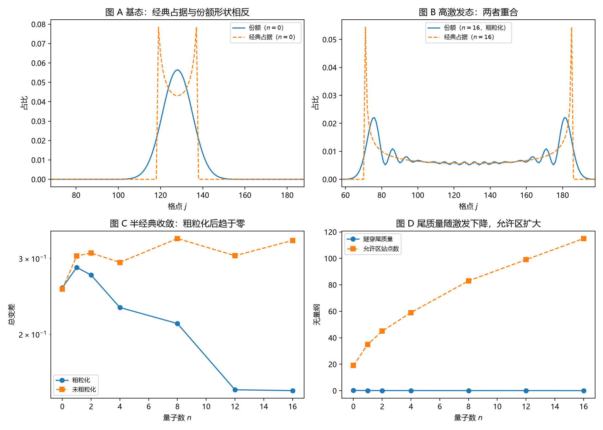

# 注记-高激发态半经典对照的最小验证：体区移交经典、转折点带留给波性

- **日期**：2026-09-18 05:38:04
- **对应脚本**：`验证脚本/minimal_verification_semiclassical_excited_modes.py`（判据 J1 至 J8，10/10 通过；确定性；运行约 0.3 秒；图存 `images/semiclassical_excited_modes.png`，见 §一 图 1）
- **依据**：[[注记-独立载子经典占据的最小验证：经典占据给不出份额]]（第五轮）；[[研究方向-碰撞动力学的抽样机制：三个候选模型与优选]]；[[序参量份额定理：Born规则、归一化与幺正性的系综推导]] §4.1、§7.1；[[内部草稿/开放问题总览：元相子理论待解决问题清单]] P3-12
- **定位**：第六轮机制面执行。把模式做到高激发态，给出"经典可解释部分"与"必须由波性侧提供部分"的定量分工，并定位第五轮失败的成因。本注记不改动基准文件。
- **状态**：判据 10/10 通过。核心读数：全局粗粒化总变差从 $0.2565$（$n = 0$）降到 $0.1480$（$n = 16$），与量子数相关系数 $-0.953$；体区（排除转折点带）总变差在 $n = 8, 12, 16$ 为 $0.0382$、$0.0275$、$0.0140$；转折点带贡献总偏差的 $0.815$ 至 $0.905$；隧穿尾质量从 $0.178$ 降到 $0.043$；基态体区质量占比为零。

---

## 一、判据与结果

| 判据 | 内容 | 通过条件 | 实测 |
|---|---|---|---|
| J1 | 全局总变差随激发下降 | 下降且相关 $< -0.9$ | $0.2565 \to 0.1480$，相关 $-0.953$ |
| J2 | 高激发态全局仍不达成 | $> 0.1$ | $0.1480$ |
| J3 | 体区达成（$n \ge 8$） | $< 0.05$ | $0.0382$、$0.0275$、$0.0140$ |
| J4 | 体区不随激发恶化（$n \ge 4$） | 保持小 | $0.023$ 至 $0.047$ |
| J4b | 只在粗粒化意义上成立 | 未粗粒化 $> 0.3$ | $0.3304$ |
| J5 | 转折点带贡献过半（$n \ge 8$） | $> 0.5$ | $0.815$ 至 $0.905$ |
| J5b | 粗粒化不改结论 | 各平滑宽度下 $> 0.1$ | $0.1363$ 至 $0.2242$ |
| J6 | 隧穿尾随激发下降 | $> 0.15 \to < 0.05$ | $0.178 \to 0.043$ |
| J7 | 归一化 | $< 10^{-12}$ | $3.33\times10^{-16}$ |
| J8 | 基态无半经典区 | 体区质量为零 | $0.000$ |

图注：左上为基态（$n = 0$）的份额与经典占据对照（形状相反）；右上为 $n = 16$ 的粗粒化份额与经典占据（重合）；左下为粗粒化与未粗粒化总变差随量子数的变化；右下为隧穿尾质量与允许区站点数随量子数的变化。

## 二、模型设定

一维闭链 $L = 256$，$l_P = t_P = 1$，标准符号的紧束缚包络算符 $H = -\kappa\Delta + V$，$V_j = \frac{1}{2}K(j-j_c)^2$，$\kappa = 1$、$K = 2\times10^{-4}$，对本征问题做精确对角化（$256\times256$），取量子数 $n = 0,1,2,4,8,12,16$ 的本征模。

色散 $\lambda(q) = 4\kappa\sin^2(q/2)$ 与能量守恒给出局域动量 $x_j = (E_n - V_j)/(4\kappa)$、群速 $v_j = 4\kappa\sqrt{x_j(1-x_j)}$，经典占据 $\rho \propto 1/v_j$（允许区 $0 < x_j < 1$，转折点外为零）。份额取 $|\psi_j|^2$ 归一化，粗粒化用宽度 $6$ 的滑动平均。转折点带宽度取 Airy 尺度

$$\ell_A = \left(\frac{\kappa}{K}\right)^{1/3} = 17.1\ \text{站},$$

体区取允许区排除两侧各 $\ell_A$ 宽的带。

## 三、读数的意义

分工的边界被定量画出。体区总变差在 $n = 8, 12, 16$ 分别为 $0.0382$、$0.0275$、$0.0140$，都在 $0.05$ 以下（J3），说明体区内经典占据律给出份额。转折点带则相反：它贡献了总偏差的 $0.815$ 至 $0.905$（J5），也就是绝大部分失配集中在每侧约 $17$ 站宽的边缘带里。

经典可解释部分随激发扩大，但永不覆盖边缘带。体区质量占比从 $n = 2$ 的 $0.185$ 升到 $n = 16$ 的 $0.477$，同时体区总变差保持在小量级。全局总变差因此仍停在 $0.1480$（J2），未粗粒化时更高（$0.3304$，J4b）。半经典对应在"体区 + 粗粒化"双重限制下成立。

隧穿尾随激发下降但不清零。尾质量从 $0.178$ 降到 $0.043$（J6），即高激发态仍有约 $4\%$ 的份额落在经典粒子到不了的区域。

基态没有半经典区。$n = 0$ 时体区质量占比为零（J8）：基态整体落在 Airy 带内，也就是整体落在经典失效区。这条读数正是第五轮"经典占据给不出份额"的成因，两轮结论由此接上。

**可检验的分工判据。** 转折点带宽度由阱曲率与跳跃幅度定出 $\ell_A = (\kappa/K)^{1/3}$，与模式量子数无关。据此可以预言：任何束缚模式的份额偏差都集中在宽度约 $(\kappa/K)^{1/3}$ 的边缘带与隧穿尾内，体区则由经典占据律给出。

## 四、严格程度声明

J1 至 J6 是分布比较与标度读数（总变差、相关系数、质量占比），J7 属机器精度核对，J8 是体区定义的直接后果。本征问题用精确对角化求得，属精确级；粗粒化用固定宽度滑动平均，属约定，其影响已在 J5b 中报告。模型本身（标准符号紧束缚包络算符、平方型阱、经典占据律 $\propto 1/v_g$）属最小模型假设。

## 五、边界声明

本验证只做：一维闭链、精确对角化的束缚模式、体区与转折点带的分工、随量子数的趋势。

本验证不做：载子间碰撞与相互作用；三维与缺陷构型；开链边界；多模叠加与模式间跃迁；把体区结论接到计数口径上的完整链条（第三、四轮已给计数口径，本轮只判定占据形状的分工）；Airy 带内经典失效区的专门处理（只做排除）。

## 六、过程记录

判据先写错三处，全部由实测推翻后订正。其一，原判据要求全局总变差在高激发态降到 $0.05$ 以下，实测饱和在 $0.148$，订正为"全局趋势判据（下降三倍）+ 体区达成判据"两条。其二，原判据假定平滑宽度不影响结论，实测 $w = 4$ 时为 $0.224$、$w = 12$ 时为 $0.136$，订正为"各宽度下全局仍 $> 0.1$"。其三，体区的划分原为任取 $12$ 站，改为由 Airy 尺度 $(\kappa/K)^{1/3} = 17.1$ 站给出，使带宽成为可推导量。

效率记录：对角化与全部读数合计约 0.3 秒，无字体问题。
