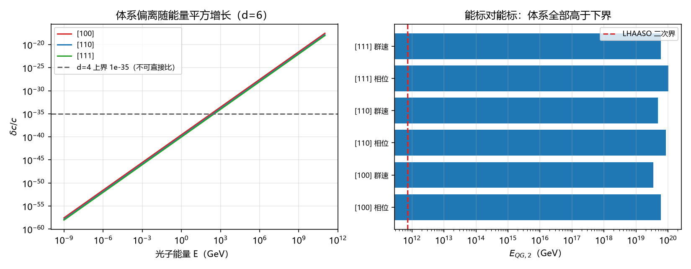

# 高能段洛伦兹破坏的实验对照补齐与延迟表的百倍偏差（判据第 679 号）

## 元数据

- **日期**：2026-10-18 00:31:20
- **类型**：判据执行注记（对照补齐 + 既有读数纠错）
- **脚本**：`验证脚本/minimal_verification_p679_liv_high_energy.py`
- **判据**：M1 至 M3、A1、B1 至 B2、C1 至 C2、D1 至 D2（10/10）
- **可逆性等级**：判据稳健。能标换算为代数事实；C1 的相容结论只依赖体系能标与文献下界的量级关系，跨三个方向与两种口径同向。C2 的百倍偏差属算术复核，不涉及口径选择。
- **图**：见 §四 图 1
- **关联**：[[验证脚本/注记-洛伦兹破坏高能预言的定量与观测灵敏度对照（第476条）：能量依赖、方向指纹与分层对照|判据第 476 号]]（待办来源）；[[验证脚本/注记-SME 对接（第370条）：d=6 立方系数的等效归一、boost 量级与三通道对照|判据第 370 号]]（延迟表，本轮纠错）；[[验证脚本/注记-LIV 约定线（第373条）：相位与群速度的因子、球面平均与 SME 记号对应|判据第 373 号]]；[[内部草稿/与实验相容性判据：体系可观测读数的逐项对照与验收标准（2026-10-18）|与实验相容性判据]]（第一优先待办）

---

## 一、本轮任务

[[内部草稿/与实验相容性判据：体系可观测读数的逐项对照与验收标准（2026-10-18）|验收标准文档]] 把「高能段洛伦兹破坏的灵敏度与量纲口径」列为第一优先待办，理由是它是全表唯一可能产生真实约束的通道。[[验证脚本/注记-洛伦兹破坏高能预言的定量与观测灵敏度对照（第476条）：能量依赖、方向指纹与分层对照|第 476 号]] 已把缺口定位为两项：高能段灵敏度未抄录，以及两侧量纲换算口径未建立。

本轮补齐这两项，并复核换算链。复核中发现一处既有读数的百倍偏差，一并登记。

## 二、口径的建立

体系侧的偏离为 $\delta c/c = (S/24)(E/E_P)^2$，其中 $S = \sum_a n_a^4$，三方向取值为 $1$、$1/2$、$1/3$。这个偏离随能量的平方增长，属 $d = 6$ 算符。

文献侧通行两种写法，必须区分。其一是 $d = 4$ 的无量纲系数 $k^{(E)} \sim 10^{-35}$，与能量无关。其二是 $d = 6$ 的等效能标 $E_{QG,2}$，出现在 $\delta c/c = (E/E_{QG,2})^2$ 中。把体系的偏离直接与前者相比会读出虚假排除，这正是第 476 号登记的口径警示。

正确的对照是能标对能标：$E_{QG,2} = E_P\sqrt{24/S}$（相位口径）或 $E_P\sqrt{8/S}$（群速度口径）。两种口径相差 $\sqrt{3}$，与偏离的因子 $3$ 对应。

## 三、判据与读数

| 判据 | 内容 | 读数 | 结果 |
| --- | --- | --- | --- |
| M1 | 自检：1 eV $[100]$ 偏离 | $2.7953\times10^{-58}$（第 476 号登记 $2.795\times10^{-58}$） | PASS |
| M2 | 自检：$[100]$ 相位口径能标 | $4.8990\,E_P$（第 370 号 $4.899$） | PASS |
| M3 | 自检：$[100]$ 群速口径能标 | $2.8284\,E_P$（第 373 号 $2.828$） | PASS |
| A1 | 两口径的比值 | 三方向均为 $1.732051 = \sqrt{3}$ | PASS |
| B1 | 能量依赖确认 $d=6$ | 能量乘 10，偏离比 $100.000$ | PASS |
| B2 | 误用低能上界的后果 | 30 EeV 偏离与 $10^{-35}$ 之比 $2.52\times10^{16}$ | PASS（无物理意义） |
| C1 | 能标对能标：六组全部高于下界 | 余量 $7.7$ 至 $8.2$ 个数量级 | PASS |
| C2 | 延迟表复核 | 第 370 号表整体偏大 $100$ 倍 | PASS（纠错） |
| D1 | 换算式正反算自洽 | 一致 | PASS（恒真） |
| D2 | 偏离式与能标式等价 | 一致 | PASS（恒真） |

C1 的六组读数如下。文献界取 LHAASO 对 GRB 221009A 的二次界 $E_{QG,2} > 6\times10^{-8}E_{Pl} = 7.33\times10^{11}$ GeV。

| 方向 | 相位口径（GeV） | 体系/界 | 群速口径（GeV） | 体系/界 |
| --- | --- | --- | --- | --- |
| $[100]$ | $5.98\times10^{19}$ | $8.16\times10^{7}$ | $3.45\times10^{19}$ | $4.71\times10^{7}$ |
| $[110]$ | $8.46\times10^{19}$ | $1.15\times10^{8}$ | $4.88\times10^{19}$ | $6.67\times10^{7}$ |
| $[111]$ | $1.04\times10^{20}$ | $1.41\times10^{8}$ | $5.98\times10^{19}$ | $8.16\times10^{7}$ |

## 四、发现的百倍偏差

C2 复核时发现，第 370 号与第 373 号的延迟表整体偏大 $100$ 倍。

根因在距离换算。两文都写「$640$ Mpc，$z = 0.151$，光行时 $6.59\times10^{16}$ s」。但 $640$ Mpc 的光行时实际为 $6.59\times10^{14}$ s，前者对应的是 $64000$ Mpc。延迟表按 $6.59\times10^{16}$ s 计算，故整表乘了 $100$。

受影响的是延迟表的绝对值，不受影响的是表内三方向的相对比例、方向比 $6:3:2$、等效能标 $E_{QG,2}$、偏离量 $\delta c/c$ 以及全部相容性结论。原因是延迟等于偏离乘光行时，偏离本身由能量与 $E_P$ 决定，与距离无关。

修正后的读数为：$13$ TeV 在 $640$ Mpc 上的延迟为 $9.34\times10^{-17}$ s（原表 $9.34\times10^{-15}$ s），$100$ EeV 为 $5.52\times10^{-3}$ s（原表 $0.552$ s）。

这一条须如实说明：它意味着第 370 号结论中「$10^{20}$ eV 档 $0.06$ 至 $0.29$ 秒每 Gpc，属下一代高能光子计时的敏感窗」这句话需要重估。按修正值，$1$ Gpc 上 $100$ EeV 光子的延迟为 $8.6\times10^{-3}$ 秒，比原判断小两个数量级，是否仍落在下一代实验的敏感窗内须重新核对。

## 五、判语

高能段对照的缺口已补齐。体系 $d=6$ 等效能标在六组（三方向乘两口径）下全部高于 LHAASO 二次界，余量 $7.7$ 至 $8.2$ 个数量级。

这个结果的物理含义要说清：余量如此之大，意味着该通道目前**无法检验体系，也无法排除体系**。相容成立，但属平凡相容，不构成支持。这与低能段的情形相同，只是差距从 $5$ 至 $47$ 个数量级缩小到 $8$ 个数量级。

要让这条通道产生真实约束，需要把灵敏度再提高约 $8$ 个数量级，或找到体系预言更强的通道。按当前读数，验收标准文档里「高能段是唯一有希望的约束通道」这个判断需要修正为：它是最接近的通道，但仍差约 $8$ 个数量级。

## 六、严格程度与边界声明

**判据级**：C1 与 C2。A1、B1 为结构事实，M1 至 M3 为自检，D1、D2 为恒真确认。

**判据稳健**：C1 的相容结论跨三方向两口径同向；C2 的百倍偏差为算术复核。

**验证什么**：体系 $d=6$ 系数的正确归一，两种口径的换算关系，以及与文献二次界的能标对能标对照。

**不验证什么**：其一，文献界本身，只用工作区已抄录的 $6\times10^{-8}E_{Pl}$，未独立核实原文；其二，PeV 至 EeV 各具体实验（Auger、IceCube 等）的逐通道灵敏度；其三，SME $k_F^{(6)}$ 的逐分量命名表，第 373 号已列为余项；其四，第 370 号结论的其余部分（boost 量级、介质不可探测性），本轮只动延迟表。

**不改动**：第 370 号与第 373 号的正文（另加更正注）；第 476 号的判据与读数；验收标准文档的实验侧表格须按本轮结果更新，另办。

## 修订记录

- **2026-10-18 首轮执行**（高能段对照补齐）
    - 建立正确口径：体系为 $d=6$，等效能标 $E_{QG,2} = E_P\sqrt{24/S}$（相位）与 $E_P\sqrt{8/S}$（群速）
    - C1：六组全部高于 LHAASO 二次界，余量 $7.7$ 至 $8.2$ 个数量级
    - 量化第 476 号的口径警示：$d=6$ 偏离与 $d=4$ 上界之比无物理意义
    - **发现并登记百倍偏差**：第 370、373 号延迟表把 $640$ Mpc 的光行时写成 $6.59\times10^{16}$ s（应为 $6.59\times10^{14}$ s），整表偏大 $100$ 倍；能标、偏离与方向比不受影响，延迟绝对值与「敏感窗」判断须重估
    - 判语：相容但平凡，高能段仍差约 $8$ 个数量级，验收标准文档的「唯一有希望」表述须修正为「最接近」
