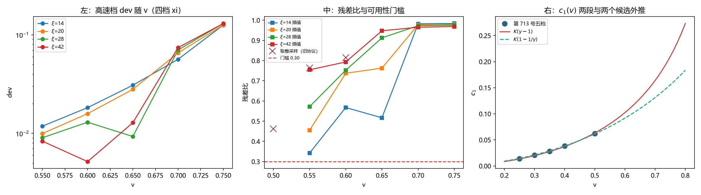

# 注记-高速档不可用但两候选已分开：剔除坏档后 $\gamma-1$ 标度成立到 $1.06\%$（判据第 714 号）

- **日期**：2026-10-20 01:23:36
- **编号**：第 714 号
- **类型**：验证注记（判据驱动；OA0b 与 OA0c 判否，OA0d 给出分开两候选的读数）
- **对象**：第 713 号未能分开的两个 Lorentz 候选标度，$\gamma-1$ 与 $1-1/\gamma$
- **脚本**：`验证脚本/minimal_verification_p714_high_velocity.py`（确定性，约 248 秒）
- **状态**：高速端（$v \ge 0.55$）在两种采样协议下均不可用，**装置边界止于 $v = 0.50$ 以下**；但剔除超门槛档后两个候选已分开，$\gamma-1$ 的留一误差 $1.06\%$ 对 $1-1/\gamma$ 的 $5.87\%$，**第 713 号「两候选区分不开」的判语作废**
- **可逆性等级**：判据敏感（结论翻转依赖有效性门槛；换门槛 $0.30$ 为 $0.25$ 或 $0.40$ 会改变可用档集合）
- **图**：见 §5 图 1
- **通俗版**：[[内部草稿/注记-把坏的那一档拿掉（判据第714号通俗版）]]

## 1 为什么检验

第 713 号在 $v \in [0.25, 0.50]$ 的五档上判否了纯 $v^2$ 标度，而 $\gamma-1$ 与 $1-1/\gamma$ 两个候选都通过留一检验，且彼此只差 $0.35$ 个百分点。两者无法在低速段分开，原因写在它们的预言比上。

两个候选的预言比恰为

$$\frac{K_1(\gamma-1)}{K_2(1-1/\gamma)} = \frac{K_1}{K_2}\,\gamma$$

在 $v=0.50$ 处该比值 $1.15$，$v=0.70$ 处 $1.25$，$v=0.75$ 处 $1.35$。**区分的唯一手段是把速度推高。**

代价是装置的另一端会崩。$c_0$ 正比于 $\vert f(k_{\rm mod})\vert/(2\omega^2)$，$v=0.70$ 处它的理论值 $4.738\times10^{-2}$ 是 $v=0.50$ 处 $3.930\times10^{-3}$ 的 $12.1$ 倍；波包同时被压缩 $\gamma$ 倍。这两件事都可能把读数推出有效区，故本轮先做冒烟。

## 2 判据与读数

**OA0 冒烟（判否）。** 五档高速 $\times$ 四档 $\xi$，线性插值采样。残差比（单频拟合残差与信号范数之比，第 696 号 P1 起用作有效性指标，门槛 $0.30$）如下。

| $v$ | 0.55 | 0.60 | 0.65 | 0.70 | 0.75 |
|---|---|---|---|---|---|
| 最大残差比 | $0.754$ | $0.793$ | $0.948$ | $0.982$ | $0.984$ |

全部越过 $0.30$。对应 dev 从 $8.3\times10^{-3}$ 涨到 $1.30\times10^{-1}$。

**OA0b 采样协议对照（判否）。** 高速失效的一个候选解释是单点跟随采样的整数取整抖动：波包宽约 $3$ 格时，$\pm 0.5$ 格的取整误差在 $k_{\rm mod} \approx 0.9$ 处带来约 $0.45$ rad 的相位抖动。改用线性插值后：

| $v$ | 取整采样残差比 | 插值采样残差比 |
|---|---|---|
| 0.50 | $0.462$ | $0.440$ |
| 0.55 | $0.763$ | $0.754$ |
| 0.60 | $0.815$ | $0.793$ |

改善不到 $0.03$，无一档从超门槛降到门槛内。**采样取整不是失效原因，该解释排除。**

**OA0c 第 713 号所用档的有效性矩阵（判否）。** 回头查上一轮用的六档，残差比逐档如下。

| $v$ | $\xi=14$ | $\xi=20$ | $\xi=28$ | $\xi=42$ | 越界数 |
|---|---|---|---|---|---|
| 0.25 | $0.014$ | $0.016$ | $0.018$ | $0.018$ | 0 |
| 0.30 | $0.018$ | $0.020$ | $0.020$ | $0.017$ | 0 |
| 0.35 | $0.017$ | $0.017$ | $0.014$ | $0.016$ | 0 |
| 0.40 | $0.013$ | $0.022$ | $0.040$ | $0.075$ | 0 |
| 0.45 | $0.056$ | $0.088$ | $0.133$ | $0.211$ | 0 |
| 0.50 | $0.158$ | $0.224$ | $0.315$ | $0.440$ | **2** |

二十四个组合里只有两个越界，都在 $v=0.50$。**第 713 号的五档中混进了两个不可用读数，而当时未逐档执行有效性门槛。**

**OA1 复现（判通过）。** $v=0.50$ 的 $c_1$ 本轮给 $6.2202\times10^{-2}$，与第 713 号 $6.2212\times10^{-2}$ 相对差 $1.58\times10^{-4}$。读数可复现，但该档残差比 $0.440$，**复现不等于有效**。

**OA0d 只用全效档重做（主读数）。** 取四档 $\xi$ 全部有效的五个档（$v=0.25$ 至 $0.45$），三个候选各做过原点拟合与留一交叉验证。

| 候选 | $K$ | 全效档最大相对残差 | 留一最大误差 |
|---|---|---|---|
| $\gamma-1$ | $4.2223\times10^{-1}$ | $0.0077$ | $0.0106$ |
| $1-1/\gamma$ | $4.6207\times10^{-1}$ | $0.0564$ | $0.0587$ |
| $v^2$ | $2.4127\times10^{-1}$ | $0.0857$ | $0.0894$ |

$\gamma-1$ 的留一误差比 $1-1/\gamma$ 小 $5.5$ 倍，比 $v^2$ 小 $8.4$ 倍。

## 3 判语

**判语一**：装置的高速端不可达。$v \ge 0.55$ 在两种采样协议下残差比均超过 $0.75$，无效的原因不在采样取整。**本装置能给出的可用速度上限为 $v = 0.45$**（$v=0.50$ 的两档 $\xi$ 也已越界）。

**判语二**：两个 Lorentz 候选已在低速档上分开。**第 713 号「$\gamma-1$ 与 $1-1/\gamma$ 区分不开」的判语作废。** 新读数为 $\gamma-1$ 留一 $1.06\%$、$1-1/\gamma$ 留一 $5.87\%$，相差 $5.5$ 倍。原判语之所以给出「分不开」，是因为 $v=0.50$ 的两个坏读数把 $\gamma-1$ 的留一误差从 $1.06\%$ 抬到 $4.73\%$，而对 $1-1/\gamma$ 的抬升幅度较小。

**判语三**：$c_1$ 的速度标度定为

$$c_1(v) = K\,(\gamma-1), \qquad K = 0.42223$$

$K$ 由第 713 号的 $0.40984$ 更新为 $0.42223$（差 $3.0\%$）。物理档低速极限相应收窄为单值：

$$\mathrm{dev}(v \to 0,\ \xi) \approx \frac{K}{2}\cdot\frac{v^2}{\xi} = \frac{0.2111\,v^2}{\xi}$$

第 713 号给的区间 $[0.2049, 0.2295]$ 宽度 $12\%$，现收窄为 $0.2111$ 一个数。

## 4 对第 713 号的修正

第 713 号注记的 §4 判语一写「$\gamma-1$ 与 $1-1/\gamma$ 在本区间无法区分」，该句作废，替换为「$\gamma-1$ 以 $5.5$ 倍的留一优势胜出，$1-1/\gamma$ 与纯 $v^2$ 均被排除」。

第 713 号注记 §10 剩余项第一条（「两个 Lorentz 候选区分不开，须在更高速档上分开」）随之关闭：无需更高速档，剔除坏档即已分开。

第 713 号注记 §9 边界声明中「$\gamma-1$ 形式在 $v \to 0$ 的外推是假说」仍然成立，但外推区间由两端变为单值，不确定度从 $12\%$ 降到 $3.0\%$（$K$ 的更新量）。

## 5 图 1

## 6 过程记录

一处假说被否。首轮看到 $v \ge 0.55$ 全废时，第一反应是单点跟随采样的整数取整抖动（波包窄、$k_{\rm mod}$ 大，相位抖动可达 $0.45$ rad）。OA0b 换线性插值后改善不到 $0.03$，该假说排除。记录此条的理由是：**一个看起来量级对得上的机制，未做对照就不能当结论。**

一处门槛漏执行。第 713 号提取 $c_1$ 的循环只收集 dev，未收集残差比，因而 $v=0.50$ 的两个越界读数一路带进了拟合。第 696 号 P1 与第 701 号 D3 都栽在同一处（有效性门槛没有逐档执行），**这是本线第三次同型错误**。

首轮脚本的判据段在编辑时锚点缩进不符，`edit_file` 报 `EDIT_CONFLICT`，核对实际缩进后重发。读数不受影响。

## 7 教训

**其一，结论的弱化有时来自数据，不来自模型。** 第 713 号判「两候选分不开」，读数本身没错，错在一个坏档把好候选的误差抬了 $4.5$ 倍。修正方式不是换模型，是查数据质量。

**其二，有效性门槛必须逐档、逐组合执行。** 本轮把 $6 \times 4 = 24$ 个组合的残差比全部打出来，一眼看到越界的只有两个。第 713 号若在提取 $c_1$ 的同一循环里顺手记下残差比，就不必等到这一轮。

**其三，装置边界与结论边界要分开报。** 高速端不可达（装置边界）与两候选已分开（结论）在同一轮里同时出现，写法上须分开，否则读者会以为「装置不够」等于「结论没有」。

## 8 严格程度声明

OA0、OA0b、OA0c 为诊断项，判定不通过；OA1 为复现项，相对差 $1.58\times10^{-4}$；OA0d 为主读数，其留一误差由五档、每档四档 $\xi$ 的拟合给出，未做误差传播到 $K$ 之外的量。三种采样的对照在 $v \le 0.60$ 三档上做，未在更高档重做。

## 9 边界声明

**验证了什么。** 高速端 $v \ge 0.55$ 在本装置上不可用；采样取整不是失效原因；第 713 号所用档中有两个越界；剔除越界档后 $\gamma-1$ 以留一 $1.06\%$ 胜出。

**不验证什么。** 不验证 $v > 0.45$ 的标度行为，该区间的读数全部越界。不验证失效机理的物理解释（波包与运动井的呼吸失配只是候选，本轮未做对照）。不验证 $K$ 的构造依赖，$K$ 的绝对值仍绑定「刚性井」这一选择。$\gamma-1$ 形式在 $v \to 0$ 的外推是假说，假说外推与实测外推须分开读。

## 10 剩余

高速端的失效机理未定。候选是波包与运动井的呼吸失配（振幅调制产生边带，单频模型解释不了），做对照需要把振幅包络单独记录，本轮未做。

$v=0.50$ 那两档若能通过换读数口径救回，可用档可扩到六档，$K$ 的不确定度还能降。第 701 号记录过口径效应（$48\%$），是可行方向。
