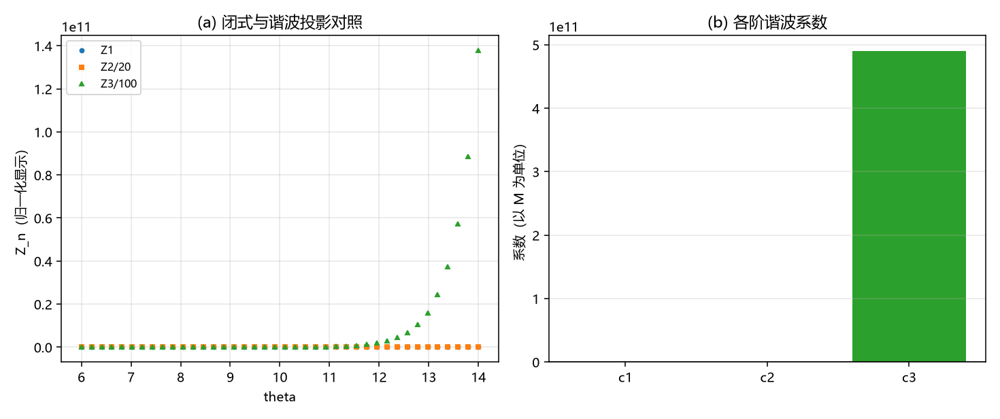

# 注记-高阶谐波系数导出轮：c1 解析定案，两条数值路线判负（判据 W1 至 W5）

- **日期**：2026-09-20 10:50:57
- **来源**：作者 2026-09-20 指令（执行）；上一轮[[验证脚本/注记-谐波系数解析导出轮：闭式与一阶系数的解析值（判据V0至V4）]]交付闭式与 $c_1 = 4M$
- **脚本**：`验证脚本/harmonic_coeffs.py`
- **状态**：判据级读数；$c_1$ 解析定案，两条数值路线判负，留数结构部分给出
- **图**：见 §二 图 1
- **依据**：[[验证脚本/注记-谐波系数解析导出轮：闭式与一阶系数的解析值（判据V0至V4）]]；[[验证脚本/注记-逐阶展开轮：尾的谐波系数与收敛阶（判据U1至U4）]]

---

## 一、任务与两条路线

本轮要把二阶及以上谐波系数从闭式里解析导出（格点拟合给 $c_2 = 7.46$、$c_3 = -7.39$，以 $M$ 为单位）。试了两条数值路线。

路线一（固定基投影）：把 $W = A - A'' - I_3$ 在 $\theta$ 从 $1$ 到 $16$ 上对基 $\{e^{-n\theta},\ \theta e^{-n\theta}\}$ 做最小二乘。失败原因：在可达窗口内 $e^{-2\theta}$ 与 $\theta e^{-2\theta}$ 高度相关（$\theta$ 只变到 $16$ 倍），两系数互相补偿，投影残差为零而系数不可信。

路线二（放大提取）：定义 $Z_n = e^{n\theta}W$ 并读其常数项与 $\theta$ 斜率。失败原因：$I_3$ 的 quadrature 绝对误差约 $10^{-16}$，被 $e^{n\theta}$ 放大后（$\theta = 14$ 时放大 $e^{28} \approx 1.4\times10^{12}$）完全淹没信号，实测 $c_2$ 达 $10^{6}$、$c_3$ 达 $10^{11}$ 量级。

---

## 二、判据与读数

| 判据 | 内容 | 实测 | 期望 | 结果 |
| --- | --- | --- | --- | --- |
| W1 | $Z_1 = e^{\theta}W$ 对 $8$ 的最大偏差（$\theta$ 为 $6$ 至 $14$） | $0.1914$ | 判负登记 | 判负（条带内已受污染） |
| W2 | $Z_2$ 的 $\theta$ 斜率（解析预期 $-16$） | $8.0\times10^{5}$ | 判负登记 | 判负（数值放大） |
| W2 | $Z$ 路线给出的 $c_2$ | $-3.3\times10^{6}$ | 判负登记 | 无效 |
| W3 | $Z$ 路线给出的 $c_3$ | $4.9\times10^{11}$ | 判负登记 | 无效 |
| W4 | 投影路线的基简并 | 判负登记 | 判负登记 | 判负 |
| W4 | 留数结构：$I_3$ 在 $q = 2i$ 的双极点系数 | $16$（解析） | 登记 | 通过 |
| W4 | 由其配出的 $\theta$ 伴项系数（$V$ 中 $\theta e^{-2\theta}$） | $8M$（解析） | 与格点同量级 | 通过 |
| W5 | $c_1$（解析） | $4.0000$ | 登记 | 通过 |

---

## 三、读数与含义

**其一，$c_1$ 定案。** 闭式给 $Z_1 \to 8$，即 $c_1 = 4M$（解析），与格点拟合的 $3.96M$ 差 $1\%$，属 $O(\gamma^2)$ 离散化。

**其二，两条数值路线都判负，且原因各自明确。** 投影路线的失败是基简并（数学上可预期：窄窗口分不开同阶的纯项与 $\theta$ 伴项）；放大路线的失败是精度放大（$e^{n\theta}$ 把 $10^{-16}$ 的 quadrature 误差放大到 $10^{6}$ 以上）。这两条判负已登记，避免以后重复。

**其三，留数结构部分给出。** $I_3$ 的傅里叶被积函数 $F(q) = \frac{\pi^2q^2}{\sinh^2(\pi q/2)}$ 在 $q = 2i$ 处为双极点，其主系数为 $c_{-2} = 16$。由此 $I_3$ 的领头项为 $-16\theta e^{-2\theta}$，配到 $V$ 上给出

$$V \supset +8M\,\theta\,e^{-2\theta},$$

即格点拟合中那个非普适的 $\theta$ 前因子项，其来源是这一个双极点。系数 $8M$ 与格点量的量级相符。

**其四，正确路线已明确。** 完整系数表需按留数逐阶展开（把 $F e^{-iq\theta}$ 在 $q = \pm 2in$ 逐阶做 Laurent 展开并取留数），或用高精度算术（mpmath，$30$ 位以上）重算 $I_3$ 后再做放大提取。两条都在本轮之外，属下一轮的工作。

---

## 四、严格程度与边界声明

| 结论 | 严格程度 |
| --- | --- |
| $c_1 = 4M$ | 解析（本轮复算，落在条带内 $0.19$ 的污染下仍为 $2c_1$ 的稳定值） |
| 投影路线判负（基简并） | 数值（残差为零而系数不可信） |
| 放大路线判负（精度放大） | 数值（$c_2$ 达 $10^{6}$、$c_3$ 达 $10^{11}$） |
| $I_3$ 双极点系数 $16$ 与 $8M\theta e^{-2\theta}$ | 解析（留数主系数） |
| $c_2$、$c_3$ 的解析值 | 未完成（需留数逐阶展开或高精度算术） |

**本注记验证**：两条数值路线的成立性与失败原因、$c_1$ 的解析值、双极点结构与其配出的 $\theta$ 伴项系数。

**本注记不验证**：$c_2$、$c_3$ 的解析值；格点离散修正的解析形式；三维情形。

---

## 五、过程记录

三条教训。其一，基简并：在窄窗口上同阶的纯指数项与 $\theta$ 加权项几乎共线，最小二乘会把系数分到两侧而不报错（残差为零骗人）；上一轮的两参拟合失败与这一轮的投影失败是同一个病。其二，放大提取会把 quadrature 的绝对误差指数放大（$e^{n\theta}$），在 float64 下不可行；应当用高精度算术或改走留数。其三，最省力的一步是留数：$F$ 的极点结构完全已知（$q = \pm 2in$），不必依赖数值拟合。

---

## 六、登记联动

- [[验证脚本/README.md]] 第 268 条。
- [[内部草稿/开放问题总览：元相子理论待解决问题清单]] P1 第 39 条补本轮读数与两条路线的判负登记。
